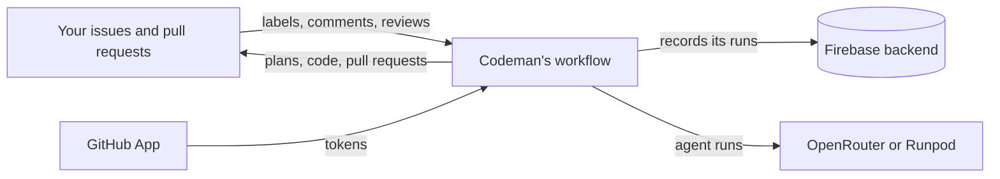

# Codeman

Codeman is a GitHub Action that lets an AI agent work on your issues and pull requests, but asks you to make the important decisions first.

> [!NOTE]
> Codeman is in early development. It plans, records decisions, implements, opens pull requests and applies review feedback.

## Why

Most coding agents start writing code as soon as they read an issue. When the issue is ambiguous, you get a pull request that must be reviewed, rejected and redone.

Codeman turns ambiguity into questions instead. It writes a plan first, and asks you about everything the plan leaves open before it writes any code.

## How a task flows

1. You open an issue and label it `codeman`. The issue is now a [task](docs/glossary.md#task).
2. Codeman writes a plan, and posts its open decisions on the issue, each with options and a recommendation.
3. You answer on the issue, with commands such as these:

   ```text
   /codeman decide 1 a 2 b
   /codeman answer 3 Keep the current URLs; only add the missing pages.
   ```

4. Codeman works in [stages](docs/tasks/stages.md), one agent each. Planning was the first. A routing stage then chooses which other stages the task needs, and says why it leaves any out.
5. Codeman opens a pull request, and you review it. A review that requests changes, or `/codeman fix <what to change>`, sends it back to the routing agent.
6. You merge it. Codeman never merges.

The stages the routing agent chooses from are:

- **web**: the documentation of the third-party services the task relies on, in `docs/web/`;
- **design**: flows and screen drafts;
- **code** and **test**;
- **review**, which always runs, and has the last word.

Other commands accept every recommendation (`/codeman approve`), ask for a revised plan (`/codeman replan <what to change>`), or pick another model for the task (`/codeman set model <openrouter-model-id>`). See [commands](docs/tasks/commands.md).

> [!IMPORTANT]
> Only [maintainers](docs/glossary.md#maintainer), the people with write access to the repository, can steer Codeman, and it works only on issues they opened. Comments from anyone else are ignored. [Security](docs/security/overview.md) explains what Codeman protects, the risks that remain, and how to protect your repository.

Codeman answers in the language of the issue. Code, commit messages and documentation stay in English, unless your `AGENTS.md` says otherwise.

## What you need

| Component | What for | Cost |
| --- | --- | --- |
| A GitHub App for Codeman | Codeman acts on your repository as the App | Free |
| An [OpenRouter](https://openrouter.ai) account | Reaching the models. Each [agent run](docs/glossary.md#agent-run) gets its own key, capped at what remains of the task's budget | The credits you add |
| A [Firebase](https://firebase.google.com) project | The [backend](docs/glossary.md#backend), where Codeman records its runs | Free: the free quota covers Codeman's use |
| Two workflow files and their credentials | Running Codeman, at the [commit](docs/glossary.md#codemans-commit) that the `CODEMAN_COMMIT_SHA` variable names | Your GitHub Actions minutes |
| A [Runpod](https://www.runpod.io) account | Optional: serving an open model on your own rented GPUs | What Runpod bills |



[Installation](docs/installation/setup.md) walks through each part, then a first task.

## Choose your models

Codeman is model-agnostic. It reaches models through OpenRouter by default. You choose the model and the budgets in `.codeman/settings.yml`:

- Each agent run spends within the task's budget, inside a monthly budget per repository and, if you set one, per organization.
- The file inherits the defaults an organization can [share](docs/installation/shared-settings.md) with its repositories.
- `.codemanignore` lists the paths the agent may not change.

You can also serve an open model yourself, on GPUs rented from Runpod, with the same budgets:

```yaml
provider: runpod-pod
model: qwen3-coder:30b
gpu: "NVIDIA RTX A6000"
```

Codeman then starts a GPU and serves the model with Ollama or vLLM, behind its own gateway. It shares the GPU among the tasks on the same model and GPU of the organization, or of its [pool](docs/installation/pool.md), and stops it when no task needs it any more.

- A Serverless endpoint works too (`provider: runpod-serverless`).
- Each provider takes only its own settings; see [self-hosted inference](docs/installation/runpod.md).
- [Profiles](docs/installation/mixing-providers.md) mix providers in one task, such as OpenRouter to plan and a GPU to write the code, under the same budgets.

## When it runs

The workflow runs:

- once a day;
- when you start it manually;
- when a maintainer comments a `/codeman` command;
- when the `codeman` label is added to or removed from an issue, and when an issue with it is closed or reopened;
- when a review on one of Codeman's pull requests asks for changes or mentions `/codeman`.

See [runs](docs/runs/runs-and-jobs.md#runs) for what each run does.

## Learn more

- [The documentation's index](docs/README.md): every page, by what you want to do.
- [Settings](docs/settings/reference.md): every setting, and where its value comes from.
- [Task lifecycle](docs/tasks/lifecycle.md) and [stages](docs/tasks/stages.md): what a task goes through.
- [Security](docs/security/overview.md): secrets, risks and how to protect your repository.
- [Development](docs/development/guide.md): building and testing Codeman itself.

## License

[MIT](LICENSE)
