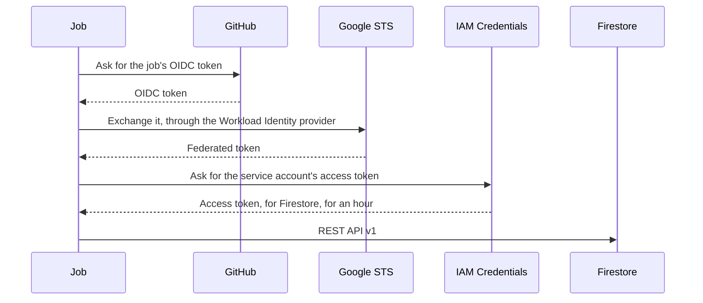

# Backend

Codeman's [backend](../glossary.md#backend) is Cloud Firestore, in a Firebase project of its own. This page explains what it holds, how jobs reach it, and how the [store](../glossary.md#store) and the [ledger](../glossary.md#ledger) write to it.

The choices were made in the [backend plan](../plans/2026-10-07-firestore-backend.md), which records its decisions. These plans build on it:

- [ledger budgets](../plans/2026-10-07-budgets-from-the-ledger.md);
- [pod registry](../plans/2026-10-07-pod-registry.md);
- [Serverless split](../plans/2026-10-07-serverless-cost-split.md);
- [GPU batches across repositories](../plans/2026-10-13-gpu-batches-across-repositories.md).

## Why a backend

- **The backend** holds what Codeman's jobs need to share across runs and repositories, and atomically, which GitHub cannot give them. Its documents are in [data layout](data-layout.md).
- **GitHub** keeps the tasks' state: labels, comments and the [task record](../glossary.md#task-record), where maintainers read and change it.

## Setup

Every repository needs the backend's three variables ([installation](../installation/setup.md#4-set-up-the-backend)):

| Variable | Names |
| --- | --- |
| `CODEMAN_FIREBASE_PROJECT` | The Firebase project |
| `CODEMAN_WORKLOAD_IDENTITY_PROVIDER` | The [Workload Identity provider](../glossary.md#workload-identity-provider) that admits the jobs' tokens |
| `CODEMAN_SERVICE_ACCOUNT` | The service account the jobs act as |

A step without them fails, naming them. `select` fails first, before it marks any task, and so does a backend it cannot read.

## Access

1. A job asks GitHub for its OIDC token (`id-token: write`).
2. It exchanges the token at Google's Security Token Service for a federated token.
3. With it, it gets an access token of the backend's service account from IAM Credentials, for Firestore only (scope `datastore`), for an hour ([`src/store/google.ts`](../../src/store/google.ts)).

The Workload Identity provider's [attribute condition](../glossary.md#attribute-condition) admits only tokens from Codeman's workflow on the default branch of:

- the organization's repositories; or
- the [pool](../glossary.md#pool-of-organizations)'s organizations' repositories, when it lists their IDs; or
- the repositories it lists, by their IDs.

The conditions are in [installation](../installation/setup.md#4-set-up-the-backend). [Backend maintenance](../installation/backend-maintenance.md) reads, changes and audits them.

- No key is stored anywhere, and the tokens are masked.
- Only `select`, `open-key`, `close-key` and `release-pod` ask for an OIDC token.
- `agent` never does, so neither the agent nor a Serverless gateway can reach Firestore.

## Client and rules

- **Client.** Firestore's REST API v1, called with `fetch` ([`src/store/firestore.ts`](../../src/store/firestore.ts)); no Google package.
- **Database.** The project's `(default)` database, in Native mode, Standard edition.
- **Rules.** [`firebase/firestore.rules`](../../firebase/firestore.rules) denies every client. Only the service account, which IAM authorizes and the rules do not apply to, reaches the data.

## Cost

Firestore's free quota is 50,000 document reads and 20,000 writes a day ([usage and limits](../web/firebase/usage-and-limits.md)).

| Operation | Reads | Writes |
| --- | --- | --- |
| A run | | About six documents, plus one per pod it creates, joins or terminates. A pod run writes two or three more in the registry |
| Each `open-key` | The task's runs and the month's: the organization's, with its budget. With an organization's budget and a pool, also the other members' runs of the month | |
| A pod run | The pool's live pods, a few. One that creates a pod reads its document of the [cache of fits](../glossary.md#cache-of-fits) | The cache's document, after a search |
| A Serverless run's `close-key` | The endpoint's runs of the last hours, and their run documents | Its own, and the costs it lowers |
| Each `select` | Its pool's members' organization documents, every snapshot of the [board](../glossary.md#board) and the unexpired batches: a few dozen documents for a pool of a few repositories | Its snapshot, and the batches it changes or forms |

- A month of 500 runs, 40 of them a day, reads about 20,000 documents a day in `open-key`.
- Transactions that run again read more.
- With the `issues` triggers, a repository's selects also run on every change of the `codeman` label.

## How it works

### The store

[`src/store/store.ts`](../../src/store/store.ts) is the interface the steps use:

- **Reads:** `get`, and `query` with equality and range filters, order and limit.
- **Writes**, applied all at once, with preconditions: a document exists, is missing, or is at a version.
- **Transactions.**

A transaction's reads see one state. Its writes apply only if nothing it read, queries included, changed before it committed. Otherwise it runs again:

| Transaction | Attempts in all |
| --- | --- |
| Any, by default | 5 |
| The budget reservation, the Serverless split, the pod registry and the board | 20, since many jobs run theirs at once |

Firestore's Standard edition locks what a transaction reads until it ends. So two transactions that read the same documents wait for each other, and one runs again ([serializability](../web/firebase/transaction-serializability-and-isolation.md)).

Tests use the store in memory ([`src/store/memory.ts`](../../src/store/memory.ts)). It passes the same contract tests as Firestore's emulator ([`src/store/contract.ts`](../../src/store/contract.ts); [development](../development/guide.md)).

### The ledger

[`src/ledger.ts`](../../src/ledger.ts) writes the [ledger runs](../glossary.md#ledger-run) and their events, and the budgets read it ([budget](../budget/budget.md)). Each job adds its own fields to the run's document, and its own events:

| Job | Run fields | Events | When |
| --- | --- | --- | --- |
| `select` | The picked run's fields, when it picks the task | `task-picked` | At its end |
| `open-key` | The reservation; then its opening, refusal or failure; and the refreshed costs of the task's earlier runs | `key-opened`, `key-refused` or `key-failed`; `pod-created`, `pod-joined`, `pod-terminated` | The reservation and the refreshed costs at once; the rest at its end |
| `close-key` | What the run used; the refreshed costs of the task's earlier runs; a Serverless split's costs | `run-closed`, `run-stopped`, `pod-terminated` | At its end, then the split, then the refreshed costs |
| `release-pod` | None: it ends a keep lease | `pod-terminated`, when it terminates the pod | At its end |

- A job writes at its end, after its GitHub writes, in one commit.
- `close-key` and `release-pod` first end the run's access and terminate pods, whatever the ledger does.
- A job that terminates a pod also records the pod's untracked time on its document, after its own writes ([spend](../budget/spend.md#untracked-time)).
- `close-key` then splits a Serverless run's time with the endpoint's other runs, in a transaction that may lower their costs ([Serverless](../inference/serverless.md#splitting-shared-worker-time)).
- Two writes do not wait for the end: `open-key`'s reservation, a transaction before it opens the run, and the costs that `open-key` and `close-key` refresh in the task's earlier runs.

#### Idempotence and failures

- Writes are idempotent: fields are merged into the run's document, and an event replaces the one of the same ID. A re-run job writes the same documents again.
- A write that fails is tried again three times, over 13 seconds; then the job fails.
- The reservation is not tried again: a store error in it fails `open-key` at once.
- A failed `select` runs no task's jobs.
- A failed `open-key` runs no agent. Its run is closed as any other, and the task becomes `codeman:blocked` ([budget](../budget/budget.md#outcomes-of-open-key)).
