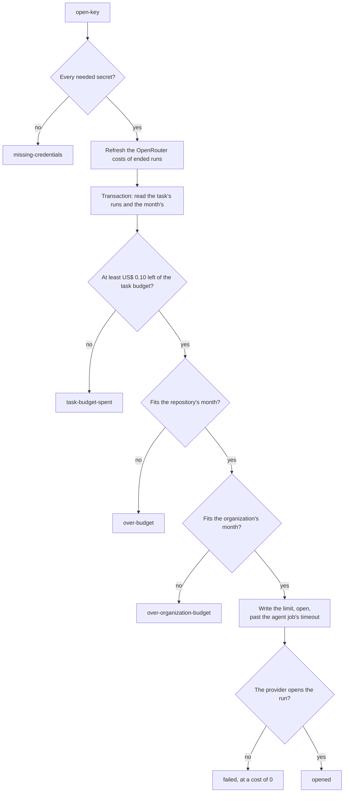
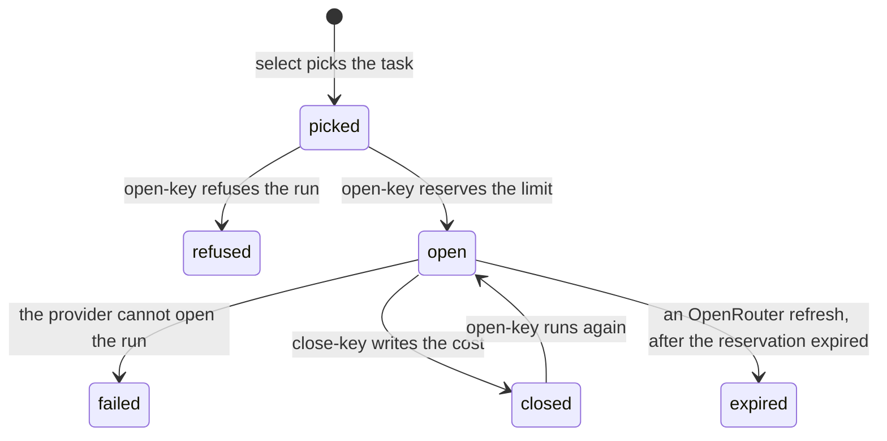

# Budget

Codeman's [ledger](../glossary.md#ledger) records what each [agent run](../glossary.md#agent-run) spent, whatever served it, and the budgets are checked against it ([the ledger](../backend/backend.md#the-ledger)). So they hold across providers, across the tasks of a [workflow run](../glossary.md#workflow-run) and across repositories.

- With self-hosted inference, spend is counted from GPU time ([spend](spend.md#self-hosted-runs)).
- With [profiles](../settings/profiles.md), a task's runs may use several providers, and the ledger adds them up.

The choices were made in the [ledger budgets plan](../plans/2026-10-07-budgets-from-the-ledger.md).

## The three budgets

| Budget | Setting | Default | Covers | Counts |
| --- | --- | --- | --- | --- |
| Task | `task-budget` | US$ 2 | The whole task, from the first plan to the last fix | Its runs, each at its cost once closed and at its limit while open |
| Repository's month | `monthly-budget` | US$ 20 | The repository's runs of the calendar month (UTC) | Their costs, and the limits of those still open |
| Organization's month | `organization-monthly-budget`, which only the [organization's settings](../glossary.md#organizations-settings) set ([settings](../settings/reference.md)) | None: no limit | The month of all the organization's repositories together | Their runs, reconciled with each GPU account's billing ([below](#reconciling-with-gpu-billing)), and the [untracked time](../glossary.md#untracked-time) of its pods |

- A task's runs on one pod count at least the pod's cost as `close-key` last read it, which includes the pod's time between them.
- The organization's month counts its share of the time of each pod Codeman terminated that no task counted ([spend](spend.md#self-hosted-runs)).
- With a [pool](../glossary.md#pool-of-organizations) on one Runpod account, each organization keeps its own budget.

## Outcomes of `open-key`

Before it opens a run, `open-key` reserves the run's limit: what remains of the task's budget ([reservations](#reservations)). Then:

| Status | Cause | The ledger run | The task |
| --- | --- | --- | --- |
| `opened` | The limit is reserved and the provider opened the run | `open` | The agent runs |
| `task-budget-spent` | Less than US$ 0.10 remains of the task's budget | `refused` | Becomes `codeman:blocked`. A maintainer can raise the budget with `/codeman set task-budget <usd>`, then comment `/codeman continue` |
| `over-budget` | The run does not fit the repository's month | `refused` | Goes back to its previous state, until a later run finds room. A task in `planning` goes back to `new` |
| `over-organization-budget` | The run does not fit the organization's month | `refused` | The same |
| `missing-credentials` | A secret the run needs is missing ([secrets](#secrets)) | `refused` | Becomes `codeman:blocked`, with an error that names the secret |
| `concurrency-reached` | Its profile runs as many [instances](../glossary.md#instance) as its `concurrency` allows: open runs of its batch key in the organization, or full pods of it in the pool ([concurrency](../settings/profiles.md#concurrency)) | `refused` | Goes back to its previous state, and the next run starts at once to make it wait for a seat |
| `open-key` fails | The provider could not open the run, or the store failed in the reservation | `failed`, at a cost of 0, for a provider's failure | Becomes `codeman:blocked`, with the command that tries again |

A run whose provider fails to open it costs nothing, and its reservation ends.

`open-key`'s log shows the task's total, the repository's month and what its open runs reserve of it, and the organization's month.

## Secrets

`open-key` needs the key of the run's [inference provider](../glossary.md#inference-provider)'s account ([providers](../settings/providers.md)). With an organization's budget, it also needs Runpod's account key, to read its billing, when:

- the settings or a profile name a Runpod provider; or
- the organization's runs used Runpod this month.

When one is missing, it opens nothing.

## How it works

### Reservations



- `open-key` reads the task's runs and the month's in one store transaction.
- When what remains of the task's budget, in whole cents rounded down, is US$ 0.10 or more and fits in the repository's month and the organization's, it writes it as the run's [budget reservation](../glossary.md#reservation): its limit, open.
- Otherwise it refuses the run and reserves nothing.
- Tasks and repositories that open at once each see the others' reservations, or run their transaction again once those are written. So together they never pass a budget.
- `close-key` replaces the limit with the run's cost.

The tasks of one workflow run, as many as its [profiles' counts](../settings/profiles.md#how-many-tasks-a-run-takes) picked, open at once in no set order. So do those of a [batch](../glossary.md#batch), in each repository's run. One refused for the month goes back, and the others keep the profile they were picked with, so a pod may serve fewer tasks than its batch.

### Expiry

A reservation whose run never closes, as after a cancelled job, expires an hour after the `agent` job's timeout, counted from when it was made. That hour covers `open-key` (35 minutes at most), `close-key` (10) and the waits between the jobs, so a run that closes always does so first. The run goes on counting its whole limit.

| Agent time ([settings](../settings/reference.md#agent-time)) | The `agent` job's timeout | The reservation |
| --- | --- | --- |
| The defaults: 50 minutes, and 10 of wrap-up | 70 minutes | 2 hours 10 minutes |
| The longest: 300 minutes, and 30 of wrap-up | 340 minutes | 6 hours 40 minutes |

Reservations made before the agent's time was a setting expire after 2 hours.

An expired OpenRouter run's key tells what it spent. The task's next `open-key` or `close-key`, whatever its provider, takes its cost from there. It does the same for an OpenRouter run that read its cost before OpenRouter counted it ([OpenRouter](../inference/openrouter.md#refreshing-earlier-runs)).

### A ledger run's states



| Status | Counts |
| --- | --- |
| `picked` | Nothing yet |
| `open` | Its limit, also once its reservation expired |
| `refused` | Nothing |
| `failed` | 0 |
| `closed` | Its cost. A refresh from OpenRouter, a pod's billing or a Serverless split may change it |
| `expired` | The cost its OpenRouter key showed |

- Only a refresh of an OpenRouter run's cost from its key writes `expired`. Other runs whose reservation expired stay `open`, and the budgets tell from `expiresAt`.
- When `open-key` runs again for a run, it reserves again. What the earlier attempt spent becomes `spentBefore`.

### Reconciling with GPU billing

The organization's month reconciles the runs of each GPU account with its billing by the hour:

- Each hour Runpod billed counts the higher of its bill and the ledger's estimate of the runs in it. So a pod's time that no run accounts for still counts.
- Each hour not billed yet counts the estimate, so a run counts as soon as it ends.
- A run's amount spreads evenly over its time. A task's runs on one pod spread over their span.
- Open runs count their whole limit, as do the runs of accounts without hourly billing.

With a pool on one Runpod account, each billed hour counts the organization's estimate, plus its share of what the bill exceeds the pool's estimate:

```text
for each hour h:
  own    = this organization's estimate for h
  all    = own + the pool's other organizations' estimates for h
  excess = max(0, bill(h) - all)
  counts = own + (all > 0 ? excess * own / all : excess / organizations)
```

The share is in proportion to its estimate, or even when the pool estimated nothing in that hour. So every billed cent counts once, in the organizations that used the account then. Alone, an organization's `counts` is the higher of the bill and its estimate.

For example, Runpod billed an hour US$ 1.00. Organization A estimated US$ 0.60 in it and B US$ 0.20, so the excess is US$ 0.20. A counts 0.60 + 0.20 × 0.60 / 0.80 = US$ 0.75, and B counts US$ 0.25.
