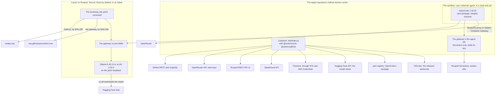

# Dependencies

Every dependency is audited before it is added (see `AGENTS.md`). This page records what Codeman uses, why, and the result of the last audit. Update it whenever a dependency is added, removed or upgraded.

## Inventory

| Dependency | Kind | Version and pin | Why | Last audit | Open findings | Details |
| --- | --- | --- | --- | --- | --- | --- |
| `@actions/core` | npm, runtime | 3.0.1 | Inputs, logging, failure reporting, the OIDC token | 2026-09-23 | None reported by `npm audit` | [Runtime](#runtime) |
| `@actions/github` | npm, runtime | 9.1.1 | Octokit with pagination | 2026-09-23 | None reported by `npm audit` | [Runtime](#runtime) |
| `typescript` | npm, development | 6.0.3 | Type checking | 2026-09-23 | None reported by `npm audit` | [Development](#development) |
| `@types/node` | npm, development | 24.13.6 | Node.js types | 2026-09-23 | None reported by `npm audit` | [Development](#development) |
| `esbuild` | npm, development | 0.28.2 | Bundles the action and the gateway | 2026-09-23 | None reported by `npm audit` | [Development](#development) |
| `@biomejs/biome` | npm, development | 2.5.14 | Lint and format | 2026-09-23 | None reported by `npm audit` | [Development](#development) |
| `yaml` | npm, development | 2.9.1 | Parses the e2e suite's scenarios and the templates, in `e2e/` only | 2026-10-20 | One maintainer, no provenance attestation, accepted | [Development](#development) |
| GitHub Actions, 5 | Actions | Full commit SHA | CI, the target repository's workflow | Not recorded | None recorded | [GitHub Actions](#github-actions) |
| GitHub, OpenRouter, npm registry and the other APIs | Services | Not pinned | What Codeman calls with `fetch` or the packages | Not recorded | None recorded | [External services](#external-services) |
| OpenCode | Harness, downloaded | 1.18.32, by npm integrity | Runs the agent | Advisories checked 2026-09-24 | CVE-2026-88624, accepted | [Agent harness](#agent-harness-opencode) |
| Runpod REST API v2 | Service | v2 | The GPUs of pods and Serverless | 2026-10-03 | Keys never expire and have no spending limit | [Runpod](#runpod) |
| SaladCloud API | Service | `https://api.salad.com/api/public`, not versioned | The GPUs of Salad pods | 2026-10-29 | The key is a user's, reaching all their organizations; hosts are third parties' PCs; no billing API | [Salad](#salad) |
| Ollama | Engine, its official image in the catalog | 0.40.10, by index digest; 0.35.1 in Codeman's retired pod image | Serves models on Ollama pods | 2026-10-30 | 9 without a fix, each an exception with its reason: loopback only. 0.35.1's binary: 50 high, fixed in 0.40.10 | [Ollama](#ollama) |
| vLLM | Engine, its official image in the catalog | 0.32.0, by index digest; 0.31.0 in Codeman's retired pod image | Batches requests whatever the model | 2026-10-30 | 0.31.0: 2 high, fixed in 0.32.0. 0.32.0: no advisory; its image's 22 high or critical OS and Python findings accepted, off the pod's path; 4 more in `pyasn1`, found on 2026-11-04, await the maintainer's decision; its `certifi`'s trust in the compromised emSign root mitigated: vLLM starts on Node.js's roots | [vLLM](#vllm-in-codemans-vllm-pod-image) |
| Node.js for pods | Runtime, downloaded by the bootstrap | 24.22.1, linux-x64 tarball by SHA-256, in the catalog | Runs the gateway in pods started from official images | 2026-10-30 | None: the release removes the compromised emSign root | [Node.js for pods](#nodejs-for-pods) |
| OSV.dev API | Service | v1, not pinned | The advisories of the pinned releases, on every run on a pod | Not recorded | None recorded | [OSV.dev](#osvdev) |
| Trivy | Maintainer tool, in a container | 0.76.1, by index digest | Scans an image's packages before it is pinned (`scripts/scan-image.sh`) | 2026-10-30 | None for 0.76.1 | [Trivy](#trivy) |
| Hugging Face Hub API | Service | One route | Checks a vLLM pod's model | 2026-10-13 | None recorded | [Hugging Face](#hugging-face) |
| Runpod's vLLM worker | Image, chosen by a maintainer | `runpod/worker-v1-vllm:<version>` | Serverless endpoints | 2026-10-03 | None recorded | [Runpod's vLLM worker](#runpods-vllm-worker) |
| Codeman's pod images, on `node:24.21.0-bookworm-slim` | Images, Codeman's own, retired | The last published from `ce1fed1`, no longer built | What pods ran before the official images | 2026-10-29 | None recorded | [Codeman's pod images](#codemans-pod-images) |
| Cloud Firestore, STS, IAM Credentials | Services | REST API v1 | The backend | 2026-10-07 | None recorded | [Cloud Firestore](#cloud-firestore-in-a-firebase-project) |
| Firestore's emulator | Test tool, in the e2e emulator image | v1.22.0 by SHA-256, on `eclipse-temurin:21.0.12_8-jre-noble` by digest | The store's tests and the e2e suite | 2026-10-20 | None recorded | [Firestore's emulator](#firestores-emulator) |
| The local runner image, on `ubuntu:noble-20260930.1` | Image, Codeman's own, local only | Base images by digest; Ubuntu's packages not pinned | Runs the tests that need GitHub's runner on a developer's machine | 2026-10-19 | None recorded | [The local runner image](#the-local-runner-image) |
| act | Test tool, on the developer's machine | 0.2.89, Homebrew's bottle | Runs the real templates for the e2e smoke scenarios | 2026-10-20 | Injects the host's `gh` token when given no `GITHUB_TOKEN` secret; the driver always passes a fake one | [act](#act) |
| vLLM's CPU image | Image, e2e only | `vllm/vllm-openai-cpu:v0.32.0`, by index digest | vLLM on CPU in the e2e vLLM pod | 2026-10-30 | vLLM 0.32.0's, as above | [vLLM's CPU image](#vllms-cpu-image) |
| `qwen2.5:0.5b` and `Qwen/Qwen2.5-0.5B-Instruct` | Models, e2e only | Ollama manifest digest; Hugging Face commit | The same tiny model on both e2e engines | 2026-10-20 | None recorded | [The e2e models](#the-e2e-models) |
| Docker Compose | Tool, bundled with Docker Desktop | v5.1.0 on the machine of the audit, not pinned | Starts the e2e suite's infrastructure | 2026-10-20 | None for v5.1.0 | [Docker Compose](#docker-compose) |
| GitHub CLI, `gh` | Tool, in the e2e runner image | v2.102.0, by SHA-256 | The templates' `run:` steps in the e2e suite | 2026-10-20 | None for v2.102.0 | [GitHub CLI](#github-cli) |

## Audit log

| Date | Scope | Plan | Result |
| --- | --- | --- | --- |
| 2026-09-23 | The page's last general audit: what no later row covers | Not recorded | Not recorded |
| Not recorded | The npm packages, with `npm audit` | Not recorded | No known vulnerabilities |
| 2026-09-24 | OpenCode's advisories | Not recorded | CVE-2026-88624 had no fixed version; accepted for 1.18.32 |
| 2026-10-03 | Self-hosted inference: Runpod, Ollama, Runpod's vLLM worker | [Self-hosted inference](../plans/2026-10-02-self-hosted-inference.md) | No npm package added. Ollama's advisories accepted for 0.35.1 |
| 2026-10-29 | Salad's Container Engine, for `salad-pod` | [Salad pods](../plans/2026-10-29-add-salad-pods.md) | No npm package added: the API is called with `fetch`. The key cannot be scoped, so a dedicated user. Hosts are Community ones; `hosts` must allow them |
| 2026-10-07 | The backend: Cloud Firestore, STS, IAM Credentials, the emulator | [Backend](../plans/2026-10-07-firestore-backend.md) | No npm package added |
| 2026-10-13 | vLLM and its image, Hugging Face | [vLLM on pods](../plans/2026-10-13-vllm-on-pods.md) | vLLM's advisories each list a fix at or before 0.31.0; the rest accepted |
| 2026-10-19 | Running Actions locally: act, `actions/runner`, `github/local-action`, a plain image | [Run GitHub Actions locally](../plans/2026-10-19-run-github-actions-locally.md#audit) | None adopted but the plain image. act 0.2.74, as installed, has CVE-2026-34041 and CVE-2026-34042, fixed in 0.2.86 |
| 2026-10-19 | The agent's jail: ai-jail, bubblewrap, `util-linux` | [Jail the agent](../plans/2026-10-19-jail-the-agent-in-a-read-only-mount-namespace.md#audit) | Nothing added: `unshare`, `mount`, `findmnt` and `setpriv` come from Ubuntu's `util-linux` and `mount`, required packages already on the runner. ai-jail and bubblewrap not adopted |
| 2026-10-20 | `yaml` for the e2e suite | [End-to-end test suite](../plans/2026-10-20-end-to-end-test-suite.md#audit) | 2.9.1 added as a development dependency: ISC, no dependencies, no install scripts, no known vulnerabilities (CVE-2026-33532 fixed in 2.8.3). One maintainer and no provenance attestation, accepted (decision 4). `npm audit`: no vulnerabilities |
| 2026-10-20 | act for the e2e smoke scenarios | [End-to-end test suite](../plans/2026-10-20-end-to-end-test-suite.md#audit) | 0.2.89 adopted for the smoke scenarios only, reversing decision 1 of [Run GitHub Actions locally](../plans/2026-10-19-run-github-actions-locally.md#decisions). CVE-2026-34041 and CVE-2026-34042 fixed in 0.2.86. Without a `GITHUB_TOKEN` secret it injects the host's `gh auth token`: the driver always passes a fake one |
| 2026-10-20 | The e2e engines: vLLM's CPU image, `qwen2.5:0.5b`, `Qwen/Qwen2.5-0.5B-Instruct` | [End-to-end test suite](../plans/2026-10-20-end-to-end-test-suite.md#audit) | `vllm/vllm-openai-cpu:v0.31.0` pinned by index digest, the vLLM version Codeman pins. Both models Apache-2.0, not gated, pinned by manifest digest and by commit |
| 2026-10-20 | The e2e emulator image: Temurin 21 JRE and Firestore's emulator jar | [End-to-end test suite](../plans/2026-10-20-end-to-end-test-suite.md#audit) | `eclipse-temurin:21.0.12_8-jre-noble` by digest, jar v1.22.0 by the SHA-256 firebase-tools 15.34.0 records (decision 3). The emulator's pin changes from the newest in Firebase's cache |
| 2026-10-20 | Docker Compose | [End-to-end test suite](../plans/2026-10-20-end-to-end-test-suite.md#audit) | v5.1.0, bundled with Docker Desktop: Apache-2.0, no advisory for it |
| 2026-10-20 | GitHub CLI for the e2e runner image | [End-to-end test suite](../plans/2026-10-20-end-to-end-test-suite.md#audit) | v2.102.0 (decision 8): MIT, maintained by GitHub, each published advisory fixed at or before it. Linux archives pinned by the SHA-256 of the release's checksums file |
| 2026-10-20 | The e2e suite's Google side: floci-gcp 0.11.0 | [End-to-end test suite](../plans/2026-10-20-end-to-end-test-suite.md#audit) | Not adopted: its STS exchanges only access tokens for GCS downscoping (no Workload Identity Federation, no JWT or JWKS check), its IAM Credentials refuses the `datastore` scope and checks no token, its Firestore is gRPC only, and its Compose file mounts the Docker socket. Pre-1.0, one main maintainer, no release checksums; its AWS sibling had two critical RCEs in September 2026. An in-house fake on Node's built-ins replaces it |
| 2026-10-27 | Codeman's pod images published from `dfef37e`, with the 402 fix | [Answer a spent run with 402](../plans/2026-10-22-answer-a-spent-run-with-402.md#out-of-scope) | Pinned `codeman-ollama@sha256:f5f89da1…` and `codeman-vllm@sha256:061cb8b1…`. Each pulls without credentials, its tag and `org.opencontainers.image.revision` are `dfef37e`, its base layers are the pinned Ollama 0.35.1 or vLLM 0.31.0 image's, and its `/opt/codeman/gateway.js` is byte for byte `dist/gateway.js`. No dependency changed |
| 2026-10-28 | Codeman's pod images published from `8c611a4`, whose gateway reports whether an Ollama model reads images | [Let self-hosted models read images](../plans/2026-10-28-let-self-hosted-models-read-images.md#out-of-scope) | Pinned `codeman-ollama@sha256:98c454e3…` and `codeman-vllm@sha256:a5b4a032…`. Each pulls without credentials, its tag and `org.opencontainers.image.revision` are `8c611a4`, its base layers are the pinned Ollama 0.35.1 or vLLM 0.31.0 image's (4 of 7 and 40 of 43), and its `/opt/codeman/gateway.js` is byte for byte `dist/gateway.js`. No dependency changed |
| 2026-10-29 | Codeman's pod images published from `4c376d5`, whose gateway serves on Salad | [Add Salad pods](../plans/2026-10-29-add-salad-pods.md#handover) | Pinned `codeman-ollama@sha256:80d94429…` and `codeman-vllm@sha256:34759041…`. Each pulls without credentials, its tag and `org.opencontainers.image.revision` are `4c376d5`, its base layers are the pinned Ollama 0.35.1 or vLLM 0.31.0 image's (4 of 7 and 40 of 43), and its `/opt/codeman/gateway.js` is byte for byte `dist/gateway.js`. No dependency changed |
| 2026-10-29 | Codeman's pod images published from `ce1fed1`, whose bundled Runpod adapter tells no room from a failure | [Fall back to the next profile](../plans/2026-10-29-fall-back-to-the-next-profile.md#steps) | Pinned `codeman-ollama@sha256:111bab4d…` and `codeman-vllm@sha256:95e00706…`. Each pulls without credentials, its tag and `org.opencontainers.image.revision` are `ce1fed1`, its base layers are the pinned Ollama 0.35.1 or vLLM 0.31.0 image's (4 of 7 and 40 of 43), and its `/opt/codeman/gateway.js` is byte for byte `dist/gateway.js`. The gateway behaves as before. No dependency changed |
| 2026-10-30 | Ollama 0.40.10's official image, in the catalog for pods started from official images | [Official engine images](../plans/2026-10-30-start-pods-from-official-engine-images.md#decisions), decision 1 | `ollama/ollama@sha256:4c5b2787…`, created 2026-10-23, from the verified commit `f52b9e7`; no image signature or revision label. OSV.dev: 9 Go records without a fix in any release up to 0.40.13; each is an exception with its reason, recorded in `docs/web/osv/`. No repository advisory. No CUDA floor. Trivy 0.76.1: 0.35.1's image (`292ee794…`, 488 s) has 144 findings, none high in its OS packages, 50 high in its Go binary, all with a fix (Go 1.26.0, old `golang.org/x` modules); 0.40.10's (512 s) has 33, none high or critical. Replaces 0.35.1 in the catalog; its server variables and serial families are unchanged, its memory estimate and llama.cpp are not. Its upgrade checklist: llama.cpp b11803's fit is b11232's byte for byte, and `/api/ps`, `/api/tags` and `/api/show` keep what the gateway reads, adding `runner`; the batch allowance changed only for decision models. `OLLAMA_VERSION` moved to 0.40.10, with its sources recorded at the tag ([Ollama](#ollama)) |
| 2026-10-30 | vLLM 0.32.0's official image, in the catalog | [Official engine images](../plans/2026-10-30-start-pods-from-official-engine-images.md#decisions), decision 1 | `vllm/vllm-openai@sha256:befccf0e…`, created 2026-10-18 from `5df63a7`, the tag's commit (unsigned); no image signature. OSV.dev and GitHub: no advisory; it fixes 0.31.0's 16 records, 2 high. No exception. CUDA 13.0, as 0.31.0's: `VLLM_MIN_CUDA` unchanged. No breaking change to the accepted keys, the parsers or the gateway's arguments. Trivy 0.76.1 (1,377 s): 920 findings without `linux-libc-dev` (3,177 skipped). OS: 15 high, no critical, all with a fix: GnuPG (CVE-2025-68973), Brotli's decoder (CVE-2026-111497), OpenSSL's `PKCS7_verify` and DTLS (CVE-2026-45447, CVE-2026-84782). Python: 3 critical and 5 high, all with a fix: `certifi` and `uv` trust the compromised emSign root (GHSA-6q48-6c7w-9gw2, GHSA-hq85-5cpj-mr62), `msgpack` (2), `setuptools`, `urllib3` (2). No later vLLM release fixes them. Accepted on 2026-10-31 (decision 10), the 22 off the pod's path: GnuPG, since no `gpg` runs in a pod; Brotli's decoder, the OS's `libbrotli1`, which the engines' Go, Python and Rust HTTP clients do not link, and the curl tool that does runs only in the bootstrap; OpenSSL's `PKCS7_verify`, since a pod verifies no PKCS7 or S/MIME; DTLS, since every connection is TLS over TCP; `uv` 0.13.1, a build tool a pod never runs; `setuptools` 80.10.2, which builds packages, and a pod builds none; `msgpack` 1.2.3 (2), which serializes only between vLLM's own processes; `urllib3` 2.8.0 (2), one in proxies, which a pod has none of, one in the chunk parser, which reads only the Hub's answers over verified TLS. This row names 7 of the 8 Python findings, and places some in the wrong copies: the [scan of 2026-11-04](#audit-log) corrects both. Mitigated on 2026-10-31 (decision 10): `certifi`'s, since vLLM downloads the model from Hugging Face over TLS; the gateway starts vLLM on Node.js's roots instead ([the engines' trusted roots](#the-engines-trusted-roots)). Its upgrade checklist: three tool call and three reasoning parsers added, none removed; the auto-fit lines' ends changed, not the start the gateway reads. `VLLM_VERSION` moved to 0.32.0, with its sources recorded at the tag ([vLLM](#vllm-in-codemans-vllm-pod-image)) |
| 2026-10-30 | Node.js 24.22.1 for pods, downloaded by the bootstrap | [Official engine images](../plans/2026-10-30-start-pods-from-official-engine-images.md#decisions), decision 9 | linux-x64 tarball pinned by SHA-256 `eb6728e7…`, which matches `SHASUMS256.txt`; its signature verified with release key `5BE8A3F6…` from `nodejs/release-keys`. Replaces 24.21.0, whose root store trusts the compromised `emSign ECC Root CA - G3` |
| 2026-10-30 | Trivy 0.76.1, a maintainer tool for `scripts/scan-image.sh` | [Official engine images](../plans/2026-10-30-start-pods-from-official-engine-images.md#decisions), decision 4 | `aquasec/trivy@sha256:790fd66d…`, of 2026-10-21. Apache-2.0, Aqua Security. None of its 5 advisories affects it. The 2026-03 compromise (GHSA-69fq-xp46-6x23) moved tags and pushed malicious images; a digest pin cannot be moved, and the advisory lists such pins as unaffected. Runs in a container with 4 GB, no Docker socket |
| 2026-10-30 | vLLM's CPU image for the e2e suite, moved to the catalog's vLLM | [Official engine images](../plans/2026-10-30-start-pods-from-official-engine-images.md#decisions), decision 1 | `vllm/vllm-openai-cpu:v0.32.0@sha256:ffaba398…`, pushed 2026-10-18, 12 days old: the minimum age holds without the bypass. The tag's index and linux/amd64 manifest hash to their recorded digests; no revision label, as `v0.31.0`'s. vLLM 0.32.0's advisories, as above: none. Not scanned with Trivy: it runs only on a developer's machine, in the e2e suite's Compose network ([vLLM's CPU image](#vllms-cpu-image)) |
| 2026-10-31 | The engines' TLS roots: Go's `crypto/x509`, `huggingface_hub` on `httpx2`, `hf_xet`, `requests`, Python's `ssl`, curl | [Official engine images](../plans/2026-10-30-start-pods-from-official-engine-images.md#decisions), decision 10 | No dependency added. The gateway writes Node.js's roots to a file and starts both engines with `SSL_CERT_FILE`, `SSL_CERT_DIR`, `REQUESTS_CA_BUNDLE` and `CURL_CA_BUNDLE` on it, over the image's. `SSL_CERT_DIR` is added: Go and OpenSSL otherwise keep `/etc/ssl/certs`, whose store in vLLM's image still trusts the emSign root. Each client honors them but the curl tool, which keeps its default directory and runs only in the bootstrap. Mitigates vLLM 0.32.0's `certifi` finding ([the engines' trusted roots](#the-engines-trusted-roots)) |
| 2026-11-04 | vLLM 0.32.0's official image, scanned again | [Official engine images](../plans/2026-10-30-start-pods-from-official-engine-images.md#progress) | `vllm/vllm-openai@sha256:befccf0e…`, Trivy 0.76.1, without `linux-libc-dev`. High and critical with a fix: 27, against 23 on 2026-10-30. OS: the same 15. Python: 3 critical and 9 high. The eighth finding the earlier row lacked is a second `certifi`, 2026.6.17. It, `msgpack` 1.1.2 (2), `setuptools` 70.3.0 and `urllib3` 2.7.0 (2) have no file path in the report and share one layer with 12 other packages, a list that matches what `pip` vendors (inferred from the report; the image's files were not listed). vLLM's own copies are `msgpack` 1.2.3, `setuptools` 80.10.2 and `urllib3` 2.8.0, which have no high or critical finding, and `certifi` 2026.7.22, the mitigated one. These stay accepted, for a better reason than the earlier row's: a pod does not run `pip`. New: `pyasn1` 0.6.4 (CVE-2026-119194 to CVE-2026-119197, published 2026-10-29), each a denial of service while decoding ASN.1, fixed in 0.6.5. Not accepted yet: the maintainer decides. No dependency changed |

## Where each dependency runs

The diagram shows where each dependency's code runs, and what it reaches. The [sandbox](../glossary.md#sandbox) and the [gateway](../glossary.md#gateway) are described in [agent sandbox](../runs/agent.md#agent-sandbox) and [the gateway](../inference/self-hosted.md#the-gateway).

## npm packages

`package-lock.json` is committed, and every version is exact.

### Runtime

| Package | Version | Purpose | License and maintenance |
| --- | --- | --- | --- |
| `@actions/core` | 3.0.1 | Inputs, logging, failure reporting | Maintained by GitHub, MIT |
| `@actions/github` | 9.1.1 | Authenticated Octokit client with pagination | Maintained by GitHub, MIT |

- **Transitive code:** together they add 26 packages, all from the `@actions` and `@octokit` projects, plus `undici`, `tunnel`, `before-after-hook`, `universal-user-agent`, `content-type` and `json-with-bigint`. None has install scripts.
- **Permissions:** they are bundled into `dist/index.js`, and run with the GitHub App token.

### Development

| Package | Version | Purpose | Notes |
| --- | --- | --- | --- |
| `typescript` | 6.0.3 | Type checking | 7.x is not supported by the lint ecosystem yet. |
| `@types/node` | 24.13.6 | Node.js types | Node 24 is the Actions runtime (`node24`). |
| `esbuild` | 0.28.2 | Bundles `dist/index.js` and the gateway, `dist/gateway.js` | Its install script only verifies the binary; not needed. |
| `@biomejs/biome` | 2.5.14 | Lint and format | One binary, from the one of its 8 platform packages (`@biomejs/cli-*`) that matches the machine; no other transitive dependencies. Chosen over ESLint + typescript-eslint (95 packages). |
| `yaml` | 2.9.1 | Parses the e2e suite's scenario files and the templates, in `e2e/` only | ISC, no dependencies, no install scripts; ships a `yaml` CLI in `node_modules/.bin`. One maintainer (`eemeli`) and no provenance attestation, only registry signatures: accepted ([e2e plan](../plans/2026-10-20-end-to-end-test-suite.md#answered), decision 4). Node has no YAML parser, and `src/yaml.ts` rejects multi-line values on purpose. |

Tests use the built-in `node:test` runner; Node 24 runs TypeScript directly.

### npm settings

`.npmrc` sets:

| Setting | Value | Why |
| --- | --- | --- |
| `ignore-scripts` | `true` | No install scripts run |
| `save-exact` | `true` | Exact versions |
| `engine-strict` | `true` | Installing fails on a Node.js version that `package.json`'s `engines` excludes |

## GitHub Actions

Pinned to full commit SHAs.

| Action | Version | Used in |
| --- | --- | --- |
| `actions/checkout` | v7.0.1 | CI, target repository workflow (the repository in `agent`, and Codeman at `CODEMAN_COMMIT_SHA` in each job that runs it) |
| `actions/setup-node` | v7.0.0 | CI |
| `actions/create-github-app-token` | v3.2.0 | Target repository workflow |
| `actions/upload-artifact` | v7.0.1 | Target repository workflow |
| `actions/download-artifact` | v8.0.1 | Target repository workflow |

## External services

Codeman calls these APIs with `fetch` or through the packages above. Their documentation is kept in `docs/web/`, with how each page was fetched.

| Service | Used for | Pages |
| --- | --- | --- |
| GitHub REST and GraphQL APIs | Issues, labels, comments, pull requests and reviews, commits through the Git Data API, contents, collaborators' permissions, Actions runs, jobs, logs and artifacts, App installation tokens, and marking a pull request ready | `docs/web/github/` |
| OpenRouter API | [Task keys](../glossary.md#task-key) (list, create, get, disable) and analytics (tokens, requests, throughput, largest prompt) | `docs/web/openrouter/` |
| npm registry | Downloading the [harness](../glossary.md#harness)'s pinned package and checking its integrity | `docs/web/npm/` |
| OpenCode | The harness's configuration, permissions, providers and `run` command | `docs/web/opencode/` |
| Runpod REST API v2 | Self-hosted inference: pods (create, get, list, terminate), Serverless endpoints (get; and the job queue: run, stream, cancel), GPU prices and availability by cloud, and billing (account, pods) | `docs/web/runpod/` |
| SaladCloud API | Salad pods: container groups (create, get, list, delete) and GPU classes, with their prices | `docs/web/salad/` |
| Ollama | The engine of Ollama pods: pulling a model, its context length, where it loads it, and its OpenAI-compatible API | `docs/web/ollama/` |
| llama.cpp | The server Ollama runs for a model in the pod: how it fits a model to the GPU | `docs/web/llama-cpp/` |
| vLLM | The engine of vLLM pods: its arguments, how it sizes the K/V cache and refuses a context that does not fit, what it reports, tool calling and reasoning parsers | `docs/web/vllm/`, `docs/web/docker-hub/` |
| Hugging Face Hub API | Before creating a vLLM pod: whether its model exists, is public and not gated, has safetensors weights, and how large they are; vLLM, in the pod, downloads the model from the Hub | `docs/web/hugging-face/` |
| OSV.dev API | The release policy: which advisories affect a pinned release, and each advisory's record | `docs/web/osv/` |
| nodejs.org | The bootstrap, in a pod: Node.js's linux-x64 tarball | `docs/web/nodejs/` |
| raw.githubusercontent.com | The bootstrap, in a pod: `dist/gateway.js` at the action's commit | None recorded: the SHA-256 is what makes the file trusted |
| Cloud Firestore REST API v1 | The backend: documents read (`batchGet`, `runQuery`), written (`commit`) and in transactions (`beginTransaction`, `rollback`); its emulator, in tests; security rules, quotas and billing | `docs/web/google-cloud/`, `docs/web/firebase/` |
| Google's Security Token Service and IAM Credentials | The backend's access: the job's OIDC token exchanged for a federated token (`token`), then for the service account's (`generateAccessToken`), through Workload Identity Federation | `docs/web/google-cloud/` |
| GitHub Actions' OIDC provider | Each backend job's OIDC token, through `getIDToken` of `@actions/core` | `docs/web/github/` |

## Agent harness: OpenCode

- **What:** the harness that runs the agent in the sandbox, as a child process (`opencode run --format json`). `@opencode-ai/sdk` is not used.
- **Version and pin:** OpenCode v1 1.18.32 (`opencode-ai`), pinned in [`src/harness/opencode.ts`](../../src/harness/opencode.ts) with the npm `dist.integrity` of each platform package (`opencode-linux-x64`, `opencode-linux-arm64`).
  - v2 (`@opencode/cli`, 2.0.x) was not adopted: it is a preview, has no tagged GitHub releases, and the published binaries cannot be traced to a source commit. Re-evaluate it once it becomes the main release.
- **License and maintenance:** MIT; repository [anomalyco/opencode](https://github.com/anomalyco/opencode); very active, with near-daily releases.
- **Transitive code:** the `opencode-ai` npm package runs a `postinstall` script that selects a per-platform package containing one compiled binary (about 185 MB).
  - Codeman skips that package and its script. It downloads the platform package from the npm registry, and checks its integrity before extracting it.
  - There is no npm provenance attestation, only registry signatures.
- **Known vulnerabilities:**
  - CVE-2026-22812 (high): an unauthenticated local HTTP server allowed command execution. Fixed in 1.0.216.
  - CVE-2026-22813 (critical): XSS in the web UI. Fixed in 1.1.10.
  - CVE-2026-88624 (critical): path traversal in the local server's `DELETE /experimental/worktree`, reported for 1.18.26 and earlier. No fixed version existed on 2026-09-24. Accepted for 1.18.32: only the agent can reach that server, and it already runs shell commands in a sandbox with no write token. Upgrade once a fix ships.
- **Permissions:** it runs any shell command as the user that starts it. Its permission system is not a sandbox, and most permissions default to `allow`. It loads configuration and plugins from `opencode.json` and `.opencode/` in the repository.

How Codeman contains it:

1. It runs as the unprivileged `codeman-agent` user, in a jail where only its home and temporary directories are writable (see [agent sandbox](../runs/agent.md#agent-sandbox)).
2. Its configuration goes through `OPENCODE_CONFIG_CONTENT`, which overrides the repository's:
   - `autoupdate: false` and `share: "disabled"`;
   - only one provider: `openrouter`, or on self-hosted inference Codeman's gateway, as `codeman`;
   - on self-hosted inference, the model's context length and, when it reads images, its image input, which OpenCode's catalog cannot give for the gateway's models ([images](../settings/pod-engines.md#images));
   - `deny` for `webfetch`, `websearch`, `external_directory`, `question` and `doom_loop`. No permission is left as `ask`, because nobody is there to answer.
3. `opencode.json`, `opencode.jsonc` and `.opencode/` are protected only by the default rules of `.codemanignore` ([change policy](../runs/changes.md#change-policy)), so the apply job drops the agent's changes to them.
   - A repository can re-allow them with `!`. The agent can then change the harness configuration of later runs.
   - Each run's summary warns about the paths no longer protected.

## Self-hosted inference

Audited on 2026-10-03 for the [self-hosted inference plan](../plans/2026-10-02-self-hosted-inference.md). No npm package is added: the Runpod API is called with `fetch`, and the gateway uses only Node's built-in modules.

### Runpod

- **What:** a GPU cloud billed per second, with [pods](../glossary.md#pod) (a container on a GPU, billed while it exists) and Serverless endpoints (workers started on demand, billed while they run).
- **Why:** it serves the GPU for the `runpod-pod` and `runpod-serverless` providers. A small in-house replacement is not possible: it is the hardware.
- **Version and pin:** the REST API v2 (`https://api.runpod.io/v2`). v1, which the plan first named, is deprecated and retired on 2026-11-15 ([migrate from API v1](../web/runpod/migrate-from-api-v1.md)).
- **Data:** the agent's prompts, and so the repository's code, go to a container on Runpod.
  - Codeman creates pods on Secure Cloud, which runs in certified data centers of vetted partners ([data security](../web/runpod/data-security-and-legal-compliance.md)), unless the settings files' `hosts` allow Community Cloud, whose hosts are peer-to-peer providers ([choose a pod](../web/runpod/choose-a-pod.md)).
  - A Serverless endpoint does not report its cloud ([get a Serverless endpoint](../web/runpod/get-a-serverless-endpoint.md)): the maintainer who creates it chooses.
- **Credentials:** API keys are **All**, **Restricted** or **Read Only**. A restricted key can be limited to one Serverless endpoint, but no key expires or has a spending limit ([manage credentials](../web/runpod/manage-credentials.md)). Codeman uses two:
  - an account key, in the jobs that manage pods and read billing, which run no LLM;
  - for Serverless, a key restricted to the endpoint, held by the agent job's gateway, outside the sandbox.
- **Spending:** the account spends prepaid credits. At US$ 0, Runpod stops every pod, and terminates those without a network volume ([billing overview](../web/runpod/billing-overview.md)). An account without auto-pay therefore caps what Codeman can spend there.
- **Terms:** the console's terms apply. Runpod's terms forbid hosts to inspect a pod's data.

### Salad

- **What:** SaladCloud's Container Engine: a container image on a GPU, billed per second while it runs, at a price per GPU class and priority ([billing](../web/salad/salad-container-engine-billing.md)).
- **Why:** it serves the GPU for the `salad-pod` provider, on consumer GPUs that cost less than Runpod's. A small in-house replacement is not possible: it is the hardware.
- **Version and pin:** the public API, `https://api.salad.com/api/public`, with no version in its path ([using the API](../web/salad/using-the-api.md)).
- **Data:** the agent's prompts, and so the repository's code, go to a container on a consumer PC that a third party owns. Salad isolates it in a virtual machine and watches for intrusion, but says its network does not suit sensitive data ([security](../web/salad/security-trust-on-saladcloud.md)). Codeman uses it only when the settings files' `hosts` allow `community` ([hosts](../settings/providers.md#hosts)).
- **Credentials:** one key per user, which reaches every organization and project the user belongs to; no scope, expiry or spending limit ([using the API](../web/salad/using-the-api.md)). Codeman holds it only in the key jobs, which run no LLM. No pod gets it: a pod ends by exiting, since its group's restart policy is `never` ([create container group](../web/salad/create-container-group.md)).
- **Spending:** prepaid credits. At US$ 0, usage is shut down "as soon as possible", and what ran past it is invoiced the next month ([billing](../web/salad/billing.md)). Salad has no billing API, so Codeman's costs are estimates, never reconciled.
- **Rate limit:** 240 requests a minute per key ([using the API](../web/salad/using-the-api.md)).

### Ollama

- **What:** the inference engine of Ollama pods. It pulls a model by name and serves an OpenAI-compatible API ([OpenAI compatibility](../web/ollama/openai-compatibility.md)). It runs llama.cpp's `llama-server` for the model.
- **Why:** it serves the model on pods with `engine: ollama`.
- **Version and pin:** 0.40.10, in the catalog (`ENGINE_RELEASES.ollama`; **In the catalog**, below).
  - The server variables that the [Ollama settings](../settings/ollama.md) give it come from this version's source ([`envconfig/config.go` at v0.40.10](../web/ollama/envconfig-config-go-at-v0-40-10.md)).
  - It runs `llama-server` at the tag it pins, `b11803` ([LLAMA_CPP_VERSION at v0.40.10](../web/ollama/llama-cpp-version-at-v0-40-10.md)).
  - How both fit a model to the GPU was recorded for 0.35.1 and b11232 ([fitting Ollama to the GPU](../plans/2026-10-13-fit-ollama-to-the-gpu.md#context)), and checked again for 0.40.10 (**Upgrade from 0.35.1**, below).
  - 0.35.1, `ollama/ollama` by its index digest `sha256:292ee7945dfc3d5840a181f3ab86fedb1e66703e02c8af98b50f4da56b7e278c`, was in Codeman's own Ollama pod image, which is no longer built ([Codeman's pod images](#codemans-pod-images)). The e2e suite's Ollama pod moved to 0.40.10.
- **License and maintenance:** MIT, [ollama/ollama](https://github.com/ollama/ollama), very active, with releases every few days.
- **Known vulnerabilities** (OSV, 2026-10-03):
  - path traversal: CVE-2024-37032, fixed in 0.1.34; CVE-2026-7020, reported up to 0.20.2;
  - file deletion and archive extraction outside its directory, fixed in 0.1.34 and 0.1.47;
  - out-of-bounds reads in model loading: CVE-2026-7482, fixed in 0.17.1;
  - several denials of service;
  - a token leak to a malicious registry during `pull`: CVE-2025-51471, reported up to 0.9.6;
  - an API without authentication: CVE-2025-63389.

  Accepted for 0.35.1. Its API listens only on the pod's loopback, behind Codeman's gateway, which forwards only the OpenAI-compatible routes. Codeman pulls models only from Ollama's own registry.
- **In the catalog:** 0.40.10, its official image `ollama/ollama:0.40.10` by the index's digest `sha256:4c5b27871a3239a717048f9b93057680a51b60c8119a7016aebb57f938e25e35`, created on 2026-10-23 (`ENGINE_RELEASES.ollama` in [`src/inference/images.ts`](../../src/inference/images.ts), [the image](../web/docker-hub/ollama-ollama-0-40-10.md)).
  - The newest release at least 7 days old. Its binary is built with Go 1.26.10 and newer `golang.org/x` modules, which fix the 50 high findings Trivy reports in 0.35.1's; Trivy finds none in it.
  - Its server variables and the families it serves one request at a time are 0.35.1's. Its scheduler's memory estimate, its runners and llama.cpp (b11803) changed ([v0.40.10](../web/ollama/ollama-v0-40-10.md)); the upgrade checklist below found none of these changes in what Codeman relies on.
- **Upgrade from 0.35.1** (the checklist below, run on 2026-10-30, against the source at both tags):
  - **Server variables:** `envconfig/config.go` is byte for byte the same, so the accepted keys stay.
  - **Families served one request at a time:** the list in `load` is the same, so `OLLAMA_SERIAL_FAMILIES` stays ([server/sched.go at v0.40.10](../web/ollama/server-sched-go-at-v0-40-10.md#parallel-requests)).
  - **The fit:** llama.cpp b11803's `common/fit.cpp` and `common/fit.h` are byte for byte b11232's; the fit's margin (1024 MiB), its least context (4096) and the options Ollama uses (`-c`, `-np`, `-fit`, `-fitt`, `-fitc`) are the same ([common/fit.cpp at b11803](../web/llama-cpp/common-fit-cpp-at-b11803.md), [common/common.h](../web/llama-cpp/common-common-h-at-b11803.md), [common/arg.cpp](../web/llama-cpp/common-arg-cpp-at-b11803.md)). Ollama still passes `-c` as the context times the parallel requests and no `-ngl`, and `MemorySize` still reports `size` equal to `size_vram` only for a model wholly on the GPU ([llm/llama_server.go at v0.40.10](../web/ollama/llm-llama-server-go-at-v0-40-10.md)).
  - **The memory estimate:** the batch's allowance moved to `llm.LlamaServerBatch`, the same for chat models; a decision model batches its whole context and gets 16 slots. The gateway fits the model from `/api/ps`, not from Ollama's estimate, so its fit stays.
  - **Runners and the API:** on Linux, `llama-server` still serves every GGUF model. `/api/ps`, `/api/tags` and `/api/show` add a `runner`; `/api/ps`'s `digest` is the selected manifest's, the same `/api/tags` reports, which the gateway matches; the background upgrade of older models is disabled at the tag ([server/routes.go at v0.40.10](../web/ollama/server-routes-go-at-v0-40-10.md)). The registry still serves `qwen2.5:0.5b` as the manifest of digest `a8b0c515…` when asked for a manifest list.
  - **Code:** `OLLAMA_VERSION`, which the warnings about those families name, moves to 0.40.10. Nothing else changes.
- **Advisories in the catalog** (OSV.dev and GitHub, 2026-10-30): OSV.dev returns 9 Go records for 0.35.1, none with a fix, and the same 9 for every release up to 0.40.13, 0.40.10 included. Their GitHub aliases bound each at or below 0.20.2, but the Go records have no upper bound and no severity. Each is an exception in `ENGINE_RELEASES.ollama.exceptions`, with its reason, and recorded in [`docs/web/osv/`](../web/osv/). GitHub lists no repository advisory for `ollama/ollama`.
- **Permissions:** it runs as root in the pod's container, which holds nothing but the model and the gateway.
- **Upgrade checklist:**
  1. Record the new version's source in `docs/web/ollama/`: `envconfig/config.go` and `server/sched.go` at least. The tests read them at `OLLAMA_VERSION`, and fail until they exist.
  2. Check the [accepted keys](../settings/ollama.md#accepted-keys) against the new version's server variables.
  3. Change `OLLAMA_VERSION` in `src/inference/ollama.ts`, `ENGINE_RELEASES.ollama` in `src/inference/images.ts`, and `Ollama <version>` in the accepted keys' section, together. A test compares them.
  4. Check again how Ollama and `llama-server` fit a model to the GPU, and `OLLAMA_SERIAL_FAMILIES`, which a test compares with the recorded `server/sched.go`.
  5. Record the new image's page in `docs/web/docker-hub/` and its audit in the [audit log](#audit-log).
- **Adding a key:**
  1. Check the key in the source of the Ollama version the catalog pins, recorded in `docs/web/ollama/`.
  2. Add it to `OLLAMA_SETTINGS`, to the [accepted keys](../settings/ollama.md#accepted-keys) table, and to its test, together.

### vLLM

Audited on 2026-10-13 for the [plan for vLLM on pods](../plans/2026-10-13-vllm-on-pods.md).

- **What:** an inference engine that serves Hugging Face models with an OpenAI-compatible API. It refuses to start rather than move a model or its cache off the GPU ([kv_cache_utils.py](../web/vllm/vllm-v1-core-kv-cache-utils-py-at-v0-32-0.md)).
- **Why:** it batches concurrent requests whatever the model, which Ollama does not for some families ([Ollama settings](../settings/ollama.md#parallel-requests)). A small in-house replacement is not possible.
- **Version and pin:** 0.32.0, in the catalog (`ENGINE_RELEASES.vllm`; **In the catalog**, below).
  - Its CUDA needs hosts whose driver supports CUDA 13.0, which Codeman requires when it creates a vLLM pod (`VLLM_MIN_CUDA`).
  - The [vLLM settings](../settings/vllm.md) and the parsers come from this version's source.
  - 0.31.0, `vllm/vllm-openai:v0.31.0` by its index digest `sha256:c1c9f6fd5c109ba7f0546a59f5b2f15fb87f64c77782e90a27b648b42a8e67c3`, 9.04 GB compressed for linux/amd64 ([the image](../web/docker-hub/vllm-vllm-openai-v0-31-0.md)), was in Codeman's own vLLM pod image, which is no longer built ([Codeman's pod images](#codemans-pod-images)).
- **In the catalog:** 0.32.0, its official image `vllm/vllm-openai:v0.32.0` by the index's digest `sha256:befccf0e7e4089aa23926bb6f887a85c0d46c2a99e6de5c5ffdf5cb7957c5b34`, created on 2026-10-18 ([the image](../web/docker-hub/vllm-vllm-openai-v0-32-0.md), `ENGINE_RELEASES.vllm`).
  - It fixes 0.31.0's 16 OSV.dev records, 2 of them high (GHSA-6757-hggm-hp2w, GHSA-h3rc-j82p-2c3h), and has none of its own on 2026-10-30.
  - CUDA 13.0, as 0.31.0's, so `VLLM_MIN_CUDA` does not change.
  - Trivy finds 27 high and critical findings with a fix in its OS and Python packages, as of 2026-11-04 ([audit log](#audit-log)). 22 are accepted: they are in packages a pod does not run. 4, in `pyasn1`, await the maintainer's decision. The last, `certifi`'s trust in the compromised emSign root, is mitigated: the gateway starts vLLM on Node.js's roots instead ([the engines' trusted roots](#the-engines-trusted-roots)).
  - Its breaking changes leave the accepted keys, the parsers (it only adds some) and the gateway's arguments and `/metrics` labels as they are ([v0.32.0](../web/vllm/v0-32-0.md#breaking-changes-that-touch-codemans-use)).
- **Upgrade from 0.31.0** (the checklist below, run on 2026-10-30, against the source at both tags):
  - **Accepted keys:** every argument behind them, its type and its default are 0.31.0's; `kv-cache-dtype`'s values are all still accepted ([arg_utils.py at v0.32.0](../web/vllm/vllm-engine-arg-utils-py-at-v0-32-0.md), [cache.py](../web/vllm/vllm-config-cache-py-at-v0-32-0.md)). The speculative methods are the same ([speculative.py](../web/vllm/vllm-config-speculative-py-at-v0-32-0.md)).
  - **Refused keys:** the server's `host`, `port`, `uds`, `api-key`, `allowed-origins`, `root-path` and `middleware` are still there, and `allowed-origins` now defaults to none. The new `--grpc-port`, which opens a gRPC listener only with `VLLM_USE_RUST_FRONTEND=1`, is not accepted, like any key not listed ([cli_args.py](../web/vllm/vllm-entrypoints-launchers-cli-args-py-at-v0-32-0.md)).
  - **Parsers:** `hf`, `plamo3` and `qwen3_json` join the tool call parsers, and `hf`, `minicpmv` and `plamo3` the reasoning parsers; none goes. `VLLM_TOOL_PARSERS` and `VLLM_REASONING_PARSERS` take them. A parser that does not suit the model may now fail vLLM's start, before the gateway's probe.
  - **CUDA:** 13.0, as 0.31.0's; `VLLM_MIN_CUDA` stays.
  - **What the gateway reads:** the auto-fit lines keep their start, which the gateway matches, and change their end ("fits in available KV cache memory (X GiB GPU)"); the tests' fixtures follow ([kv_cache_utils.py](../web/vllm/vllm-v1-core-kv-cache-utils-py-at-v0-32-0.md)). `vllm:cache_config_info` and the scheduler's gauges are the same; a new counter of refused admissions has no `engine` label ([loggers.py](../web/vllm/vllm-v1-metrics-loggers-py-at-v0-32-0.md)). The usage variables are the same ([envs.py](../web/vllm/vllm-envs-py-at-v0-32-0.md)).
  - **The probe:** `max_tokens` is now an upper bound, not reserved from the context; the gateway's cap of half the context stays.
  - **MIG:** the release notes name no fix for a MIG UUID in `CUDA_VISIBLE_DEVICES`, so the gateway still gives the GPU by index.
- **License and maintenance:** Apache-2.0, [vllm-project/vllm](https://github.com/vllm-project/vllm), very active: a release about every two weeks ([v0.31.0](../web/vllm/v0-31-0.md), [v0.32.0](../web/vllm/v0-32-0.md)).
- **Transitive code:** the image holds PyTorch, CUDA's libraries, FlashInfer, Transformers, XGrammar and their Python dependencies, all from vLLM's build ([v0.32.0](../web/vllm/v0-32-0.md#images-and-cuda)). Codeman adds nothing to the image: the bootstrap downloads Node's binary and the gateway into the pod.
- **Known vulnerabilities** (GitHub's advisories for vllm-project/vllm, 2026-10-13): over 100 published.
  - Most are denials of service from crafted requests, many through multimodal inputs.
  - Some are remote code execution through a model's or a request's code (`trust_remote_code`, `mm_processor_kwargs`).
  - Each lists a fix at or before 0.31.0, which itself fixes several high ones.

  Accepted for 0.31.0. vLLM listens only on the pod's loopback, behind Codeman's gateway, which forwards only the OpenAI-compatible routes, and only for the runs' tokens. `trust-remote-code`, plugins and chat templates are refused ([vLLM settings](../settings/vllm.md#refused-keys)).
- **Permissions:** it runs as root in the pod's container, which holds nothing but the model, vLLM's caches and the gateway.
- **Data:**
  - It sends anonymous usage statistics to `https://stats.vllm.ai` by default. The gateway sets `VLLM_NO_USAGE_STATS=1` and `DO_NOT_TRACK=1` ([envs.py](../web/vllm/vllm-envs-py-at-v0-32-0.md)).
  - Arguments that send the cache, events, traces or requests elsewhere are refused.
  - It downloads the model from Hugging Face.
- **Upgrade checklist:**
  1. Record the new version's pages in `docs/web/vllm/`, and its image's page in `docs/web/docker-hub/`. The tests read them at `VLLM_VERSION`.
  2. Change `VLLM_VERSION` in `src/inference/vllm.ts` and `ENGINE_RELEASES.vllm` in `src/inference/images.ts` together. A test compares them, and checks the digest against the image's recorded page.
  3. Check against the new pages: the accepted keys, the refused ones, the parsers, the CUDA floor (`VLLM_MIN_CUDA`, which a test compares with the image's CUDA), and the messages the gateway reads (auto-fit, `/metrics`).
  4. Change `vLLM <version>` in the [accepted keys](../settings/vllm.md#accepted-keys)' section. A test compares it.
  5. Record the new image's audit in the [audit log](#audit-log), and move the e2e suite's [CPU image](#vllms-cpu-image) to the same version.
- **Adding a key:**
  1. Check the key in the source of the vLLM version the catalog pins, recorded in `docs/web/vllm/`.
  2. Add it to `VLLM_SETTINGS`, to the [accepted keys](../settings/vllm.md#accepted-keys) table, and to its test, together.

### Hugging Face

Audited on 2026-10-13 for the [plan for vLLM on pods](../plans/2026-10-13-vllm-on-pods.md), decision 10.

- **What:** the Hub where vLLM's models are published, by ID (`namespace/name`).
  - Codeman's [key job](../glossary.md#key-jobs) calls one route of its API, `GET https://huggingface.co/api/models/<id>?blobs=true`, with `fetch` ([hf_api.py](../web/hugging-face/src-huggingface-hub-hf-api-py-at-v2-2-0.md)).
  - vLLM, in the pod, downloads the model's files from the Hub.
- **Why:** before paying for a pod, a model that does not exist, is private or gated, or has no safetensors weights stops the run. The weights' size sets the pod's container disk.
  - A small in-house check is what Codeman does: no client library is added. `huggingface_hub` is Python, and the call is one request.
- **License and maintenance:** the Hub is Hugging Face's service. Its route is described by its official client, [huggingface/huggingface_hub](https://github.com/huggingface/huggingface_hub) (Apache-2.0, v2.2.0 of 2026-10-08), since its OpenAPI document leaves it out ([tool](../web/tools/hugging-face.md)).
  - A change to the route's response would show as a refused model, with the Hub's answer in the message.
- **Permissions:** the calls are public, unauthenticated and read-only.
- **Data:** the request carries only the model's ID.
- **Credentials:** none. Codeman holds no Hugging Face token: gated and private models are out of scope.
- **Spending:** free. Codeman makes one call per vLLM pod it creates. Anonymous calls count against the Hub's limits per IP address ([rate limits](../web/hugging-face/hub-rate-limits.md)):
  - its API limit, 500 per 5 minutes;
  - its resolver limit, for downloads, 3,000 per 5 minutes.
- **Terms:** Hugging Face's terms of service apply to the Hub. Each model has its own license, which the person who chooses it is responsible for.

### Runpod's vLLM worker

- **What:** Runpod's official Serverless worker, [runpod-workers/worker-vllm](https://github.com/runpod-workers/worker-vllm), running vLLM.
  - Codeman sends it OpenAI-compatible requests as jobs, `{"openai_route": ..., "openai_input": ...}`: the shape Runpod's own OpenAI-compatible route sends ([`src/handler.py`](https://github.com/runpod-workers/worker-vllm/blob/v2.28.0/src/handler.py) at v2.28.0).
  - A streamed request's output is vLLM's own events.
- **Version and pin:** a maintainer chooses it, pinned to a release image (`runpod/worker-v1-vllm:<version>`), when creating the endpoint in Runpod's console. Codeman never runs it and does not install it: it checks the endpoint's settings when a run opens.
- **License and maintenance:** MIT, maintained by Runpod, released weekly (v2.28.0 on 2026-09-28).

### Codeman's pod images

- **What:** one image per [engine](../glossary.md#engine), which pods ran before they started from the engines' official images: Ollama's image or vLLM's, each with Node's binary (from `node:24.21.0-bookworm-slim`) and the gateway, `dist/gateway.js`.
- **Status:** retired by the [plan to start pods from official engine images](../plans/2026-10-30-start-pods-from-official-engine-images.md) (decision 5). Their Dockerfile and the workflow that published them are gone: nothing builds them.
- **What stays:** the images published to GitHub's container registry, `ghcr.io/<owner>/codeman-ollama` and `ghcr.io/<owner>/codeman-vllm`, untouched, since pods created from them may still run. The last pinned were published from `ce1fed1` ([audit log](#audit-log)). The lists of older images in `src/inference/` still tell them apart ([keep older images listed](guide.md#keep-older-images-listed)).

### Node.js for pods

Audited on 2026-10-30 for the [plan to start pods from official engine images](../plans/2026-10-30-start-pods-from-official-engine-images.md), decision 9.

- **What:** Node.js's official linux-x64 binary, which the bootstrap downloads into a pod started from an engine's official image, to run the gateway.
- **Version and pin:** 24.22.1, published on 2026-10-21 ([v24.22.1](../web/nodejs/node-v24-22-1.md)), as `NODE_RELEASE` in [`src/inference/images.ts`](../../src/inference/images.ts): `https://nodejs.org/dist/v24.22.1/node-v24.22.1-linux-x64.tar.gz`, SHA-256 `eb6728e77c576a35162c122c45ccadf224d89ff00abc8dae46cc2897c6002d7c`. It replaces 24.21.0, which Codeman's retired pod images bundle.
- **Why this release:** 24.21.0's root store trusts `emSign ECC Root CA - G3`, under which eight intermediates had their keys compromised (GHSA-hq85-5cpj-mr62). 24.22.1, the earliest fix, removes that root and blocks the eight intermediates' keys ([security releases](../web/nodejs/wednesday-october-21-2026-security-releases.md)). The gateway calls `api.runpod.io` with the Runpod key over TLS.
- **How the digest was checked:**
  1. The tarball was downloaded from `nodejs.org`, which served it without a redirect; its SHA-256 matches its line in `SHASUMS256.txt`.
  2. `SHASUMS256.txt.sig` is an Ed25519 signature by `5BE8A3F6C8A5C01D106C0AD820B1A390B168D356` (Antoine du Hamel), a release key in the README at `v24.22.1` and in `nodejs/release-keys` at `481637f`. It was verified with Node's `crypto`, from the key in that repository: GnuPG was not on the machine. A tampered copy failed. The key's expiry and revocation were not checked.
- **Known vulnerabilities:** OSV.dev covers no Node.js release, so its security releases are the source. 24.22.1 is the security release of 2026-10-21; the next 24.x release, 24.22.2, has V8 backports and a stream fix only ([v24.22.1](../web/nodejs/node-v24-22-1.md)).
- **The engines' roots:** the engines trust its roots too ([below](#the-engines-trusted-roots)).

### The engines' trusted roots

Checked on 2026-10-31 for the [plan to start pods from official engine images](../plans/2026-10-30-start-pods-from-official-engine-images.md#decisions), decision 10.

- **Why:** vLLM 0.32.0's image trusts the compromised `emSign ECC Root CA - G3` twice: in `certifi` 2026.7.22 (GHSA-6q48-6c7w-9gw2) and in its system store, `ca-certificates` (seen in the CPU image, 20260601~22.04.1). Ollama 0.40.10's system store (20260816ubuntu0.24.04.1) no longer has it.
- **What the gateway does:** before it starts either engine, it writes Node.js's own roots (`tls.rootCertificates`, 118 on 24.22.1) to `/tmp/codeman/roots/roots.pem`, alone in its directory, and starts the engine with four variables pointing at it ([`roots.ts`](../../src/gateway/roots.ts)):

  | Variable | Value | Read by |
  | --- | --- | --- |
  | `SSL_CERT_FILE` | The file | Go, OpenSSL's defaults, `httpx2`, `hf_xet` |
  | `SSL_CERT_DIR` | Its directory | Go and OpenSSL, which otherwise add every root of `/etc/ssl/certs` to the file's |
  | `REQUESTS_CA_BUNDLE` | The file | `requests` |
  | `CURL_CA_BUNDLE` | The file | `requests`, the curl tool |

- **Over the image's values:** the four replace any value the image sets, and the gateway logs what they replace. The engines then trust exactly what the gateway trusts, whatever image `pod-image` names. A pod reaches only public hosts, so no image needs a private CA.
- **What each consumer honors**, read in the source at the versions in the images, and checked in the CPU images against `huggingface.co`, the Xet storage and `registry.ollama.ai`: refused with a store that lacks their roots, served with Node.js 24.22.1's. The GPU image's layers hold the same `huggingface_hub`, `hf_xet`, `requests`, `certifi` and `truststore` as the CPU image's.

  | Consumer | Version | Reads | Source |
  | --- | --- | --- | --- |
  | Ollama, Go's `crypto/x509` | Go 1.26.10 | `SSL_CERT_FILE` and `SSL_CERT_DIR`. With the file alone, it still trusts `/etc/ssl/certs` | [root_unix.go](../web/go/go-src-crypto-x509-root-unix-go-at-4e8c85f.md), [root_linux.go](../web/go/go-src-crypto-x509-root-linux-go-at-4e8c85f.md) |
  | `huggingface_hub`, which downloads the model | 2.2.0, on `httpx2` 2.13.1, not `requests` or `httpx` | `SSL_CERT_FILE` alone; without it, the system's store through `truststore`, never `certifi` | [_http.py](../web/hugging-face/src-huggingface-hub-utils-http-py-at-v2-2-0.md#the-http-client), [_config.py](../web/httpx2/httpx2-src-httpx2-httpx2-config-py-at-d91c9f4.md), [_ssl.py](../web/httpx2/httpx2-src-httpcore2-httpcore2-ssl-py-at-d91c9f4.md) |
  | `hf_xet`, for files stored with Xet | 1.7.0: `reqwest` 0.13.2, rustls, `rustls-native-certs` 0.8.3 | `SSL_CERT_FILE` and `SSL_CERT_DIR`, either replacing the system's store | [Cargo.lock](../web/xet-core/xet-core-hf-xet-cargo-lock-at-4b48571.md), [others.rs](../web/rustls/rustls-platform-verifier-rustls-platform-verifier-src-verification-others-rs-at.md), [lib.rs](../web/rustls/rustls-native-certs-src-lib-rs-at-71e4dd8.md) |
  | `requests` | 2.34.2 | `REQUESTS_CA_BUNDLE`, then `CURL_CA_BUNDLE`; `certifi` otherwise. It ignores `SSL_CERT_FILE` | [sessions.py](../web/requests/requests-src-requests-sessions-py-at-6e83187.md), [certs.py](../web/requests/requests-src-requests-certs-py-at-6e83187.md) |
  | Python's `ssl` defaults, as `aiohttp` and `urllib` use them | Python 3.12.15, OpenSSL 3.5.9 | `SSL_CERT_FILE` and `SSL_CERT_DIR`, through OpenSSL; with both set, only the file's 118 roots | [ssl.rst](../web/cpython/cpython-doc-library-ssl-rst-at-e848e4b.md), [OpenSSL](../web/openssl/openssl-doc-man3-ssl-ctx-load-verify-locations-pod-at-45e844f.md) |
  | The curl tool | 7.81.0 in the CPU image | `CURL_CA_BUNDLE` as its file, but it keeps its default directory, `/etc/ssl/certs`; `SSL_CERT_DIR` is read only without `CURL_CA_BUNDLE` | [cacert.d](../web/curl/curl-docs-cmdline-opts-cacert-d-at-7161cb1.md), [capath.d](../web/curl/curl-docs-cmdline-opts-capath-d-at-7161cb1.md) |

- **What still trusts the image's roots:**
  - The curl tool, through `/etc/ssl/certs`. Neither engine runs it; the bootstrap does, before the gateway, for Node.js's tarball, which it checks by SHA-256.
  - Code that loads `certifi`'s bundle itself, found in the CPU image: pip, `sentry_sdk`'s transport and matplotlib's reading of URLs. None runs in a pod. `httpx` 0.28.1, also there, loads it only without `SSL_CERT_FILE`.
- **Tests:** [`roots.test.ts`](../../src/gateway/roots.test.ts) checks that the file holds exactly `tls.rootCertificates`, alone in its directory, that both engines' environments get the four variables over the image's, and, on Node.js 24.22.1 or later, that `emSign ECC Root CA - G3` is absent.

### OSV.dev

- **What:** an open database of vulnerabilities, which the [release policy](../security/release-policy.md) reads on every run on a pod.
- **Why:** it catches an advisory published after a release was pinned. A small in-house replacement is not possible: it is the data.
- **Version and pin:** API v1, `https://api.osv.dev`, called with `fetch`, so no package is added ([API](../web/osv/api.md)).
- **Coverage:** Codeman asks it about the engines' Go module and PyPI package. It covers no Node.js release, and Codeman does not ask it about an image's OS packages.
- **Data:** each request carries only a package's name and version, or an advisory's ID.
- **Credentials:** none.
- **Spending:** free, with no rate limit at present ([API](../web/osv/api.md#is-the-api-rate-limited)).
- **When it fails:** a passing check of the last 24 hours stands; otherwise the run stops ([when OSV.dev does not answer](../security/release-policy.md#when-osvdev-does-not-answer)).

### Trivy

Audited on 2026-10-30 for the [plan to start pods from official engine images](../plans/2026-10-30-start-pods-from-official-engine-images.md), decision 4.

- **What:** Aqua Security's vulnerability scanner. [`scripts/scan-image.sh`](../../scripts/scan-image.sh) runs it against an image by digest, when a maintainer pins one, and the result goes in the [audit log](#audit-log).
- **Why:** an engine's image holds OS and Python packages that the engine's own advisories do not cover ([E5](../plans/2026-10-30-investigate-multi-service-pods.md#e5-scanning-os-packages)). Writing a scanner is not small: it needs vulnerability databases. Grype, the alternative, ran out of memory on vLLM's image.
- **Version and pin:** 0.76.1, of 2026-10-21, its official image `aquasec/trivy` by the index's digest `sha256:790fd66d1697395d8693d1acaa1ea702406a20f109b6fc7bac8db623eca6c06c` ([the image](../web/docker-hub/aquasec-trivy-0-76-1.md)). It is built with Go 1.27.3, which distrusts the compromised eMudhra (emSign) intermediates. The image has two Sigstore bundles as referrers, not verified.
- **License and maintenance:** Apache-2.0, [aquasecurity/trivy](https://github.com/aquasecurity/trivy), maintained by Aqua Security, with a release every few weeks; its GitHub releases are immutable (`immutable: true`).
- **Known vulnerabilities** (`GET /repos/aquasecurity/trivy/security-advisories`, 2026-10-30): five, none affecting 0.76.1.
  - [GHSA-69fq-xp46-6x23](../web/trivy/trivy-ecosystem-supply-chain-temporarily-compromised.md) (critical): the 2026-03 supply-chain compromise. With stolen credentials, an attacker published a malicious v0.69.4, moved the tags of `trivy-action` and `setup-trivy`, and pushed malicious v0.69.5 and v0.69.6 images. A digest names the image's exact bytes, so a pin by digest cannot be moved to other ones; the advisory lists images referenced by digest as unaffected. OSV.dev's Go record, GO-2026-4919, has no upper bound, while GitHub's names only 0.69.4.
  - [GHSA-mcj4-mphf-j9ff](../web/trivy/path-traversal-via-a-crafted-vulnerability-database-or-other-downloaded-artifact.md) (high): path traversal through a crafted database, fixed in 0.71.1.
  - Three moderate ones, fixed in 0.51.2, 0.71.0 and 0.72.0.
- **Permissions:** it runs as root in its container, limited to 4 GB of memory, with its database, temporary and report directories mounted; no Docker socket. It reads the image from its registry anonymously, and its databases from `mirror.gcr.io`.

## The local runner image

Audited on 2026-10-19 for the [plan to run Actions locally](../plans/2026-10-19-run-github-actions-locally.md#audit).

- **What:** [`docker/runner/Dockerfile`](../../docker/runner/Dockerfile), a stand-in for GitHub's `ubuntu-latest` runner, built and run by `scripts/runner.sh` ([running Actions locally](local-actions.md)). It is never published, and CI does not use it.
- **Why:** the [sandbox](../glossary.md#sandbox) test needs Linux, a runner user with passwordless `sudo`, and the image's permissions and `PATH`. A plain image with `docker run` reproduces them; act, `actions/runner` and `github/local-action` were not adopted (see the plan's audit).
- **Version and pin:**
  - `ubuntu:noble-20260930.1`, by its index digest `sha256:68ee22004a9109b44973313b02ff7b1de250f1de0f5ecb628d73f579aaff33ac` ([the image](../web/docker-hub/ubuntu-noble-20260930-1.md)).
  - Node.js and npm come from `node:24.21.0-bookworm-slim`, by digest, the base of Codeman's retired pod images.
  - `ca-certificates`, `git`, `sudo`, `procps` and `unzip` come from Ubuntu's archive at build time, not pinned: apt checks them against the archive's signed indexes.
- **Transitive code:** the packages' dependencies, from Ubuntu. No npm package is added: the container runs `npm ci` from `package-lock.json`, with the repository's `.npmrc`.
- **Permissions:** the container gets the working tree read-only, which it copies, and the network, for `npm ci`. It gets no Docker socket. It gets `SYS_ADMIN` and no seccomp or AppArmor profile, which the agent's jail needs to create namespaces and mount ([running Actions locally](local-actions.md#run-the-tests)). It needs a Docker daemon on the developer's machine: Docker Engine is Apache-2.0, and Docker Desktop's subscription terms apply to the developer's organization.

## The end-to-end test suite

Audited on 2026-10-20 for the [end-to-end test suite plan](../plans/2026-10-20-end-to-end-test-suite.md#audit). What it adds runs only on a developer's machine, under `e2e/`: none of it reaches `dist/`, a real pod or a target repository. Firestore's emulator image is under [Firestore's emulator](#firestores-emulator), and `yaml` under [Development](#development). Already audited and reused: the catalog's `ollama/ollama:0.40.10`, `node:24.21.0-bookworm-slim` and `ubuntu:noble-20260930.1`. The e2e pods download the catalog's Node.js, 24.22.1, from the suite's fake nodejs.org, which `seed-node` fills from nodejs.org once, checked against its SHA-256.

### act

- **What:** [nektos/act](https://github.com/nektos/act), which reads `.github/workflows/` and runs each job in a Docker container.
- **Why:** the e2e suite's smoke scenarios, `pods/ollama-keep-and-release.act` and `security/set-env-in-agent-output.act`, run the real templates under it, on success paths only (decision 10). The other scenarios run on the suite's own workflow simulator. This reverses decision 1 of [Run GitHub Actions locally](../plans/2026-10-19-run-github-actions-locally.md#decisions) for those scenarios only. How the driver runs it: [under act](e2e/suite.md#under-act).
- **Version and pin:** 0.2.89, the latest release (2026-06-01), installed from Homebrew's bottle, whose SHA-256 the formula records ([formula](../web/homebrew/formula-act.md)). Its source was read at the tag's commit `4f41128` ([cmd/root.go](../web/nektos/act-cmd-root-go-at-4f41128.md), [run_context.go](../web/nektos/act-pkg-runner-run-context-go-at-4f41128.md), [gh.go](../web/nektos/act-pkg-gh-gh-go-at-4f41128.md)).
- **License and maintenance:** MIT, community maintained. No commit on `master` since 2026-06-01.
- **Transitive code:** one Go binary, with 38 direct and 61 indirect modules ([audit of 2026-10-19](../plans/2026-10-19-run-github-actions-locally.md#audit)).
- **Known vulnerabilities:** CVE-2026-34041 (`::set-env::` and `::add-path::` processed from any step's output, [advisory](../web/nektos/set-env-and-add-path-workflow-commands-unconditionally-processed.md)) and CVE-2026-34042 (an unauthenticated cache server on every interface, [advisory](../web/nektos/remote-code-execution-possible-actions-cache-server-allows-malicious-cache-injec.md)), both fixed in 0.2.86.
- **Permissions:** it drives the Docker daemon. By default it mounts the Docker socket into each job, starts a cache server on the LAN address, binds its artifact server there too, and asks `api.nektosact.com` for notices at each start ([notices.go](../web/nektos/act-cmd-notices-go-at-4f41128.md)). The e2e driver passes `--container-daemon-socket -`, `--no-cache-server`, `--pull=false` and `ACT_DISABLE_VERSION_CHECK=1`, uses the fake GitHub's artifact API instead of act's server, and binds nothing beyond `127.0.0.1` ([step 6.1](../plans/2026-10-20-end-to-end-test-suite.md#61-add-the-act-driver)).
- **Actions:** the four actions the templates pin, cloned once into the driver's action cache from github.com, anonymously, or from local clones, and checked out at their pinned commits (`node e2e/runtime/act/fill-cache.ts`). act runs in offline mode, and the driver checks every pin is there before act starts.

> [!WARNING]
> When no `GITHUB_TOKEN` secret is given, act runs `gh auth token` on the host and injects the developer's real token into the jobs ([gh.go](../web/nektos/act-pkg-gh-gh-go-at-4f41128.md)). An action missing from its cache is cloned with the `GITHUB_TOKEN` secret as the password, from github.com when no other host is given. The driver always passes a fake token and explicit env, secret and variable files, from an empty directory, in offline mode with every pinned action checked in its cache before act starts.

Other limits, from the plan's [spike 0.2](../plans/2026-10-20-end-to-end-test-suite.md#02-results):

- act reads `.env`, `.secrets`, `.vars`, `.input` and `.actrc` from its working directory, `.actrc` from the home directory, and writes its configuration and cache in the home directory; the driver runs it from an empty directory, with its home, `XDG_CONFIG_HOME`, `XDG_CACHE_HOME` and `TMPDIR` in its own, and a `PATH` with no `gh`.
- Its `act-toolcache` volume, mounted on `/opt/hostedtoolcache`, is world-writable and shared by every job: invocations run one at a time, each with a new volume the driver labels as its own; it refuses to remove one it did not make.
- A failed job inside a reusable workflow stops the whole run, so failure scenarios run only on the simulator. A skipped job's outputs are their unevaluated text, so no scenario with a decision to answer runs under act. It evaluates a job's matrix before its `if:`. It ignores `permissions`, `concurrency` and `timeout-minutes`, and has no OIDC. The list, with what each changes: [act's limits](e2e/suite.md#acts-limits).

### vLLM's CPU image

- **What:** vLLM's official CPU image, `vllm/vllm-openai-cpu`, which its CPU installation page names for pre-built images ([cpu.x86.inc.md](../web/vllm/docs-getting-started-installation-cpu-x86-inc-md-at-v0-32-0.md)).
- **Why:** the e2e vLLM pod runs the vLLM version Codeman pins, on the developer's CPU, so the gateway's fit, the K/V cache's capacity and `/metrics` are vLLM's own.
- **Version and pin:** `v0.32.0`, by its index digest `sha256:ffaba3989b9b96d95a576143c872a4110ce9800f5199b6a36eb27bdff1cbbe05`; linux/amd64 manifest `sha256:827ef38187f9b52f2bb838695ef815ec5b65f4bf3e4c061b002b2b0a19cb0701`, 1.72 GB compressed, pushed 2026-10-18, 12 days before it was pinned ([the image](../web/docker-hub/vllm-vllm-openai-cpu-v0-32-0.md)). It replaced `v0.31.0` (`sha256:495c84fe…`) on 2026-10-30, with the catalog's vLLM.
  - On x86 it chooses AVX-512 or AVX2 kernels at run time ([platform](../web/vllm/vllm-platforms-cpu-py-at-v0-32-0.md)).
  - Its K/V cache's size is set by `VLLM_CPU_KVCACHE_SPACE`; otherwise it takes a fraction of the container's memory ([CPU](../web/vllm/cpu.md), [worker](../web/vllm/vllm-v1-worker-cpu-worker-py-at-v0-32-0.md), [memory](../web/vllm/vllm-utils-cpu-resource-utils-py-at-v0-32-0.md)).
- **License and maintenance:** Apache-2.0, from [vllm-project/vllm](https://github.com/vllm-project/vllm)'s build, as the [GPU image](#vllm-in-codemans-vllm-pod-image).
- **Transitive code:** PyTorch for CPU, Ubuntu 22.04's packages, tcmalloc and Intel's OpenMP runtime, and gcc 15, from vLLM's build. The e2e image adds the suite's tee and a Node.js binary for it, `node:24.21.0-bookworm-slim`'s, off the `PATH`; the pod's bootstrap downloads its own Node.js and the gateway.
- **Known vulnerabilities:** those of vLLM 0.32.0, [above](#vllm): none on OSV.dev on 2026-10-30. It serves only the e2e suite's Compose network.
- **Permissions:** it runs as root in its container. With `HF_HUB_OFFLINE=1`, it reads the model from a volume filled once.

### The e2e models

The same model on both engines: Qwen2.5 0.5B Instruct, small enough for a CPU, with a Hermes tool-call template. What matters to the suite is the engines' concurrency and context, not the model's replies, which the tee scripts.

| Model | Engine | Pin | Size | License |
| --- | --- | --- | --- | --- |
| `qwen2.5:0.5b` | Ollama | Manifest `sha256:a8b0c51577010a279d933d14c2a8ab4b268079d44c5c8830c0a93900f1827c67` ([manifest](../web/ollama/qwen2-5-0-5b.md)) | 398 MB, GGUF Q4_K_M | Apache-2.0 |
| `Qwen/Qwen2.5-0.5B-Instruct` | vLLM | Commit `7ae557604adf67be50417f59c2c2f167def9a775` ([model](../web/hugging-face/qwen-qwen2-5-0-5b-instruct-at-7ae5576.md)) | 988 MB, safetensors bf16 | Apache-2.0 |

- **Why:** 24 layers with 2 K/V heads of size 64 make 12 KB of K/V per token, so a 32,768-token context fits several seats in the VM's memory. `qwen3:0.6b` (112 KB per token) and `smollm2:135m` (no tool-call template) were not chosen.
- **Pin:** a tag or `main` can move. The one-shot seed services of the Compose file check the manifest's digest and the Hugging Face commit before any scenario runs.
- **Ollama's layout:** Ollama 0.40.10 adds `manifests-v2/` and `metadata/` to its models directory on its first listing, and answers `/api/tags` with 500 while it cannot write them. The pods mount the volume read-only, so `seed-ollama` lists it once with the catalog's Ollama.
- **Data:** the downloads are public and unauthenticated, from `registry.ollama.ai` and the Hugging Face Hub, once per machine. Neither model is gated.

### Docker Compose

- **What:** Docker's tool that starts a set of containers, networks and volumes from one file. The e2e suite uses its profiles, health checks with `up --wait`, named volumes, memory limits and an internal network ([services](../web/docker/define-services-in-docker-compose.md), [networks](../web/docker/define-and-manage-networks-in-docker-compose.md), [volumes](../web/docker/define-and-manage-volumes-in-docker-compose.md), [deploy](../web/docker/compose-deploy-specification.md), [profiles](../web/docker/learn-how-to-use-profiles-in-docker-compose.md), [`up`](../web/docker/docker-compose-up.md)).
- **Version and pin:** not pinned: it comes with the developer's Docker. The audit's machine has v5.1.0, bundled with Docker Desktop 4.66.1 ([release](../web/docker/compose-v5-1-0.md)).
- **License and maintenance:** Apache-2.0, [docker/compose](https://github.com/docker/compose), maintained by Docker, with a release every few weeks.
- **Known vulnerabilities:** one published advisory, CVE-2025-62725 (high), fixed in v2.40.2.
- **Permissions:** it runs as the developer and drives the Docker daemon, as `docker` does. No container of the suite gets the Docker socket (decision 2).

### GitHub CLI

- **What:** `gh`, GitHub's command-line client, which the templates' `run:` steps call: the commit check, `next-run`, `dispatch` and `forward-review`.
- **Why:** the e2e runner image runs those steps against the fake GitHub, with `GH_HOST` on it, so `gh`'s own calls, such as its GraphQL query for the default branch, meet the fake's token permissions (decision 8). A shim would hide them.
- **Version and pin:** v2.102.0, of 2026-09-30, the newest release at least two weeks old on 2026-10-20 ([release](../web/github-cli/cli-v2-102-0.md)). The image downloads the Linux archive and checks its SHA-256, from the release's checksums file:
  - `gh_2.102.0_linux_amd64.tar.gz`: `bb766f710eef8ede859c18578c72c327597cd4c8a85b06001b1f3843c6019386`;
  - `gh_2.102.0_linux_arm64.tar.gz`: `7862c86c72f43df3a2d93ddde6f473285b4e2af61b494849846827e513ef6484`.

  The release's build attestations were not verified.
- **License and maintenance:** MIT, [cli/cli](https://github.com/cli/cli), maintained by GitHub, with a release every few weeks.
- **Transitive code:** one Go binary, with 61 direct and 118 indirect modules.
- **Known vulnerabilities:** 17 published advisories, each fixed at or before v2.102.0, which fixes four. v2.102.1, of 2026-10-20, only updates the Go toolchain.
- **Permissions:** it runs in the e2e runner image's jobs, with the fake GitHub's tokens only.

## Backend

Audited on 2026-10-07 for the [backend plan](../plans/2026-10-07-firestore-backend.md). No npm package is added (decision 2):

- Firestore's REST API, STS and IAM Credentials are called with `fetch`.
- GitHub's OIDC token comes from `@actions/core`, already a dependency.
- `firebase-admin` and `@google-cloud/firestore` were not adopted: each brings a large tree (gRPC, Google's auth library) for the few calls Codeman makes.

### Cloud Firestore, in a Firebase project

- **What:** Google's managed document database, with transactions and a free daily quota, reached over HTTPS ([usage and limits](../web/firebase/usage-and-limits.md)). Codeman uses the project's `(default)` database, Standard edition, in Native mode.
- **Why:** it holds what jobs share across runs and repositories, atomically: the [ledger](../glossary.md#ledger) with its budget reservations, the [pod registry](../glossary.md#pod-registry) with its leases, the Serverless endpoints' runs, the board and the batches. GitHub cannot hold it, and the responsible person wants no Codeman service to host.
- **Data** ([data layout](../backend/data-layout.md)):
  - Codeman's records of runs (repository and task numbers, stages, models, limits, costs, tokens, pods) and events;
  - the pods it created (model, GPU type, image, leases);
  - each repository's ready tasks on the board (repository, task numbers, stages) and the batches;
  - the [cache of fits](../glossary.md#cache-of-fits): the context each pod's model fitted its GPU with.

  No secret, no code, no issue text.
- **Credentials:** none stored.
  - Jobs act as a service account through Workload Identity Federation ([deployment pipelines](../web/google-cloud/configure-workload-identity-federation-with-deployment-pipelines.md)).
  - The service account has only Cloud Datastore User (`roles/datastore.user`, [IAM roles](../web/firebase/identity-and-access-management-iam.md)). Its tokens last an hour, scoped to Firestore.
  - The security rules deny every client ([rules](../web/firebase/get-started-with-cloud-firestore-security-rules.md)).
- **Spending:** none within the free quota ([cost](../backend/backend.md)), which applies to one database per project ([billing](../web/firebase/understand-cloud-firestore-billing.md)). A project without a billing account cannot go beyond it.
- **Terms:** Google Cloud's and Firebase's terms. Google's documentation is CC BY 4.0, so the pages in `docs/web/` are copies.

### Firestore's emulator

- **What:** Google's `cloud-firestore-emulator` jar, which the Firebase CLI downloads into `~/.cache/firebase/emulators/`. It runs on Java 21.
- **Why:** only for Codeman's tests, on a developer's machine: the contract tests run against it when it is there ([Firestore's emulator](guide.md#firestores-emulator)).
- **Version and pin:** v1.22.0, in the e2e emulator image (decision 3 of the [e2e plan](../plans/2026-10-20-end-to-end-test-suite.md#answered-in-review)), which the store's tests reach through `FIRESTORE_EMULATOR_HOST`. Without it, they use the newest jar in Firebase's cache, which Codeman does not install. CI does not run it.
  - The jar: `https://storage.googleapis.com/firebase-preview-drop/emulator/cloud-firestore-emulator-v1.22.0.jar`, 136,707,194 bytes, SHA-256 `9b6498b7f62714d67f48f59b3818883cd682dbcd46b9f59511de81c97bb5166c`, as firebase-tools 15.34.0 records it ([emulator info](../web/firebase/firebase-tools-downloadableemulatorinfo-json-at-48f511a.md)). The image's Dockerfile checks it with `ADD --checksum` ([Dockerfile reference](../web/docker/dockerfile-reference.md)).
  - The base: `eclipse-temurin:21.0.12_8-jre-noble`, by its index digest `sha256:7739f0ffce786528961eea6bf46d9610ee968ac6127c9b2e93494757bdecce9f` ([the image](../web/docker-hub/eclipse-temurin-21-0-12-8-jre-noble.md)): Eclipse Temurin's Java 21 runtime on Ubuntu Noble, about 100 MB compressed. Its newer build, `21.0.12.1_1` of 2026-10-17, was under two weeks old.
  - Not `google/cloud-sdk:emulators`: 452 MB with gcloud, Python and every emulator, re-pushed weekly, the jar's version hidden.
- **Permissions:** Temurin's image sets no user, so the container runs as root unless the e2e image sets one. It listens on the e2e suite's Compose network only, and holds no credential: the fake Google's token, `owner`, is what the emulator takes as an administrator.
