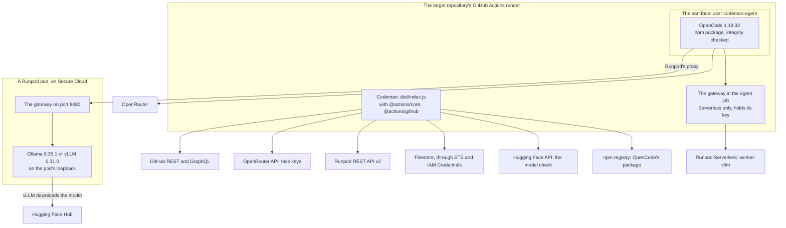

# Dependencies

Every dependency is audited before it is added (see `AGENTS.md`). This page records what Codeman uses, why, and the result of the last audit. Update it whenever a dependency is added, removed or upgraded.

## Inventory

| Dependency | Kind | Version and pin | Why | Last audit | Open findings | Details |
| --- | --- | --- | --- | --- | --- | --- |
| `@actions/core` | npm, runtime | 3.0.1 | Inputs, logging, failure reporting, the OIDC token | 2026-09-23 | None reported by `npm audit` | [Runtime](#runtime) |
| `@actions/github` | npm, runtime | 9.1.1 | Octokit with pagination | 2026-09-23 | None reported by `npm audit` | [Runtime](#runtime) |
| `typescript` | npm, development | 6.0.3 | Type checking | 2026-09-23 | None reported by `npm audit` | [Development](#development) |
| `@types/node` | npm, development | 24.13.6 | Node.js types | 2026-09-23 | None reported by `npm audit` | [Development](#development) |
| `esbuild` | npm, development | 0.28.2 | Bundles the action and the gateway | 2026-09-23 | None reported by `npm audit` | [Development](#development) |
| `@biomejs/biome` | npm, development | 2.5.14 | Lint and format | 2026-09-23 | None reported by `npm audit` | [Development](#development) |
| GitHub Actions, 5 | Actions | Full commit SHA | CI, the pod images, the target repository's workflow | Not recorded | None recorded | [GitHub Actions](#github-actions) |
| GitHub, OpenRouter, npm registry and the other APIs | Services | Not pinned | What Codeman calls with `fetch` or the packages | Not recorded | None recorded | [External services](#external-services) |
| OpenCode | Harness, downloaded | 1.18.32, by npm integrity | Runs the agent | Advisories checked 2026-09-24 | CVE-2026-88624, accepted | [Agent harness](#agent-harness-opencode) |
| Runpod REST API v2 | Service | v2 | The GPUs of pods and Serverless | 2026-10-03 | Keys never expire and have no spending limit | [Runpod](#runpod) |
| Ollama | Engine, in a pod image | 0.35.1, by digest | Serves models on Ollama pods | 2026-10-03 | Several, accepted: loopback only | [Ollama](#ollama) |
| vLLM | Engine, in a pod image | 0.31.0, by digest | Batches requests whatever the model | 2026-10-13 | Over 100 advisories, each fixed at or before 0.31.0 | [vLLM](#vllm-in-codemans-vllm-pod-image) |
| Hugging Face Hub API | Service | One route | Checks a vLLM pod's model | 2026-10-13 | None recorded | [Hugging Face](#hugging-face) |
| Runpod's vLLM worker | Image, chosen by a maintainer | `runpod/worker-v1-vllm:<version>` | Serverless endpoints | 2026-10-03 | None recorded | [Runpod's vLLM worker](#runpods-vllm-worker) |
| Codeman's pod images, on `node:24.21.0-bookworm-slim` | Images, Codeman's own | By digest | What pods run | Not recorded | None recorded | [Codeman's pod images](#codemans-pod-images) |
| Cloud Firestore, STS, IAM Credentials | Services | REST API v1 | The backend | 2026-10-07 | None recorded | [Cloud Firestore](#cloud-firestore-in-a-firebase-project) |
| Firestore's emulator | Test tool, not installed | The newest in Firebase's cache | The store's tests | 2026-10-07 | None recorded | [Firestore's emulator](#firestores-emulator) |
| The local runner image, on `ubuntu:noble-20260930.1` | Image, Codeman's own, local only | Base images by digest; Ubuntu's packages not pinned | Runs the tests that need GitHub's runner on a developer's machine | 2026-10-19 | None recorded | [The local runner image](#the-local-runner-image) |

## Audit log

| Date | Scope | Plan | Result |
| --- | --- | --- | --- |
| 2026-09-23 | The page's last general audit: what no later row covers | Not recorded | Not recorded |
| Not recorded | The npm packages, with `npm audit` | Not recorded | No known vulnerabilities |
| 2026-09-24 | OpenCode's advisories | Not recorded | CVE-2026-88624 had no fixed version; accepted for 1.18.32 |
| 2026-10-03 | Self-hosted inference: Runpod, Ollama, Runpod's vLLM worker | [Self-hosted inference](../plans/2026-10-02-self-hosted-inference.md) | No npm package added. Ollama's advisories accepted for 0.35.1 |
| 2026-10-07 | The backend: Cloud Firestore, STS, IAM Credentials, the emulator | [Backend](../plans/2026-10-07-firestore-backend.md) | No npm package added |
| 2026-10-13 | vLLM and its image, Hugging Face | [vLLM on pods](../plans/2026-10-13-vllm-on-pods.md) | vLLM's advisories each list a fix at or before 0.31.0; the rest accepted |
| 2026-10-19 | Running Actions locally: act, `actions/runner`, `github/local-action`, a plain image | [Run GitHub Actions locally](../plans/2026-10-19-run-github-actions-locally.md#audit) | None adopted but the plain image. act 0.2.74, as installed, has CVE-2026-34041 and CVE-2026-34042, fixed in 0.2.86 |

## Where each dependency runs

The diagram shows where each dependency's code runs, and what it reaches. The [sandbox](../glossary.md#sandbox) and the [gateway](../glossary.md#gateway) are described in [agent sandbox](../runs/agent.md#agent-sandbox) and [the gateway](../inference/self-hosted.md#the-gateway).

## npm packages

`package-lock.json` is committed, and every version is exact.

### Runtime

| Package | Version | Purpose | License and maintenance |
| --- | --- | --- | --- |
| `@actions/core` | 3.0.1 | Inputs, logging, failure reporting | Maintained by GitHub, MIT |
| `@actions/github` | 9.1.1 | Authenticated Octokit client with pagination | Maintained by GitHub, MIT |

- **Transitive code:** together they add 26 packages, all from the `@actions` and `@octokit` projects, plus `undici`, `tunnel`, `before-after-hook`, `universal-user-agent`, `content-type` and `json-with-bigint`. None has install scripts.
- **Permissions:** they are bundled into `dist/index.js`, and run with the GitHub App token.

### Development

| Package | Version | Purpose | Notes |
| --- | --- | --- | --- |
| `typescript` | 6.0.3 | Type checking | 7.x is not supported by the lint ecosystem yet. |
| `@types/node` | 24.13.6 | Node.js types | Node 24 is the Actions runtime (`node24`). |
| `esbuild` | 0.28.2 | Bundles `dist/index.js` and the gateway, `dist/gateway.js` | Its install script only verifies the binary; not needed. |
| `@biomejs/biome` | 2.5.14 | Lint and format | One binary, from the one of its 8 platform packages (`@biomejs/cli-*`) that matches the machine; no other transitive dependencies. Chosen over ESLint + typescript-eslint (95 packages). |

Tests use the built-in `node:test` runner; Node 24 runs TypeScript directly.

### npm settings

`.npmrc` sets:

| Setting | Value | Why |
| --- | --- | --- |
| `ignore-scripts` | `true` | No install scripts run |
| `save-exact` | `true` | Exact versions |
| `engine-strict` | `true` | Installing fails on a Node.js version that `package.json`'s `engines` excludes |

## GitHub Actions

Pinned to full commit SHAs.

| Action | Version | Used in |
| --- | --- | --- |
| `actions/checkout` | v7.0.1 | CI, pod image, target repository workflow (the repository in `agent`, and Codeman at `CODEMAN_COMMIT_SHA` in each job that runs it) |
| `actions/setup-node` | v7.0.0 | CI |
| `actions/create-github-app-token` | v3.2.0 | Target repository workflow |
| `actions/upload-artifact` | v7.0.1 | Target repository workflow |
| `actions/download-artifact` | v8.0.1 | Target repository workflow |

## External services

Codeman calls these APIs with `fetch` or through the packages above. Their documentation is kept in `docs/web/`, with how each page was fetched.

| Service | Used for | Pages |
| --- | --- | --- |
| GitHub REST and GraphQL APIs | Issues, labels, comments, pull requests and reviews, commits through the Git Data API, contents, collaborators' permissions, Actions runs, jobs, logs and artifacts, App installation tokens, and marking a pull request ready | `docs/web/github/` |
| OpenRouter API | [Task keys](../glossary.md#task-key) (list, create, get, disable) and analytics (tokens, requests, throughput, largest prompt) | `docs/web/openrouter/` |
| npm registry | Downloading the [harness](../glossary.md#harness)'s pinned package and checking its integrity | `docs/web/npm/` |
| OpenCode | The harness's configuration, permissions, providers and `run` command | `docs/web/opencode/` |
| Runpod REST API v2 | Self-hosted inference: pods (create, get, list, terminate), Serverless endpoints (get; and the job queue: run, stream, cancel), GPU prices, and billing (account, pods) | `docs/web/runpod/` |
| Ollama | The engine in Codeman's Ollama pod image: pulling a model, its context length, where it loads it, and its OpenAI-compatible API | `docs/web/ollama/` |
| llama.cpp | The server Ollama runs for a model in the pod image: how it fits a model to the GPU | `docs/web/llama-cpp/` |
| vLLM | The engine in Codeman's vLLM pod image: its arguments, how it sizes the K/V cache and refuses a context that does not fit, what it reports, tool calling and reasoning parsers | `docs/web/vllm/`, `docs/web/docker-hub/` |
| Hugging Face Hub API | Before creating a vLLM pod: whether its model exists, is public and not gated, has safetensors weights, and how large they are; vLLM, in the pod, downloads the model from the Hub | `docs/web/hugging-face/` |
| Cloud Firestore REST API v1 | The backend: documents read (`batchGet`, `runQuery`), written (`commit`) and in transactions (`beginTransaction`, `rollback`); its emulator, in tests; security rules, quotas and billing | `docs/web/google-cloud/`, `docs/web/firebase/` |
| Google's Security Token Service and IAM Credentials | The backend's access: the job's OIDC token exchanged for a federated token (`token`), then for the service account's (`generateAccessToken`), through Workload Identity Federation | `docs/web/google-cloud/` |
| GitHub Actions' OIDC provider | Each backend job's OIDC token, through `getIDToken` of `@actions/core` | `docs/web/github/` |

## Agent harness: OpenCode

- **What:** the harness that runs the agent in the sandbox, as a child process (`opencode run --format json`). `@opencode-ai/sdk` is not used.
- **Version and pin:** OpenCode v1 1.18.32 (`opencode-ai`), pinned in [`src/harness/opencode.ts`](../../src/harness/opencode.ts) with the npm `dist.integrity` of each platform package (`opencode-linux-x64`, `opencode-linux-arm64`).
  - v2 (`@opencode/cli`, 2.0.x) was not adopted: it is a preview, has no tagged GitHub releases, and the published binaries cannot be traced to a source commit. Re-evaluate it once it becomes the main release.
- **License and maintenance:** MIT; repository [anomalyco/opencode](https://github.com/anomalyco/opencode); very active, with near-daily releases.
- **Transitive code:** the `opencode-ai` npm package runs a `postinstall` script that selects a per-platform package containing one compiled binary (about 185 MB).
  - Codeman skips that package and its script. It downloads the platform package from the npm registry, and checks its integrity before extracting it.
  - There is no npm provenance attestation, only registry signatures.
- **Known vulnerabilities:**
  - CVE-2026-22812 (high): an unauthenticated local HTTP server allowed command execution. Fixed in 1.0.216.
  - CVE-2026-22813 (critical): XSS in the web UI. Fixed in 1.1.10.
  - CVE-2026-88624 (critical): path traversal in the local server's `DELETE /experimental/worktree`, reported for 1.18.26 and earlier. No fixed version existed on 2026-09-24. Accepted for 1.18.32: only the agent can reach that server, and it already runs shell commands in a sandbox with no write token. Upgrade once a fix ships.
- **Permissions:** it runs any shell command as the user that starts it. Its permission system is not a sandbox, and most permissions default to `allow`. It loads configuration and plugins from `opencode.json` and `.opencode/` in the repository.

How Codeman contains it:

1. It runs as the unprivileged `codeman-agent` user (see [agent sandbox](../runs/agent.md#agent-sandbox)).
2. Its configuration goes through `OPENCODE_CONFIG_CONTENT`, which overrides the repository's:
   - `autoupdate: false` and `share: "disabled"`;
   - only one provider: `openrouter`, or on self-hosted inference Codeman's gateway, as `codeman`;
   - `deny` for `webfetch`, `websearch`, `external_directory`, `question` and `doom_loop`. No permission is left as `ask`, because nobody is there to answer.
3. `opencode.json`, `opencode.jsonc` and `.opencode/` are protected only by the default rules of `.codemanignore` ([change policy](../runs/changes.md#change-policy)), so the apply job drops the agent's changes to them.
   - A repository can re-allow them with `!`. The agent can then change the harness configuration of later runs.
   - Each run's summary warns about the paths no longer protected.

## Self-hosted inference

Audited on 2026-10-03 for the [self-hosted inference plan](../plans/2026-10-02-self-hosted-inference.md). No npm package is added: the Runpod API is called with `fetch`, and the gateway uses only Node's built-in modules.

### Runpod

- **What:** a GPU cloud billed per second, with [pods](../glossary.md#pod) (a container on a GPU, billed while it exists) and Serverless endpoints (workers started on demand, billed while they run).
- **Why:** it serves the GPU for the `runpod-pod` and `runpod-serverless` providers. A small in-house replacement is not possible: it is the hardware.
- **Version and pin:** the REST API v2 (`https://api.runpod.io/v2`). v1, which the plan first named, is deprecated and retired on 2026-11-15 ([migrate from API v1](../web/runpod/migrate-from-api-v1.md)).
- **Data:** the agent's prompts, and so the repository's code, go to a container on Runpod.
  - Codeman creates pods on Secure Cloud only, which runs in certified data centers of vetted partners ([data security](../web/runpod/data-security-and-legal-compliance.md)).
  - A Serverless endpoint does not report its cloud ([get a Serverless endpoint](../web/runpod/get-a-serverless-endpoint.md)): the maintainer who creates it chooses.
- **Credentials:** API keys are **All**, **Restricted** or **Read Only**. A restricted key can be limited to one Serverless endpoint, but no key expires or has a spending limit ([manage credentials](../web/runpod/manage-credentials.md)). Codeman uses two:
  - an account key, in the jobs that manage pods and read billing, which run no LLM;
  - for Serverless, a key restricted to the endpoint, held by the agent job's gateway, outside the sandbox.
- **Spending:** the account spends prepaid credits. At US$ 0, Runpod stops every pod, and terminates those without a network volume ([billing overview](../web/runpod/billing-overview.md)). An account without auto-pay therefore caps what Codeman can spend there.
- **Terms:** the console's terms apply. Runpod's terms forbid hosts to inspect a pod's data.

### Ollama

- **What:** the inference engine in Codeman's Ollama pod image. It pulls a model by name and serves an OpenAI-compatible API ([OpenAI compatibility](../web/ollama/openai-compatibility.md)). It runs llama.cpp's `llama-server` for the model.
- **Why:** it serves the model on pods with `engine: ollama`.
- **Version and pin:** 0.35.1, from its official image `ollama/ollama`, pinned by digest in [`docker/pod/Dockerfile`](../../docker/pod/Dockerfile): `sha256:292ee7945dfc3d5840a181f3ab86fedb1e66703e02c8af98b50f4da56b7e278c`, the multi-platform index.
  - The server variables that the [Ollama settings](../settings/ollama.md) give it come from this version's source ([`envconfig/config.go` at v0.35.1](../web/ollama/envconfig-config-go-at-v0-35-1.md)).
  - It runs `llama-server` at the tag it pins, `b11232` ([LLAMA_CPP_VERSION at v0.35.1](../web/ollama/llama-cpp-version-at-v0-35-1.md)).
  - How both fit a model to the GPU is recorded for these versions ([fitting Ollama to the GPU](../plans/2026-10-13-fit-ollama-to-the-gpu.md#context)).
- **License and maintenance:** MIT, [ollama/ollama](https://github.com/ollama/ollama), very active, with releases every few days.
- **Known vulnerabilities** (OSV, 2026-10-03):
  - path traversal: CVE-2024-37032, fixed in 0.1.34; CVE-2026-7020, reported up to 0.20.2;
  - file deletion and archive extraction outside its directory, fixed in 0.1.34 and 0.1.47;
  - out-of-bounds reads in model loading: CVE-2026-7482, fixed in 0.17.1;
  - several denials of service;
  - a token leak to a malicious registry during `pull`: CVE-2025-51471, reported up to 0.9.6;
  - an API without authentication: CVE-2025-63389.

  Accepted for 0.35.1. Its API listens only on the pod's loopback, behind Codeman's gateway, which forwards only the OpenAI-compatible routes. Codeman pulls models only from Ollama's own registry.
- **Permissions:** it runs as root in the pod's container, which holds nothing but the model and the gateway.
- **Upgrade checklist:**
  1. Record the new version's source in `docs/web/ollama/`: `envconfig/config.go` and `server/sched.go` at least. The tests read them at `OLLAMA_VERSION`, and fail until they exist.
  2. Check the [accepted keys](../settings/ollama.md#accepted-keys) against the new version's server variables.
  3. Change `OLLAMA_VERSION` in `src/inference/ollama.ts`, the Dockerfile's `FROM ollama/ollama:<version>@sha256:<digest>`, and `Ollama <version>` in the accepted keys' section, together. A test compares them.
  4. Check again how Ollama and `llama-server` fit a model to the GPU, and `OLLAMA_SERIAL_FAMILIES`, which a test compares with the recorded `server/sched.go`.
  5. Publish and pin the new image ([pod images](guide.md#pod-images)).
- **Adding a key:**
  1. Check the key in the source of the Ollama version the pod image pins, recorded in `docs/web/ollama/`.
  2. Add it to `OLLAMA_SETTINGS`, to the [accepted keys](../settings/ollama.md#accepted-keys) table, and to its test, together.

### vLLM, in Codeman's vLLM pod image

Audited on 2026-10-13 for the [plan for vLLM on pods](../plans/2026-10-13-vllm-on-pods.md).

- **What:** an inference engine that serves Hugging Face models with an OpenAI-compatible API. It refuses to start rather than move a model or its cache off the GPU ([kv_cache_utils.py](../web/vllm/vllm-v1-core-kv-cache-utils-py-at-v0-31-0.md)).
- **Why:** it batches concurrent requests whatever the model, which Ollama does not for some families ([Ollama settings](../settings/ollama.md#parallel-requests)). A small in-house replacement is not possible.
- **Version and pin:** 0.31.0, from its official image `vllm/vllm-openai:v0.31.0`, CUDA 13.0, pinned by the index's digest in [`docker/pod/Dockerfile`](../../docker/pod/Dockerfile): `sha256:c1c9f6fd5c109ba7f0546a59f5b2f15fb87f64c77782e90a27b648b42a8e67c3`.
  - The image is 9.04 GB compressed for linux/amd64 ([the image](../web/docker-hub/vllm-vllm-openai-v0-31-0.md)). That size is vLLM's image, before Codeman adds Node's binary and the gateway.
  - It runs as root, and its entry point is replaced by the gateway's.
  - Its CUDA needs hosts whose driver supports CUDA 13.0, which Codeman requires when it creates a vLLM pod (`VLLM_MIN_CUDA`).
  - The [vLLM settings](../settings/vllm.md) and the parsers come from this version's source.
- **License and maintenance:** Apache-2.0, [vllm-project/vllm](https://github.com/vllm-project/vllm), very active: a release about every two weeks ([v0.31.0](../web/vllm/v0-31-0.md)).
- **Transitive code:** the image holds PyTorch, CUDA's libraries, FlashInfer, Transformers, XGrammar and their Python dependencies, all from vLLM's build ([v0.31.0](../web/vllm/v0-31-0.md#images-and-cuda)). Codeman installs nothing in it but Node's binary and the gateway.
- **Known vulnerabilities** (GitHub's advisories for vllm-project/vllm, 2026-10-13): over 100 published.
  - Most are denials of service from crafted requests, many through multimodal inputs.
  - Some are remote code execution through a model's or a request's code (`trust_remote_code`, `mm_processor_kwargs`).
  - Each lists a fix at or before 0.31.0, which itself fixes several high ones.

  Accepted for 0.31.0. vLLM listens only on the pod's loopback, behind Codeman's gateway, which forwards only the OpenAI-compatible routes, and only for the runs' tokens. `trust-remote-code`, plugins and chat templates are refused ([vLLM settings](../settings/vllm.md#refused-keys)).
- **Permissions:** it runs as root in the pod's container, which holds nothing but the model, vLLM's caches and the gateway.
- **Data:**
  - It sends anonymous usage statistics to `https://stats.vllm.ai` by default. The image sets `VLLM_NO_USAGE_STATS=1` and `DO_NOT_TRACK=1`, and the gateway sets them again ([envs.py](../web/vllm/vllm-envs-py-at-v0-31-0.md)).
  - Arguments that send the cache, events, traces or requests elsewhere are refused.
  - It downloads the model from Hugging Face.
- **Upgrade checklist:**
  1. Record the new version's pages in `docs/web/vllm/`, and its image's page in `docs/web/docker-hub/`. The tests read them at `VLLM_VERSION`.
  2. Change `VLLM_VERSION` in `src/inference/vllm.ts` and the Dockerfile's `FROM vllm/vllm-openai:v<version>@sha256:<digest>` together. A test compares them, and checks the digest against the image's recorded page.
  3. Check against the new pages: the accepted keys, the refused ones, the parsers, the CUDA floor (`VLLM_MIN_CUDA`, which a test compares with the image's CUDA), and the messages the gateway reads (auto-fit, `/metrics`).
  4. Change `vLLM <version>` in the [accepted keys](../settings/vllm.md#accepted-keys)' section. A test compares it.
  5. Publish and pin the new image ([pod images](guide.md#pod-images)).
- **Adding a key:**
  1. Check the key in the source of the vLLM version the image pins, recorded in `docs/web/vllm/`.
  2. Add it to `VLLM_SETTINGS`, to the [accepted keys](../settings/vllm.md#accepted-keys) table, and to its test, together.

### Hugging Face

Audited on 2026-10-13 for the [plan for vLLM on pods](../plans/2026-10-13-vllm-on-pods.md), decision 10.

- **What:** the Hub where vLLM's models are published, by ID (`namespace/name`).
  - Codeman's [key job](../glossary.md#key-jobs) calls one route of its API, `GET https://huggingface.co/api/models/<id>?blobs=true`, with `fetch` ([hf_api.py](../web/hugging-face/src-huggingface-hub-hf-api-py-at-v2-2-0.md)).
  - vLLM, in the pod, downloads the model's files from the Hub.
- **Why:** before paying for a pod, a model that does not exist, is private or gated, or has no safetensors weights stops the run. The weights' size sets the pod's container disk.
  - A small in-house check is what Codeman does: no client library is added. `huggingface_hub` is Python, and the call is one request.
- **License and maintenance:** the Hub is Hugging Face's service. Its route is described by its official client, [huggingface/huggingface_hub](https://github.com/huggingface/huggingface_hub) (Apache-2.0, v2.2.0 of 2026-10-08), since its OpenAPI document leaves it out ([tool](../web/tools/hugging-face.md)).
  - A change to the route's response would show as a refused model, with the Hub's answer in the message.
- **Permissions:** the calls are public, unauthenticated and read-only.
- **Data:** the request carries only the model's ID.
- **Credentials:** none. Codeman holds no Hugging Face token: gated and private models are out of scope.
- **Spending:** free. Codeman makes one call per vLLM pod it creates. Anonymous calls count against the Hub's limits per IP address ([rate limits](../web/hugging-face/hub-rate-limits.md)):
  - its API limit, 500 per 5 minutes;
  - its resolver limit, for downloads, 3,000 per 5 minutes.
- **Terms:** Hugging Face's terms of service apply to the Hub. Each model has its own license, which the person who chooses it is responsible for.

### Runpod's vLLM worker

- **What:** Runpod's official Serverless worker, [runpod-workers/worker-vllm](https://github.com/runpod-workers/worker-vllm), running vLLM.
  - Codeman sends it OpenAI-compatible requests as jobs, `{"openai_route": ..., "openai_input": ...}`: the shape Runpod's own OpenAI-compatible route sends ([`src/handler.py`](https://github.com/runpod-workers/worker-vllm/blob/v2.28.0/src/handler.py) at v2.28.0).
  - A streamed request's output is vLLM's own events.
- **Version and pin:** a maintainer chooses it, pinned to a release image (`runpod/worker-v1-vllm:<version>`), when creating the endpoint in Runpod's console. Codeman never runs it and does not install it: it checks the endpoint's settings when a run opens.
- **License and maintenance:** MIT, maintained by Runpod, released weekly (v2.28.0 on 2026-09-28).

### Codeman's pod images

- **What:** one image per [engine](../glossary.md#engine), the targets of [`docker/pod/Dockerfile`](../../docker/pod/Dockerfile): Ollama's image or vLLM's, each with Node's binary and the gateway, `dist/gateway.js`. Each image is labeled with Codeman's repository as its source, replacing the base image's.
- **Why one per engine:** each new pod pulls its image, which Runpod bills. vLLM and later engines pin conflicting PyTorch and CUDA versions. And the newest engine would raise the CUDA floor for all ([plan for vLLM on pods](../plans/2026-10-13-vllm-on-pods.md), decision 8).
- **Version and pin:**
  - The `node` binary comes from `node:24.21.0-bookworm-slim`, pinned by digest: `sha256:0e0ff40c39bc087845bfb27465a0df4ea419520094bc35842ff83dd8cbe6f9b6`.
  - The images are published to GitHub's container registry as `ghcr.io/<owner>/codeman-ollama` and `ghcr.io/<owner>/codeman-vllm`, each public.
  - They are referenced by digest in `POD_IMAGES` in [`src/inference/images.ts`](../../src/inference/images.ts), by a reviewed commit, never by tag. Publishing and pinning are in [pod images](guide.md#pod-images).
- **Transitive code:** the gateway is bundled from [`src/gateway/`](../../src/gateway/) with Node's modules only. CI checks that `dist/` matches the source, so the images need no npm install.
- **Permissions:** [`.github/workflows/pod-image.yml`](../../.github/workflows/pod-image.yml) builds them, one leg per engine, when the Dockerfile, the workflow or `dist/gateway.js` changes.
  - It uses only `actions/checkout` (pinned) and the runner's `docker`, with `packages: write` and `contents: read`.
  - It removes preinstalled toolchains with `rm`, to make room for vLLM's image.

## The local runner image

Audited on 2026-10-19 for the [plan to run Actions locally](../plans/2026-10-19-run-github-actions-locally.md#audit).

- **What:** [`docker/runner/Dockerfile`](../../docker/runner/Dockerfile), a stand-in for GitHub's `ubuntu-latest` runner, built and run by `scripts/runner.sh` ([running Actions locally](local-actions.md)). It is never published, and CI does not use it.
- **Why:** the [sandbox](../glossary.md#sandbox) test needs Linux, a runner user with passwordless `sudo`, and the image's permissions and `PATH`. A plain image with `docker run` reproduces them; act, `actions/runner` and `github/local-action` were not adopted (see the plan's audit).
- **Version and pin:**
  - `ubuntu:noble-20260930.1`, by its index digest `sha256:68ee22004a9109b44973313b02ff7b1de250f1de0f5ecb628d73f579aaff33ac` ([the image](../web/docker-hub/ubuntu-noble-20260930-1.md)).
  - Node.js and npm come from `node:24.21.0-bookworm-slim`, the pod images' pinned digest.
  - `ca-certificates`, `git`, `sudo`, `procps` and `unzip` come from Ubuntu's archive at build time, not pinned: apt checks them against the archive's signed indexes.
- **Transitive code:** the packages' dependencies, from Ubuntu. No npm package is added: the container runs `npm ci` from `package-lock.json`, with the repository's `.npmrc`.
- **Permissions:** the container gets the working tree read-only, which it copies, and the network, for `npm ci`. It gets no Docker socket. It needs a Docker daemon on the developer's machine: Docker Engine is Apache-2.0, and Docker Desktop's subscription terms apply to the developer's organization.

## Backend

Audited on 2026-10-07 for the [backend plan](../plans/2026-10-07-firestore-backend.md). No npm package is added (decision 2):

- Firestore's REST API, STS and IAM Credentials are called with `fetch`.
- GitHub's OIDC token comes from `@actions/core`, already a dependency.
- `firebase-admin` and `@google-cloud/firestore` were not adopted: each brings a large tree (gRPC, Google's auth library) for the few calls Codeman makes.

### Cloud Firestore, in a Firebase project

- **What:** Google's managed document database, with transactions and a free daily quota, reached over HTTPS ([usage and limits](../web/firebase/usage-and-limits.md)). Codeman uses the project's `(default)` database, Standard edition, in Native mode.
- **Why:** it holds what jobs share across runs and repositories, atomically: the [ledger](../glossary.md#ledger) with its budget reservations, the [pod registry](../glossary.md#pod-registry) with its leases, the Serverless endpoints' runs, the board and the batches. GitHub cannot hold it, and the responsible person wants no Codeman service to host.
- **Data** ([data layout](../backend/data-layout.md)):
  - Codeman's records of runs (repository and task numbers, stages, models, limits, costs, tokens, pods) and events;
  - the pods it created (model, GPU type, image, leases);
  - each repository's ready tasks on the board (repository, task numbers, stages) and the batches;
  - the [cache of fits](../glossary.md#cache-of-fits): the context each pod's model fitted its GPU with.

  No secret, no code, no issue text.
- **Credentials:** none stored.
  - Jobs act as a service account through Workload Identity Federation ([deployment pipelines](../web/google-cloud/configure-workload-identity-federation-with-deployment-pipelines.md)).
  - The service account has only Cloud Datastore User (`roles/datastore.user`, [IAM roles](../web/firebase/identity-and-access-management-iam.md)). Its tokens last an hour, scoped to Firestore.
  - The security rules deny every client ([rules](../web/firebase/get-started-with-cloud-firestore-security-rules.md)).
- **Spending:** none within the free quota ([cost](../backend/backend.md)), which applies to one database per project ([billing](../web/firebase/understand-cloud-firestore-billing.md)). A project without a billing account cannot go beyond it.
- **Terms:** Google Cloud's and Firebase's terms. Google's documentation is CC BY 4.0, so the pages in `docs/web/` are copies.

### Firestore's emulator

- **What:** Google's `cloud-firestore-emulator` jar, which the Firebase CLI downloads into `~/.cache/firebase/emulators/`. It runs on Java 21.
- **Why:** only for Codeman's tests, on a developer's machine: the contract tests run against it when it is there ([Firestore's emulator](guide.md#firestores-emulator)).
- **Version and pin:** none. The tests use the newest jar in the cache. Codeman neither installs nor downloads it, and CI does not run it.
