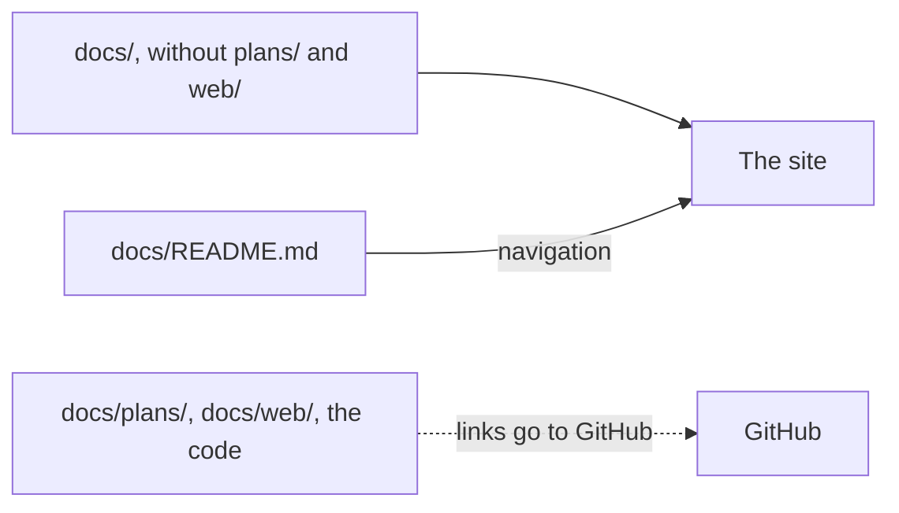

# Writing the docs

This page is for whoever writes Codeman's docs: how to shape a page, which Markdown form fits each kind of content, and what the tests and the site expect.

## Sections and sentences

- Give each section one subject, and each sentence one fact.
- When a heading needs "and", split the section. When a sentence needs a semicolon to go on, split the sentence.
- Keep paragraphs and list items under about 80 words, and sentences under about 45.

## Which form to use

| Content | Form |
| --- | --- |
| A reason, or a short explanation | Prose |
| A procedure | Numbered steps, each with its expected result |
| Parallel facts | Bullets |
| Items compared on the same attributes: settings, secrets, jobs, states, outcomes | A table |
| Commands, formulas, log lines | A code block, with its language (`sh`, `yaml`, `text`) |
| The one thing a reader must not miss | A callout |
| A flow, a sequence, states or boundaries | A diagram |

Tiny examples of the first five, in order:

```markdown
Codeman stages the workflows the agent writes, because a workflow file can run as soon as it reaches a branch.

1. Run `npm ci`. npm installs the exact versions of `package-lock.json`.
2. Run `npm run check`. Lint, type check, tests and build pass.

- `task-budget` covers one task, across all its runs.
- `monthly-budget` covers the repository's calendar month.

| Setting | Default | Covers |
| --- | --- | --- |
| `task-budget` | `2` | One task |
| `monthly-budget` | `20` | The repository's month |

> [!WARNING]
> Never put a secret in `CODEMAN_SETTINGS`: its value is plain text.
```

The code block under [links and anchors](#links-and-anchors) and the diagram under [the site](#the-site) are examples of the last two.

## Callouts

- Use only `> [!NOTE]`, `> [!IMPORTANT]` and `> [!WARNING]`, as GitHub writes them.
  - NOTE: a fact a reader who skims would miss.
  - IMPORTANT: a requirement without which something fails.
  - WARNING: an action that risks secrets, money or data.
- Use them sparingly: rarely more than one per section.
- Word each one so it reads well as a plain blockquote, since some generators show the marker as text. Its first sentence states the point; it never refers to its own label.

## Diagrams

- Write ```` ```mermaid ```` fences. Keep one idea per diagram, and short labels.
- A diagram summarizes. State the facts it shows in the text or a table beside it too.
- Check each diagram against the code it draws: job names, states and their order come from the code, not from another page.
- Use SVG only when Mermaid cannot draw the idea. Put images in `docs/<subject>/images/`, with alt text: ``.

## Page shape

1. A single H1, the page's title.
2. An opening of one or two sentences: what the page is for.
3. The sections a user needs.
4. The internals, under a `## How it works` heading, after the user's sections.

Upgrade history goes in [upgrading](../installation/upgrading.md), not in reference pages.

## Terms

- Use the terms of the [glossary](../glossary.md), with the meaning it gives them.
- On each page, link a term to the glossary at its first use, such as `[agent run](../glossary.md#agent-run)`.
- Always qualify the terms with several meanings: run, pool, provider, condition and version.

## Links and anchors

- Write relative links with the `.md` extension, such as `[budget](../budget/budget.md)`.
- Never write root-absolute paths (`/docs/...`): the link check skips them. Never link to a directory: the site has no page for it.
- A heading's text defines its anchor, by GitHub's rules: lowercase, punctuation removed, spaces to hyphens, and `-1`, `-2` for repeats.

> [!IMPORTANT]
> Code, tests and other pages cite anchors, some in runtime error messages. Before renaming a heading, find every referrer and update it.

```sh
grep -rn 'ollama.md#pod-images' README.md AGENTS.md action.yml docs src templates docker
```

To keep an old anchor alive, put `<a id="old-anchor"></a>` on the line above the renamed heading.

### Tests that read the docs

| Test | Reads | Requires |
| --- | --- | --- |
| `src/docs.test.ts` | Every Markdown file of `README.md`, `AGENTS.md` and `docs/`, but full copies in `docs/web/`; and each `docs/<path>.md#<anchor>` in `src/`, `templates/`, `docker/` and `action.yml` | Each relative link names a file that exists, and its anchor a heading or an `<a id>` of that file. Code blocks and code spans are not checked |
| `src/inference/providers.test.ts` | `settings/providers.md` | A `` ## `<provider>` `` section per provider, in the registry's order. In each, before any `###`: rows whose first two columns are the setting and its default, and a `- **Secrets:** ` bullet naming the secrets in order |
| `src/inference/ollama.test.ts` | `settings/ollama.md` | `## Accepted keys` and `## Refused keys`, with columns key, variable, values first. The values, the refusal reasons and `Ollama <version>` match the code's text |
| `src/inference/vllm.test.ts` | `settings/vllm.md` | The same sections, with columns key, argument, values first. Each refused key's reason, in the second column, equals the code's; `vLLM <version>` appears |
| `src/testing/settings-example.ts` | `## Example` in `settings/profiles.md` | The first `yaml` block of the section: the settings the tests run |
| `src/webdocs.ts` | The front matter of `docs/web/` | Only the fields `AGENTS.md` lists, so no site keys; a file name made from the title |

## The site

- These files are the source of a GitHub Pages site. Its generator is not set up yet.
- [`docs/README.md`](../README.md) is its landing page, and the only source of the navigation order. Pages have no navigation front matter.
- `docs/plans/` and `docs/web/` are not published. The site's build rewrites links into them, and any link out of `docs/`, to GitHub.
- So keep every link relative: the link check still covers it.


