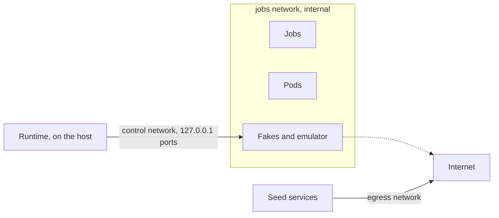

# The e2e fakes

This page is for whoever changes the [end-to-end suite's](suite.md) fakes, or debugs a scenario through them: what each one stands for, how the runtime drives it, and how the scripted model and the tee answer the agent. Each fake is Node's built-ins only, under [`e2e/fakes/`](../../../e2e/fakes/main.ts), with tests that `npm test` runs without Docker.

## The services

The Compose file, [`e2e/infra/compose.yaml`](../../../e2e/infra/compose.yaml), runs each fake as a service of one image, with `node e2e/fakes/main.ts <name>`.

| Service | Stands for | Jobs and pods reach it at |
| --- | --- | --- |
| `github` | GitHub's REST and GraphQL APIs, git over HTTPS, the artifact service, App and `GITHUB_TOKEN` tokens | `https://github-e2e.localhost`, at a fixed address |
| `google` | GitHub's OIDC issuer, Google's STS and IAM Credentials | `http://google:8080` |
| `openrouter` | OpenRouter's management API, and its inference API for OpenCode | `http://openrouter:8080` |
| `runpod` | Runpod's REST API, the pods' proxy, and the Serverless queues | `http://runpod:8080`; a pod at `/pods/{id}/{port}` |
| `llm` | The scripted model, behind OpenRouter, the Serverless queues and the tee | `http://llm:8080` |
| `npm` | The npm registry, for OpenCode's tarballs only | `http://npm:8080` |
| `huggingface` | Hugging Face's Hub, for the model information only | `http://huggingface:8080` |
| `firestore` | Firestore, as Google's emulator with Codeman's rules | `http://firestore:8080` |

- **The fake Hub** serves `GET /api/models/{namespace}/{name}`, the one route Codeman calls before it creates a vLLM pod ([`huggingface.ts`](../../../e2e/fakes/huggingface/huggingface.ts)). Its models come from the `codeman-e2e-hf` volume, mounted read-only, in [the client's cache layout](../../web/hugging-face/understand-caching.md): each file's size and hash from its blob. Without the `vllm` profile the volume is empty, and every model answers 401, as the Hub does for a missing one. Its unit tests use `models.json`, the pinned model as the seeded volume gives it.
- **The fake Runpod's errors** are Runpod's problems, `application/problem+json`: 400 for a GPU without capacity, 402 under the `low-balance` fault, 422 for a body outside the contract ([create a pod](../../web/runpod/create-a-pod.md#errors)).
- **The fake GitHub's permissions** follow [GitHub's table](../../web/github/permissions-required-for-github-apps.md): one pull request reads with Contents or Pull requests, an issue with Issues alone. Where the table lists Issues and Pull requests as alternatives, as for an issue's labels and comments, the fake takes Pull requests only on a pull request.
- **The fake GitHub** serves HTTPS under a `*.localhost` name, which `@actions/artifact` requires. A test CA signs its certificate, made once and kept in a volume while valid. Node, git and `gh` in the job image trust it.
- **The fake Google's** token is `owner`, which the emulator takes as an admin, past the rules. A job that skips the token path is refused.
- **The npm cache** is filled once by `seed-npm`, which checks each tarball against OpenCode's pinned integrity. Codeman checks it again on download.

### Networks



| Network | Joined by | Reaches |
| --- | --- | --- |
| `codeman-e2e-jobs`, internal | Jobs, pods, the fakes, the emulator | Only each other: no internet |
| `codeman-e2e-control` | The fakes, the emulator | Their ports, published on `127.0.0.1` for the runtime |
| `codeman-e2e-egress` | The seed services | The registries, once |

## Control API

Each fake has a control API under `/_fake/`, for the runtime only. When `CODEMAN_E2E_CONTROL_TOKEN` is set, as the runtime sets it, each call needs it as a bearer token, so a job cannot drive the fakes.

Every fake has these routes:

| Route | Does |
| --- | --- |
| `GET /_fake/requests` | The requests it got, oldest first. Control calls are not logged |
| `DELETE /_fake/requests` | Forgets them |
| `POST /_fake/faults` | Adds an HTTP fault: `{ path, method, status, body, delayMs, drop, times }` |
| `DELETE /_fake/faults` | Clears the faults |
| `POST /_fake/reset` | A fresh state, before each scenario |

### Control routes

Each fake's own routes are under `/_fake/<fake>/`.

| Fake | Routes |
| --- | --- |
| `github` | `POST users`, `orgs`, `repos` (with `files` and their `submodules`, gitlinks by path), `apps`, `installations`, `tokens` (with the `job` that asks); `GET` and `PATCH tokens`; `PUT repos/{owner}/{repo}/collaborators/{login}`; `POST act`, a user's action; `runs`, `jobs` and `artifacts`, for the simulator and act's driver; `GET events`, `dispatches`, `runs` (each with its event, status, conclusion and concurrency group), `violations`, `repos/{owner}/{repo}/issues` |
| `google` | `PUT setup`, the provider, service accounts and condition; `POST runs`, a run's OIDC request token; `PUT faults` |
| `openrouter` | `GET keys`, with each key's shown `usage` and real spend; `PUT keys/{hash}/usage`; `PUT credits`, the account's credits until the next reset; `PUT lags`; `POST settle`; `PUT prices`; `PUT completions`; `GET generations`, each billed request |
| `runpod` | `GET pods`, terminated ones included, with each one's env, `cost` and `billing` (`running`, or `stopped` once it exited or was terminated); `POST pods/{id}/{action}`; `PUT setup`; `GET` and `PATCH catalog`; `PUT endpoints/{id}` and its `workers`; `GET jobs`, the Serverless jobs; `GET endpoints/{id}/cost`; `PUT faults`, `{ podStart, lowBalance, holdQueues, podAgeMs }`, where `podAgeMs` dates the pods created from then on, and their billing, that far back. The setup's shapes refuse unknown keys |
| `llm` | `PUT scripts/{scenario}`, `GET scripts`, `DELETE scripts/{scenario}`; `GET turns`, each request and what it was taken for; `GET violations`, the requests no script covered |

The `fakes` check of a scenario reads these lists ([checks](scenarios.md#the-fakes-lists)).

- **GitHub's events** carry the payload a job gets at `GITHUB_EVENT_PATH`.
- **GitHub's tokens** (`GET tokens`) are every token it gave, never their values: `kind` (`installation` or `job`), `job`, the template's job that asked for it as `<workflow file>/<job id>` (such as `codeman.yml/select`, or `e2e/runtime` for the runtime's own reads), `run`, `repositories`, `scopes` (its permissions as sorted `name=level`), `revoked` and `expiresAt`. The simulator names the job when it makes a job's `GITHUB_TOKEN`, and after its emulated `create-github-app-token` gets an App token (`PATCH tokens`, `{ token, job }`).
- **GitHub's requests** note their caller as `token`: the same `kind`, `job`, `run` and `scopes`; `app` with the App's slug for an App's JWT; or `anonymous`. With each request's `status`, a scenario checks that no job got a 403.
- **Its violations** are calls with a token it did not give, or beyond a token's permissions.
- **OpenRouter's lags:** a key's usage and analytics show a request only after their lag, as OpenRouter's do. The key's limit applies to what it really spent.

## The scripted model

The `llm` fake answers the agent as an OpenAI-compatible server, from the scenario's `agent:` section ([the agent's script](scenarios.md#the-agents-script)).

`open-issue` adds a marker to the issue's body, which reaches the agent through its task file:

```text
<!-- codeman-e2e scenario=happy-path/openrouter-plan-only issue=i1 -->
```

No gateway passes a token upstream, so the model tells a request's place from its content alone:

| What | From |
| --- | --- |
| The scenario and the issue | The marker |
| The stage | The task file's first heading |
| The round | The nonce of the task file's quoted blocks, new for each run of the stage |
| The fix pass | The last user message is Codeman's fix prompt |
| The turn | The tool results since the last user message |

The first turn of every conversation reads the task file. OpenCode's title request gets a title.

## The tee

Each e2e pod image runs the tee on the engine's port: 11434 for Ollama, 8000 for vLLM. A wrapper moves the real engine one port up. The gateway, the e2e build's `gateway.js`, runs as on a real pod.

| Request | The tee |
| --- | --- |
| The agent's chat | Sends the engine a short fixed prompt, with `temperature: 0` and `max_tokens` 8. Once the engine's reply ends, returns the scripted reply |
| Other chat, such as the gateway's tool-call probe | Passes it to the engine unchanged |
| Ollama's `GET /api/ps` | Rewrites `size_vram` against a virtual VRAM: the pod's `CODEMAN_GPU_MEMORY_GB` |
| Ollama's `POST /api/pull` | Answers from the engine's `/api/tags`, without a registry |
| Any other route | Passes it unchanged |

With `TEE_MEET_ISSUES` (the scenario's `world.runpod.tee.meet`, which the launcher passes), the tee holds each agent's turn, one whose issue the scripted model tells, before the engine, until turns of that many issues are held; it then sends them to the engine at once, and holds nothing more. A turn held `TEE_MEET_TIMEOUT_MS` (2 minutes by default) goes on alone. Agents start seconds apart, each once its `open-key` sees the pod serve, and a turn takes about a second at the engine, so without it two tasks' agents may never meet there. A held turn's record has `heldMs`, and its engine start is when the hold ended; a turn that goes on at once has none.

So the engine's concurrency, the context split between seats and the engine's settings are real, and the [fit](../../glossary.md#fit) searches on Ollama's real sizes. A real prompt on a CPU would take minutes, and one past vLLM's 8,192 tokens would be refused ([spike 0.1](../../plans/2026-10-20-end-to-end-test-suite.md#01-results)).

> [!NOTE]
> Ollama's pull needs the registry even for a model it has, and the gateway's pull has no timeout. Without the tee's answer, an offline pod fails at once or hangs.

Its inspection API, under `/_fake/tee/` on port 9091 and on the engine's port:

- `GET /requests`: each chat request, what the model took it for, and when the engine started and ended it, so a scenario can count how many were at the engine at once;
- `DELETE /requests`;
- `GET /runners`: the engine's runner processes in the pod, from `/proc`: Ollama's `llama-server`, with its arguments, its context (`-c`, all its parallel requests together) and its parallel requests (`-np`);
- `GET /slots`: the runners' slots, from llama-server's `/slots`, each with its context; and `busiest`, the most slots that processed at once. The tee samples them every 100 ms while agents' requests are at the engine, since Ollama queues requests beyond its slots, which the tee cannot tell from running ones. In a vLLM pod (`CODEMAN_IMAGE_ENGINE=vllm`), it samples vLLM's `/metrics` instead: `busiest` is the most requests `vllm:num_requests_running` gave, and `waiting` the most `vllm:num_requests_waiting` gave;
- `PUT /vram` `{ bytes }`: the virtual VRAM, or `null` to pass `/api/ps` unchanged.

## The pod launcher

No container gets the Docker socket. When the fake Runpod creates a pod, it calls the runtime's launcher, on the host, behind a token of the session ([`launcher.ts`](../../../e2e/runtime/launcher.ts)).

1. The launcher maps the pod's image to a local e2e image, by the allowlist of [`e2e/infra/pod-images.ts`](../../../e2e/infra/pod-images.ts): Codeman's [pinned pod images](../../glossary.md#pinned-pod-image), by digest. Any other image is refused.
2. It runs the container with `docker run --init` on the jobs network, with the pod's environment, the tee's options of the scenario (`world.runpod.tee`), and its model's volume, read-only. A vLLM pod also gets 1 GiB of `/dev/shm`, as a Runpod pod has more than Docker's default of 64 MiB: vLLM's CPU engine allocates 160 MiB there at its start, and fails without it.
3. The fake Runpod's proxy forwards `/pods/{id}/{port}` to the container.
4. A terminated pod's container is removed, after the runtime reads its engine's state, which the `engine` check then gives for that pod ([checks](scenarios.md#checks)). Every container of a scenario goes when the scenario ends.
