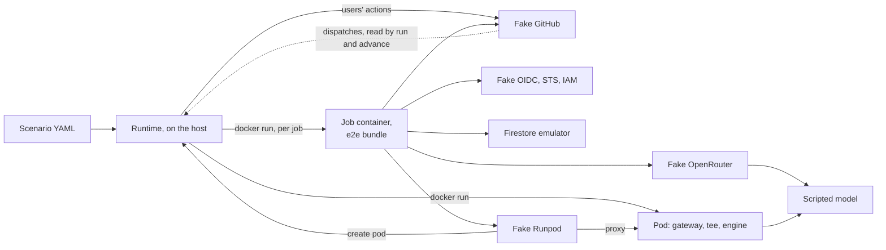

# The end-to-end suite

This page is for whoever changes Codeman and wants to see a [task](../../glossary.md#task) run from a labeled issue to its end on their machine. It says what the suite covers, how to run it, and how to read a failure. [Writing e2e scenarios](scenarios.md) and [the e2e fakes](fakes.md) go further.

## What it covers

Codeman's bundles of the [e2e build](../guide.md#the-e2e-build) run the templates' jobs, one container per job, against local fakes of GitHub, OpenRouter, Runpod, Google and Hugging Face's Hub. The bugs it is for showed only on real repositories; the [plan](../../plans/2026-10-20-end-to-end-test-suite.md#context) lists them.

- **The workflows:** the job order, `if:` rules, matrices and the reusable workflow, read from `templates/codeman.yml` and `codeman-task.yml`. Real outputs and artifacts cross the jobs.
- **The jobs:** in the local runner image, plus `gh`, with the agent's [jail](../../runs/agent.md#the-jail).
- **The agent:** OpenCode itself, downloaded from a local npm cache and checked against its pinned integrity. A scripted model gives its replies.
- **GitHub:** every App token's permissions and every user's collaborator role, enforced. A token the fake did not give fails the scenario.
- **Google:** the OIDC, STS and IAM Credentials path, with its signature, audience and [attribute condition](../../glossary.md#attribute-condition). Firestore's emulator runs Codeman's security rules.
- **Pods:** the [gateway](../../glossary.md#gateway) as a process, in front of real Ollama 0.35.1 or vLLM 0.31.0 on the CPU, with the same tiny model on both.

Each scenario is a YAML file under [`e2e/scenarios/`](../../../e2e/scenarios/happy-path/openrouter-plan-only.yaml). Two exist today, in `happy-path/`. The rest of the catalogue is phase 5 of the plan.

## What it does not cover

- Real OpenRouter, Runpod, Google or GitHub accounts, and anything that costs money.
- vLLM on a GPU, and the production `vllm` image: the e2e vLLM pod uses vLLM's CPU image.
- The model's quality: replies are scripted.
- Real throughput, the proxy's 100-second cut, Runpod's real worker states and billing, and Workload Identity Federation's real behavior.
- arm64 hosts and AVX-512 paths.
- CI: the suite runs only on a developer's machine, with `npm run test:e2e`.

The [plan's out of scope](../../plans/2026-10-20-end-to-end-test-suite.md#out-of-scope) has the reasons.

### What the seams hide

The suite replaces some parts of the real path. What each replacement hides, no scenario can catch.

| Seam | Replaces | Hides |
| --- | --- | --- |
| The [e2e build's](../guide.md#the-e2e-build) redirects | The hosts of OpenRouter, Runpod, Google's STS, IAM Credentials and Firestore, Hugging Face's Hub, and npm, by the fakes' origins | The real services' TLS, DNS and behavior: the fakes follow `docs/web/`, which does not prove the services agree. The published `dist/` differs from the e2e bundle in its wiring |
| The fake Hub | Hugging Face's model information, from the `vllm` profile's model volume | Other models, and private, gated or disabled ones: the fake serves only what the volume holds, as public |
| The fake GitHub | GitHub's API, under `/api/v3` and `/api/graphql` as on GitHub Enterprise Server | github.com's own behavior where it differs from the fake |
| The simulator's emulated actions | `actions/checkout`, `create-github-app-token`, `upload-artifact` and `download-artifact` | The actions' own code, and GitHub's runner. An input the emulation lacks stops the run |
| The tee, in each pod | The agent's chat to the engine | The engine reads a short fixed prompt, not the agent's: real prefill, real context use and parsing of the agent's tool calls go untested |
| The tee's `/api/ps` and pull | Ollama's `size_vram`, and its registry pull | A real GPU's memory, and a pull from the registry |
| The pod launcher | Runpod's machines, and Codeman's pinned pod images | The published images: the e2e images are built locally, with the e2e gateway |

## Before you run it

You need:

- an x86_64 machine: vLLM's CPU image is `linux/amd64` only;
- Docker with Compose, such as Docker Desktop;
- Node.js 24 and `npm ci` ([setup](../guide.md#setup));
- the disk and memory below.

### The first run's downloads

The first run with both profiles downloads about 6.4 GB and stores about 17 GB of images. Later runs download nothing: one-shot seed services check each model's digest and keep it in a named volume.

| Input | Needed by | Measured on the plan's machine |
| --- | --- | --- |
| The fakes', emulator's and job images' bases, the emulator's jar, `gh`, OpenCode | Every scenario | Not measured apart |
| `ollama/ollama:0.35.1` and `qwen2.5:0.5b` | The `ollama` profile | 9.37 GB of image, 35 minutes to pull; 398 MB of model |
| `vllm/vllm-openai-cpu:v0.31.0` and `Qwen/Qwen2.5-0.5B-Instruct` | The `vllm` profile | 6.73 GB of image, 25 minutes to pull; 1.0 GB of model |

> [!NOTE]
> Large pulls can fail midway, with `unexpected EOF`. Run the command again: the seeds retry and resume, and Docker keeps the layers it has.

Each input is pinned and audited in [dependencies](../dependencies.md#the-end-to-end-test-suite).

### Profiles and memory

A scenario's `profiles` field names the pods it needs. The runtime starts the profiles that the selected scenarios name, and refuses to start when Docker's memory is short.

| Profiles | Starts | Docker memory the runtime requires |
| --- | --- | --- |
| None, the default | The fakes, Firestore's emulator, and jobs | 2.5 GiB |
| `ollama` | Also Ollama's model seed, and Ollama pods | 4 GiB |
| `vllm` | Also vLLM's model seed, and a vLLM pod | 8 GiB |
| `ollama` and `vllm` | Both | 9.5 GiB |

A vLLM pod peaks at about 5.5 GiB. Docker Desktop's default of 8 GB shows about 7.8 GB, which is short of what `vllm` requires.

> [!IMPORTANT]
> For the `vllm` profile, set Docker Desktop's memory to 10 GB or more (Settings, Resources). Otherwise the runtime stops before it starts anything: "Docker has … of memory, and the vllm profile needs about …".

A vLLM pod takes 5 to 6 minutes to serve on a CPU. Scenarios run one at a time.

## Run it

1. Run one scenario:

   ```sh
   npm run test:e2e -- happy-path/openrouter-plan-only
   ```

   The runtime builds the e2e bundle, builds the images it lacks, starts the services, and runs the scenario. The output ends with `PASS happy-path/openrouter-plan-only`, its time (34 s on the plan's machine), and `1 passed, 0 failed.`
2. Run more: name tags, directories or files, or nothing for every scenario.
3. Stop the services with your last run's `--down`, or `docker compose -f e2e/infra/compose.yaml --profile ollama --profile vllm down`. The named volumes stay, with the models.

The command exits 1 when a scenario fails or is not run, or when a [known bug's](#known-bugs) scenario passes, and 2 on an unknown option. Ctrl-C makes the scenario running now the last.

| Argument | Selects |
| --- | --- |
| None | Every scenario |
| A bare word, such as `happy-path` | The scenarios with that tag, and those under `e2e/scenarios/<word>/` |
| A path | That file or directory, from the working directory, else from `e2e/scenarios/`; or a scenario's ID, its path there without `.yaml` |
| `--down` | Stops the services after the run |
| `--no-build` | Starts Compose without rebuilding; builds only the missing images |

An argument that matches no scenario is an error, so a typo runs nothing.

> [!NOTE]
> The pod images hold the e2e gateway. With `--no-build`, they keep the gateway of their last build, even after a change to `src/gateway/`.

- **Services stay up** between runs, so the next run starts in seconds. Compose recreates only what changed.
- **Each scenario starts fresh:** every fake is reset, the store is a new Firestore project, and the runtime removes the scenario's containers when it ends. A scenario fails at once if anything of an earlier one is left.
- **The pod launcher** listens on `127.0.0.1`, which Docker Desktop's `host.docker.internal` reaches. `CODEMAN_E2E_LAUNCHER_HOST` sets another address.
- **`e2e/.out/session.json`** keeps the session's control tokens, so the running services stay usable. Both `e2e/.build/` and `e2e/.out/` are ignored by git.

## Read a failure

A failing scenario prints what did not hold, the timeline's last 20 events and the report's path, such as:

```text
[e2e] FAIL happy-path/openrouter-to-done (95.2s)
  expect: i1: labels codeman:done
  - i1 lacks the label codeman:done; it has codeman, codeman:blocked.

  The timeline's last 20 events:
     90.1s  job        #1 / Agent (code): failure
  ...
  The report: e2e/.out/happy-path/openrouter-to-done/
```

The report replaces the scenario's last one. A passing scenario leaves only `timeline.txt` and `jobs/`.

| File | Holds |
| --- | --- |
| `README.md` | The failure's message, and this list |
| `timeline.txt`, `timeline.json` | Every event, oldest first, with seconds since the start: `action`, `event`, `run`, `job`, `dispatch`, `pod`, `expect` |
| `jobs/` | Each job's log, as `<order>-run<id>-<job>.log` |
| `fakes/` | Each fake's lists, as `<fake>-<list>.json`: the requests it got, GitHub's events and dispatches, OpenRouter's keys, the model's turns |
| `store.json` | The store's documents, by path: the organizations' runs and events, and their pools' pods, board, batches and Serverless endpoints' runs |
| `engine.json` | Each pod's gateway status, engine status and last 300 log lines |
| `violations.json` | What the fakes refused: tokens they did not give, model requests no script covers |

To find the cause:

1. Read the failure's first lines. They name the check and what the fakes hold instead.
2. In `timeline.txt`, find the first job or run that did not end as expected.
3. Read that job's log in `jobs/`. Codeman's own messages say why it stopped.
4. Check `violations.json`. A violation fails the scenario at its end, even when every `expect` held.
5. For a request a fake answered badly, read `fakes/<fake>-requests.json`.

### Known bugs

A scenario tagged `known-bug` reproduces a bug of Codeman that is not fixed yet. Its file's first comment says what the bug is.

- It runs like any other, and is reported apart, at the summary's end: `reproduced` when it fails, as expected.
- Its failure does not fail the run. Its pass does, as `PASSES`: the bug looks fixed, so remove the tag.

## Under act

> [!NOTE]
> This section is completed in phase 6 of the [plan](../../plans/2026-10-20-end-to-end-test-suite.md#phase-6-act-smoke-scenarios). The act driver does not exist yet: the runtime refuses a scenario with `runner: act` before it starts anything, and names it.

In phase 6, act 0.2.89 runs two smoke scenarios on the real templates, on success paths only. Its audit and limits are in [dependencies](../dependencies.md#act).

> [!WARNING]
> When no `GITHUB_TOKEN` secret is given, act injects the developer's real GitHub token into the jobs, from `gh auth token`. It also clones an action missing from its cache with that secret as the password, from github.com by default. The driver always passes a fake token, and its own env, secret and variable files, from an empty directory, in offline mode, with every pinned action checked in its cache before act starts.

## How it works



1. `npm run test:e2e` ([`e2e/runtime/main.ts`](../../../e2e/runtime/main.ts)) loads and validates the scenarios, refuses those whose runner it lacks, checks Docker's memory, and runs `npm run build:e2e`.
2. The session ([`session.ts`](../../../e2e/runtime/session.ts)) builds the images, runs `docker compose up --wait` with the profiles, and opens the pod launcher.
3. For each scenario, it builds the world on the fakes: users, repositories with the templates, the App, the Google side and the agent's script.
4. The scenario's actions run in order ([`run.ts`](../../../e2e/runtime/run.ts)). A `run` or an `advance` hands an event to the workflow simulator, which runs each job in its own container on the internal jobs network. A cancelled or timed-out step's processes get SIGINT, then SIGTERM after 7.5 seconds, then SIGKILL 2.5 seconds later, as GitHub's runner sends them; the container stays, so the job's `always()` steps run.
5. A pod the fake Runpod creates goes to the launcher, which runs the local image its allowlist maps the pinned image to.
6. `expect`, `wait` and `advance` read the fakes and the store ([`expect.ts`](../../../e2e/runtime/expect.ts)). At the end, any violation fails the scenario, and a failure writes the report ([`report.ts`](../../../e2e/runtime/report.ts)).

Each job container gets `--init`, `SYS_ADMIN`, unconfined seccomp and AppArmor, as the [local runner](../local-actions.md#run-the-tests) does, and 3 GiB of memory. The fakes get 192 MiB each, the fake GitHub 384 MiB, and the emulator 1 GiB. No container gets the Docker socket.
