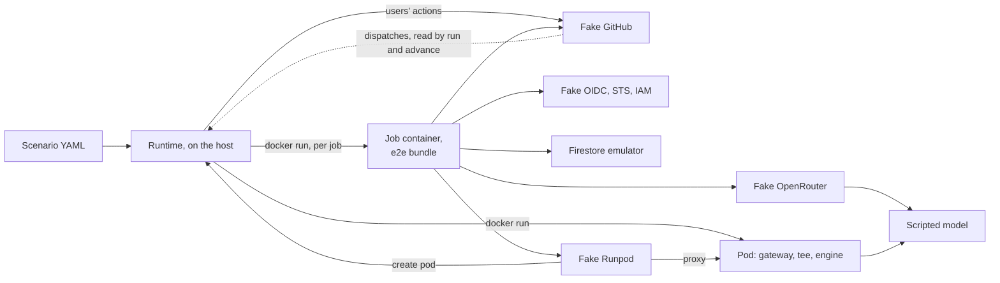

# The end-to-end suite

This page is for whoever changes Codeman and wants to see a [task](../../glossary.md#task) run from a labeled issue to its end on their machine. It says what the suite covers, how to run it, and how to read a failure. [Writing e2e scenarios](scenarios.md) and [the e2e fakes](fakes.md) go further.

## What it covers

Codeman's bundles of the [e2e build](../guide.md#the-e2e-build) run the templates' jobs, one container per job, against local fakes of GitHub, OpenRouter, Runpod, Google and Hugging Face's Hub. The bugs it is for showed only on real repositories; the [plan](../../plans/2026-10-20-end-to-end-test-suite.md#context) lists them.

- **The workflows:** the job order, `if:` rules, matrices and the reusable workflow, read from `templates/codeman.yml` and `codeman-task.yml`. Real outputs and artifacts cross the jobs.
- **The jobs:** in the local runner image, plus `gh`, with the agent's [jail](../../runs/agent.md#the-jail).
- **The agent:** OpenCode itself, downloaded from a local npm cache and checked against its pinned integrity. A scripted model gives its replies.
- **GitHub:** every App token's permissions and every user's collaborator role, enforced. A token the fake did not give fails the scenario. The fake lists each token with the template job that asked for it, so a scenario checks that each job's token holds only what the template declares (`security/token-permissions`).
- **Google:** the OIDC, STS and IAM Credentials path, with its signature, audience and [attribute condition](../../glossary.md#attribute-condition). Firestore's emulator runs Codeman's security rules.
- **Pods:** the [gateway](../../glossary.md#gateway) as a process, in front of real Ollama 0.35.1 or vLLM 0.31.0 on the CPU, with the same tiny model on both.

Each scenario is a YAML file under [`e2e/scenarios/`](../../../e2e/scenarios/happy-path/openrouter-plan-only.yaml), by subject: `happy-path/`, `pods/`, `serverless/`, `parallel/`, `pools/`, `budgets/`, `failures/`, `commands/` and `security/` today. The catalogue is phase 5 of the [plan](../../plans/2026-10-20-end-to-end-test-suite.md#phase-5-the-scenario-catalogue).

## What it does not cover

- Real OpenRouter, Runpod, Google or GitHub accounts, and anything that costs money.
- vLLM on a GPU, and the production `vllm` image: the e2e vLLM pod uses vLLM's CPU image.
- The model's quality: replies are scripted.
- Real throughput, the proxy's 100-second cut, Runpod's real worker states and billing, and Workload Identity Federation's real behavior.
- arm64 hosts and AVX-512 paths.
- CI: the suite runs only on a developer's machine, with `npm run test:e2e`.

The [plan's out of scope](../../plans/2026-10-20-end-to-end-test-suite.md#out-of-scope) has the reasons.

### What the seams hide

The suite replaces some parts of the real path. What each replacement hides, no scenario can catch.

| Seam | Replaces | Hides |
| --- | --- | --- |
| The [e2e build's](../guide.md#the-e2e-build) redirects | The hosts of OpenRouter, Runpod, Google's STS, IAM Credentials and Firestore, Hugging Face's Hub, and npm, by the fakes' origins | The real services' TLS, DNS and behavior: the fakes follow `docs/web/`, which does not prove the services agree. The published `dist/` differs from the e2e bundle in its wiring |
| The fake Hub | Hugging Face's model information, from the `vllm` profile's model volume | Other models, and private, gated or disabled ones: the fake serves only what the volume holds, as public |
| The fake GitHub | GitHub's API, under `/api/v3` and `/api/graphql` as on GitHub Enterprise Server | github.com's own behavior where it differs from the fake |
| The simulator's emulated actions | `actions/checkout`, `create-github-app-token`, `upload-artifact` and `download-artifact` | The actions' own code, and GitHub's runner. An input the emulation lacks stops the run |
| act, for the scenarios [under act](#under-act) | GitHub's runner, with the actions' own code | What [act's limits](#acts-limits) list |
| The tee, in each pod | The agent's chat to the engine | The engine reads a short fixed prompt, not the agent's: real prefill, real context use and parsing of the agent's tool calls go untested |
| The tee's `/api/ps` and pull | Ollama's `size_vram`, and its registry pull | A real GPU's memory, and a pull from the registry |
| The pod launcher | Runpod's machines, and Codeman's pinned pod images | The published images: the e2e images are built locally, with the e2e gateway |
| The simulator's masks | GitHub's runner's, which hide each secret a step registers and skip each job output holding one | The fake Google's access token, `owner`, the one the Firestore emulator takes as an admin: Codeman masks it, but the simulator does not, since a real token is random and a common word would hide every output with it, such as `select`'s `dispatches`. A log that printed the token would not show it masked |

## Before you run it

You need:

- an x86_64 machine: vLLM's CPU image is `linux/amd64` only;
- Docker with Compose, such as Docker Desktop;
- Node.js 24 and `npm ci` ([setup](../guide.md#setup));
- the disk and memory below.

### The first run's downloads

The first run with both profiles downloads about 6.4 GB and stores about 17 GB of images. Later runs download nothing: one-shot seed services check each model's digest and keep it in a named volume.

| Input | Needed by | Measured on the plan's machine |
| --- | --- | --- |
| The fakes', emulator's and job images' bases, the emulator's jar, `gh`, OpenCode | Every scenario | Not measured apart |
| `ollama/ollama:0.35.1` and `qwen2.5:0.5b` | The `ollama` profile | 9.37 GB of image, 35 minutes to pull; 398 MB of model |
| `vllm/vllm-openai-cpu:v0.31.0` and `Qwen/Qwen2.5-0.5B-Instruct` | The `vllm` profile | 6.73 GB of image, 25 minutes to pull; 1.0 GB of model |

> [!NOTE]
> Large pulls can fail midway, with `unexpected EOF`. Run the command again: the seeds retry and resume, and Docker keeps the layers it has.

Each input is pinned and audited in [dependencies](../dependencies.md#the-end-to-end-test-suite).

### Profiles and memory

A scenario's `profiles` field names the pods it needs. The runtime starts the profiles that the selected scenarios name. Scenarios run one at a time, so each scenario needs its own profiles' memory: the runtime refuses to start when Docker's memory is short of any selected scenario's, and names each such scenario.

| A scenario's profiles | Starts | Docker memory the runtime requires |
| --- | --- | --- |
| None, the default | The fakes, Firestore's emulator, and jobs | 2.5 GiB |
| `ollama` | Also Ollama's model seed, and Ollama pods | 4 GiB |
| `vllm` | Also vLLM's model seed, and a vLLM pod | 8 GiB |

A vLLM pod peaks at about 5.5 GiB. Docker Desktop's default of 8 GB shows about 7.8 GB, which is short of what `vllm` requires. The only `vllm` scenario, `parallel/vllm-two-seats`, peaked at 6.3 to 7.0 GiB of containers on a VM of 9.7 GiB: the pod at 4.5 to 5.2 GiB, two agent jobs at about 0.65 GiB each, the emulator and the fakes.

The largest `ollama` scenario, `parallel/four-tasks-one-pod`, peaks at about 5.6 GiB of containers: four agent jobs of about 0.75 GiB each, the pod at 2.1 GiB, the emulator at 0.3 GiB and the fakes. Five agent jobs and two pods, about 8.5 GiB, would not fit in 7.8 GB.

> [!IMPORTANT]
> For the `vllm` profile, set Docker Desktop's memory to 10 GB or more (Settings, Resources). Otherwise a run that selects a vLLM scenario, such as `npm run test:e2e -- parallel`, stops before it starts anything: "Docker has 7.7 GiB of memory, too little for a scenario: parallel/vllm-two-seats needs about 8.0 GiB, with the vllm profile. …". Select the other scenarios by name or tag to run them.

A vLLM pod takes 5 to 6 minutes to serve on a CPU. Scenarios run one at a time.

## Run it

1. Run one scenario:

   ```sh
   npm run test:e2e -- happy-path/openrouter-plan-only
   ```

   The runtime builds the e2e bundle, builds the images it lacks, starts the services, and runs the scenario. The output ends with `PASS happy-path/openrouter-plan-only`, its time (34 s on the plan's machine), and `1 passed, 0 failed.`
2. Run more: name tags, directories or files, or nothing for every scenario.
3. Stop the services with your last run's `--down`, or `docker compose -f e2e/infra/compose.yaml --profile ollama --profile vllm down`. The named volumes stay, with the models.

The command exits 1 when a scenario fails or is not run, or when a [known bug's](#known-bugs) scenario passes, and 2 on an unknown option. Ctrl-C makes the scenario running now the last.

| Argument | Selects |
| --- | --- |
| None | Every scenario |
| A bare word, such as `happy-path` | The scenarios with that tag, and those under `e2e/scenarios/<word>/` |
| A path | That file or directory, from the working directory, else from `e2e/scenarios/`; or a scenario's ID, its path there without `.yaml` |
| `--down` | Stops the services after the run |
| `--no-build` | Starts Compose without rebuilding; builds only the missing images |

An argument that matches no scenario is an error, so a typo runs nothing.

> [!NOTE]
> The pod images hold the e2e gateway. With `--no-build`, they keep the gateway of their last build, even after a change to `src/gateway/`.

- **Services stay up** between runs, so the next run starts in seconds. Compose recreates only what changed.
- **Each scenario starts fresh:** every fake is reset, the store is a new Firestore project, and the runtime removes the scenario's containers when it ends. A scenario fails at once if anything of an earlier one is left.
- **The pod launcher** listens on `127.0.0.1`, which Docker Desktop's `host.docker.internal` reaches. `CODEMAN_E2E_LAUNCHER_HOST` sets another address.
- **`e2e/.out/session.json`** keeps the session's control tokens, so the running services stay usable. Both `e2e/.build/` and `e2e/.out/` are ignored by git.

## Read a failure

A failing scenario prints what did not hold, the timeline's last 20 events and the report's path, such as:

```text
[e2e] FAIL happy-path/openrouter-to-done (95.2s)
  expect: i1: labels codeman:done
  - i1 lacks the label codeman:done; it has codeman, codeman:blocked.

  The timeline's last 20 events:
     90.1s  job        #1 / Agent (code): failure
  ...
  The report: e2e/.out/happy-path/openrouter-to-done/
```

The report replaces the scenario's last one. A passing scenario leaves only `timeline.txt` and `jobs/`.

| File | Holds |
| --- | --- |
| `README.md` | The failure's message, and this list |
| `timeline.txt`, `timeline.json` | Every event, oldest first, with seconds since the start: `action`, `event`, `run`, `job`, `dispatch`, `pod`, `expect` |
| `jobs/` | Each job's log, as `<order>-run<id>-<job>.log` |
| `fakes/` | Each fake's lists, as `<fake>-<list>.json`: the requests it got, GitHub's events and dispatches, OpenRouter's keys, the model's turns |
| `store.json` | The store's documents, by path: the organizations' runs and events, and their pools' pods, board, batches and Serverless endpoints' runs |
| `engine.json` | Each live pod's gateway status, engine status, tee's view and last 300 log lines; a terminated pod's last status, read before its container was removed |
| `violations.json` | What the fakes refused: tokens they did not give, model requests no script covers |

To find the cause:

1. Read the failure's first lines. They name the check and what the fakes hold instead.
2. In `timeline.txt`, find the first job or run that did not end as expected.
3. Read that job's log in `jobs/`. Codeman's own messages say why it stopped.
4. Check `violations.json`. A violation fails the scenario at its end, even when every `expect` held.
5. For a request a fake answered badly, read `fakes/<fake>-requests.json`.

### Known bugs

A scenario tagged `known-bug` reproduces a bug of Codeman that is not fixed yet. Its file's first comment says what the bug is.

- It runs like any other, and is reported apart, at the summary's end: `reproduced` when it fails, as expected.
- Its failure does not fail the run. Its pass does, as `PASSES`: the bug looks fixed, so remove the tag.

## Under act

act 0.2.89 runs the smoke scenarios on Codeman's real templates, on success paths only: `pods/ollama-keep-and-release.act` and `security/set-env-in-agent-output.act`. They are the act variants of files that name both runners ([writing scenarios](scenarios.md#under-act)). act's audit is in [dependencies](../dependencies.md#act).

> [!WARNING]
> When no `GITHUB_TOKEN` secret is given, act injects the developer's real GitHub token into the jobs, from `gh auth token`. It also clones an action missing from its cache with that secret as the password, from github.com by default. The driver always passes a fake token, and its own env, secret and variable files, from an empty directory, in offline mode, with every pinned action checked in its cache before act starts.

### Run them

1. Install act 0.2.89 ([dependencies](../dependencies.md#act)). The runtime takes the first `act` on the `PATH`, or `CODEMAN_E2E_ACT`, and refuses another version.
2. Fill act's action cache, once:

   ```sh
   node e2e/runtime/act/fill-cache.ts
   ```

   It clones the four actions the templates pin into `e2e/.out/act/actions/`, from github.com, anonymously: git runs with no user or system configuration, so no credential helper, and no prompt. `--from actions/checkout=<dir>` takes a local clone instead. Each clone is checked out at its pinned commit, and its `origin` is the fake GitHub's, as act requires of a cached action.
3. Run them:

   ```sh
   npm run test:e2e -- act
   ```

   The tag `act` selects every act scenario. On the plan's machine, `pods/ollama-keep-and-release.act` takes about 5.5 minutes and `security/set-env-in-agent-output.act` about 5, against 2.5 for the simulator's `security/set-env-in-agent-output`: act starts a container per job and copies the workspace and each action into it.

The runtime refuses, before it starts anything, a scenario under act that faults a job or `apply`, and stops a run when act's cache lacks a pinned action, naming the command above. It also stops when a Docker volume `act-toolcache` exists that it did not make: act mounts that volume on `/opt/hostedtoolcache` in every job, where it would hide the job image's Node. Remove it with `docker volume rm act-toolcache` if nothing of yours needs it.

### How the driver runs act

Each event, schedule and dispatch is one `act <event> --eventpath <payload>` invocation ([`e2e/runtime/act/`](../../../e2e/runtime/act/runner.ts)), on the repository's workflow files at the run's commit. The fake GitHub's dispatches, from `next-run` or `gh workflow run`, become the next `act workflow_dispatch`, with their inputs.

| What | How |
| --- | --- |
| The token | `-s GITHUB_TOKEN=<the fake's token for the run>`, always. act's process gets a `PATH` with no `gh`, and a home, configuration, cache and temporary directory in `e2e/.out/act/`, with nothing of the runtime's environment |
| The files | `--env-file`, `--secret-file` and `--var-file`, JSON read as YAML, and the event, written outside the working directory, which act copies into every job. The working directory is a new temporary directory with `.github/workflows/` only; the driver refuses any other entry, such as `.env`, `.secrets`, `.vars`, `.input` or `.actrc` |
| The run | `GITHUB_RUN_ID`, `GITHUB_RUN_ATTEMPT` and `GITHUB_RUN_NUMBER` of the fake's run, and `GITHUB_REPOSITORY`, `GITHUB_REF` and `SHA_REF`, act's name for `github.sha` |
| GitHub | `--env` `GITHUB_SERVER_URL`, `GITHUB_API_URL` and `GITHUB_GRAPHQL_URL`, on `https://github-e2e.localhost` at its fixed address; the driver refuses any other host, and never passes `--github-instance`. `GH_HOST`, and `GH_ENTERPRISE_TOKEN` in the env file |
| Artifacts | The fake GitHub's artifact API: `ACTIONS_RESULTS_URL` and the run's runtime token. act's own artifact server never starts (no `--artifact-server-path`), its cache server neither (`--no-cache-server`), and both addresses are `127.0.0.1` |
| OIDC | `ACTIONS_ID_TOKEN_REQUEST_URL`, and a request token per invocation, with the run's claims |
| Actions | `--action-cache-path e2e/.out/act/actions/ --action-offline-mode`, every pin checked first; `--no-skip-checkout`, so `actions/checkout` runs against the fake |
| Codeman's action | The e2e bundle, `action.yml` and the files beside it are Codeman's repository on the fake GitHub, at `CODEMAN_COMMIT_SHA`: the templates' own checkout then `uses: ./.codeman/action` run it. `--local-repository` would not apply: it replaces `uses: <owner>/<repo>@<ref>` actions, and the templates check Codeman out instead |
| The jobs | `-P ubuntu-latest=codeman-e2e-runner:local --pull=false --rm`, the jobs network, `--container-daemon-socket -`, and `--container-options` with `--init`, `SYS_ADMIN`, seccomp and AppArmor unconfined, the CA's volume, 3 GiB and the scenario's labels |
| The CA | act replaces the image's entry point, which installs the CA: `GIT_SSL_CAINFO` for git and `SSL_CERT_DIR` for `gh`; Node has `NODE_EXTRA_CA_CERTS` from the image |
| `RUNNER_TEMP` | `/tmp`, which `${{ runner.temp }}` is under act whatever `RUNNER_TEMP` says, so the templates' artifact paths and Codeman's agree |
| One at a time | Invocations queue, so per repository too: act ignores `concurrency`. Before each, the driver makes a new `act-toolcache` volume, labeled as its own |
| act's notices | `ACT_DISABLE_VERSION_CHECK=1`, or act asks `api.nektosact.com` at each start |

### act's limits

Where act differs from GitHub in a way a scenario cannot avoid. Each is from act's source at 0.2.89, in `docs/web/nektos/`.

| act | On the templates | So |
| --- | --- | --- |
| A failed job inside a reusable workflow stops the whole run | `next-run` and every `always()` job after a failed task never start | Failure scenarios run on the simulator only |
| A skipped job's outputs are their unevaluated text, such as `${{ steps.codeman.outputs.handle }}` ([expression.go](../../web/nektos/act-pkg-runner-expression-go-at-4f41128.md)) | A run that skips `open-key`, such as the one that records a decision's answer, runs `close-key` with that text as the handle; it fails, which stops the run | No scenario with decisions to answer runs under act: `happy-path/openrouter-to-done` stays on the simulator |
| It evaluates a job's `strategy.matrix` before its `if:` ([runner.go](../../web/nektos/act-pkg-runner-runner-go-at-4f41128.md)) | A run whose `select` is skipped, or picks nothing, leaves `tasks` unset: act stops with exit code 1, "Error while evaluating matrix", as it plans the `task` job | A run in which no job ran counts as skipped, as on GitHub; one where `select` ran then fails. The timeline keeps act's error |
| It ignores `permissions` | Every job of a run gets the one `GITHUB_TOKEN`, with the union of the jobs' permissions (`actions: write`, `contents: read`), and `GH_ENTERPRISE_TOKEN` in every step | `security/token-permissions` runs on the simulator only |
| No OIDC of its own | One request token per invocation: a called workflow's jobs have the caller's `job_workflow_ref` | The fake's attribute condition reads `workflow_ref`, the same on both |
| It ignores `concurrency` and `timeout-minutes` | The `codeman` group never queues or replaces a run | The driver runs one invocation at a time |
| `${{ runner.temp }}` is `/tmp`, whatever `RUNNER_TEMP` says | The job's temporary files are in `/tmp`, not under the runner's work directory | The jail mounts a new `/tmp` for the agent, so it still sees none of them; the sandbox's own tests were not run under act |
| The workspace is the working directory's host path | Not `/home/runner/work/<repo>/<repo>` | – |
| `act-toolcache` is shared by the jobs of a run, and world-writable | What a job writes in `/opt/hostedtoolcache` reaches the run's later jobs; on GitHub each job has its own machine | A new volume per invocation keeps runs apart |
| Skipped jobs are logged at the debug level only | The report's `jobs/` holds the jobs that ran, and `act.log` per run with act's command and its own lines | – |

## How it works



1. `npm run test:e2e` ([`e2e/runtime/main.ts`](../../../e2e/runtime/main.ts)) loads and validates the scenarios, refuses an act scenario that faults a job, checks Docker's memory, and runs `npm run build:e2e`.
2. The session ([`session.ts`](../../../e2e/runtime/session.ts)) builds the images, runs `docker compose up --wait` with the profiles, and opens the pod launcher.
3. For each scenario, it builds the world on the fakes: users, repositories with the templates, the App, the Google side and the agent's script.
4. The scenario's actions run in order ([`run.ts`](../../../e2e/runtime/run.ts)). A `run` or an `advance` hands an event to the workflow simulator, or to act's driver ([under act](#under-act)), which runs each job in its own container on the internal jobs network. A cancelled or timed-out step's processes get SIGINT, then SIGTERM after 7.5 seconds, then SIGKILL 2.5 seconds later, as GitHub's runner sends them; the container stays, so the job's `always()` steps run.
5. A pod the fake Runpod creates goes to the launcher, which runs the local image its allowlist maps the pinned image to.
6. `expect`, `wait` and `advance` read the fakes and the store ([`expect.ts`](../../../e2e/runtime/expect.ts)). At the end, any violation fails the scenario, and a failure writes the report ([`report.ts`](../../../e2e/runtime/report.ts)).

Each job container gets `--init`, `SYS_ADMIN`, unconfined seccomp and AppArmor, as the [local runner](../local-actions.md#run-the-tests) does, and 3 GiB of memory. The fakes get 192 MiB each, the fake GitHub 384 MiB, and the emulator 1 GiB. No container gets the Docker socket.
