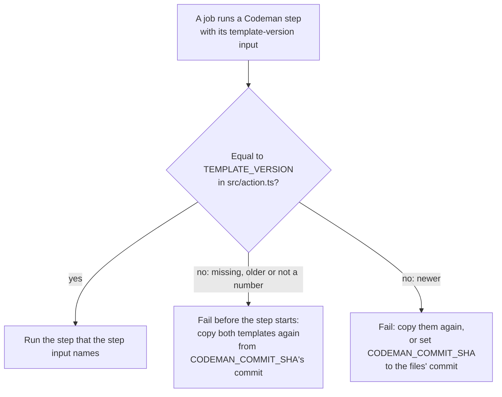
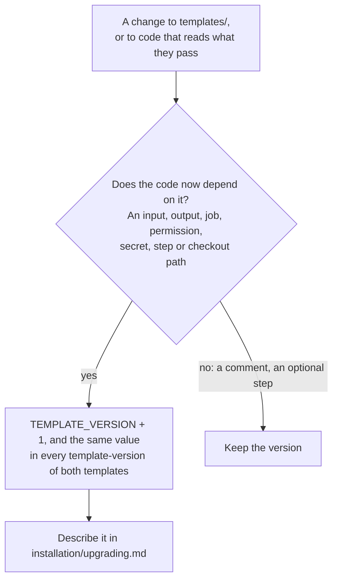
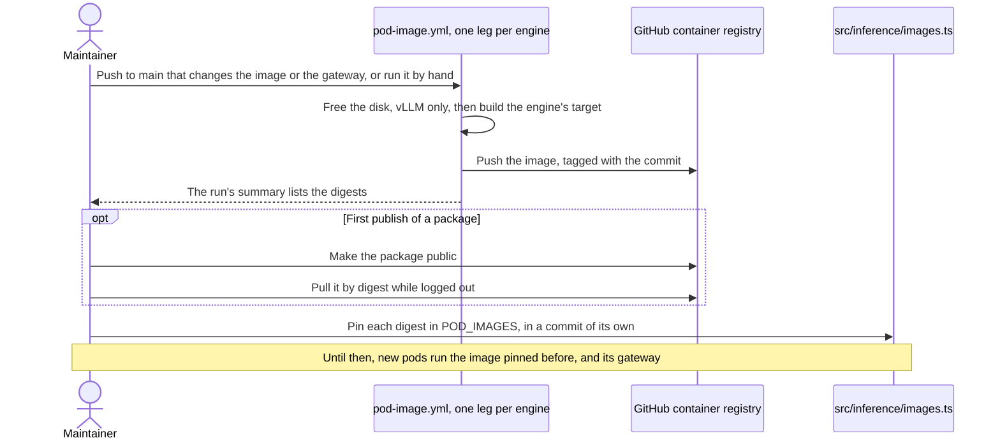
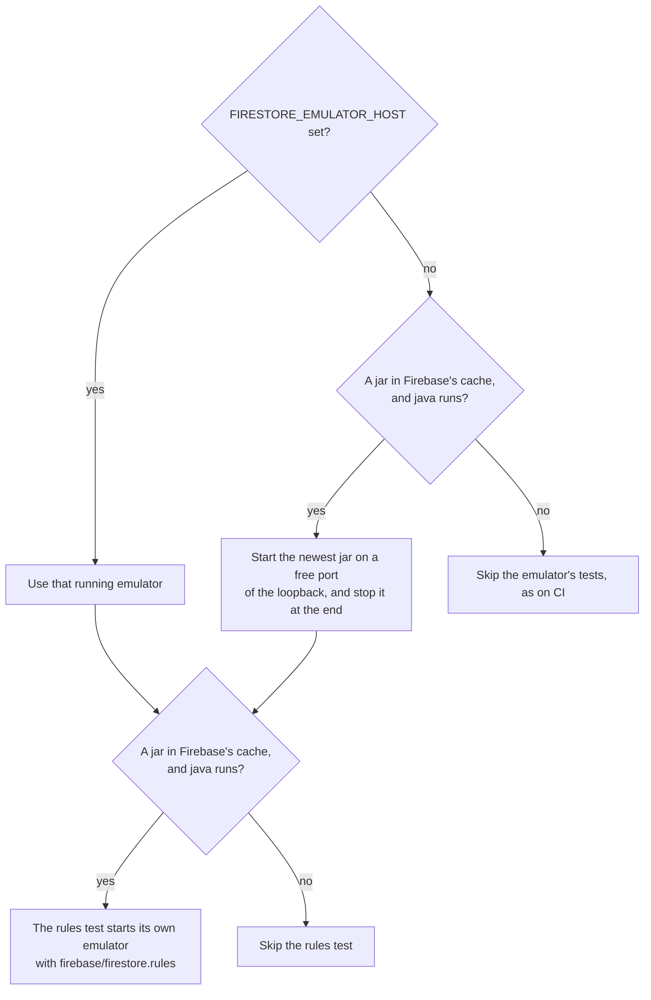

# Development

This page is for whoever changes Codeman itself: how to build and test it, where the code lives, and how a change reaches the repositories that run it.

## Setup

Codeman requires Node.js 24 (see `.nvmrc`).

```sh
npm ci          # install exact versions from package-lock.json, without install scripts
npm run check   # lint, type check, test and build
```

## Scripts

| Script | What it does |
| --- | --- |
| `npm run lint` | Biome lint and format check |
| `npm run format` | Apply Biome fixes and formatting |
| `npm run typecheck` | `tsc`, no output |
| `npm test` | `node:test` on `src/**/*.test.ts`, and on `e2e/**/*.test.ts`, the e2e suite's fakes, which need no Docker; see [tests](#tests) |
| `npm run test:runner` | `npm ci`, then `npm test` with the sandbox test, in a local stand-in for GitHub's runner; `npm run test:runner -- <command>` runs another command there. Needs Docker; see [running Actions locally](local-actions.md) |
| `npm run build` | Bundle `src/index.ts` into `dist/index.js`, and the [gateway](../glossary.md#gateway), `src/gateway/main.ts`, into `dist/gateway.js` |
| `npm run build:e2e` | The same bundles, into `e2e/.build/`, with the [e2e build's](#the-e2e-build) redirects |
| `npm run test:e2e` | The [end-to-end suite](../plans/2026-10-20-end-to-end-test-suite.md): `npm run build:e2e`, its services with Docker Compose (kept running; `--down` stops them), then the scenarios one at a time; `-- <paths or tags>` selects some. A failure's report goes to `e2e/.out/<scenario>/`. Needs Docker |
| `npm run check` | Lint, type check, test and build, in that order |

### The e2e build

The [end-to-end suite](../plans/2026-10-20-end-to-end-test-suite.md) runs the bundles of `npm run build:e2e`, which reach its fakes instead of the real services. [`src/e2e.ts`](../../src/e2e.ts) reads `CODEMAN_E2E_ENDPOINTS`, a JSON object of the fakes by key; each value is an origin, such as `http://fake:8080`, and the requests keep their paths.

| Key | Replaces |
| --- | --- |
| `openRouter` | `https://openrouter.ai`: the management API, and OpenCode's `openrouter` provider |
| `runpod` | `https://api.runpod.io`, Runpod's REST API |
| `runpodPods` | A pod's URL, `https://{id}-{port}.proxy.runpod.net`; this value is a URL with `{id}` and `{port}` |
| `runpodServerless` | `https://api.runpod.ai`: the Serverless queues, and the origin the `endpoint` setting accepts |
| `huggingFace` | `https://huggingface.co` |
| `npm` | `https://registry.npmjs.org`, where OpenCode is downloaded; its pinned integrity is still checked |
| `googleSts`, `googleIamCredentials`, `firestore` | Google's STS, IAM Credentials and Firestore |

The e2e pod images run the gateway's e2e bundle, `e2e/.build/gateway.js`, so a pod that terminates itself reaches the fake Runpod through `runpod` ([decision 11](../plans/2026-10-20-end-to-end-test-suite.md#answered-after-the-spikes)). Like `e2e/.build/index.js`, it refuses to start without `CODEMAN_E2E_ENDPOINTS`; the images set it to the fake Runpod's origin on the suite's network.

> [!IMPORTANT]
> The published `dist/` never redirects: `npm run build` sets `__CODEMAN_E2E__` to `false`, so esbuild drops the code that reads the variable, and the build fails if `dist/` names `CODEMAN_E2E`.

## Tests

Tests sit next to the code they test, as `*.test.ts`. Most run everywhere. These depend on the machine or check the repository itself:

| Test | Runs when | Skipped when |
| --- | --- | --- |
| [`src/sandbox.test.ts`](../../src/sandbox.test.ts), the [sandbox](../glossary.md#sandbox) | Its tests that run the agent: on Linux, with `CODEMAN_SANDBOX_TEST=1`. They create a system user, run the agent's [jail](../runs/agent.md#the-jail), and need passwordless `sudo` and the right to create namespaces, like GitHub's Linux runners. CI sets the variable, and so does `npm run test:runner` ([running Actions locally](local-actions.md)). Its other tests, the jail's arguments and setup among them, run everywhere | On any other system, or without the variable |
| [`src/store/emulator.test.ts`](../../src/store/emulator.test.ts), the [store](../glossary.md#store) on Firestore's emulator | An emulator is running, or one is in Firebase's cache; see [Firestore's emulator](#firestores-emulator) | Neither is there, as on CI |
| [`e2e/fakes/google/emulator.test.ts`](../../e2e/fakes/google/emulator.test.ts), the fake Google's token on Firestore's emulator, past the security rules | The emulator is in Firebase's cache, with Java | It is not, as on CI |
| [`src/docs.test.ts`](../../src/docs.test.ts), the links | Always | Never |
| [`src/webdocs.test.ts`](../../src/webdocs.test.ts), the format of `docs/web/` | Always | Never |

- **`src/docs.test.ts`** checks each relative link in `README.md`, `AGENTS.md` and `docs/`, but not in full copies of third-party pages. It also checks each `docs/<path>.md#<anchor>` named in `src/`, `templates/`, `docker/` and `action.yml`, and the templates' URLs under `github.com/codenergy-dev/codeman/blob/main/`. Each must name a file that exists, and its anchor a heading of that file. It reads tracked and new files, never ignored ones or `logs/`.
- **`src/webdocs.test.ts`** checks that each page of `docs/web/` follows the format that `AGENTS.md` sets ("Third-party documentation").
- Other tests read specific pages of `docs/`: they are listed in [tests that read the docs](documentation.md#tests-that-read-the-docs).

## What CI checks

[`.github/workflows/ci.yml`](../../.github/workflows/ci.yml) runs on every push to `main` and every pull request. Its one job, `check`, has `contents: read` and 10 minutes, on `ubuntu-latest`:

1. Check out the repository, without keeping its credentials.
2. Set up the Node.js version of `.nvmrc`, with no package cache.
3. `npm ci`.
4. `npm run lint`.
5. `npm run typecheck`.
6. `npm test`, with `CODEMAN_SANDBOX_TEST=1`, so the sandbox test runs.
7. `npm run build`.
8. Fail when `dist/` differs from what the build wrote: "dist/ is out of date. Run 'npm run build' and commit the result."

CI has no Firestore emulator, so the emulator's tests are skipped there. The pod images have a workflow of their own; see [pod images](#pod-images).

## Source layout

### Entry points and steps

[`src/index.ts`](../../src/index.ts) is the action's entry point. It creates the GitHub Actions runtime and calls `run` in [`src/main.ts`](../../src/main.ts) with `gitHubServices`. `run` checks the [template version](#template-version), then runs the step its `step` input names, from `STEPS`.

Each of the six workflow jobs runs one step, in five modules of `src/steps/`:

| Job | Module | Function |
| --- | --- | --- |
| `select` | [`src/steps/select.ts`](../../src/steps/select.ts) | `select` |
| `open-key` | [`src/steps/keys.ts`](../../src/steps/keys.ts) | `openKey` |
| `agent` | [`src/steps/agent.ts`](../../src/steps/agent.ts) | `agent` |
| `apply` | [`src/steps/apply.ts`](../../src/steps/apply.ts) | `apply` |
| `close-key` | [`src/steps/keys.ts`](../../src/steps/keys.ts) | `closeKey` |
| `release-pod` | [`src/steps/keys.ts`](../../src/steps/keys.ts) | `release` |

The steps share [`src/steps/common.ts`](../../src/steps/common.ts). What each job does is in [jobs](../runs/runs-and-jobs.md#jobs).

Each step takes `Services` ([`src/services.ts`](../../src/services.ts)), which has eight members:

| Member | Gives |
| --- | --- |
| `runtime` | The runtime the step runs in |
| `conventions` | The platform's conventions |
| `platform(access)` | The platform's API: with the `workflow-token` input for `workflows` access, else with `github-token` |
| `ci()` | Its CI's results |
| `inference()` | The [inference provider](../glossary.md#inference-provider) |
| `accounts()` | The providers' accounts that the budgets read |
| `store()` | The store of the [backend](../glossary.md#backend) |
| `ledger(job, pool)` | The job's [ledger](../glossary.md#ledger) |

The gateway has its own entry point, [`src/gateway/main.ts`](../../src/gateway/main.ts), bundled into `dist/gateway.js`. It runs in Codeman's pod images and in the agent job, and uses Node's modules only.

### Interfaces and adapters

| Interface | Directory | Adapters | Doc |
| --- | --- | --- | --- |
| `Platform`, `CiResults`, `Conventions` | [`src/platform/`](../../src/platform/) | A directory each, such as `src/platform/github/` | [Platforms](platforms.md) |
| `Runtime` | [`src/runtime/`](../../src/runtime/) | `src/runtime/github-actions.ts` | [Platforms](platforms.md) |
| `Harness` | [`src/harness/`](../../src/harness/) | `src/harness/opencode.ts` | [Agent harness](dependencies.md#agent-harness-opencode) |
| `InferenceProvider`, `GpuProvider`, `InferenceEngine` | [`src/inference/`](../../src/inference/) | OpenRouter, Runpod, Ollama, vLLM | [Self-hosted inference](../inference/self-hosted.md) |
| `Store` | [`src/store/`](../../src/store/) | Firestore, and memory for tests | [The store](../backend/backend.md#the-store) |

- Only runtime adapters import `@actions/core`.
- To add a [harness](../glossary.md#harness), implement `install` and `command`, and register it in `src/harness/index.ts`.
- To add a platform, see what an adapter must guarantee in [platforms](platforms.md).
- [`src/testing/`](../../src/testing/) holds the fakes that tests pass as `Services`: an in-memory platform unlike GitHub, its CI, a runtime that keeps what steps report, an inference provider, and a GPU cloud with its pods' gateways. It also reads the example settings of [profiles](../settings/profiles.md#example), which the tests run. See [platforms](platforms.md#how-steps-get-them).

### Other modules

| Concern | Modules | Doc |
| --- | --- | --- |
| Providers and their settings | `src/inference/providers.ts` | [Providers](../settings/providers.md) |
| Pod engines' settings | `src/inference/ollama.ts`, `src/inference/vllm.ts` | [Ollama settings](../settings/ollama.md), [vLLM settings](../settings/vllm.md) |
| Pod images by [engine](../glossary.md#engine) | `src/inference/images.ts` | [Pod images](#pod-images) |
| A vLLM pod's model on Hugging Face | `src/inference/huggingface.ts` | [The model](../settings/vllm.md#the-model) |
| The [pod registry](../glossary.md#pod-registry) | `src/inference/registry.ts` | [Pods](../inference/pods.md) |
| The gateway | `src/gateway/` | [The gateway](../inference/self-hosted.md#the-gateway) |
| Fitting the model to the GPU | `src/gateway/fit.ts`, `src/gateway/vllm.ts` | [Ollama's memory](../settings/ollama.md#memory), [vLLM's](../settings/vllm.md#memory) |
| The store on Firestore, Google's authentication, the data layout | `src/store/firestore.ts`, `src/store/google.ts`, `src/store/layout.ts` | [Backend](../backend/backend.md), [data layout](../backend/data-layout.md) |
| The ledger | `src/ledger.ts` | [The ledger](../backend/backend.md#the-ledger) |
| Budgets and spend | `src/budget.ts`, `src/spend.ts` | [Budget](../budget/budget.md), [spend](../budget/spend.md) |
| The board, batches and pools | `src/board.ts`, `src/batches.ts`, `src/pool.ts` | [Batches across repositories](../runs/batches.md) |
| Settings and their YAML | `src/settings.ts`, `src/yaml.ts` | [Settings](../settings/reference.md) |
| Tasks and their state labels | `src/tasks.ts`, `src/state.ts` | [Task lifecycle](../tasks/lifecycle.md) |
| Commands | `src/commands.ts`, `src/problems.ts` | [Commands](../tasks/commands.md) |
| Stages | `src/stages.ts` | [Stages](../tasks/stages.md) |
| The status comment and the [task record](../glossary.md#task-record) | `src/status.ts`, `src/record.ts` | [Comments](../tasks/comments.md) |
| Messages in the task's language | `src/i18n/` (`en`, `pt-BR`) | [Conversation language](../tasks/comments.md#conversation-language) |
| The sandbox and collecting the agent's changes | `src/sandbox.ts`, `src/collect.ts` | [Agent sandbox](../runs/agent.md#agent-sandbox) |
| The agent's rules and prompt | `src/rules.ts`, `src/prompt.ts` | [Agent rules](../runs/agent.md#agent-rules) |
| The agent's output, and the plan's check | `src/output.ts`, `src/validate.ts` | [Agent output](../runs/agent.md#agent-output) |
| The change policy | `src/policy.ts` | [Change policy](../runs/changes.md#change-policy) |
| Results of accepted workflows | `src/results.ts` | [Results](../runs/changes.md#results) |
| The pull request | `src/pull.ts` | [The pull request](../tasks/stages.md#the-pull-request) |
| The task key between jobs | `src/crypto.ts` | [The key between jobs](../inference/openrouter.md#the-key-between-jobs) |
| Third-party documentation | `src/webdocs.ts` | [Third-party documentation](../runs/changes.md#third-party-documentation) |
| Codeman's checkout and the template version | `src/action.ts` | [Codeman's checkout](../runs/runs-and-jobs.md#codemans-checkout), [template version](#template-version) |
| Safe text for logs and Markdown | `src/text.ts` | [Safe rendering](../tasks/comments.md#safe-rendering) |

### Outside src/

| Path | Holds |
| --- | --- |
| `action.yml` | The action's metadata. It runs `dist/index.js` on Node 24 |
| `dist/` | The bundled action and gateway |
| `templates/` | The files that target repositories copy; see [template version](#template-version) |
| `firebase/firestore.rules` | The backend's security rules, which deny every client. [Installation](../installation/setup.md#4-set-up-the-backend) publishes them |
| `docker/pod/` | Codeman's pod images, one target per engine; see [pod images](#pod-images) |
| `docker/runner/`, `scripts/runner.sh` | A local stand-in for GitHub's `ubuntu-latest` runner, and the script that runs a command in it; see [running Actions locally](local-actions.md) |
| `docs/web/` | The documentation of the third-party services Codeman uses |

- **`dist/` is committed**, because GitHub runs actions straight from the repository. CI fails when it does not match the source, so run `npm run build` before committing.
- **`docs/web/`** has one page per file under `docs/web/<third-party>/`, and in `docs/web/tools/` how each kind of page is fetched. The format is in `AGENTS.md` ("Third-party documentation"). Pages are full copies only where their license allows. The others hold what Codeman relies on, in our own words.

## Conventions

- Write the docs as [writing the docs](documentation.md) says.
- Imports of local files use the `.ts` extension; Node runs the tests without a build step.
- Use only TypeScript syntax that can be erased (`erasableSyntaxOnly`): no `enum`, `namespace` or parameter properties.
- Keep logic in pure functions that tests can call directly. `src/main.ts` wires the steps to GitHub; nothing else picks a platform.
- In the `agent` job, run a program only through `program(name)` from `src/sandbox.ts`, or `sudo(name, ...)` and its siblings, never by its name. A test checks it.

## Releasing

Codeman has no tags or packages: every commit of `main` is a version that repositories may run.

- **Merging to `main` releases.** Each repository runs the commit that its `CODEMAN_COMMIT_SHA` variable names, its [Codeman's commit](../glossary.md#codemans-commit). It moves to a new one only when that variable changes ([installation](../installation/setup.md#5-add-the-workflow-and-settings)).
- **A user-facing change** goes in [upgrading](../installation/upgrading.md): what changed, and what to do.
- **A change the templates must follow** bumps the [template version](#template-version).
- **A change to the gateway or the pod images** reaches pods only after a re-pin; see [pod images](#pod-images).

## Template version

Repositories run the Codeman commit that their `CODEMAN_COMMIT_SHA` variable names. Their workflow files were copied from `templates/` at some commit, maybe an older one. The template version tells the code whether those files fit it.

- Every Codeman step of both templates passes `template-version`.
- `TEMPLATE_VERSION` in [`src/action.ts`](../../src/action.ts) is the version the code expects.
- On any other value, every step fails before it starts. It says to copy `codeman.yml` and `codeman-task.yml` again from the variable's commit ([installation](../installation/setup.md#5-add-the-workflow-and-settings)).



### When to bump

> [!IMPORTANT]
> Each bump makes every repository copy its workflow files again. Bump only when the code needs it.

- **Bump it** when the code comes to depend on something in the templates that older copies lack or do differently: an input or an output it reads, a job, a permission, a secret, a step, or the checkout's path.
  1. Add one to `TEMPLATE_VERSION`.
  2. Write the new value in every `template-version:` of both templates.
  3. Say what changed in [upgrading](../installation/upgrading.md).
- **Keep it** for comments, and for changes the code does not depend on, such as a step a repository may do without.
- `src/templates.test.ts` fails when a template's value differs from `TEMPLATE_VERSION`. It cannot tell whether a change needed a bump: the reviewer of a change to `templates/` decides.



## Pod images

[Pods](../glossary.md#pod) run one of Codeman's images, one per engine. Each is the engine's official image, plus Node's binary and the gateway, `dist/gateway.js`. [`docker/pod/Dockerfile`](../../docker/pod/Dockerfile) has a target per engine.

| Engine | Dockerfile target | Package |
| --- | --- | --- |
| Ollama | `ollama` | `ghcr.io/<owner>/codeman-ollama` |
| vLLM | `vllm` | `ghcr.io/<owner>/codeman-vllm` |

> [!IMPORTANT]
> Pods run the images pinned in `POD_IMAGES`, not the latest build. A change to `docker/pod/` or to `dist/gateway.js`, the gateway included, reaches pods only once the new digests are pinned, in a commit after the one the images were built from.



### Publish

[`.github/workflows/pod-image.yml`](../../.github/workflows/pod-image.yml) builds and publishes both images, one leg per engine:

- **When:** a push to `main` that changes `docker/pod/`, `dist/gateway.js` or the workflow, or a manual run.
- **Where:** GitHub's container registry, as `ghcr.io/<owner>/codeman-<engine>:<commit>`.
- **Output:** the run's summary lists both digests.
- **Time:** the vLLM leg first frees the runner's disk. It may take most of its 60 minutes the first time, while GHCR has none of vLLM's layers.

### Make a new package public, once

A package that GHCR creates is private. Runpod pulls images without credentials, so a pod on a private image never starts.

After the first publish of `codeman-ollama` and of `codeman-vllm`:

1. On GitHub, open the owner's **Packages** tab, then the package.
2. Go to **Package settings** › **Danger Zone** › **Change visibility** › **Public**, and type the package's name to confirm. The package is public.
3. While logged out, run `docker pull ghcr.io/<owner>/codeman-<engine>@sha256:<digest>`. The pull succeeds.

An organization must allow public packages: organization **Settings** › **Packages** › **Package creation**.

### Pin the digests

1. Check that each image's tag is the commit it was built from.
2. In [`src/inference/images.ts`](../../src/inference/images.ts), set the engine's line of `POD_IMAGES`, such as `vllm: "ghcr.io/codenergy-dev/codeman-vllm@sha256:<digest>"`.
3. Commit it on its own, after the commit the images were built from.

A test checks that each pinned image is its engine's package, by digest. The pinned digest is what the glossary calls a [pinned pod image](../glossary.md#pinned-pod-image).

### Keep older images listed

Pods on an image pinned before may still exist. Codeman must know what their gateway cannot do, so it lists such images by digest in [`src/inference/ollama.ts`](../../src/inference/ollama.ts):

| List | Holds the images whose gateway | Effect |
| --- | --- | --- |
| `SINGLE_RUN_IMAGES` | Serves one run at a time | Each task gets a pod of its own on them |
| `IMAGES_WITHOUT_OLLAMA_SETTINGS` | Cannot apply [Ollama settings](../settings/ollama.md#pod-images) | A run with some stops before creating a pod on them |

- When the Ollama image changes, the image it replaces stays in the lists where it belongs.
- Both lists hold `ghcr.io/codenergy-dev/codeman-pod` digests, pinned before the images per engine.
- An image built from the current code needs neither list.

## Firestore's emulator

`src/store/emulator.test.ts` runs the store's contract tests ([`src/store/contract.ts`](../../src/store/contract.ts)) on Firestore's emulator: the same tests that the store in memory passes. It adds five checks that need the emulator's transactions or its rules:

- Two runs that reserve their limits in the ledger at once never pass the monthly budget together.
- Two Serverless runs that close at once split the time they shared on the endpoint's worker.
- Two tasks that claim a pod's settings in the pod registry at once get one creator.
- Two `select`s at once reserve each task of the [board](../glossary.md#board) once.
- The security rules deny every client.



The test uses, in this order:

1. The emulator that `FIRESTORE_EMULATOR_HOST` names (`host:port`), already running. The rules test still needs the next one.
2. The newest `cloud-firestore-emulator-v*.jar` in Firebase's cache, `~/.cache/firebase/emulators/`, which the Firebase CLI downloads (`firebase setup:emulators:firestore`). The test starts it with `java -jar` on a free port of the loopback, and stops it at the end.

- **Java:** the test only checks that `java -version` runs. Firebase asks for Java 21 or later for its latest emulator ([the emulator](../web/firebase/connect-your-app-to-the-cloud-firestore-emulator.md)). An older Java fails the tests with "Firestore's emulator exited at start." instead of skipping them.
- **With neither**, the tests are skipped.
- **Each test uses a project of its own**, so they share no documents.
- **Only tests reach it.** The emulator takes requests without a token, and the action never reads `FIRESTORE_EMULATOR_HOST`.
