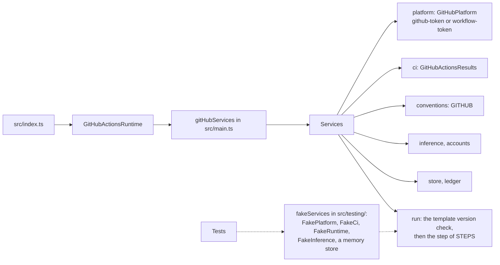

# Platforms

This page is for whoever adds a platform or a runtime to Codeman: the interfaces the steps use, and what each adapter must guarantee.

The steps reach the platform and the runtime only through interfaces. GitHub and GitHub Actions are the only implementations so far. A [change request](../glossary.md#change-request) is the interface's name for a pull request, so that other platforms can map theirs.

## Interfaces

| Interface | Covers | GitHub implementation | Fake for tests |
| --- | --- | --- | --- |
| `Platform` ([`src/platform/platform.ts`](../../src/platform/platform.ts)) | Tasks and their state labels, comments on issues and on change requests, change requests and their reviews, who is a [maintainer](../glossary.md#maintainer), the account Codeman writes as, files and commits, links and references | [`src/platform/github/platform.ts`](../../src/platform/github/platform.ts), on the REST and GraphQL APIs, with the App's token | `FakePlatform` ([`src/testing/fake-platform.ts`](../../src/testing/fake-platform.ts)): one repository in memory |
| `CiResults` ([`src/platform/platform.ts`](../../src/platform/platform.ts)) | Runs of CI on a commit, their jobs, logs and artifacts | [`src/platform/github/ci.ts`](../../src/platform/github/ci.ts), on GitHub Actions | `FakeCi` ([`src/testing/fake-platform.ts`](../../src/testing/fake-platform.ts)): results kept in memory |
| `Conventions` ([`src/platform/conventions.ts`](../../src/platform/conventions.ts)) | The Markdown dialect (mentions and references to break), the comment size limit, where CI configuration lives, the rules that protect it, and what the agent is told about writing and reviewing it | [`src/platform/github/conventions.ts`](../../src/platform/github/conventions.ts) | `FAKE_CONVENTIONS` ([`src/testing/fake-platform.ts`](../../src/testing/fake-platform.ts)) |
| `Runtime` ([`src/runtime/runtime.ts`](../../src/runtime/runtime.ts)) | Inputs and outputs of a step, logs, the run's summary, secret masking, the workspace, the run's ID, attempt and link, the repository, and the job's OIDC token | [`src/runtime/github-actions.ts`](../../src/runtime/github-actions.ts) | `FakeRuntime` ([`src/testing/fake-runtime.ts`](../../src/testing/fake-runtime.ts)): keeps what a step reports |

The fake platform is unlike GitHub on purpose, so tests show that the steps assume nothing of it: its CI lives in `.ci/workflows/`, and its change requests are numbered apart from issues and referred to as `!12`.

## How steps get them

[`src/main.ts`](../../src/main.ts) wires the GitHub implementations into `Services` ([`src/services.ts`](../../src/services.ts)), which each step takes. Tests pass fakes instead, through `fakeServices`, and run the steps on them.

- **`src/index.ts`** creates the runtime, builds the services with `gitHubServices`, and calls `run`.
- **`platform`** uses the `github-token` input, or `workflow-token` for `workflows` access.
- **`run`** checks the [template version](../glossary.md#template-version), then runs the step its `step` input names.
- **Nothing else picks a platform.** The members are listed in [source layout](guide.md#entry-points-and-steps).

## What an adapter must guarantee

- **Ordered IDs.** Comment and review IDs are numbers that grow with time within an issue or change request: Codeman marks requests as handled by the highest ID it has read. A platform without them, such as reviewer votes, synthesizes them.
- **An identity nobody else has.** `self()` names an account only Codeman can post as. The [task record](../glossary.md#task-record) and the run history are read only from its comments.
- **A real maintainer check.** `isMaintainer` reads the platform's permissions (write access or more), never what a user or a comment claims.
- **Comments kept as written.** The task record lives in a hidden HTML comment inside the [status comment](../glossary.md#status-comment). So the platform must keep Markdown as written, HTML comments included, up to its `commentLimit`.
- **A comment limit of at least 65,536 characters.** The agent's output limits are set for it.
- **Atomic, guarded commits.** `commit` writes all changes at once, without running git on the agent's files, and fails without writing if the branch moved since the base commit.
- **Safe Markdown.** The dialect matches every mention and reference the platform renders. This is a security boundary: a reference it misses lets the agent notify or link anyone.
- **Unambiguous key names.** OpenRouter keys are named `codeman/<owner>/<repo>/<issue>/<run>`. An owner of several segments, such as a group path, must not make one repository's name a prefix of another's.
- **Unambiguous pod owners.** [Pods](../glossary.md#pod) carry the owner in `CODEMAN_ORGANIZATION`, and their pool's ID in `CODEMAN_POOL`, which decides which [pool](../glossary.md#pool-of-organizations) a pod belongs to. Both are compared whole, ignoring case.

## Adding a runtime

The [security model](../security/overview.md) relies on GitHub Actions:

- credentials scoped to each job;
- secrets masked at runtime;
- runs started by comments and reviews.

> [!IMPORTANT]
> Another runtime must provide each of these or an equivalent. The security model must be reviewed for it before Codeman runs there.
