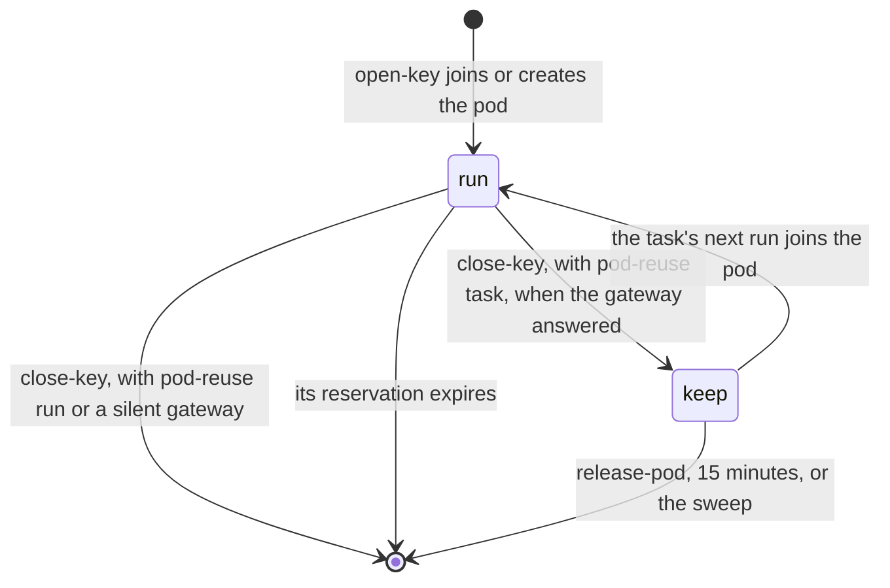
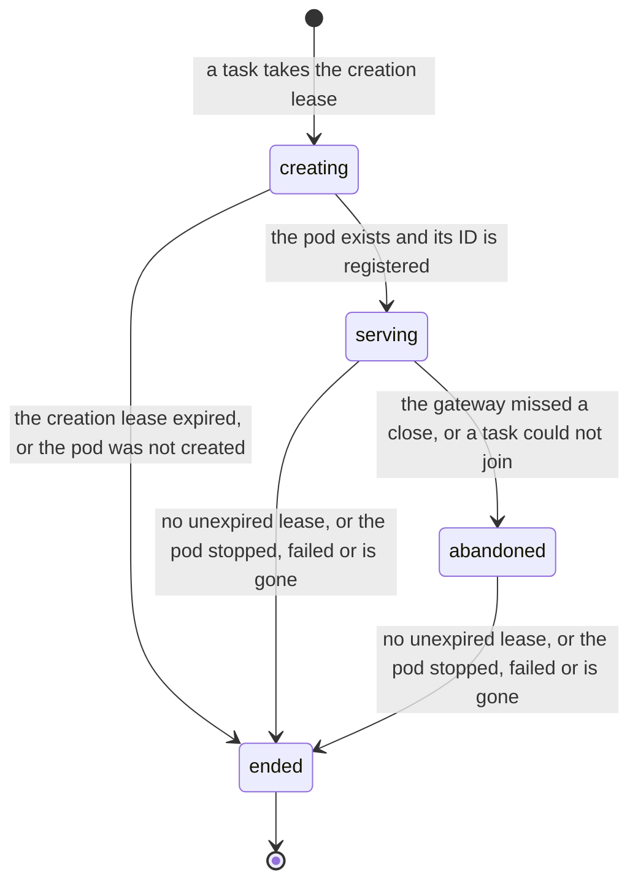
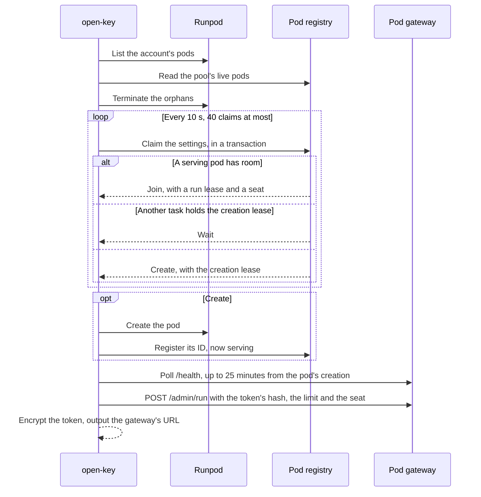

# Pods

With `provider: runpod-pod`, Codeman creates [pods](../glossary.md#pod) on Runpod and shares each among the tasks that run on the same settings. This page explains how pods are shared, held and ended.

Codeman keeps a [pool](../glossary.md#pool-of-organizations)'s pods in its [pod registry](../glossary.md#pod-registry), in the [backend](../backend/backend.md) (`pools/{pool}/pods`). Each pod has a document with:

- the [pod settings](../glossary.md#pod-settings) it serves;
- the GPU account's fingerprint;
- its [capacity](../glossary.md#capacity) and [batch](../glossary.md#batch);
- the [leases](../glossary.md#lease) of the tasks that use or keep it.

The fields are in [data layout](../backend/data-layout.md#pod-registry). The choices were made in the [pod registry plan](../plans/2026-10-07-pod-registry.md) and the [plan for GPU batches across repositories](../plans/2026-10-13-gpu-batches-across-repositories.md), which record their decisions.

## Shared pods

The pool's tasks whose pod settings are the same share one pod, whether they run at once or one after another, in any of its repositories ([decision 2 of the pod registry plan](../plans/2026-10-07-pod-registry.md)), up to the pod's capacity. Each task keeps its own run, token, limit and share.

### Capacity

A pod's capacity is its [parallel requests](../glossary.md#parallel-requests): the `OLLAMA_NUM_PARALLEL` or the `max-num-seqs` it gets, the profile's count by default.

- A pod takes a task only while its unexpired run leases, and the tasks of its [batch](../runs/batches.md#on-the-pod) that have not joined, are fewer than its capacity.
- A task of its batch always joins it.
- A task that finds every pod of its settings full creates another. So two batches of 4 on the same settings get two pods.

### Seats

The registry gives each task a [seat](../glossary.md#seat) on the pod when it first joins it, for the pod's life. The [gateway](../glossary.md#gateway) names the task's runs by it, so two repositories' tasks with the same issue number never mix.

### Starting

Each task starts its own run on the pod, with its own token and limit.

- A task that waited for the pod's start shares it: its run's cost starts with the pod's creation.
- A task that joins a pod already serving starts then.

### Splitting

Each second of the pod is split evenly among the runs on it ([decision 3 of the parallel tasks plan](../plans/2026-10-06-parallel-tasks-and-inference-profiles.md)). A second with no run, [kept time](../glossary.md#kept-time), goes to the tasks that keep the pod then.

For example, tasks A and B run on a pod together for 10 minutes: each run counts 5 minutes of the pod's price. Then A's run closes and A keeps the pod for 2 minutes while B's run goes on: B counts those 2 minutes whole. Then B closes too, and both keep the pod for 1 minute with no run: each counts 30 seconds.

The gateway measures both runs' shares and the kept time, since it sees every run. `release-pod` releases the task on the gateway before it ends the task's keep lease.

### Keeping

A kept pod serves the next run on its settings, whichever task kept it, of whichever repository of the pool. Keep leases do not count against its capacity, so a kept pod also serves the next batch.

## Leases

A task holds one lease on a pod at a time.

| Lease | Taken by | Lasts | Ends when | Counts against capacity |
| --- | --- | --- | --- | --- |
| Creation | The `open-key` that creates the pod, on its settings | 5 minutes | The pod is registered; or it expires, as when its job died, and the next task takes it | Not a run lease |
| Run | `open-key`, when it joins or creates the pod | As long as the run's [budget reservation](../budget/budget.md#expiry): an hour past the `agent` job's timeout | `close-key` turns it into a keep lease or drops it | Yes |
| Keep | `close-key`, with `pod-reuse: task` (the default) and a gateway that answered | 15 minutes | `release-pod`, the task's next run, its expiry, or the sweep when the task now runs on other settings | No |

- `release-pod` ends the task's keep lease when `apply` says the task does not go on: it is not ready, routing or in a routed stage.
- The job that leaves no unexpired lease on the pod ends it in the registry and terminates it. That is `close-key` with `pod-reuse: run` or when the gateway does not answer, or `release-pod`.
- A pod whose gateway did not answer a close, or that a task could not join, takes no new task. It stays while other leases hold it.
- When the job cannot reach the registry, the pod stays. It terminates itself once no run uses it, after 15 idle minutes ([self-termination](#self-termination)).

## Timers

| Timer | Value |
| --- | --- |
| Creation lease | 5 minutes |
| Claims while another task creates the pod | Every 10 seconds, 40 claims at most: about 7 minutes |
| Run lease | An hour past the `agent` job's timeout: 2 hours 10 minutes with the default [agent time](../settings/reference.md#agent-time) |
| Keep lease | 15 minutes |
| The model served | Within 25 minutes of the pod's creation |
| A failed start reported | 2 minutes, then the pod terminates itself |
| A pod with no run served | 15 minutes, then it terminates itself |
| A run without a request | 30 minutes, then the gateway stops it |
| The gateway's checks of its runs and its pod | Every 15 seconds |
| `close-key`'s calls to `/admin/end` | 3 tries, 5 seconds apart |

## How it works

### The registry

| Status | Takes new tasks | Meaning |
| --- | --- | --- |
| `creating` | No: tasks wait for it while it has room | A task holds the creation lease; the pod has no ID yet |
| `serving` | Yes, while it has room | The pod serves its settings' tasks |
| `abandoned` | No | Its gateway did not answer a close, or a task could not join it; it stays while other leases hold it |
| `ended` | No | `live` is false; the job that ended it terminated it. A pod that did not serve its model ends too |

A creator writes its pod's document before it creates the pod. The document stays after the pod ends, as its record.

### Opening a run

#### Sweeping orphans

`open-key` first lists the account's pods, then reads the registry's live pods of its account.

| Pod found | Action |
| --- | --- |
| A pod of its pool (`CODEMAN_POOL`) that no live document holds | Terminated |
| The organization's pod from before pools: `CODEMAN_ORGANIZATION`, or `CODEMAN_REPOSITORY` of one of its repositories, without `CODEMAN_POOL`. No registry reads it any more | Terminated |
| A pod the organization created for another pool, when that pool's registry does not hold it either | Terminated |
| A registry pod whose leases all expired, or that stopped or failed | Ended in the registry, and terminated |
| A registry pod whose creation lease expired | Ended in the registry |
| A registry pod the provider no longer has | Leaves the registry |
| This task's keep lease on a pod of other settings, as after a model change | The lease is dropped |
| A pod without Codeman's environment, another pool's that another organization created, or a pod of another account | Never touched |

Each termination is logged with its reason, and recorded as a `pod-terminated` event. The sweep lists pods before it reads the documents, and a creator writes its document first, so a pod being created is always held.

#### Claiming

In one store transaction, `open-key` reads the live pods of its pod settings on its GPU account. The settings are a hash of:

- the model, GPU type, image and `pod-reuse`;
- for an Ollama pod, the [Ollama settings](../settings/ollama.md) when there are some, the derived `num-parallel` included;
- for a vLLM pod, the engine and its [vLLM settings](../settings/vllm.md), the derived `max-num-seqs` included.

The account is its fingerprint: an HMAC of a fixed label with the account key. Then `open-key` does one of three things:

1. It joins the oldest pod that serves the settings and has room, with a run lease ([shared pods](#shared-pods)).
2. While another task holds the settings' creation lease, it waits, and claims again every 10 seconds.
3. Otherwise, it takes the creation lease, for 5 minutes, and creates the pod.

Tasks that claim at once see each other's writes, or run their transaction again: one creates, the others wait for its pod. A pod created after its creator's lease was taken is terminated, and its creator joins the other.

A task claims 40 times at most, counting its waits and the pods it could not create or join. Its waits for another task's creation so add up to about 7 minutes at most. Then `open-key` fails, and the task becomes `codeman:blocked` ([budget](../budget/budget.md#outcomes-of-open-key)).

#### Creating

The pod runs Codeman's image for its [engine](../glossary.md#engine), pinned by digest, on Secure Cloud. Its environment holds:

| Variable | Value |
| --- | --- |
| `CODEMAN_MODEL`, `CODEMAN_ENGINE` | The model and the engine |
| `CODEMAN_ADMIN_SHA256` | The admin token's hash |
| `CODEMAN_START_BY`, `CODEMAN_KEPT_IDLE_MINUTES`, `CODEMAN_RUN_IDLE_MINUTES` | Its limits ([timers](#timers)) |
| `CODEMAN_OLLAMA` | An Ollama pod's settings, only when there are some |
| `CODEMAN_GPU_MEMORY_GB` | An Ollama pod's GPU memory, from Runpod's catalog |
| `CODEMAN_VLLM` | A vLLM pod's settings |
| `CODEMAN_FIT` | The context that fitted the same settings before, from the [cache of fits](../glossary.md#cache-of-fits), when there is one; for Ollama, with its model's digest |
| `CODEMAN_ORGANIZATION`, `CODEMAN_POOL` | The creating organization and its pool |
| `CODEMAN_ACCOUNT` | The account's fingerprint, never the key |
| `CODEMAN_POD_SETTINGS`, `CODEMAN_NONCE` | The settings' hash and the document's nonce |

A vLLM pod also gets a host with CUDA 13.0 or newer (`minCudaVersion`), and a container disk sized for its model. Before creating it, `open-key` checks that such a host has room and that Hugging Face serves the model publicly. Otherwise it stops the run, at no cost ([vLLM settings](../settings/vllm.md#cuda)).

The run's cost starts with the pod, since Runpod bills the image and model pulls. `open-key` waits up to 25 minutes for the gateway to report the model served, and ends and terminates a pod that does not.

A gateway that reports its start failed, such as for a model that does not fit the GPU, fails the run at once, with its reason. The tasks that waited for the pod fail with it rather than create another.

- The creator's `open-key` ends the pod's document with the reason, then terminates the pod.
- A task that joined the pod reads the reason from the gateway, or, once the pod is gone, from the document ([plan to fail the tasks waiting for a failed pod](../plans/2026-10-22-fail-the-tasks-waiting-for-a-failed-pod.md)).

#### Starting

In the pod, the gateway starts the engine with the pod's settings, finds the largest context that fits the GPU, and reports that [fit](../glossary.md#fit) in its status. How it fits is in [context and the GPU](../settings/pod-engines.md#context-and-the-gpu), and in [Ollama's memory](../settings/ollama.md#memory) and [vLLM's](../settings/vllm.md#memory).

`open-key` logs the fit and gives the agent its context length, and whether its model reads images ([images](../settings/pod-engines.md#images)). For a pod the task created after a search, it records the fit in the cache of fits. A start that fails is reported in the status for 2 minutes, then the pod terminates itself.

### Closing a run

`close-key`:

1. **Ends the run on the gateway** and reads its usage, with `/admin/end`. It tries 3 times, 5 seconds apart, since calling `/admin/end` again returns the same usage.
2. **Costs the run** (below).
3. **Leaves the pod**: it turns its run lease into a keep lease, or drops it ([leases](#leases)). It terminates the pod when no unexpired lease remains.

| The gateway | The run's cost |
| --- | --- |
| Answered | Its share of the pod since the run started, at the pod's billed rate. Alone on the pod, its share is the pod's whole time |
| Never answered, or did not know the run, as after a restart, which `close-key` warns of | The pod's time since the run started, capped at its limit, which its share never passes. `close-key` warns that the cost is an estimate ([choice 4 of the plan for keeping a spent pod for its close](../plans/2026-10-15-keep-a-spent-pod-for-its-close.md)) |

What the task counts for the pod, beyond its runs, is in [spend](../budget/spend.md#self-hosted-runs).

### Self-termination

A pod terminates itself: it asks Runpod to, with the pod-scoped key Runpod gives it, and stops its container either way.

| When | Why |
| --- | --- |
| Its model is not served within 25 minutes of its creation; and at once when its container restarts after that | The start took too long |
| 2 minutes after its start failed | The key jobs that wait for it have read why |
| 15 minutes without a run being served | No run came to use it |
| 15 minutes after the gateway stopped its last run | No key job ended the stopped runs in time |

The gateway stops a run that spent its budget or went 30 minutes without a request, alone or with every other run on the pod. From then on, the run takes none of the pod's time.

A pod left without a run that way waits the same 15 minutes, counted from the last stop. It waits for the key jobs to end its runs and read their usage, and then for the next runs of the tasks that keep it. When a `close-key` or `release-pod` leaves no lease on it, that job terminates it at once ([the plan for keeping a spent pod for its close](../plans/2026-10-15-keep-a-spent-pod-for-its-close.md)). Pods on older images behave otherwise ([upgrading](../installation/upgrading.md#a-spent-pod-waits-for-its-close)).
