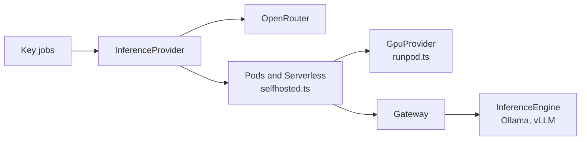

# Self-hosted inference

With `provider: runpod-pod` or `provider: runpod-serverless` ([providers](../settings/providers.md)), a task's agents use a model that Codeman serves on GPUs rented from Runpod, instead of OpenRouter. Runpod charges per second of GPU, whether or not the agent is generating, so a run's cost is time, not tokens.

The choice was made in the [self-hosted inference plan](../plans/2026-10-02-self-hosted-inference.md), which records its decisions.

## At a glance

| Provider | GPU | [Engine](../glossary.md#engine) | Billed | Start |
| --- | --- | --- | --- | --- |
| `runpod-pod` | A [pod](../glossary.md#pod) Codeman creates, with the task's `gpu`, on Secure Cloud | Ollama or vLLM (`engine`), each in a pod image of Codeman's | Every second the pod exists, from its creation | Minutes (more for vLLM), unless the task's pod was kept |
| `runpod-serverless` | The workers of an endpoint a maintainer created ([installation](../installation/runpod.md)) | Runpod's vLLM worker | Every second a worker runs, its model's load and idle timeout included | Minutes, while vLLM prepares the model, unless a worker is still up; a run with no worker for 25 minutes fails |

## Choosing

What Codeman's tests on Runpod showed (step 8 of the plan):

| | OpenRouter | A pod | Serverless |
| --- | --- | --- | --- |
| Bills | Tokens only | The pod's whole life, used or not | Each worker's start (minutes, compilation included), its requests, and the idle timeout after its last one, at the flex price |
| Not billed | Starts, and the time the agent spends running tools | Tokens: long contexts and many requests cost the same | Nothing while no worker runs |
| Sharing | None needed | The [pool](../glossary.md#pool-of-organizations)'s tasks on the same [pod settings](../glossary.md#pod-settings) share one pod, at once or one after another, and split its cost by the second ([shared pods](pods.md#shared-pods)) | Each run counts the worker time it used; time it shared with other runs, of any of the pool's repositories, is split among them ([Serverless](serverless.md)) |
| Pays off when | One task at a time: it gives the most for the money and time, with the strongest models | A smaller model does the work and runs follow each other, since a pod is kept between runs | Its worker stays busy, so that starts and idle time are shared, such as one endpoint serving several repositories at once; never for a single task |

On a pod, sharing helps in two ways: one task's tool runs leave the GPU to another's requests, and one repository's next run finds the pod another kept. A Serverless worker also takes several requests at once.

The pod's engine changes the start and the sharing:

- **Ollama** starts sooner, but serves some model families one request at a time.
- **vLLM** (`engine: vllm`) starts later, but serves the tasks that share the pod at once, whatever the model. It decoded twice as fast on Serverless for the test model ([vLLM settings](../settings/vllm.md)).

> [!NOTE]
> Serverless cost the most in the tests, though it was twice as fast on its GPUs: US$ 1.96 for three runs of a task, against US$ 1.90 for a four-run task on a pod.

[Profiles](../settings/profiles.md) combine the providers in one task, such as OpenRouter for planning and a pod for the routed stages, whose runs follow each other.

## How it works

### Layers

| Interface | Covers | Implementations |
| --- | --- | --- |
| `InferenceProvider` ([`src/inference/provider.ts`](../../src/inference/provider.ts)) | What the [key jobs](../glossary.md#key-jobs) use: opening a run with a limit (a handle, a credential, an API) and closing it (its usage, and what the task's other runs and pods cost, when the provider can tell). | OpenRouter; pods and Serverless ([`selfhosted.ts`](../../src/inference/selfhosted.ts)) |
| `GpuProvider` ([`gpu.ts`](../../src/inference/gpu.ts)) | Pods (price, create, get, list, terminate, URL, billing) and Serverless endpoints (settings, price, job queue URL), and the account's billing by the hour. | Runpod's REST API v2 ([`runpod.ts`](../../src/inference/runpod.ts)) |
| `InferenceEngine` ([`engine.ts`](../../src/inference/engine.ts)) | Model names and usage from responses. | Ollama, vLLM |
| Gateway ([`src/gateway/`](../../src/gateway/)) | In front of the engine: the runs' tokens, forwarding, a record per request, each run's budget limit and share of a pod, and usage in OpenRouter's terms. | One program, in the pod or in the agent job |

### The gateway

The [gateway](../glossary.md#gateway) serves several [gateway runs](../glossary.md#gateway-run) at once, one per task. A pod's gateway serves the tasks that share the pod, named by their [seats](../glossary.md#seat) ([shared pods](pods.md#shared-pods)). A Serverless agent job's gateway serves its one run.

#### Runs and tokens

- Each run's [run token](../glossary.md#run-token) is random, and reaches its agent encrypted, like an OpenRouter key.
- The gateway keeps only the token's hash. A token opens only its own run, with its own records and limit.
- A task's new run replaces its last one. A run that names no task, as Serverless runs, replaces every run.
- Ending a run revokes its token and leaves the others.

#### Routes

- Only `POST /v1/chat/completions`, `POST /v1/completions` and `GET /v1/models` reach the engine.
- Streamed requests ask the engine for usage in their last chunk.
- `GET /usage` and the `/admin/` routes take an admin token ([the admin token](#the-admin-token)). The `/admin/` routes start, end and release runs, and report the gateway's state, with its API `version`: 2 serves several runs.

#### Usage

The gateway records each request's input and output tokens, as the engine reports them (cached prompt tokens are input), when its response began, and when it ended. It reports a run's usage like OpenRouter's:

- tokens and requests;
- the context length: the largest request's input tokens;
- the mean completion tokens per second over streamed requests, from the first token to the end. A plain response arrives whole, so it says nothing of speed.

#### The budget cut-off

The gateway stops serving a run, with `402`, once the run's cost reaches its limit:

| Provider | The run's cost |
| --- | --- |
| Pod | Its share of the pod's time since it started, at the pod's price: each second is split evenly among the runs on the pod. Alone, it is the whole time, so its deadline is known in advance |
| Serverless | The estimated time a worker was billed for the run ([Serverless](serverless.md)) |

A pod's gateway then stops the run within 15 seconds. It takes no more of the pod's time, whether or not other runs go on ([pods](pods.md)).

| A run's requests | Answer |
| --- | --- |
| Once its budget is spent, before and after its stop, the one in flight included | `402` `budget_exceeded`, which agents do not retry |
| Once the gateway stopped it for 30 minutes without a request, or for no worker ([Serverless](serverless.md#when-a-run-has-no-worker-or-no-report)) | `503` `run_stopped` |
| Once its key job ended it, or its task's next run replaced it | `401`: its token is revoked |

#### The admin token

The admin token is an HMAC of the GPU account key and a nonce in the pod's environment, which also holds the token's hash. Only the jobs with the account key manage pods, and no token is stored anywhere.

#### Through Runpod's proxy

- A pod's gateway is public, through Runpod's proxy, which drops a request that gets no response within 100 seconds.
- So the gateway answers a streamed request at once, and sends SSE comments while the engine is silent.
- Ollama and vLLM listen only on the pod's loopback.
