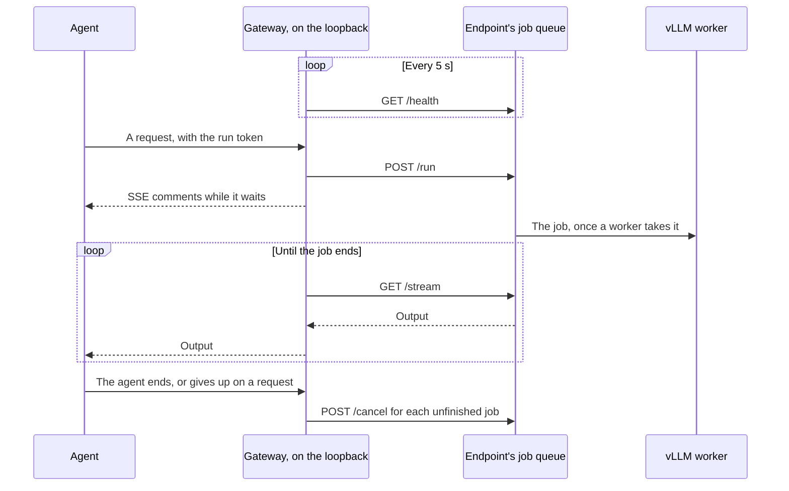

# Serverless

With `provider: runpod-serverless`, an [agent run](../glossary.md#agent-run) uses the workers of a Runpod Serverless endpoint that a maintainer created ([installation](../installation/runpod.md#serverless)). This page explains what Codeman requires of the endpoint, and how it estimates and splits what a run costs.

## Endpoint requirements

`open-key` checks the endpoint before each run, and refuses it unless:

| Check | Required |
| --- | --- |
| Type | A queue (`QUEUE`), which the vLLM worker needs |
| Active workers | 0, since an active worker is billed all the time |
| Max workers | Exactly 1. 0, which Runpod sets after 7 days without requests, is refused too |
| Idle timeout | 300 seconds or less |
| The worker | Runpod's vLLM worker, serving the task's model |
| Tool calls | `ENABLE_AUTO_TOOL_CHOICE` and `TOOL_CALL_PARSER` set on the worker |

Runpod's API does not say whether an endpoint runs on Secure Cloud. The [installation steps](../installation/runpod.md#serverless) do.

Nor does it say whether the worker serves its model's vision tower, so the agent reads text only ([images](../settings/pod-engines.md#images)).

## What a run costs

Runpod bills endpoints by the hour at the finest, so a run's cost is an estimate. It is priced at the flex price of the endpoint's dearest GPU type.

Runpod bills a worker only while it is running ([worker states](../web/runpod/overview.md#worker-states)):

| The worker | Billed |
| --- | --- |
| Pulls its image or a cached model | No |
| Waits for a GPU | No |
| Runs its handler, from its start: the model's load, the requests, the idle timeout after them | Yes |

### The estimate

The [gateway](../glossary.md#gateway) asks the endpoint's `/health` every 5 seconds ([operation reference](../web/runpod/operation-reference.md#health)). It counts the time when a worker is running (`running` above 0) and the run has a request open, or is within the idle timeout after one.

| Between two samples | Counts |
| --- | --- |
| Both saw no worker running | No |
| Either saw a worker running | Yes |
| A sample failed, or the gateway could not read it: unknown | Yes |
| After the last sample, which includes the idle timeout after the run's last request | Yes |

The run's limit (`402`) uses the same estimate ([decision 1 of the plan](../plans/2026-10-06-serverless-cost-from-worker-state.md)).

### Other runs on the worker

An endpoint's workers may serve other repositories, and the other tasks of a [workflow run](../glossary.md#workflow-run) that works on several at once. Each run goes through its own agent job's gateway.

- The other runs' time counts for this run only while it has a request open, or within the idle timeout after one.
- The run's limit counts the time it shares with other runs whole, since its gateway cannot see theirs (decision 3 of the [Serverless split plan](../plans/2026-10-07-serverless-cost-split.md)).
- In the [ledger](../glossary.md#ledger), the shared time is split once the runs close ([below](#splitting-shared-worker-time)).

## Splitting shared worker time

Runs that used an endpoint's worker at the same times split that time in the [ledger](../backend/backend.md#the-ledger), as runs on a [shared pod](pods.md#shared-pods) split its seconds ([Serverless split plan](../plans/2026-10-07-serverless-cost-split.md)).

- Each millisecond is split evenly among the runs whose billed times hold it, each at its own price.
- A run that closes first counts its whole estimate, until another run that overlapped it closes.
- Each later close lowers the costs it overlaps, never below a run's share. So the runs' costs add up to the worker's estimated time.
- Only closed runs change. An open run counts its limit, and a run that `open-key` opened again keeps what its earlier attempt spent.
- Each run's times are its own gateway's estimate. A millisecond one gateway counted and another did not counts for the first alone.

For example, runs A and B use one endpoint at the same price p per second. A is billed from 0 to 600 s, B from 300 to 900 s.

| Step | A counts | B counts |
| --- | --- | --- |
| A closes first | 600p | (open: its limit) |
| B closes; the shared 300-600 s is split | 300p + 150p = 450p | 150p + 300p = 450p |

The total is 900p: the worker's estimated time.

The budgets read the new costs at once: the task's total and both months. A task's [spend table](../budget/spend.md#the-spend-table) shows them at its next run, when `close-key` reports its runs' costs again.

## When a run has no worker or no report

| Case | What happens | The run counts |
| --- | --- | --- |
| A request waited 25 minutes while every sample saw no worker initializing or running | The gateway fails the waiting requests and stops serving the run. The agent job stops the agent and fails, saying why | Nothing for the wait, except the idle timeout after the last request ([decision 2](../plans/2026-10-06-serverless-cost-from-worker-state.md)) |
| Unknown samples during the wait | They neither stop the run nor prove a worker | |
| The agent job failed before the agent reached its model | It reports that nothing was used | 0 |
| No report, as after a cancelled job | | Its whole limit |
| A report above 200,000 characters | It leaves out its billed times, and the run takes no part in the split | Its own estimate |

GitHub keeps 1 MB of a job's outputs ([workflow syntax](../web/github/workflow-syntax-for-github-actions.md#jobsjob_idoutputs)). A report above 200,000 characters would take thousands of separate times.

## How it works

### The gateway in the agent job

The agent job runs the gateway on the loopback, with the endpoint's key: `CODEMAN_RUNPOD_SERVERLESS_KEY`, which only the agent job gets ([secrets](../security/secrets.md)). It gives the agent a local URL and the run's [run token](../glossary.md#run-token).

When the agent ends, the gateway stops. Its usage becomes the job's `gateway-usage` output, with the times its estimate counts (`busy`).

### The request path

The gateway sends each request through the endpoint's job queue ([`src/gateway/queue.ts`](../../src/gateway/queue.ts); [operation reference](../web/runpod/operation-reference.md)). Each request becomes a [Serverless job](../glossary.md#serverless-job):

1. The gateway queues the job (`/run`).
2. It reads the job's output (`/stream`) until the job ends.
3. A job waits as long as no worker serves it, while the gateway keeps a streamed request alive. Runpod's OpenAI-compatible route gave up after 5 minutes.
4. A job nobody waits for any more, because the agent gave up on its request or the run ended, is cancelled (`/cancel`). So it neither runs later nor piles up in the queue.

| Job limit | Value |
| --- | --- |
| Running, once a worker takes it (`executionTimeout`) | 30 minutes |
| Its whole life, its wait in the queue included (`ttl`) | 1 hour |

Both are set on each job ([send API requests](../web/runpod/send-api-requests.md)).

### Recording the split

`close-key` writes the run's billed times under the endpoint. In one store transaction, it then reads the endpoint's runs of the last hours, splits their times, and writes each overlapping run's share as its cost ([data layout](../backend/data-layout.md#serverless-endpoint-runs)).
