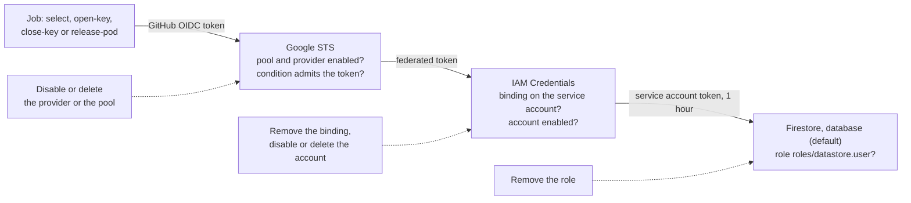
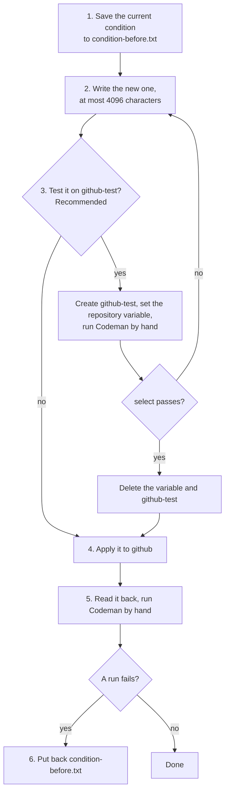

# Backend maintenance

For whoever runs Codeman's [backend](../glossary.md#backend): how to read, change, disable, delete and restore each part of the Google Cloud setup, and how to see who changed it. Creating them is in the [installation](setup.md#4-set-up-the-backend); this page starts from there.

## Before you start

### Where to run the commands

The commands use the installation's names, in the project `PROJECT_ID`:

- the [Workload Identity pool](../glossary.md#workload-identity-pool) `codeman`;
- the [Workload Identity provider](../glossary.md#workload-identity-provider) `github`;
- the service account `codeman`.

Run them where `gcloud` is installed, such as [Cloud Shell](https://shell.cloud.google.com), with an account that may manage the project, such as its owner. Set these variables first:

```sh
PROJECT_ID=codeman-ops   # the project ID
PROJECT_NUMBER=$(gcloud projects describe "$PROJECT_ID" --format='value(projectNumber)')
SA="codeman@$PROJECT_ID.iam.gserviceaccount.com"
ORG_ID=123456789   # the organization's numeric ID: gh api orgs/<organization> --jq .id
```

A variable does not expand inside single quotes, such as a log filter: write the value there.

### Check that no run is in progress

> [!IMPORTANT]
> Make changes between workflow runs. Each job of a [workflow run](../glossary.md#workflow-run) that reaches the backend exchanges its own token. A change that refuses them fails the jobs that start after it, even within a run that `select` already passed.

The jobs that reach the backend are `select`, `open-key`, `close-key` and `release-pod`. Before a change, check in each repository that runs Codeman that no run is in progress, queued, or pending in the workflow's concurrency group ([gh run list](../web/github-cli/gh-run-list.md)):

```sh
for status in in_progress queued pending; do
  gh run list --repo <owner>/<repository> --workflow codeman.yml --status "$status"
done
```

**Expected:** no run is listed.

A run can still start after the check ([`templates/codeman.yml`](../../templates/codeman.yml)):

- the schedule starts one at 09:00 UTC;
- a `/codeman` comment, a change of a task's labels, a review, a manual run, or a dispatch from another repository of the [pool of organizations](../glossary.md#pool-of-organizations) starts one at any time.

## Quick reference

| To | Go to | Undone by | Effect on runs |
| --- | --- | --- | --- |
| Stop every job's access at once | [Emergency stop](#emergency-stop) | The same lever, reversed | Every job that reaches the backend fails |
| Read the [attribute condition](../glossary.md#attribute-condition) and the mapping | [Read the condition and the mapping](#read-the-condition-and-the-mapping) | — | None |
| Admit or refuse repositories | [Change the attribute condition](#change-the-attribute-condition) | The saved condition | Refused repositories fail in `select` |
| Disable or enable the pool | [The pool](#disable-and-enable-the-pool) | The console's **Status** toggle | Every job fails while disabled |
| Disable or enable the provider | [The provider](#disable-and-enable-the-provider) | Its **Edit** icon in the console | New token exchanges fail |
| Delete and restore the pool or the provider | [The pool](#delete-and-restore-the-pool), [the provider](#delete-and-restore-the-provider) | `undelete`, within 30 days | Every job fails while deleted |
| Check who may act as the service account | [Who may act as it](#who-may-act-as-it) | `add-iam-policy-binding` | Without the binding, every job fails |
| Check the service account's role | [Its role on the project](#its-role-on-the-project) | `projects add-iam-policy-binding` | Without the role, every job fails |
| Disable or enable the service account | [Disable and enable it](#disable-and-enable-it) | `enable` | Every job fails at once, held tokens included |
| Delete and restore the service account | [Delete and restore it](#delete-and-restore-it) | `undelete`, within 30 days | Every job fails while deleted |
| Check the APIs | [The APIs](#the-apis) | — | None |
| Protect, delete, back up or restore the database | [Firestore](#firestore) | A backup restore, if one exists | Deleting it empties the [ledger](../glossary.md#ledger) and the [pod registry](../glossary.md#pod-registry) |
| See who changed what | [Who changed what](#who-changed-what) | — | None |

## Emergency stop

Each job reaches Firestore in three exchanges, and each lever cuts one of them:



| Lever | New exchanges | A job that already holds the service account's token | Undo |
| --- | --- | --- | --- |
| [Disable the provider](#disable-and-enable-the-provider) | Refused for this provider only. Another provider of the pool still admits | Keeps access | The provider's **Edit** icon, in the console |
| [Disable the pool](#disable-and-enable-the-pool) | Refused for every provider of the pool. The tokens the pool issued stop granting access | Not documented: see below | The pool's **Status** toggle, in the console |
| [Remove the binding](#who-may-act-as-it) | IAM Credentials refuses | Keeps access | `add-iam-policy-binding`, with the same flags |
| [Remove the role](#its-role-on-the-project) | Firestore refuses | Refused at its next request | `projects add-iam-policy-binding`, with the same flags |
| [Disable the service account](#disable-and-enable-it) | Refused | Refused: Google rejects the account's existing tokens | `gcloud iam service-accounts enable` |
| [Delete the pool](#delete-and-restore-the-pool) or [the provider](#delete-and-restore-the-provider) | Refused | As for disabling | `undelete`, within 30 days |
| [Delete the service account](#delete-and-restore-it) | Refused | Refused | `undelete <numeric ID>`, within 30 days |

**The service account's token.** Each job asks IAM Credentials for a token of the account that lasts 1 hour. It uses that token until 5 minutes before it expires, up to 55 minutes ([`src/store/google.ts`](../../src/store/google.ts)). That is longer than any of these jobs may run: `open-key`'s limit, the longest, is 35 minutes. Google's pages do not say whether disabling the pool revokes that token. Disabling the service account does.

**Undoing a disable needs the console.** The `gcloud` reference documents no flag that enables a pool or a provider again ([update](../web/google-cloud/gcloud-iam-workload-identity-pools-update.md)).

## When jobs cannot reach the backend

`select` and `open-key` read the store first. Each tries 4 times, 1, 3 and 9 seconds apart, warning between attempts ([`src/ledger.ts`](../../src/ledger.ts)):

```text
Could not read Codeman's store (<message>); trying again in 1 s.
```

Then it fails with:

```text
Could not read Codeman's store after 4 attempts: <message>
```

`select` fails before it marks any task. `close-key` ends the run's access first, then fails with `Could not write to Codeman's ledger after 4 attempts: <message>`. `release-pod` reaches the pod registry without retries, and fails with the message alone.

| The message | Cause | See |
| --- | --- | --- |
| `Google's STS refused the request with <status>: <error>`, where the error is what Google's Security Token Service answered | The attribute condition refuses this repository: its owner ID, its repository ID, the workflow file's name or the branch. Or the provider or the pool is disabled or deleted, `CODEMAN_WORKLOAD_IDENTITY_PROVIDER` names another provider, or the STS API is disabled | [Change the attribute condition](#change-the-attribute-condition), [the pool](#the-workload-identity-pool), [the provider](#the-provider) |
| `IAM Credentials refused the request with <status>: <error>` | The binding was removed, the service account is disabled or deleted, or the IAM Credentials API is disabled | [Who may act as it](#who-may-act-as-it), [disable and enable it](#disable-and-enable-it), [the APIs](#the-apis) |
| `Firestore batchGet failed with 403 PERMISSION_DENIED`, then Google's message ([`src/store/firestore.ts`](../../src/store/firestore.ts)) | The service account lacks `roles/datastore.user` | [Its role on the project](#its-role-on-the-project) |
| `Firestore batchGet failed with <status>`, another status | The project may have no `(default)` database | [Firestore](#firestore) |

Other failures come before the store:

| The log says | Cause |
| --- | --- |
| `Codeman's backend is not set up: this step has no <variables>. …` ([`src/store/backend.ts`](../../src/store/backend.ts)) | A backend variable is missing, or the workflow files do not pass it |
| `Codeman's backend settings are wrong: …` | A backend variable has the wrong form |
| ``The job could not get GitHub's OIDC token: give it the `id-token: write` permission, as the templates do.`` | The workflow file was changed |

`close-key` only warns when it cannot leave its pod in the registry: `Could not leave pod <ID> in the pod registry (<message>); it terminates itself once no run uses it, after 15 idle minutes.` ([`src/inference/selfhosted.ts`](../../src/inference/selfhosted.ts)).

Google's audit logs do not record a refused exchange. The logs of token exchanges are Data Access logs, off by default, and they leave out failures caused by the request, such as invalid credentials ([example logs](../web/google-cloud/example-logs-for-workload-identity-federation.md#logs-for-exchanging-an-idp-token-for-a-federated-token)).

The checks of a new installation are in [check the setup](setup.md#6-check-the-setup).

<a id="the-pool"></a>

## The Workload Identity pool

### Read the pool

In the console, the **Workload Identity Pools** page (`https://console.cloud.google.com/iam-admin/workload-identity-pools`) lists the pools. A pool's display name opens its details ([manage pools](../web/google-cloud/manage-workload-identity-pools-and-providers.md#list-pools)).

```sh
gcloud iam workload-identity-pools list --project="$PROJECT_ID" --location=global
gcloud iam workload-identity-pools describe codeman --project="$PROJECT_ID" --location=global
```

- **Expected:** `state: ACTIVE`, and no `disabled: true` ([pool resource](../web/google-cloud/rest-resource-projects-locations-workloadidentitypools.md#resource-workloadidentitypool)).
- `list --show-deleted` includes deleted pools ([list](../web/google-cloud/gcloud-iam-workload-identity-pools-list.md)).
- `update` changes its display name, description, or state ([update](../web/google-cloud/gcloud-iam-workload-identity-pools-update.md)).

### Disable and enable the pool

Disabling the pool is the backend's emergency stop:

- A disabled pool exchanges no tokens, and the tokens it already issued stop granting access.
- Every Codeman job that reaches the backend fails until the pool is enabled again. Then those tokens work again.
- A job that already holds the service account's token keeps using it, up to 55 minutes, as under [emergency stop](#emergency-stop).

```sh
gcloud iam workload-identity-pools update codeman --project="$PROJECT_ID" --location=global --disabled
```

- **Expected:** `describe` shows `disabled: true`.
- **Undo:** the pool's **Status** toggle in the console ([update a pool](../web/google-cloud/manage-workload-identity-pools-and-providers.md#update-a-pool)). The `gcloud` reference documents no flag for it.

### Delete and restore the pool

- Deleting the pool deletes its providers too.
- Google advises disabling it first, and deleting it once nothing broke.
- A deleted pool can be restored for 30 days; then it is gone. Until then, its ID cannot be reused ([delete a pool](../web/google-cloud/manage-workload-identity-pools-and-providers.md#delete-a-pool)).
- While it is deleted, its tokens grant no access. Restored, they grant access again ([pool resource](../web/google-cloud/rest-resource-projects-locations-workloadidentitypools.md#state)).

```sh
gcloud iam workload-identity-pools delete codeman --project="$PROJECT_ID" --location=global
```

- **Expected:** `list --show-deleted` shows it with `state: DELETED`.
- **Undo:** within 30 days, `undelete` restores it with its providers. In the console, **Show deleted pools and providers**, then the pool's **Restore** icon, does the same ([undelete a pool](../web/google-cloud/manage-workload-identity-pools-and-providers.md#undelete-a-pool)).

```sh
gcloud iam workload-identity-pools undelete codeman --project="$PROJECT_ID" --location=global
```

## The provider

### Read the provider

In the console, on the **Workload Identity Pools** page, the pool's **Expand node** icon lists its providers. A provider's **Edit** icon shows its details and edits them ([get a provider](../web/google-cloud/manage-workload-identity-pools-and-providers.md#get-a-provider), [update a provider](../web/google-cloud/manage-workload-identity-pools-and-providers.md#update-a-provider)).

```sh
gcloud iam workload-identity-pools providers list --project="$PROJECT_ID" \
  --location=global --workload-identity-pool=codeman
gcloud iam workload-identity-pools providers describe github --project="$PROJECT_ID" \
  --location=global --workload-identity-pool=codeman
```

**Expected:** `state: ACTIVE`, and no `disabled: true` ([provider resource](../web/google-cloud/rest-resource-projects-locations-workloadidentitypools-providers.md#state)).

### Read the condition and the mapping

`--format` prints one field of the provider ([formats](../web/google-cloud/gcloud-topic-formats.md)). The fields are `attributeCondition` and `attributeMapping` ([provider resource](../web/google-cloud/rest-resource-projects-locations-workloadidentitypools-providers.md)):

```sh
gcloud iam workload-identity-pools providers describe github --project="$PROJECT_ID" \
  --location=global --workload-identity-pool=codeman --format='value(attributeCondition)'
gcloud iam workload-identity-pools providers describe github --project="$PROJECT_ID" \
  --location=global --workload-identity-pool=codeman --format='yaml(attributeMapping)'
```

**Expected:** the condition you set ([the two conditions](setup.md#choose-the-attribute-condition)), and a mapping with `google.subject`, `attribute.repository`, `attribute.repository_id`, `attribute.repository_owner_id` and `attribute.workflow_ref`. A provider created before `attribute.repository_id` was in the installation's mapping lacks it ([upgrading](upgrading.md#backend-mapping-gains-repository_id)).

### Change the attribute condition

The condition decides which repositories reach the backend ([the two conditions](setup.md#choose-the-attribute-condition)). Change it to:

- add a repository, with the listed-repositories condition;
- add an organization to a [pool](pool.md);
- move from one condition to the other;
- follow a renamed `codeman.yml` or default branch.



1. **Save the current condition**, to put it back if needed:

   ```sh
   gcloud iam workload-identity-pools providers describe github --project="$PROJECT_ID" \
     --location=global --workload-identity-pool=codeman \
     --format='value(attributeCondition)' > condition-before.txt
   ```

   **Expected:** `cat condition-before.txt` prints the condition.

2. **Write the new one** in a variable, from the saved one, and check its length: at most 4096 characters ([update-oidc](../web/google-cloud/gcloud-iam-workload-identity-pools-providers-update-oidc.md)).
   - A repository's ID comes from `gh api repos/<owner>/<repository> --jq .id`.
   - IDs are quoted, since the token's claims are strings.

   ```sh
   CONDITION="assertion.repository_owner_id == '$ORG_ID' && assertion.repository_id in ['111111111', '222222222', '333333333'] && assertion.workflow_ref == assertion.repository + '/.github/workflows/codeman.yml@refs/heads/main'"
   printf %s "$CONDITION" | wc -c
   ```

   **Expected:** a number up to 4096.

3. **Test it on a provider of its own** (recommended).
   1. Create `github-test` in the same pool, with the new condition and the provider's mapping ([create-oidc](../web/google-cloud/gcloud-iam-workload-identity-pools-providers-create-oidc.md)):

      ```sh
      gcloud iam workload-identity-pools providers create-oidc github-test --project="$PROJECT_ID" \
        --location=global --workload-identity-pool=codeman --display-name="GitHub test" \
        --issuer-uri="https://token.actions.githubusercontent.com" \
        --attribute-mapping="google.subject=assertion.sub,attribute.repository=assertion.repository,attribute.repository_id=assertion.repository_id,attribute.repository_owner_id=assertion.repository_owner_id,attribute.workflow_ref=assertion.workflow_ref" \
        --attribute-condition="$CONDITION"
      ```

   2. Choose a repository that is not in production use, that the new condition admits, and that has no open `codeman` issue, so the run does no work.
   3. In it, add the repository variable `CODEMAN_WORKLOAD_IDENTITY_PROVIDER` with `projects/<project number>/locations/global/workloadIdentityPools/codeman/providers/github-test`. It overrides the organization's.
   4. Run Codeman by hand (**Actions → Codeman → Run workflow**). **Expected:** `select` passes.
   5. Delete that repository variable and the test provider. Its ID cannot be used again for 30 days ([delete a provider](../web/google-cloud/manage-workload-identity-pools-and-providers.md#delete-a-provider)).

      ```sh
      gcloud iam workload-identity-pools providers delete github-test --project="$PROJECT_ID" \
        --location=global --workload-identity-pool=codeman
      ```

   > [!WARNING]
   > Delete `github-test` once the test is done. The service account's binding admits every provider of the pool, so `github-test` is a second way in while it exists.

4. **Apply it** to `github`:

   ```sh
   gcloud iam workload-identity-pools providers update-oidc github --project="$PROJECT_ID" \
     --location=global --workload-identity-pool=codeman --attribute-condition="$CONDITION"
   ```

   The condition may use only fields the mapping also maps ([attribute condition](../web/google-cloud/configure-workload-identity-federation-with-deployment-pipelines.md#define-an-attribute-condition)). If the mapping lacks `attribute.repository_id`, pass the whole mapping of step 3 with `--attribute-mapping` in the same command ([upgrading](upgrading.md#backend-mapping-gains-repository_id)).

5. **Check it.** Read the condition back, and run Codeman by hand in one repository the condition admits.

   ```sh
   [ "$(gcloud iam workload-identity-pools providers describe github --project="$PROJECT_ID" \
     --location=global --workload-identity-pool=codeman --format='value(attributeCondition)')" \
     = "$CONDITION" ] && echo "The condition is applied."
   ```

   **Expected:** `The condition is applied.`, and `select` passes. A condition that admits too much fails nothing, so read it, not only the runs.

6. **Put the old one back** if a run fails:

   ```sh
   gcloud iam workload-identity-pools providers update-oidc github --project="$PROJECT_ID" \
     --location=global --workload-identity-pool=codeman --attribute-condition="$(cat condition-before.txt)"
   ```

#### What a wrong condition does

Every job that reaches the backend fails at the token exchange, in each repository the condition refuses. `select` fails first, before it marks any task, with `Could not read Codeman's store after 4 attempts: Google's STS refused the request with <status>: <error>` ([when jobs cannot reach the backend](#when-jobs-cannot-reach-the-backend)). Google's audit logs do not record the refused exchange.

#### Many repositories

About 280 repository IDs of 10 digits fit in 4096 characters with the rest of the condition. Beyond that, either:

- add a second provider to the pool with the next IDs, created as in step 3 and kept, and set `CODEMAN_WORKLOAD_IDENTITY_PROVIDER` to it in the repositories it lists;
- or use the condition that admits any repository of the organization.

<a id="disable-delete-or-restore-it"></a>

### Disable and enable the provider

A disabled provider exchanges no tokens, but the tokens it already issued still grant access ([update-oidc](../web/google-cloud/gcloud-iam-workload-identity-pools-providers-update-oidc.md)). To stop those too, [disable the pool](#disable-and-enable-the-pool). To stop the service account's tokens that jobs already hold, [disable the service account](#disable-and-enable-it).

```sh
gcloud iam workload-identity-pools providers update-oidc github --project="$PROJECT_ID" \
  --location=global --workload-identity-pool=codeman --disabled
```

- **Expected:** `describe` shows `disabled: true`.
- **Undo:** the provider's **Edit** icon in the console ([update a provider](../web/google-cloud/manage-workload-identity-pools-and-providers.md#update-a-provider)).

### Delete and restore the provider

As for the pool: Google advises disabling it first, a deleted provider can be restored for 30 days, and its ID is not reusable until then ([delete a provider](../web/google-cloud/manage-workload-identity-pools-and-providers.md#delete-a-provider), [undelete a provider](../web/google-cloud/manage-workload-identity-pools-and-providers.md#undelete-a-provider)).

```sh
gcloud iam workload-identity-pools providers delete github --project="$PROJECT_ID" \
  --location=global --workload-identity-pool=codeman
```

- **Expected:** `list --show-deleted` shows it with `state: DELETED` ([provider resource](../web/google-cloud/rest-resource-projects-locations-workloadidentitypools-providers.md#state)).
- **Undo:** within 30 days:

  ```sh
  gcloud iam workload-identity-pools providers undelete github --project="$PROJECT_ID" \
    --location=global --workload-identity-pool=codeman
  ```

## The service account

### Read the service account

In the console, the **Service accounts** page (`https://console.cloud.google.com/iam-admin/serviceaccounts`) lists the project's service accounts ([delete a service account](../web/google-cloud/delete-and-undelete-service-accounts.md#delete-a-service-account)).

```sh
gcloud iam service-accounts list --project="$PROJECT_ID"
gcloud iam service-accounts describe "$SA" --project="$PROJECT_ID"
```

`describe` prints the account's numeric ID as `uniqueId`. Restoring a deleted account takes that ID, so note it ([undelete](../web/google-cloud/delete-and-undelete-service-accounts.md#undelete-a-service-account)).

### Who may act as it

The account's own IAM policy says which identities may act as it ([get-iam-policy](../web/google-cloud/gcloud-iam-service-accounts-get-iam-policy.md)):

```sh
gcloud iam service-accounts get-iam-policy "$SA" --project="$PROJECT_ID"
```

**Expected:** one binding, `roles/iam.workloadIdentityUser` for every identity of the pool, and an `etag`:

```yaml
bindings:
- members:
  - principalSet://iam.googleapis.com/projects/<project number>/locations/global/workloadIdentityPools/codeman/*
  role: roles/iam.workloadIdentityUser
```

Removing that binding cuts every job off from the backend, whatever the pool and the provider say ([remove-iam-policy-binding](../web/google-cloud/gcloud-iam-service-accounts-remove-iam-policy-binding.md)):

- the federated token can no longer get the account's token;
- jobs fail with `Could not read Codeman's store after 4 attempts: IAM Credentials refused the request with <status>: <error>`;
- a job that already holds the account's token keeps using it, for up to 55 minutes, as under [emergency stop](#emergency-stop).

```sh
gcloud iam service-accounts remove-iam-policy-binding "$SA" --project="$PROJECT_ID" \
  --role=roles/iam.workloadIdentityUser \
  --member="principalSet://iam.googleapis.com/projects/$PROJECT_NUMBER/locations/global/workloadIdentityPools/codeman/*"
```

**Undo:** add it back, as step 6 of the [backend's setup](setup.md#4-set-up-the-backend) does ([add-iam-policy-binding](../web/google-cloud/gcloud-iam-service-accounts-add-iam-policy-binding.md)):

```sh
gcloud iam service-accounts add-iam-policy-binding "$SA" --project="$PROJECT_ID" \
  --role=roles/iam.workloadIdentityUser \
  --member="principalSet://iam.googleapis.com/projects/$PROJECT_NUMBER/locations/global/workloadIdentityPools/codeman/*"
```

### Its role on the project

The account holds one role on the project, Cloud Datastore User (`roles/datastore.user`), and nothing else. The project's policy lists who holds each role; in the console, it is in the IAM & Admin section. This prints the members that hold `roles/datastore.user` ([filters](../web/google-cloud/gcloud-topic-filters.md), [get-iam-policy](../web/google-cloud/gcloud-projects-get-iam-policy.md)):

```sh
gcloud projects get-iam-policy "$PROJECT_ID" --flatten=bindings \
  --filter=bindings.role:roles/datastore.user --format='value(bindings.members)'
```

**Expected:** `serviceAccount:codeman@<project ID>.iam.gserviceaccount.com`, alone. `gcloud projects get-iam-policy "$PROJECT_ID"` prints the whole policy.

Removing the role stops Codeman's reads and writes ([remove-iam-policy-binding](../web/google-cloud/gcloud-projects-remove-iam-policy-binding.md)). Every run fails in `select`, with `Could not read Codeman's store after 4 attempts: Firestore batchGet failed with 403`, then Google's status and message ([`src/store/firestore.ts`](../../src/store/firestore.ts)).

```sh
gcloud projects remove-iam-policy-binding "$PROJECT_ID" --role=roles/datastore.user \
  --member="serviceAccount:$SA"
```

**Undo:** grant it again, as step 4 of the [backend's setup](setup.md#4-set-up-the-backend) does ([add-iam-policy-binding](../web/google-cloud/gcloud-projects-add-iam-policy-binding.md)):

```sh
gcloud projects add-iam-policy-binding "$PROJECT_ID" --role=roles/datastore.user \
  --member="serviceAccount:$SA"
```

### Disable and enable it

Disabling the account stops the backend for every repository at once ([projects.serviceAccounts.disable](../web/google-cloud/method-projects-serviceaccounts-disable.md)):

- Google rejects the account's existing access tokens, so it cuts off the jobs that already hold one too.
- It refuses new ones.
- Enabling it again makes its existing tokens valid again, and lets jobs get new ones.

In the console, the account's page, under **Service account status**, has **Disable service account** and **Enable service account** ([disable](../web/google-cloud/disable-and-enable-service-accounts.md#disable-a-service-account), [enable](../web/google-cloud/disable-and-enable-service-accounts.md#enable-a-service-account)).

```sh
gcloud iam service-accounts disable "$SA"
```

- **Expected:** `Disabled service account <email>`.
- **Undo:** `gcloud iam service-accounts enable "$SA"`, which prints `Enabled service account <email>`.

### Delete and restore it

Google advises disabling an account before deleting it ([delete](../web/google-cloud/delete-and-undelete-service-accounts.md#delete-a-service-account)), and waiting at least 24 hours for unintended consequences ([projects.serviceAccounts.disable](../web/google-cloud/method-projects-serviceaccounts-disable.md)).

- Deleting the account stops the backend for every repository.
- A deleted account can be restored for 30 days, by its numeric ID, with its roles. Its bindings stay in the policies, shown as `deleted:serviceAccount:<email>?uid=<numeric ID>`, for up to 60 days.
- A new account with the same name is another identity. It holds none of the old one's roles until steps 4 and 6 of the backend's setup grant them again. While it exists, the old one cannot be restored ([undelete](../web/google-cloud/delete-and-undelete-service-accounts.md#undelete-a-service-account)).

```sh
gcloud iam service-accounts delete "$SA" --project="$PROJECT_ID"
```

**Undo:** within 30 days, and while no new account has its name:

```sh
gcloud iam service-accounts undelete <numeric ID> --project="$PROJECT_ID"
```

A deleted account's numeric ID is also in the bindings above, after `?uid=`, and in the audit log of its deletion ([find the numeric ID](../web/google-cloud/delete-and-undelete-service-accounts.md#find-a-deleted-service-accounts-numeric-id)).

## The APIs

```sh
gcloud services list --enabled --project="$PROJECT_ID"
```

**Expected:** the list includes `iam.googleapis.com`, `sts.googleapis.com` and `iamcredentials.googleapis.com` ([services list](../web/google-cloud/gcloud-services-list.md)). Step 4 of the backend's setup enabled them, and the token exchange uses them. Keep them enabled.

## Firestore

The Firebase console and `gcloud` cover it; the Firebase CLI is not needed.

### Rules

In the [Firebase console](https://console.firebase.google.com), the project's **Databases & Storage → Firestore → Rules** tab shows the published rules. Edit them there and **Publish** ([security rules](../web/firebase/get-started-with-cloud-firestore-security-rules.md#use-the-firebase-console), [manage rules](../web/firebase/manage-and-deploy-firebase-security-rules.md#use-the-firebase-console)).

**Expected:** the rules of [`firebase/firestore.rules`](../../firebase/firestore.rules), which deny every client. Codeman's service account does not go through them, so Codeman never needs them changed.

### Data

The **Data** tab shows the documents. [Data layout](../backend/data-layout.md) says what each is.

### Read and protect the database

In the Google Cloud console, the **Databases** page (`https://console.cloud.google.com/firestore/databases`) lists it. `gcloud` prints its details, and turns on delete protection, which blocks deleting it until it is turned off ([manage databases](../web/firebase/manage-databases.md#view-database-details), [delete protection](../web/firebase/manage-databases.md#update-the-delete-protection-setting)):

```sh
gcloud firestore databases describe --database='(default)' --project="$PROJECT_ID"
gcloud firestore databases update --database='(default)' --delete-protection --project="$PROJECT_ID"
```

- **Expected:** `describe` shows `deleteProtectionState: DELETE_PROTECTION_ENABLED` once it is on.
- **Undo:** `--no-delete-protection`, in place of `--delete-protection`.

### Delete the database

> [!WARNING]
> Deleting the database deletes Codeman's records: the ledger the budgets read, the pod registry and the [board](../glossary.md#board) of a pool. Without a backup, Google's pages document no way to restore it.

Every run fails in `select` until a new database exists. Codeman then starts from an empty ledger:

- **The month's spend** counts from zero, for `monthly-budget` and for `organization-monthly-budget`. The organization's month still counts the hours a GPU account billed, when the run uses that account.
- **A task's spend** starts from what its [task record](../glossary.md#task-record) on GitHub holds, carried on its first run in the new ledger ([budget](../budget/budget.md)).
- **Live pods** are terminated by the next `open-key` of a pod run, since the pod registry is empty. It logs `Terminated pod <ID>: it carries Codeman's environment, and the pod registry does not hold it.` ([`src/inference/selfhosted.ts`](../../src/inference/selfhosted.ts)).
- **The first pod of each settings** searches its context again.

With delete protection, turn it off first (`--no-delete-protection`). Then, in the Firebase console, **Databases & Storage → Firestore → Data**, the menu above the data table, **Delete database**; or the command below ([delete a database](../web/firebase/manage-databases.md#delete-a-database)).

```sh
gcloud firestore databases delete --database='(default)' --project="$PROJECT_ID"
```

### Back up and restore

The installation turns no backup on ([backups](../web/google-cloud/back-up-and-restore-data.md)):

- A backup schedule takes a backup of the database each day or each week, kept for up to 14 weeks.
- Backups need billing enabled, and their storage and restores are charged.
- Deleting the database does not delete its backups.

```sh
gcloud firestore backups schedules create --database='(default)' --recurrence=daily \
  --retention=14w --project="$PROJECT_ID"
gcloud firestore backups list --format="table(name, database, state)" --project="$PROJECT_ID"
```

**Expected:** `list` shows the schedule's backups, with their names.

A restore writes a backup into a new database, whose ID must not be in use ([restore](../web/google-cloud/back-up-and-restore-data.md#restore-data-from-a-database-backup)). Codeman reads only `(default)`, an ID that can be used again about 5 minutes after its database is deleted ([database ID](../web/firebase/manage-databases.md#database-id)).

```sh
gcloud firestore databases restore --source-backup=<backup name> \
  --destination-database='(default)' --project="$PROJECT_ID"
```

After a restore:

1. Publish the rules again ([after restoring](../web/google-cloud/back-up-and-restore-data.md#what-to-do-after-restoring)).
2. Expect what the backup lacks. The restored ledger lacks the runs since the backup, and the registry the pods created since. The next `open-key` of a pod run terminates those pods, as above.

### Point-in-time recovery

Point-in-time recovery (PITR) is off by default ([PITR](../web/google-cloud/point-in-time-recovery-pitr-overview.md)):

- Once on, Firestore keeps a version of each document per minute for 7 days.
- From it, part of the database can be read back, or the whole of it cloned or exported.
- Its storage has no free tier.
- Google's page does not say whether that data outlives a deleted database.

## Who changed what

Cloud Audit Logs' **Admin Activity** logs record every change to the pool, the provider, the service account and the project's policy ([Cloud Audit Logs](../web/google-cloud/cloud-audit-logs-overview.md#admin-activity-audit-logs), [caller identities](../web/google-cloud/cloud-audit-logs-overview.md#caller-identities-in-audit-logs)):

- they are always written, and cannot be turned off;
- they record the caller's email for every write;
- changes to pools and providers are long-running operations, which usually write two entries, at the start and at the end ([IAM audit logging](../web/google-cloud/identity-and-access-management-audit-logging.md)).

In the console, the **Logs Explorer** page (`https://console.cloud.google.com/logs/query`), with the project selected, runs a query ([viewing audit logs](../web/google-cloud/cloud-audit-logs-overview.md#viewing-audit-logs)). For the pool and the provider:

```text
log_id("cloudaudit.googleapis.com/activity")
protoPayload.methodName:"WorkloadIdentityPools"
```

With `gcloud`, the last 30 days, with when, what and who ([logging read](../web/google-cloud/gcloud-logging-read.md)):

```sh
gcloud logging read 'log_id("cloudaudit.googleapis.com/activity") AND protoPayload.methodName:"WorkloadIdentityPools"' \
  --project="$PROJECT_ID" --freshness=30d \
  --format='table(timestamp, protoPayload.methodName, protoPayload.authenticationInfo.principalEmail)'
```

Other filters, in place of the second term:

| Changes to | Filter |
| --- | --- |
| The service account, its policy included | `resource.type="service_account" AND resource.labels.email_id="codeman@<project ID>.iam.gserviceaccount.com"` ([undelete](../web/google-cloud/delete-and-undelete-service-accounts.md#find-a-deleted-service-accounts-numeric-id)) |
| The project's policy, and the project | `protoPayload.serviceName="cloudresourcemanager.googleapis.com"` ([Resource Manager](../web/google-cloud/resource-manager-audit-logging.md#service-name)) |
| Everything of IAM | `protoPayload.serviceName="iam.googleapis.com"` ([IAM audit logging](../web/google-cloud/identity-and-access-management-audit-logging.md)) |

This page gives no filter for changes to Firestore: its rules, its delete protection, or deleting the database.
