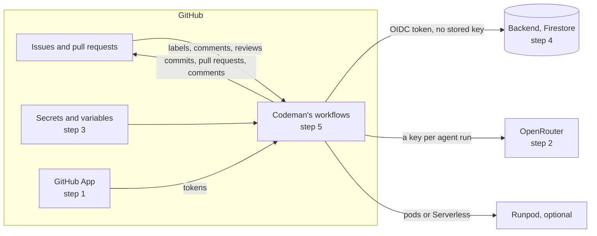
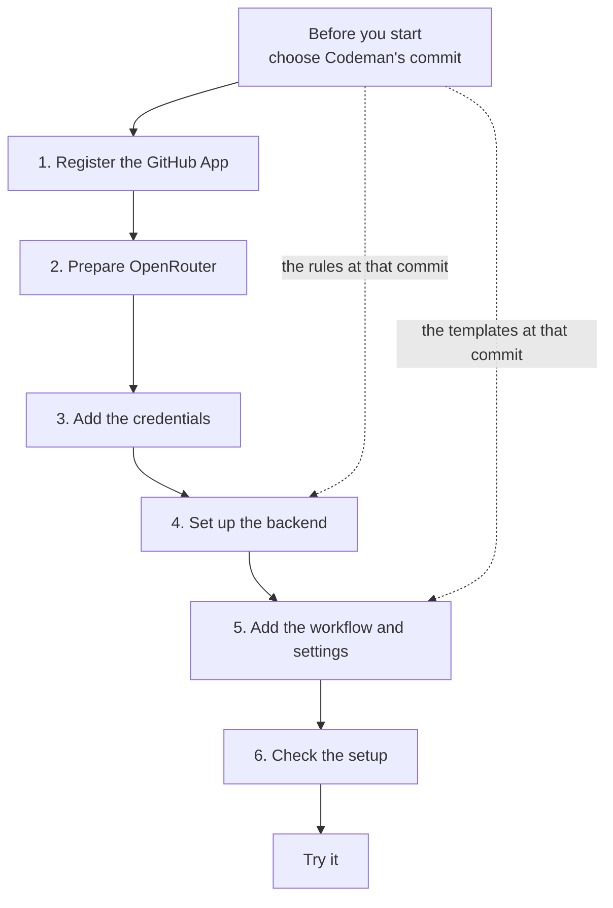
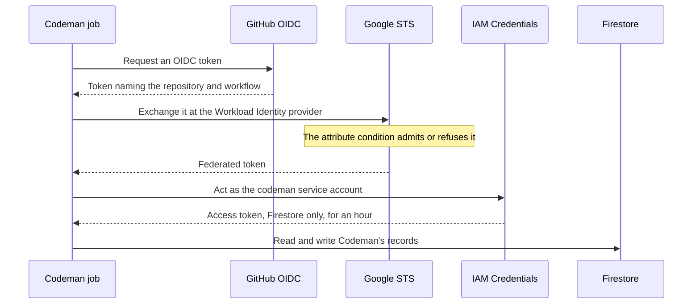
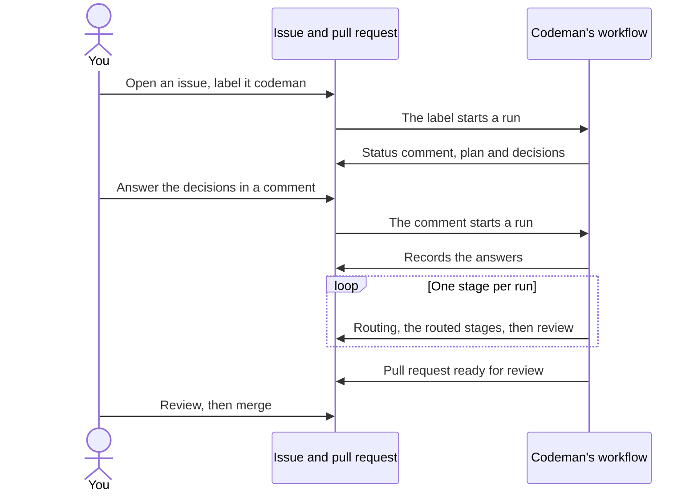

# Installation

This page sets Codeman up on a repository, step by step, and ends with a first [task](../glossary.md#task). To serve models on your own rented GPUs instead of OpenRouter, see [self-hosted inference on Runpod](runpod.md) or [on Salad](salad.md) once you are done here.

Codeman has five parts: a GitHub App, an OpenRouter account, credentials in the repository or organization, a [backend](../glossary.md#backend) where Codeman records its runs, and a workflow, which runs the [commit of Codeman](../glossary.md#codemans-commit) that a variable names.



- The workflows act on GitHub as the App, with tokens scoped to each job.
- They reach the backend with GitHub's OIDC token: no key is stored anywhere.
- They reach models through OpenRouter, or through Runpod when you serve them yourself.

Do the steps in this order. Each one uses what the steps before it set up:



## Before you start

### What you need

| You need | For | Optional |
| --- | --- | --- |
| An owner of the GitHub organization, or the user account, that runs Codeman | Registering the App, and the organization's secrets and variables ([GitHub](../web/github/using-secrets-in-github-actions.md#creating-secrets-for-an-organization)) | No |
| Write access to the target repository | Its workflow files, label and repository secrets ([GitHub](../web/github/using-secrets-in-github-actions.md#creating-secrets-for-a-repository)) | No |
| An [OpenRouter](https://openrouter.ai) account, with credits | Models through OpenRouter | Yes, when no run uses the `openrouter` provider |
| A Google account | The backend's Firebase project | No |
| [`gh`](https://cli.github.com), with the `admin:org` scope for organization secrets | Reading IDs and commits, and setting secrets and variables | The organization's settings page does the same |
| `gcloud`, or [Cloud Shell](https://shell.cloud.google.com), which has it | Setting up the backend's identity | No |
| `openssl` | Generating the encryption secret | Any random value of 32 characters or more will do |
| A [Runpod](https://www.runpod.io) account | Serving models on your own GPUs ([Runpod setup](runpod.md)) | Yes |
| A [Salad](https://salad.com) user and organization | Serving models on consumer GPUs that third parties own ([Salad setup](salad.md)) | Yes |

The `agent` job needs a Linux runner, x64 or arm64. The templates use `ubuntu-latest`.

Before the first task, go through the [security checklist](../security/overview.md#checklist).

### Choose Codeman's commit

Every job runs the commit of Codeman that the `CODEMAN_COMMIT_SHA` variable names. Choose it now: the backend's rules (step 4) and the workflow templates (step 5) come from that same commit, and you set the variable in step 3.

Take the latest commit of Codeman's `main`:

```sh
gh api repos/codenergy-dev/codeman/commits/main --jq .sha
```

Each job checks the value, checks Codeman out at it into `.codeman/action`, and runs it from there. The job fails when the value is:

- unset;
- not a full SHA, 40 lowercase hexadecimal characters, since a branch or tag would let the code change by itself;
- not a commit of Codeman's `main` branch, since GitHub also serves the commits of Codeman's forks under its name.

## 1. Register the GitHub App

Codeman acts as a GitHub App, not with the workflow's `GITHUB_TOKEN`. The `GITHUB_TOKEN` cannot push changes under `.github/workflows/`, and events it creates do not trigger other workflows.

Register the App once, under the owner (user or organization) that runs Codeman, in **Settings → Developer settings → GitHub Apps → New GitHub App**:

| Field | Value |
| --- | --- |
| **Webhook** | Disabled. Codeman runs from workflows, not webhooks |
| **Where can this GitHub App be installed** | **Only on this account**, for one organization. **Any account**, for a [pool of organizations](pool.md), which then installs it by its link. Making it public does not list it in the Marketplace |

Give it these repository permissions:

| Permission | Access | Why |
| --- | --- | --- |
| Contents | Read and write | `apply` commits the plan and the agent's changes to the [task branch](../glossary.md#task-branch) |
| Issues | Read and write | The [status comment](../glossary.md#status-comment), the labels and the run comments |
| Pull requests | Read and write | `apply` opens the pull request; `select` reads its reviews |
| Workflows | Read and write | `apply` pushes changes under `.github/workflows/`, when they are accepted |
| Actions | Read and write | Read for the results of workflows the agent asked for. Write only in the `dispatch` job, which starts another repository's Codeman run for a [batch](../runs/batches.md#waking-the-other-repositories), with a token for that repository alone |
| Metadata | Read-only | Mandatory |

Each job requests a token scoped down to the permissions it needs.

After creating it:

1. Note the **Client ID**. It goes in a variable in step 3.
2. Generate a **private key** and download it. Your browser saves a `.pem` file.

   > [!WARNING]
   > The private key is a secret: never commit it.

3. Install the App on the repositories where Codeman should run, choosing **Only select repositories**. The App's **Install App** page lists the installation.

## 2. Prepare OpenRouter

Codeman creates one OpenRouter key per [agent run](../glossary.md#agent-run), capped at what remains of the task's budget: the [task key](../glossary.md#task-key). To do that it needs a **management key**.

1. In OpenRouter, create a management key under **Settings → Management keys**. It goes in a secret in step 3.
2. Add credits to the account. Each run's key spends from them.

> [!WARNING]
> A management key can create keys without limits. So only the two [key jobs](../glossary.md#key-jobs) that open and close runs, `open-key` and `close-key`, receive it.

## 3. Add the credentials

Add the credentials under **Settings → Secrets and variables → Actions**, either in the repository or in the organization. At organization level, make them visible only to the repositories that use Codeman: see [repository access](#repository-access).

> [!IMPORTANT]
> On GitHub Free, private repositories cannot read organization secrets or variables ([GitHub](../web/github/using-secrets-in-github-actions.md#creating-secrets-for-an-organization)). Add them to each repository instead.

Which job reads each credential, and why that is safe, is in [secrets](../security/secrets.md#where-each-credential-goes).

### Secrets

| Secret | Value | Needed when |
| --- | --- | --- |
| `CODEMAN_GITHUB_APP_PRIVATE_KEY` | The full contents of the App's private key file | Always |
| `CODEMAN_KEY_ENCRYPTION_SECRET` | A random value of at least 32 characters | Always |
| `CODEMAN_OPENROUTER_MANAGEMENT_KEY` | The OpenRouter management key | The settings or a [profile](mixing-providers.md) use the `openrouter` [provider](../glossary.md#inference-provider), the default |
| `CODEMAN_RUNPOD_API_KEY` | The Runpod account's API key | The settings or a profile use `runpod-pod` or `runpod-serverless`; see [mixing providers](mixing-providers.md#add-the-secrets) for the organization's monthly budget |
| `CODEMAN_RUNPOD_SERVERLESS_KEY` | A key restricted to the Serverless endpoint | The settings or a profile use `runpod-serverless` |
| `CODEMAN_SALAD_API_KEY` | The API key of Codeman's Salad user | The settings or a profile use `salad-pod` |

Generate the encryption secret with:

```sh
openssl rand -base64 32
```

It encrypts each run's OpenRouter key, or self-hosted [run token](../glossary.md#run-token), while it travels from `open-key`, which creates it, to the `agent` job, within one [workflow run](../glossary.md#workflow-run); see [OpenRouter](../inference/openrouter.md). Self-hosted inference needs it too. The organizations of a pool need not share it.

### Variables

| Variable | Value | Needed when |
| --- | --- | --- |
| `CODEMAN_GITHUB_APP_CLIENT_ID` | The App's Client ID | Always |
| `CODEMAN_COMMIT_SHA` | The commit you chose in [Before you start](#choose-codemans-commit) | Always |
| `CODEMAN_FIREBASE_PROJECT`, `CODEMAN_WORKLOAD_IDENTITY_PROVIDER`, `CODEMAN_SERVICE_ACCOUNT` | The backend; you add them at the end of [step 4](#4-set-up-the-backend) | Always |
| `CODEMAN_SETTINGS` | Settings the organization's repositories share; see [shared settings](shared-settings.md) | Optional, in the organization |
| `CODEMAN_SALAD_ORGANIZATION`, `CODEMAN_SALAD_PROJECT` | The Salad organization and project where Codeman creates its pods | The settings or a profile use `salad-pod` |

A repository variable overrides the organization's variable of the same name.

### Repository access

An organization secret or variable reaches the repositories its access policy names ([secrets](../web/github/using-secrets-in-github-actions.md#creating-secrets-for-an-organization), [variables](../web/github/store-information-in-variables.md#creating-configuration-variables-for-an-organization)). Give every Codeman secret and variable of the organization the policy **Selected repositories**, listing only the repositories that run Codeman.

| Policy | Who receives the App's private key, the Runpod and OpenRouter keys and the encryption secret |
| --- | --- |
| **Selected repositories** | Only the repositories listed |
| **All repositories**, **Private repositories** | Also any repository created later in the organization, and any fork created inside it, as soon as it exists ([forks](../security/forks.md#what-a-fork-gets)) |

#### In the organization's settings

Under **Secrets and variables → Actions**, the **Repository access** list of a new secret or variable chooses its policy. The list of secrets shows each one's policy, and its **Update** button the details ([reviewing access](../web/github/using-secrets-in-github-actions.md#reviewing-access-to-organization-level-secrets)).

#### With `gh`

`gh` needs the `admin:org` scope: `gh auth login --scopes "admin:org"`. Pass `--visibility selected`, and `--repos` with the organization's repositories separated by commas ([gh secret set](../web/github-cli/gh-secret-set.md), [gh variable set](../web/github-cli/gh-variable-set.md)):

```sh
ORG=<organization>
REPOS=<repository-a>,<repository-b>   # the repositories that run Codeman
gh secret set CODEMAN_GITHUB_APP_PRIVATE_KEY --org "$ORG" --visibility selected --repos "$REPOS" < private-key.pem
gh secret set CODEMAN_KEY_ENCRYPTION_SECRET --org "$ORG" --visibility selected --repos "$REPOS"
gh variable set CODEMAN_COMMIT_SHA --org "$ORG" --visibility selected --repos "$REPOS" --body <commit SHA>
```

- Each command sets the value and the list of repositories together, replacing the previous list.
- Without `--body`, `gh secret set` reads the value from standard input.
- Without `--repos`, `gh` gives the policy **Private repositories**.

#### Add a repository later

To add a repository without setting the values again, add its ID to each secret and variable, once per name ([secrets](../web/github/rest-api-endpoints-for-github-actions-secrets.md#add-selected-repository-to-an-organization-secret), [variables](../web/github/rest-api-endpoints-for-github-actions-variables.md#add-selected-repository-to-an-organization-variable), [gh api](../web/github-cli/gh-api.md)):

```sh
REPO_ID=$(gh api repos/$ORG/<repository> --jq .id)
gh api --method PUT orgs/$ORG/actions/secrets/CODEMAN_GITHUB_APP_PRIVATE_KEY/repositories/$REPO_ID
gh api --method PUT orgs/$ORG/actions/variables/CODEMAN_COMMIT_SHA/repositories/$REPO_ID
```

With the [listed-repositories condition](#choose-the-attribute-condition), add the ID to the backend's condition too.

#### Check the access

List the policy and number of repositories of each secret and variable, and the repositories of one ([gh secret list](../web/github-cli/gh-secret-list.md), [gh variable list](../web/github-cli/gh-variable-list.md), [list selected repositories](../web/github/rest-api-endpoints-for-github-actions-secrets.md#list-selected-repositories-for-an-organization-secret)):

```sh
gh secret list --org "$ORG" --json name,visibility,numSelectedRepos
gh variable list --org "$ORG" --json name,visibility,numSelectedRepos
gh api orgs/$ORG/actions/secrets/CODEMAN_GITHUB_APP_PRIVATE_KEY/repositories --jq '.repositories[].full_name'
```

## 4. Set up the backend

Codeman records each run, what it cost and what its jobs did, in [Cloud Firestore](https://firebase.google.com/docs/firestore), in a Firebase project of its own; see [backend](../backend/backend.md).

- One project serves every repository of the organization, and several organizations if you like.
- The backend is required: without its variables, every run fails in `select`, saying which to set.
- Firestore's free quota covers Codeman's use by far ([cost](../backend/backend.md)), so the project needs no billing account.

The jobs reach the backend as a service account, with the OIDC token GitHub gives each job, so no key is stored anywhere:



1. Only `select`, `open-key`, `close-key` and `release-pod` ask GitHub for an OIDC token, with the `id-token: write` permission.
2. Google's Security Token Service exchanges it for a federated token, if the provider's [attribute condition](../glossary.md#attribute-condition) admits it.
3. With it, IAM Credentials gives an access token of the service account, for Firestore only, for an hour.

The commands below run in [Cloud Shell](https://shell.cloud.google.com), or anywhere `gcloud` is installed.

### Choose the attribute condition

The [Workload Identity provider](../glossary.md#workload-identity-provider) admits GitHub's OIDC tokens from Codeman's workflow on the default branch, of the repositories its attribute condition admits. Choose one of two conditions:

| Condition | Admits | A new repository, or a fork inside the organization | Recommended for |
| --- | --- | --- | --- |
| Any repository of the organization | Every repository of the organization whose `codeman.yml` on `main` asks for a token, those created later included | Gets in at once: nothing needs updating when a repository starts using Codeman | One organization whose repository creation and forking are restricted to people you trust as maintainers |
| Only listed repositories | The repositories whose numeric IDs it lists, in `assertion.repository_id` | Gets nothing until its ID is added ([change the condition](backend-maintenance.md#change-the-attribute-condition)) | A [pool](pool.md), and public repositories |

> [!WARNING]
> With the condition for any repository of the organization, anyone who can create a repository in the organization, or fork one into it, reaches the backend without any secret ([forks](../security/forks.md#what-a-fork-cannot-reach)). Restrict repository creation and forking in the organization to people you trust as maintainers.

IDs are unique and never reused, unlike names ([Google's advice](../web/google-cloud/configure-workload-identity-federation-with-deployment-pipelines.md#github-actions-1)).

Set `CONDITION` with the block of the condition you chose. Run only one of the two blocks.

Any repository of the organization:

```sh
ORG_ID=123456789   # your organization's numeric ID: gh api orgs/<organization> --jq .id
CONDITION="assertion.repository_owner_id == '$ORG_ID' && assertion.workflow_ref == assertion.repository + '/.github/workflows/codeman.yml@refs/heads/main'"
```

Only listed repositories:

```sh
ORG_ID=123456789   # your organization's numeric ID: gh api orgs/<organization> --jq .id
# Each repository's ID: gh api repos/<organization>/<repository> --jq .id
CONDITION="assertion.repository_owner_id == '$ORG_ID' && assertion.repository_id in ['111111111', '222222222'] && assertion.workflow_ref == assertion.repository + '/.github/workflows/codeman.yml@refs/heads/main'"
```

### What the condition checks

- **IDs, not names.** Someone else could take a name if the organization or repository were renamed or deleted. A user account has an ID too: `gh api users/<login> --jq .id`. GitHub's token carries the IDs as strings ([OpenID Connect](../web/github/openid-connect.md)), so the condition quotes them.
- **The workflow.** `workflow_ref` names the workflow that runs the job, the caller's for the jobs of `codeman-task.yml`, at its branch. Only `codeman.yml` on `main` gets in, which only a reviewed pull request changes. No other workflow of your repositories can reach the backend, not even one that runs code the agent wrote on a task branch.
- **The default branch.** If your default branch has another name, change `main`.
- **Several organizations.** Use `assertion.repository_owner_id in ['<ID>', '<ID>']`, with either condition.
- **The length.** A condition is at most 4096 characters ([update-oidc](../web/google-cloud/gcloud-iam-workload-identity-pools-providers-update-oidc.md)), about 280 repository IDs. Beyond that, see [many repositories](backend-maintenance.md#many-repositories).

### Steps

1. **Create the project.** In the [Firebase console](https://console.firebase.google.com), **Create a project**, named for instance `codeman-ops`. Google Analytics is not needed. Note its **project ID** (Project settings), which may differ from its name.
2. **Create the database.** Under **Databases & Storage → Firestore**, **Create database** ([manage databases](../web/firebase/manage-databases.md#create-a-database)), with:
   - **Standard edition**;
   - the database ID `(default)`;
   - a location near GitHub's runners, such as `nam5` or `us-east1`, which cannot be changed later;
   - **production mode**.
3. **Publish the rules.** Under **Databases & Storage → Firestore → Rules**, replace the rules with the contents of [`firebase/firestore.rules`](../../firebase/firestore.rules) at [the commit you chose](#choose-codemans-commit), and **Publish**. They deny every client: only Codeman's service account, which the rules do not apply to, reaches the data.
4. **Enable the APIs** that Workload Identity Federation uses, and **create the service account**, with the role that reads and writes Firestore's documents (Cloud Datastore User) and nothing else:

   ```sh
   PROJECT_ID=codeman-ops   # the project ID
   gcloud services enable iam.googleapis.com sts.googleapis.com iamcredentials.googleapis.com \
     --project="$PROJECT_ID"
   gcloud iam service-accounts create codeman --project="$PROJECT_ID" --display-name="Codeman"
   gcloud projects add-iam-policy-binding "$PROJECT_ID" --role=roles/datastore.user \
     --member="serviceAccount:codeman@$PROJECT_ID.iam.gserviceaccount.com"
   ```

5. **Create the [Workload Identity pool](../glossary.md#workload-identity-pool) and provider**, with the `CONDITION` you [chose](#choose-the-attribute-condition):

   ```sh
   gcloud iam workload-identity-pools create codeman --project="$PROJECT_ID" \
     --location=global --display-name="Codeman"
   gcloud iam workload-identity-pools providers create-oidc github --project="$PROJECT_ID" \
     --location=global --workload-identity-pool=codeman --display-name="GitHub" \
     --issuer-uri="https://token.actions.githubusercontent.com" \
     --attribute-mapping="google.subject=assertion.sub,attribute.repository=assertion.repository,attribute.repository_id=assertion.repository_id,attribute.repository_owner_id=assertion.repository_owner_id,attribute.workflow_ref=assertion.workflow_ref" \
     --attribute-condition="$CONDITION"
   ```

   The condition reads the token's claims as `assertion.<claim>`, and the mapping maps each of them, as Google's guide asks ([attribute condition](../web/google-cloud/configure-workload-identity-federation-with-deployment-pipelines.md#define-an-attribute-condition)). It maps `repository_id` for both conditions, so moving from one to the other changes only the condition.

6. **Let the pool's identities act as the service account**, and print the provider's name:

   ```sh
   PROJECT_NUMBER=$(gcloud projects describe "$PROJECT_ID" --format='value(projectNumber)')
   gcloud iam service-accounts add-iam-policy-binding \
     "codeman@$PROJECT_ID.iam.gserviceaccount.com" --project="$PROJECT_ID" \
     --role=roles/iam.workloadIdentityUser \
     --member="principalSet://iam.googleapis.com/projects/$PROJECT_NUMBER/locations/global/workloadIdentityPools/codeman/*"
   echo "projects/$PROJECT_NUMBER/locations/global/workloadIdentityPools/codeman/providers/github"
   ```

7. **Add the variables**, in the organization (visible to the repositories that use Codeman: [repository access](#repository-access)) or in each repository. They are not secrets. On GitHub Free, add them to each repository ([credentials](#3-add-the-credentials)).

   | Variable | Value |
   | --- | --- |
   | `CODEMAN_FIREBASE_PROJECT` | The project ID, such as `codeman-ops` |
   | `CODEMAN_WORKLOAD_IDENTITY_PROVIDER` | What the last command printed: `projects/<project number>/locations/global/workloadIdentityPools/codeman/providers/github` |
   | `CODEMAN_SERVICE_ACCOUNT` | `codeman@<project ID>.iam.gserviceaccount.com` |

The workflow templates pass these variables to the jobs that record runs, and give those jobs, and only those, the `id-token: write` permission. The first run that finds a task writes the first documents: **Databases & Storage → Firestore → Data** shows `organizations/<owner>/runs` and `events`.

To read, change, delete or restore any of this later, and to see who changed it, see [backend maintenance](backend-maintenance.md).

## 5. Add the workflow and settings

You add two workflow files, optional settings and a label to the target repository. Everything goes on the **default branch**: Codeman reads its configuration from there, and the backend admits only `codeman.yml` on that branch.

### Add the workflow files

1. From [the commit you chose](#choose-codemans-commit), copy:

   | Template | Copy to | Role |
   | --- | --- | --- |
   | [`templates/codeman.yml`](../../templates/codeman.yml) | `.github/workflows/codeman.yml` | Picks the tasks and starts the next run |
   | [`templates/codeman-task.yml`](../../templates/codeman-task.yml) | `.github/workflows/codeman-task.yml` | Runs each task's jobs |

   Nothing in the templates needs replacing.

   > [!IMPORTANT]
   > Keep the name `codeman.yml`. If you copy it under another name, change the backend's [attribute condition](#choose-the-attribute-condition) to match it.

2. **Optional: tools for the agent.** If the agent needs tools that the runner image lacks, set them up in the `agent` job of `codeman-task.yml`, where the template marks the place, for example with `actions/setup-node`. Install them system-wide: tools installed inside the runner's home, such as Rust through `rustup`, are out of the agent's reach.

   > [!WARNING]
   > Add only steps that install tools. A step that runs repository code, such as `npm ci`, runs code the agent wrote outside its [sandbox](../glossary.md#sandbox), where it can read the job's secrets. See [risk 3](../security/risks.md#3-steps-added-to-the-agent-job-run-outside-the-sandbox).

### Add the settings

3. **Optional: `.codeman/settings.yml`.** Without it, the organization's [shared settings](shared-settings.md) and Codeman's defaults apply. Every agent run needs a model from one of them.
   - Without shared settings: write it with [`templates/settings.yml`](../../templates/settings.yml) as a guide, and choose the model.
   - With shared settings: write only the values this repository changes.

   > [!WARNING]
   > The template sets `model`, `provider`, the budgets, `max-runs` and the limits. Each value in the file overrides the organization's, so a whole copy overrides all of them.

   See [settings](../settings/reference.md) for every value. To run several tasks at once, see [mixing providers](mixing-providers.md#several-tasks-at-once).

4. **Optional: `.codemanignore`**, the paths the agent may not change ([change policy](../runs/changes.md#change-policy)).
   - Without one, Codeman uses its own rules and proposes them in its first pull request.
   - Those rules keep the agent out of `.github/`, workflows included. To allow workflows, see [on-demand workflows](../runs/changes.md#on-demand-workflows).
5. **Create the `codeman` label** in the target repository.
6. **Commit everything to the default branch.** GitHub runs the default branch's copy of the workflow for comments, labels and the schedule, and starts a manual run only of a workflow there ([events](../web/github/events-that-trigger-workflows.md)).

**You should now see** the **Codeman** workflow under the repository's **Actions** tab.

### Where Codeman reads its configuration

| What | Read from | Overridden by |
| --- | --- | --- |
| `.codeman/settings.yml`, `.codemanignore` | The default branch | A manual run (**Actions → Codeman → Run workflow**): the model and the budgets, for that run only |
| Codeman's code | The commit in `CODEMAN_COMMIT_SHA` | A repository variable of the same name, over the organization's |

### Move to another version

1. Before moving, read what changed ([risk 7](../security/risks.md#7-codemans-own-code-and-dependencies)) and the [upgrade notes](upgrading.md).
2. Change `CODEMAN_COMMIT_SHA` **between runs**. A change made during a run reaches the jobs that start after it.
3. Copy the templates again **only when Codeman asks**. Each Codeman step passes the [template version](../glossary.md#template-version) its file was copied from (`template-version`). A commit that expects another version fails at its first job, with a link to the templates at that commit. Copy both files then, keeping the steps you added to the `agent` job.

## 6. Check the setup

A manual run with no labeled issue checks the commit, the templates, the App and the backend, and changes nothing on GitHub.

1. Check that no open issue of the repository has the `codeman` label.
2. Under **Actions → Codeman → Run workflow**, run the workflow on the default branch, with every input empty.
3. Open the run. The **Select tasks** job succeeds, and the other jobs are skipped. Its log shows:

   ```text
   Found 0 open issue(s) labeled "codeman".
   ```

If **Select tasks** fails, its log names the problem:

| The log says | Cause | Fix |
| --- | --- | --- |
| `Set the CODEMAN_COMMIT_SHA variable to a full commit SHA of codenergy-dev/codeman (40 lowercase hexadecimal characters), not a branch or tag.` | The variable is unset, or is not a full SHA | Set it as in [Before you start](#choose-codemans-commit), visible to this repository |
| `CODEMAN_COMMIT_SHA must be a commit of codenergy-dev/codeman's main branch, but GitHub compares it with main as "…".` | The commit is not on Codeman's `main` | Take a commit of `main` |
| The step **Run actions/create-github-app-token** fails | The App's Client ID or private key is wrong or missing, or the App is not installed on the repository | Check [step 1](#1-register-the-github-app) and [step 3](#3-add-the-credentials) |
| `This workflow's files are template version …, but Codeman at commit … expects version …` | The workflow files come from another commit | Copy both templates from the commit in `CODEMAN_COMMIT_SHA` |
| `Codeman's backend is not set up: this step has no …` | Backend variables are missing, or the workflow files do not pass them | Add the variables it names ([step 4](#4-set-up-the-backend), 7), or copy the templates again |
| `Codeman's backend settings are wrong: …` | A backend variable has the wrong form | Compare it with [step 4](#4-set-up-the-backend), 7 |
| ``The job could not get GitHub's OIDC token: give it the `id-token: write` permission, as the templates do.`` | The workflow file was changed | Copy the templates again |
| `Could not read Codeman's store after 4 attempts: Google's STS refused the request …` | The attribute condition refuses the token: the owner ID, a repository ID, the file's name or the branch | Check the [condition](#choose-the-attribute-condition) |
| `Could not read Codeman's store after 4 attempts: IAM Credentials refused the request …` | The pool's identities cannot act as the service account | Run [step 4](#4-set-up-the-backend), 6, again |
| `Could not read Codeman's store after 4 attempts: Firestore batchGet failed with …` | The service account lacks Cloud Datastore User, or the project has no `(default)` database | Check [step 4](#4-set-up-the-backend), 2 and 4 |
| An error naming ``the `settings` input (organization variable CODEMAN_SETTINGS)`` | The organization's settings are malformed | Fix the variable ([shared settings](shared-settings.md)) |

## Try it



| Step | You do | Codeman does | You should see |
| --- | --- | --- | --- |
| 1 | As a [maintainer](../glossary.md#maintainer), open an issue that leaves something to decide, and label it `codeman` | Adding the label starts a run. Codeman works only on issues that maintainers open | A run under **Actions → Codeman**. You can also start one by hand |
| 2 | Wait | Plans the task | A status comment, a plan on the branch `codeman/<issue>-<slug>`, and the decisions in a comment of their own |
| 3 | Answer in a comment, for example `/codeman decide 1 a` or `/codeman approve` | The comment starts a new run, which records the answers | The label `codeman:ready` once no decision is pending |
| 4 | Wait | Starts the next run right away. The [stages](../glossary.md#stage) follow one run each: routing, then the [routed stages](../glossary.md#routed-stage) it chose among web, design, code and test, then review. Unfinished work is committed, and the following run continues it | After code, a draft pull request that closes the issue. When the route has no code stage, the pull request opens when review passes |
| 5 | Wait | Review passes | The pull request is ready for review, and the issue gets `codeman:done` |
| 6 | Review the pull request. Request changes, or comment `/codeman fix <what to change>` | Starts a run that pushes the changes to the same branch | New commits on the pull request |
| 7 | Merge the pull request | Nothing: Codeman never merges | The issue closes |

To choose settings for this task, add lines such as `/codeman model <id>` or `/codeman set task-budget 5` to the issue's description; see [commands](../tasks/commands.md).

## A pool of organizations

Organizations that share one GPU account can batch tasks on the same pods. Setting one up is in [a pool of organizations](pool.md).

## Next steps

- [Security checklist](../security/overview.md#checklist): protect the repository before real tasks.
- [Settings](../settings/reference.md): every setting, and where its value comes from.
- [Shared settings](shared-settings.md): give the organization's repositories the same settings.
- [Mixing providers](mixing-providers.md): a different model per stage, and several tasks at once.
- [Self-hosted inference on Runpod](runpod.md) or [on Salad](salad.md): serve an open model on GPUs you rent.
- [Commands](../tasks/commands.md) and [task lifecycle](../tasks/lifecycle.md): steer a task, and read its labels.
- [Upgrading](upgrading.md) and [backend maintenance](backend-maintenance.md): keep the installation running.
