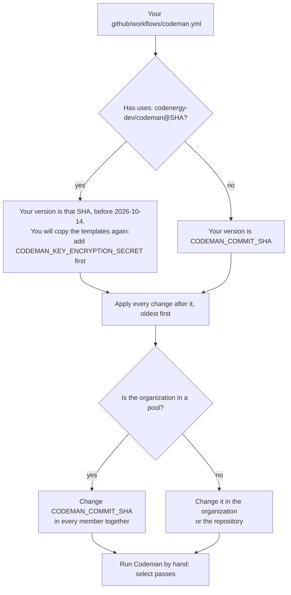

# Upgrading

This page lists the changes of Codeman that ask something of an installation, and what Codeman does with what older versions left behind. Read the entries after the version you run, oldest first.

## Find your version

The version of Codeman a repository runs is [Codeman's commit](../glossary.md#codemans-commit).

- **Since `7e2a137`** (2026-10-14), it is the `CODEMAN_COMMIT_SHA` variable. A repository's variable overrides the organization's ([gh variable list](../web/github-cli/gh-variable-list.md)):

  ```sh
  gh variable list --repo <owner>/<repository> --json name,value
  gh variable list --org <organization> --json name,value
  ```

- **Before**, it is the SHA in the workflow files' `uses: codenergy-dev/codeman@<sha>` lines.

A commit's date, and whether your commit includes a change ([compare two commits](../web/github/rest-api-endpoints-for-commits.md#compare-two-commits)):

```sh
gh api repos/codenergy-dev/codeman/commits/<your commit> --jq .commit.committer.date
gh api repos/codenergy-dev/codeman/compare/<change commit>...<your commit> --jq .status
```

The second prints `ahead` or `identical` when your commit includes the change, and `behind` when it does not.



## How to upgrade

1. **List the changes** after your commit in the [changes table](#changes), and read their entries, oldest first.
2. **Fix the settings** that an entry names. Old settings stop the [workflow run](../glossary.md#workflow-run) with an error that says what to write.
3. **Add the secrets and variables** that an entry names, before copying any template that needs them.
4. **Wait for the [pods](../glossary.md#pod) to end**, when an entry says so. Runpod's console shows none.
5. **Set `CODEMAN_COMMIT_SHA`** to the new commit, between runs ([check that no run is in progress](backend-maintenance.md#check-that-no-run-is-in-progress)). In a [pool of organizations](../glossary.md#pool-of-organizations), set the same commit in every member together ([pool](pool.md#add-an-organization)).
6. **Copy both templates again** from the new commit, when an entry says so, or when a job fails with `This workflow's files are template version …, but Codeman at commit … expects version …` ([template version](../glossary.md#template-version)).
7. **Check it.** Run Codeman by hand, as in [check the setup](setup.md#6-check-the-setup): `select` passes.

> [!IMPORTANT]
> Copying the templates again replaces the steps you added to the `agent` job. Keep them: copy them into the new `codeman-task.yml`.

> [!IMPORTANT]
> Templates copied from `362a8da` on pass only `CODEMAN_KEY_ENCRYPTION_SECRET`. Add it before copying them, or every `open-key` fails ([secret renamed](#secret-renamed)).

### Roll back

1. Set `CODEMAN_COMMIT_SHA` back to the commit you ran, between runs, in every member of the pool together.
2. If you copied the templates again and their template version differs from the older commit's, copy the older commit's templates too. The failing job says so.
3. Do not roll back across an entry whose [backend](../glossary.md#backend) data moved: [GPU batches across repositories](#gpu-batches-across-repositories). Older versions do not read `pools/`, and older and newer versions do not share pods.

## Changes

| Since | Change | Commit | Who is affected | Action | Breaking |
| --- | --- | --- | --- | --- | --- |
| 2026-10-07 | [Workflow files copied before the backend](#workflow-files-copied-before-the-backend) | `e694970`, `0bf6daa`, `42e6b83` | Workflow files copied before the ledger | Copy both templates, set up the backend | Yes: `select` fails |
| 2026-10-08 | [Old setting names](#old-setting-names) | `27f0ece` | Settings with `inference`, `gpu-*`, `serverless-endpoint` or `inference-profiles` | Rename | Yes: the run stops |
| 2026-10-08 | [A model per provider](#a-model-per-provider) | `ac75773` | A layer or profile that changes provider without a `model` | Add `model` | Yes: the run stops |
| 2026-10-08 | [Profiles pick the tasks](#profiles-pick-the-tasks) | `ab6a93f` | Settings with `when` or `parallel-tasks` | Rewrite the counts | Yes: the run stops |
| 2026-10-08 | [Ollama settings on pods](#ollama-settings-on-pods) | `91600ce` to `c983069`; on pods from `df7b528` | Pod profiles with an `ollama:` block | None | No |
| 2026-10-13 | [Pods fit the GPU](#pods-fit-the-gpu) | `2429c0d` to `95962c0`; on pods from `df7b528` | Pod profiles | Check two things | No |
| 2026-10-13 | [vLLM on pods](#vllm-on-pods) | `513f4d9`; vLLM image from `df7b528` | Pod profiles that change engine | Check three things | No |
| 2026-10-13 | [GPU batches across repositories](#gpu-batches-across-repositories) | `3ea1e27` to `f2c2a74` | Every repository; pods most | Ordered steps | Yes |
| 2026-10-14 | [Secret renamed](#secret-renamed) | `362a8da` | Every installation | Add the new secret before copying the templates | Once the templates are copied |
| 2026-10-14 | [Codeman's commit from a variable](#codemans-commit-from-a-variable) | `7e2a137`, `840e90b` | Workflow files with `uses: codenergy-dev/codeman@` | Add the variable, copy both templates | Yes |
| 2026-10-14 | [Backend mapping gains repository_id](#backend-mapping-gains-repository_id) | `c4da7e2` | Backends set up before, moving to the listed-repositories condition | Update the mapping | No |
| 2026-10-15 | [The dispatch reads the default branch](#the-dispatch-reads-the-default-branch) | `e26a8c9`, fixed by `e0370fd` | Repositories whose batches take another repository's tasks | Copy `codeman.yml` | Dispatches fail |
| 2026-10-15 | [A spent pod waits for its close](#a-spent-pod-waits-for-its-close) | `ca7f3e8`; on pods from `c69ea45` | Pod runs | None | No |
| 2026-10-19 | [Review rounds block at max-runs](#review-rounds-block-at-max-runs) | `503e9fc` | Tasks that reach review | None, or raise `max-runs` | No |
| 2026-10-28 | [Agent time in the settings](#agent-time-in-the-settings) | This plan's first commit | Every installation, and copies of `codeman-task.yml` that changed `agent-minutes` | Copy both templates; move a changed `agent-minutes` to the settings | Yes: template version 2 |

The [older versions](#older-versions) entries say what Codeman does with tasks, pod images and records from before some of these changes.

## Settings

### Old setting names

- **Since:** 2026-10-08, `27f0ece` ([provider settings plan](../plans/2026-10-08-provider-settings.md)).
- **Who is affected:** settings that use an old name, in `.codeman/settings.yml`, the organization's `CODEMAN_SETTINGS` or a profile; and tasks that changed their GPU with `/codeman set gpu-type`.
- **Breaking:** yes. The run stops with an error that gives the new name.

#### What to do

Rename, in each of those places:

| Before | Now |
| --- | --- |
| `inference: openrouter` | `provider: openrouter`, or nothing, since it is the default |
| `inference: self-hosted` with `gpu-mode: pod`, or no `gpu-mode` | `provider: runpod-pod` |
| `inference: self-hosted` with `gpu-mode: serverless` | `provider: runpod-serverless` |
| `gpu-type` | `gpu` |
| `serverless-endpoint` | `endpoint` |
| `gpu-provider`, `gpu-mode` | Nothing: they go |
| `inference-profiles` | `profiles` |

A task that changed its GPU with `/codeman set gpu-type` needs `/codeman set gpu` instead. The old command is reported as a problem that gives the new name.

#### How to verify

Run Codeman by hand: `select` passes, with no error naming an old setting.

### A model per provider

- **Since:** 2026-10-08, `ac75773` ([model per provider plan](../plans/2026-10-08-model-per-provider.md)).
- **Who is affected:** a repository's file or a profile that names another [inference provider](../glossary.md#inference-provider) than the one it inherits, without a `model` of its own.
- **Breaking:** yes. The first run stops with an error that names it.

#### What to do

1. Add the model the new provider serves, such as `model: qwen3-coder:30b` to a profile with `provider: runpod-pod` that inherits OpenRouter from the [top level](../glossary.md#top-level).
2. Note that a task's `/codeman set model` now applies only to the runs on the top level's provider ([the model](../settings/provider-settings-across-layers.md#the-model)).

#### How to verify

Run Codeman by hand: `select` passes.

### Profiles pick the tasks

- **Since:** 2026-10-08, `ab6a93f` ([plan for profiles that pick the tasks](../plans/2026-10-08-profiles-pick-the-tasks.md)).
- **Who is affected:** settings with a profile's `when`, or with `parallel-tasks`, in `.codeman/settings.yml`, the organization's `CODEMAN_SETTINGS` or a profile.
- **Breaking:** yes. Settings written before stop the run with an error that says what to write instead.

A [profile](../glossary.md#profile)'s [conditions](../glossary.md#profile-condition) now sit at its first level, the profiles' [counts](../glossary.md#count) decide how many tasks a run takes, and no setting is required.

#### What to do

| Before | Now |
| --- | --- |
| `when:` with `stages: [code]` under it | `stages: [code]` in the profile, beside its `name` |
| `parallel-tasks: N` under a profile's `when` (at least N tasks) | `min-tasks: N` in the profile; or `tasks: N` for exactly N, `max-tasks` for at most |
| `parallel-tasks: N` at the top level | `max-tasks: N` (or `tasks: N`) in a profile: the largest count a profile names is how many tasks a run takes. A profile with only a `name` and `max-tasks: N` is enough: it changes nothing else |
| `parallel-tasks: 1`, or none | Nothing: one task at a time when no profile has a count |
| `model` required at the top level | Optional: without it, only profiles serve agent runs, and each sets its own `model` |

For example:

```yaml
# Before
model: deepseek/deepseek-v4.1-flash
parallel-tasks: 3
profiles:
  - name: small-pod
    when:
      stages: [code, test]
      parallel-tasks: 2
    provider: runpod-pod
    gpu: "NVIDIA RTX A6000"
    model: qwen3-coder:30b

# Now
model: deepseek/deepseek-v4.1-flash
profiles:
  - name: small-pod
    stages: [code, test]
    min-tasks: 2
    max-tasks: 3
    provider: runpod-pod
    gpu: "NVIDIA RTX A6000"
    model: qwen3-coder:30b
```

`small-pod`'s `max-tasks: 3` makes runs of up to 3 tasks, as `parallel-tasks: 3` did. The top level serves the other runs, at any count. Without a profile that names a count, add one with only a `name` and `max-tasks: 3`.

The workflow files need no change: the run's matrix already follows what `select` picks.

Behind the change ([profiles](../settings/profiles.md#how-many-tasks-a-run-takes)):

- a task that its profiles serve only with more tasks than are ready now waits, and its panel says so;
- a task whose stage nothing serves at any count is blocked.

#### How to verify

Run Codeman by hand: `select` passes. A run with ready tasks starts a `task` job per task it took, up to the largest count.

### Review rounds block at max-runs

- **Since:** 2026-10-19, `503e9fc` ([plan for the max-runs counters](../plans/2026-10-19-align-the-max-runs-counters.md)).
- **Who is affected:** every repository whose tasks reach review; most, those with `max-runs: 1`.
- **Breaking:** no. Nothing changes in settings or workflow files.

[Review rounds](../glossary.md#review-round) now block a task at the `max-runs`th `changes` in a row, as a stage's [runs in a row](../glossary.md#runs-in-a-row) do at the `max-runs`th unfinished run ([runs in a row and review rounds](../tasks/stages.md#runs-in-a-row-and-review-rounds)):

- review blocks one round sooner: with `max-runs: 3`, at the 3rd `changes` in a row instead of the 4th;
- with `max-runs: 1`, every `changes` blocks the task: review no longer sends the work back on its own;
- tasks in progress follow the new rule from their next `changes`. Their record needs no change.

#### What to do

Nothing. To keep review's old limit, set `max-runs` one higher, which also gives each stage one more run.

Copying `codeman.yml` again is optional: it updates the description of the manual run's `max-runs` input.

#### How to verify

A task blocked by review's rounds says "Review asked for changes 3 times in a row (`max-runs` is 3)".

## Workflow files and secrets

### Workflow files copied before the backend

- **Since:** 2026-10-07: the [ledger](../glossary.md#ledger), `e694970`; the budgets from the ledger, `0bf6daa`; the pod registry, `42e6b83` ([backend plan](../plans/2026-10-07-firestore-backend.md)).
- **Who is affected:** workflow files copied before the backend; with pods, every repository of the organization.
- **Breaking:** yes. Older workflow files fail in `select`, before they mark any task, since they pass none of the backend's variables.

#### What to do

1. **Set up the backend**, as in [installation](setup.md#4-set-up-the-backend).
2. **Copy both templates again.** The jobs that record runs need their new permissions, variables and the run's ID in the ledger.
3. **Move any steps you added** to the `agent` job into `codeman-task.yml`. It holds each task's jobs since `b8c1ddc` (2026-10-06).
4. **Copy them even after the backend**, if they were copied before the budgets came from the ledger. Those files pass neither the organization's monthly budget nor the task's spend from `close-key` to `apply`.
5. **With pods, update every repository of the organization at once** to a version with the pod registry. Its `open-key` terminates the organization's pods created by older versions, which the registry does not hold. Older versions cannot share the newer pods.

Files copied before `31ced3a` (2026-10-06) also ignore the organization's `CODEMAN_SETTINGS`: they do not pass it to `select` ([layers](../settings/reference.md#layers)). Copying the templates again fixes that too.

#### How to verify

The first run that finds a task writes the first documents: **Databases & Storage → Firestore → Data** shows `organizations/<owner>/runs` and `events`.

### Secret renamed

- **Since:** 2026-10-14, `362a8da`.
- **Who is affected:** every installation that has `CODEMAN_OPENROUTER_KEY_ENCRYPTION_SECRET`.
- **Breaking:** once the templates are copied again. Templates copied from this change on pass only the new name. Without the new secret, every `open-key` fails with `Input required and not supplied: encryption-secret`, so no agent runs.

`CODEMAN_OPENROUTER_KEY_ENCRYPTION_SECRET` is now `CODEMAN_KEY_ENCRYPTION_SECRET`, since it also protects the [gateway](../glossary.md#gateway) tokens of self-hosted runs. Workflow files copied before keep passing the old name, and work until they are replaced.

#### What to do

1. Add the secret under the new name where the old one is. The same value will do.
2. Then copy the templates again.
3. Then remove the old one.

#### How to verify

- `gh secret list --repo <owner>/<repository>`, or `--org <organization>`, lists `CODEMAN_KEY_ENCRYPTION_SECRET` ([gh secret list](../web/github-cli/gh-secret-list.md)).
- The next `open-key` passes.

### Codeman's commit from a variable

- **Since:** 2026-10-14, `7e2a137`; and `840e90b`, which runs only commits of Codeman's `main` ([plan for Codeman's commit from a variable](../plans/2026-10-14-commit-from-a-variable.md)).
- **Who is affected:** workflow files with `uses: codenergy-dev/codeman@<sha>`.
- **Breaking:** yes. Until the templates are copied again, the files keep running the commit written in them. Pointed by hand at a commit since the plan, they fail at once, saying they pass no template version.

The workflow files name no commit of Codeman: each job that runs it checks it out at the commit in the `CODEMAN_COMMIT_SHA` variable.

#### What to do

Once, in each repository:

1. **Add `CODEMAN_COMMIT_SHA`**, in the organization or the repository: a full commit SHA of Codeman's `main` branch, at or after that plan ([choose Codeman's commit](setup.md#choose-codemans-commit)).
2. **Add `CODEMAN_KEY_ENCRYPTION_SECRET`** first, if the old name is all you have ([secret renamed](#secret-renamed)). These templates pass only the new name.
3. **Copy both templates again** from that commit, keeping the steps you added to the `agent` job.

From then on, a new version of Codeman is a change of the variable. Copy the templates again only when a job fails saying the files' [template version](../development/guide.md#template-version) is not the one Codeman expects.

#### How to verify

Run Codeman by hand, as in [check the setup](setup.md#6-check-the-setup). Its table lists the errors of a wrong `CODEMAN_COMMIT_SHA`.

### The dispatch reads the default branch

- **Since:** 2026-10-15, `e26a8c9`; fixed on 2026-10-28, `e0370fd` ([plan](../plans/2026-10-28-dispatch-on-the-default-branch-read-by-rest.md)).
- **Who is affected:** each repository of the pool, whose batches take tasks of its other repositories.
- **Breaking:** only the dispatches. The template version does not change: files copied before keep running, and only their dispatches fail.

The `dispatch` job's App token has `actions: write` and `metadata: read`. Without `--ref`, `gh workflow run` reads the target repository's default branch through GraphQL, which that token cannot. Every dispatch to another repository of the pool fails with "Resource not accessible by integration (repository.defaultBranchRef)".

`e26a8c9` added `metadata: read` to the token, which did not fix it. The `dispatch` job now reads the default branch through REST, which `metadata: read` allows, and passes it to gh as `--ref`.

#### What to do

Copy `codeman.yml` again in each repository of the pool, from a commit at or after `e0370fd`. The token asks for no new permission, so the App's installations approve nothing.

#### How to verify

In a run whose batch takes another repository's tasks, the `dispatch` job succeeds.

### Agent time in the settings

- **Since:** 2026-10-28 ([plan for configurable agent time](../plans/2026-10-28-configurable-agent-time-and-wrap-up-after-timeout.md)).
- **Who is affected:** every installation: the templates are version 2.
- **Breaking:** yes. Until the templates are copied again, every job fails saying the files are template version 1.

The agent's time is now the `agent-minutes` setting, and the `agent` job's timeout follows it ([agent time](../settings/reference.md#agent-time)). `codeman-task.yml` no longer passes `agent-minutes` to the agent step, and its `agent` job's `timeout-minutes` comes from `select`.

#### What to do

1. **Copy both templates again**, keeping the steps you added to the `agent` job.
2. **If your copy of `codeman-task.yml` changed `agent-minutes`**, or the `agent` job's `timeout-minutes`, write the time as `agent-minutes` in `.codeman/settings.yml` or the organization's settings instead.

#### How to verify

The `agent` step's log says "Running … for up to N minutes", N being your `agent-minutes`.

## Backend

### GPU batches across repositories

- **Since:** 2026-10-13 to 2026-10-14, `3ea1e27` to `f2c2a74` ([plan for GPU batches across repositories](../plans/2026-10-13-gpu-batches-across-repositories.md)).
- **Who is affected:** every repository. Steps 1 and 5 matter most with pod profiles.
- **Breaking:** yes. Older and newer versions do not share pods, and the backend's layout changes.

A profile's count is now the size of a [batch](../glossary.md#batch). On a pod, a batch may take tasks of the organization's other repositories, and of a [pool](../runs/batches.md#pools)'s organizations.

> [!WARNING]
> Upgrade every repository of every member of the pool together, while no pod runs. An upgraded `open-key` terminates the organization's pods created by older versions, which no registry reads any more.

What moves in the backend ([data layout](../backend/data-layout.md)):

| Data | Now | Before |
| --- | --- | --- |
| Pods, Serverless endpoints' runs | `pools/{pool}/` | `organizations/{owner}`: `pods`, `endpoints` |
| The [board](../glossary.md#board), the batches | `pools/{pool}/` | — |
| The [cache of fits](../glossary.md#cache-of-fits) | `contexts/` | `organizations/{owner}`: `contexts` |
| Runs and events | `organizations/{owner}`, unchanged | `organizations/{owner}` |

- The older `pods`, `contexts` and `endpoints` of each organization stay as history, unread. The exception: the organization's month still counts its older pods' [untracked time](../glossary.md#untracked-time).
- The first pod of each settings searches its context again.

#### What to do

Upgrade in this order:

1. **Every repository at once, with no live pod.** Wait until no pod runs, as Runpod's console shows, before the first upgraded run. Upgrade every repository of every member of the pool together.
2. **The App's Actions permission**: read and write, approved in each installation ([setup](setup.md#1-register-the-github-app)). An App created before batches has Actions read-only: change it to read and write, then approve the new permission in each installation (**Settings → GitHub Apps → Codeman → Review request**). Until then, a `dispatch` leg fails, and the batch runs smaller ([changing an App's permissions](../web/github/modifying-a-github-app-registration.md#changing-the-permissions-of-a-github-app)).
3. **Both workflow files**, copied again in each repository. `codeman.yml` gains:
   - the `issues` trigger;
   - the concurrency group of skipped runs;
   - the `batch` input;
   - the `dispatch` job.

   Create the `codeman` label if a repository lacks it.
4. **Counts.** A planning task and code tasks are no longer counted together. In the [profiles' example](../settings/profiles.md#example), 1 planning task and 3 code tasks now run the code tasks on `mig` (3), not on the profile named `parallel-tasks` (4). A profile whose count was meant as the whole run's needs another look.
5. **A pool of organizations**, optionally: [a pool of organizations](pool.md).

#### How to verify

- After the first upgraded run, **Firestore → Data** shows `pools/<pool ID>`. The pool's ID is the organization's login in lowercase, or the members' logins sorted and joined by `+` ([`src/pool.ts`](../../src/pool.ts)).
- Each repository has the label: `gh api repos/<owner>/<repository>/labels/codeman` answers.
- In a pool, `select`'s log says `Pool <pool ID>: batches with the repositories of <members>.`

### Backend mapping gains repository_id

- **Since:** 2026-10-14, `c4da7e2` ([plan for the backend's condition and maintenance](../plans/2026-10-14-backend-condition-and-maintenance.md)).
- **Who is affected:** backends set up before, which move to the condition that lists repositories.
- **Breaking:** no. Nothing changes in settings or workflow files.

The installation's [Workload Identity provider](../glossary.md#workload-identity-provider) also maps `attribute.repository_id=assertion.repository_id`, so that an [attribute condition](../glossary.md#attribute-condition) can admit only listed repositories by their IDs ([setup](setup.md#4-set-up-the-backend)). A provider created before maps only `google.subject`, `attribute.repository`, `attribute.repository_owner_id` and `attribute.workflow_ref`. It keeps working with its condition, and needs no change while it admits any repository of the organization.

#### What to do

A condition may use only fields the mapping maps ([attribute condition](../web/google-cloud/configure-workload-identity-federation-with-deployment-pipelines.md#define-an-attribute-condition)). To move to the listed-repositories condition:

1. Read the mapping, with the names and variables of [backend maintenance](backend-maintenance.md#where-to-run-the-commands):

   ```sh
   gcloud iam workload-identity-pools providers describe github --project="$PROJECT_ID" \
     --location=global --workload-identity-pool=codeman --format='yaml(attributeMapping)'
   ```

2. If it has no `attribute.repository_id`, pass the installation's whole mapping with `--attribute-mapping` in the same `update-oidc` that sets the new condition ([change the attribute condition](backend-maintenance.md#change-the-attribute-condition), step 4).

#### How to verify

The same `describe` lists `attribute.repository_id: assertion.repository_id`.

## Pods

### Ollama settings on pods

- **Since:** 2026-10-08, `91600ce` to `c983069` ([plan for Ollama settings](../plans/2026-10-08-ollama-settings.md)). On pods, from `df7b528` (2026-10-14), the first pinned image that applies them.
- **Who is affected:** pod profiles with an `ollama:` block.
- **Breaking:** no.

A profile's `ollama:` block sets the [engine](../glossary.md#engine)'s variables on its pods ([Ollama settings](../settings/ollama.md)).

- The settings are part of the [pod settings](../glossary.md#pod-settings), only when there are some. Pods without them keep the settings they had, so their tasks go on sharing them.
- The images pinned before `df7b528` cannot apply them. On those versions, a run with Ollama settings stops before any pod is created ([Ollama's pod images](../settings/ollama.md#pod-images)).

#### What to do

Nothing. To use Ollama settings, run a version at or after `df7b528`.

#### How to verify

A run with an `ollama:` block gets a pod, and `open-key` logs its [fit](../glossary.md#fit): `Pod <ID> serves <model> with <N> parallel request(s) and a context of <N> tokens…, wholly on the GPU; …`.

### Pods fit the GPU

- **Since:** 2026-10-13, `2429c0d` to `95962c0` ([plan for fitting Ollama to the GPU](../plans/2026-10-13-fit-ollama-to-the-gpu.md)). On pods, from `df7b528` (2026-10-14), the first pinned image built since.
- **Who is affected:** pod profiles.
- **Breaking:** no. Settings need no change.

Once the pinned [pod image](../glossary.md#pinned-pod-image) is one built since the plan, a pod:

- serves as many requests at once as its profile's tasks;
- takes the largest context that fits its GPU, instead of the model's own;
- fails to start when the model does not fit wholly on the GPU ([memory](../settings/ollama.md#memory)).

#### What to do

Check two things:

- An `ollama:` block written only to match the profile's count, such as `num-parallel: 4` in a `tasks: 4` profile, can go.
- A pod profile with `min-tasks` alone, or none of the counts while another profile has `min-tasks` alone, serves up to 10 requests at once ([parallel requests](../settings/ollama.md#parallel-requests)). Give it a `max-tasks`, or `num-parallel` in its `ollama:` block, when its GPU cannot hold their caches.

#### How to verify

`open-key` logs the fit: `Pod <ID> serves <model> with <N> parallel request(s) and a context of <N> tokens…, wholly on the GPU; …`.

### vLLM on pods

- **Since:** 2026-10-13, `513f4d9` ([plan for vLLM on pods](../plans/2026-10-13-vllm-on-pods.md)). The first vLLM image is pinned in `df7b528` (2026-10-14).
- **Who is affected:** pod profiles that use `engine: vllm`, or a layer that changes engine; and a `pod-image` input.
- **Breaking:** no. Nothing changes for Ollama pods: their settings, [pod settings](../glossary.md#pod-settings) and environment stay as they were.

A pod can serve a Hugging Face model with vLLM (`engine: vllm`, [vLLM settings](../settings/vllm.md)).

#### What to do

Check three things:

- **Pod images.** Codeman's images are now one per engine, `codeman-ollama` and `codeman-vllm`, pinned in `POD_IMAGES` (`src/inference/images.ts`) instead of `POD_IMAGE`. A version that pins no vLLM image yet, before `df7b528`, stops runs with `engine: vllm` before any pod is created. A `pod-image` input still overrides the Ollama image only.
- **Layers that change engine.** A layer or profile that names another `engine` leaves out the block of the engine it inherits, as one that names another provider leaves out its settings ([provider settings across layers](../settings/provider-settings-across-layers.md)).
- **The model.** With `engine: vllm`, `model` is a Hugging Face ID of a public model, not gated, with safetensors weights, such as `unsloth/Qwen3.8-27B-NVFP4`, not an Ollama name. The `vllm` block needs the model's `tool-call-parser`.

#### How to verify

A run with `engine: vllm` gets a pod, and `open-key` logs `Pod <ID> serves <model> with vLLM, <N> parallel request(s) and a context of <N> tokens…`.

### A spent pod waits for its close

- **Since:** 2026-10-15, `ca7f3e8` ([plan for keeping a spent pod for its close](../plans/2026-10-15-keep-a-spent-pod-for-its-close.md)). The gateway's part, on pods from `c69ea45` (2026-10-17).
- **Who is affected:** pod runs.
- **Breaking:** no. Nothing to change in settings or workflow files.

A pod whose runs all spent their budget or went silent stops them and waits for their `close-key`, instead of terminating at once ([pods](../inference/pods.md)).

- That is the gateway's, so it applies with the version of Codeman that pins the pod images published from `e26a8c9`, which contains the change: `c69ea45` (`POD_IMAGES` in `src/inference/images.ts`, [pod images](../development/guide.md#pod-images)).
- Pods on the images pinned before keep terminating at once.
- `close-key`'s retries of `/admin/end`, and its estimate capped at the run's limit, apply to pods on any image.

#### What to do

Nothing.

#### How to verify

Your commit includes `c69ea45`, as in [find your version](#find-your-version).

## Older versions

What Codeman does with what older versions left: tasks, pod images and records. None asks for anything, except where a row says so.

### Tasks from older versions

- **Since:** 2026-09-28 to 2026-10-02.
- **Who is affected:** tasks still open from before those commits.
- **Breaking:** no.

| Left by an older version | Since | What Codeman does now |
| --- | --- | --- |
| The label `codeman:in-progress` | `f17ed96` (2026-09-28), the stages | It is left from before the [routed stages](../glossary.md#routed-stage): the task goes on in the code stage |
| A [task record](../glossary.md#task-record) that is not compressed | `50f62b7` (2026-10-01) | Records written before compression are still read |
| A task without a decisions comment | `6658cb9` (2026-10-01) | Tasks from before this comment existed get it in their next run |
| A record without a route | `cac11b5` (2026-10-02), routing | Tasks from before routing go on in the fixed order |
| A route without review | `1ff96ea` (2026-10-02), review always runs | Records from before review always ran may hold a route without it, which still ends with review |
| An empty route | `1ff96ea` (2026-10-02) | From when the router could block the task: `/codeman continue <guidance>` routes it again |
| A record without the staged workflows' blobs | 2026-10-23, [accept only the listed workflows](../plans/2026-10-23-accept-only-the-listed-workflows.md) | The first `/codeman accept-workflows` moves nothing and lists them; the next one moves them if unchanged since ([accepting](../runs/changes.md#accepting)) |

#### What to do

Nothing, except `/codeman continue <guidance>` for a task with an empty route ([routing](../tasks/stages.md#routing)), and a second `/codeman accept-workflows` for a task whose record has no staged workflows' blobs.

#### How to verify

The task's [status comment](../glossary.md#status-comment) shows the stage it goes on with.

### Older pod images

- **Since:** 2026-10-05 to 2026-10-14: the images pinned from `63d74fe` to `df7b528`.
- **Who is affected:** a version of Codeman before `df7b528`, a `pod-image` input that names an older image, and pods that still run one.
- **Breaking:** no.

Versions before `df7b528` pin `ghcr.io/codenergy-dev/codeman-pod`, the images published before the image per engine ([dependencies](../development/dependencies.md#codemans-pod-images)).

| Image | Pinned | What Codeman does |
| --- | --- | --- |
| `codeman-pod@sha256:6a7617fc…`, before shared pods | `63d74fe` to `4ef93ac` (2026-10-05 to 2026-10-08) | It serves one run at a time. Codeman lists it in `SINGLE_RUN_IMAGES` ([`ollama.ts`](../../src/inference/ollama.ts)), and its pods' settings include the task. So each task has a pod of its own, which it keeps for its next run |
| `codeman-pod@sha256:3252d417…`, before Ollama settings | `4ef93ac` to `df7b528` (2026-10-08 to 2026-10-14) | It cannot apply Ollama settings, nor can the image before it: both are in `IMAGES_WITHOUT_OLLAMA_SETTINGS`. A run with Ollama settings stops on them before any pod is created. Runs without get neither the derived `num-parallel` nor the computed context, nor the check of the GPU, and keep their pod settings ([Ollama's pod images](../settings/ollama.md#pod-images)) |
| Any other image, from a `pod-image` input | — | It must serve several runs. A pod whose gateway reports an older `version` fails the run, and the error says to list its image |

- **The gateway's version.** The gateway reports its API `version` with its state: 2 serves several runs, and an older gateway reports none ([the gateway](../inference/self-hosted.md#the-gateway)). The error says: `Pod <ID>'s gateway serves one run at a time: list its image in SINGLE_RUN_IMAGES (src/inference/ollama.ts) to give each task a pod of its own on it.`
- **Sharing and splitting.** Tasks share a pod and split its cost by the second only on an image that serves several runs.
- **Capacity.** A pod's [capacity](../glossary.md#capacity) is its `OLLAMA_NUM_PARALLEL` or its `max-num-seqs`. A pod that gets neither, on an older image, has no limit.
- **Runs that name no task.** A run that names no task replaces every run on the gateway. Serverless runs start that way, and so did Codeman before shared pods (`154c895`, 2026-10-06).

Which images stay listed, and why, is in [pod images](../development/guide.md#pod-images).

#### What to do

Nothing. To get shared pods, Ollama settings and the fit, run a version at or after `df7b528`.

#### How to verify

`POD_IMAGES` at your commit names `codeman-ollama` and `codeman-vllm` ([`src/inference/images.ts`](../../src/inference/images.ts)).

### Older ledger records

- **Since:** 2026-10-06 to 2026-10-08.
- **Who is affected:** tasks and [ledger runs](../glossary.md#ledger-run) recorded before those commits.
- **Breaking:** no.

| Recorded before | Since | What Codeman does now |
| --- | --- | --- |
| The ledger | `e694970` and `0bf6daa` (2026-10-07) | A task that started before the ledger carries what its record counted then: `carried`, on its first run in the ledger ([budget](../budget/budget.md)). `select` passes the record's total to the [key jobs](../glossary.md#key-jobs) for it |
| Providers, in the ledger | `27f0ece` (2026-10-08) | Runs picked before providers have the account, `openrouter` or `runpod`, and a `mode`: `openrouter`, `pod` or `serverless`, in place of `provider` ([data layout](../backend/data-layout.md#ledger-runs)) |
| Providers, in the spend table | `27f0ece` (2026-10-08) | Rows recorded before providers keep the name they had ([spend](../budget/spend.md)) |
| The spend table kept the provider | `4cdc3cf` (2026-10-06) | Rows recorded before the record kept it show "—" |

The organization's older `pods`, `contexts` and `endpoints` are in [GPU batches across repositories](#gpu-batches-across-repositories).

#### What to do

Nothing.

#### How to verify

The task's spend table shows its older runs, with the name they had or "—".
