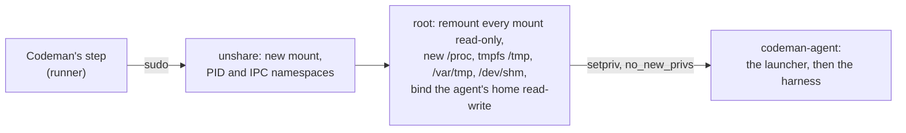

# Jail the agent in a read-only mount namespace

## Goal

The agent cannot write any file that the runner's user, root or a later step runs or loads, and the `agent` job no longer walks the root file system to get there. The harness runs in a mount namespace where everything is read-only except the agent's home and its temporary directories.

## Context

The [plan for privileged tools](2026-10-19-resolve-privileged-tools-outside-the-agents-reach.md) closed the image's world-writable paths with one `find / -xdev ... -exec chmod o-w` before the agent starts (its decision 2a). It took about 5 seconds on the [local runner image](../development/local-actions.md). On GitHub's `ubuntu-latest`, after the push of that plan:

| Measure | Time |
| --- | --- |
| The sandbox test, which runs the walk | 476 s |
| CI's `npm test` step | 8 min 21 s |

So the walk fails CI and slows every `agent` job by minutes. A redesign is needed: keep the agent from writing those paths, instead of changing them.

### What must hold

The protections of the [agent sandbox](../runs/agent.md#agent-sandbox) stay:

- the runner's home closed to the agent;
- the environment rebuilt from an allowlist;
- no access to the runner's processes;
- the agent's work tree, collected safely afterwards;
- the time limit, and the kill of every process of the agent;
- the network it needs for its model provider or gateway, including a Serverless gateway on the loopback (`src/inference/access.ts`).

### Audit

Three ways to put the harness in a mount namespace were compared. Sources are in `docs/web/`.

| | ai-jail | bubblewrap (`bwrap`) | `sudo unshare`, written in Codeman |
| --- | --- | --- | --- |
| What | A sandbox for AI agents, on top of bwrap, with Landlock and seccomp ([README](../web/akitaonrails/ai-jail-readme-md-at-7dfd34f.md)) | The low-level sandbox tool under Flatpak ([bwrap(1)](../web/ubuntu/usr-share-man-man1-bwrap-1-gz-in-bubblewrap-0-9-0-1ubuntu0-3-amd64-deb.md)) | `unshare`, `mount`, `findmnt` and `setpriv` from util-linux ([unshare(1)](../web/ubuntu/usr-share-man-man1-unshare-1-gz-in-util-linux-2-39-3-9ubuntu6-6-amd64-deb.md), [setpriv(1)](../web/ubuntu/usr-share-man-man1-setpriv-1-gz-in-util-linux-2-39-3-9ubuntu6-6-amd64-deb.md)) |
| Language, size | Rust, about 39,000 lines, 70 locked crates ([Cargo.toml](../web/akitaonrails/ai-jail-cargo-toml-at-7dfd34f.md)) | C, a 72 KB binary | Shell, about 15 lines in `src/sandbox.ts` |
| License | GPL-3.0-only | LGPL-2.0-or-later | util-linux's, already on the runner |
| Maintenance | Created 2026-03-01, 1,379 stars, one account with 436 commits, a release every few days ([v2.10.0](../web/akitaonrails/ai-jail-v2-10-0.md)) | `containers/bubblewrap`, since 2016, 9,127 stars | Ubuntu's `util-linux`, `Essential: yes` |
| Distribution | Linux x86_64 archive with a checksum, no signature, no arm64 | Ubuntu's `bubblewrap` package; not in the image's apt list ([toolset-2404.json](../web/github/runner-images-toolset-2404-json-at-82d1b86.md)) | Installed on every Ubuntu |
| Known vulnerabilities | Two advisories, no patched version named ([v1.22.0 audit](../web/akitaonrails/v1-22-0-source-audit-five-findings-worktree-validation-tiocsti-filter-lockdown-d.md), [Landlock scopes](../web/akitaonrails/landlock-v6-scope-restrictions-absent-default-deployment-vulnerable-to-abstract.md)) | Ubuntu's 0.9.0-1ubuntu0.3 dropped the fix for [CVE-2026-87766](../web/containers/cve-2026-87766-sandbox-escape-symlink-traversal-via-oldroot-allows-writing-files.md) ([changelog](../web/ubuntu/usr-share-doc-bubblewrap-changelog-debian-gz-in-bubblewrap-0-9-0-1ubuntu0-3-amd6.md)) | None new |
| Install scripts, permissions | Needs bwrap and an unprivileged user namespace, which AppArmor denies on `ubuntu-24.04` ([issue 10443](../web/github/ubuntu-24-04-error-during-unshare-operation-not-permitted.md), [AppArmor profile](../web/ubuntu/etc-apparmor-d-unprivileged-userns-in-apparmor-4-0-1really4-0-1-0ubuntu0-24-04-9.md)): a `sysctl` change for every user | Not setuid ([/usr/bin/bwrap](../web/ubuntu/usr-bin-bwrap-in-bubblewrap-0-9-0-1ubuntu0-3-amd64-deb.md)); run as root, then `setpriv` | Root through `sudo`, then `setpriv` |
| Threat model | "An accident guard, not a security boundary" ([SECURITY.md](../web/akitaonrails/ai-jail-docs-security-md-at-7dfd34f.md)) | A building block | Codeman's own |

All three kept `codeman-agent` from writing `/opt/pipx_bin` and `/usr/local/bin` in a prototype on the local image, while it wrote its work tree and reached the loopback and the internet. `util-linux`'s `mount -o remount,bind,ro=recursive /` did not reach submounts there, so the jail remounts each mount.

## Decisions

Answered by the responsible person on 2026-10-19.

1. **How to jail the harness.**
   - a) ai-jail, run as `codeman-agent`.
   - b) Ubuntu's bwrap, run as root, then `setpriv` to `codeman-agent`.
   - c) `sudo unshare`, with read-only remounts written in Codeman, then `setpriv`.

   **Answer: c).** It adds no third-party code and changes no system setting.

2. **How it is verified.** The responsible person pushes the change and reports CI on GitHub's runner. The local runner image is the check before the push.

## Design

- The harness, the fix pass included, runs under `sudo -n --preserve-env=<harness's variables> -- unshare --mount --pid --ipc --fork --kill-child --propagation private -- bash -c <setup>`.
- The setup runs as root in the new namespaces. It remounts every mount read-only, except under `/proc`, and fails closed on any error. It then mounts a new `/proc`, a `1777` tmpfs on `/tmp`, `/var/tmp` and `/dev/shm`, and binds `/home/codeman-agent` read-write, `nosuid` and `nodev`.
- `setpriv --reuid --regid codeman-agent --init-groups --no-new-privs --inh-caps=-all --bounding-set=-all` runs the existing launcher, which rebuilds the environment. Root's shell stays as PID 1 of the namespace, so it reaps orphans, and the harness keeps the default signal actions.
- The network is shared. Node, git and the harness are readable through the read-only tree: no other bind.
- When the harness exits, root's shell exits, and the kernel kills every process left in the namespace.
- `unshare --fork` ignores SIGTERM. So the time limit and a stop send SIGTERM to every process of `codeman-agent` with `pkill`, then SIGKILL 10 seconds later.
- `codeman-agent` is created with `/usr/sbin/nologin` as its shell, so `sshd` would run no command for it.
- The walk (`closeArgs`) and the job's `PATH` check (`pathProblems`) go. `findProgram` and the trusted directories stay: Codeman's step still runs nothing by its name.
- Sealing and collection do not change. Host paths keep the image's permissions.

## Steps

Each step is one commit. A step is done when `npm run check` passes on the host, and `npm run test:runner` gives fail 0 with every sandbox test passed.

### 1. Record the sources

**Done on 2026-10-19.** The pages of the [audit](#audit) in `docs/web/`, and the tool [GitHub releases](../web/tools/github-releases.md).

Commit message: `Record the sources for jailing the agent in a mount namespace`.

### 2. Run the harness in the jail

**Done on 2026-10-19,** locally; CI runs after the push (step 3). Where the work differs from the text below:

- The setup's tests run it with stub programs that log their arguments, so they run everywhere, on macOS's `bash` 3.2 too. A third test checks that the agent does not start when a mount stays writable.
- `createAgentUser` also sets `nologin` on an agent user that already exists, as on a self-hosted runner.
- The contained test also checks that the agent cannot see the runner's processes.
- The glossary's [sandbox](../glossary.md#sandbox) entry changed with the docs listed below.

Code, in `src/sandbox.ts`:

- `jailArgs` and `jailScript`, pure, for the `sudo` arguments and the setup; `runAsAgent` spawns `sudo` with them.
- `stopAgentProcesses(signal)`, with `pkill`; a stop or the time limit sends SIGTERM, then SIGKILL.
- `createAgentUser()` checks the programs, creates the user with `nologin`, and closes the runner's home. No walk.
- Remove `closeArgs`, `pathProblems` and `FileStats.readdir`.
- `unshare`, `mount`, `findmnt` and `setpriv` join the required programs.

Tests, in `src/sandbox.test.ts`:

- Everywhere: the jail's arguments name every program by its trusted path, share the network, and run the setup; the setup passes `bash -n`, remounts read-only, mounts the temporary directories, binds the agent's home and drops to `codeman-agent` with `no_new_privs`.
- Linux with `CODEMAN_SANDBOX_TEST=1`: the regression test opens `/opt/pipx_bin` and `/usr/local/bin` to every user, as the image does. The agent tries to write `sudo` and `git` there; neither exists afterwards, the directories stay open, and nothing ran. The test logs the jail's setup time.
- The test that the job fails on an unsafe `PATH` goes with `pathProblems`.

Elsewhere:

- `scripts/runner.sh` runs the container with `--cap-add SYS_ADMIN --security-opt seccomp=unconfined --security-opt apparmor=unconfined`, which a container needs for `unshare` and `mount`.
- Docs: [agent sandbox](../runs/agent.md#agent-sandbox), [risk 3](../security/risks.md#3-steps-added-to-the-agent-job-run-outside-the-sandbox), [dependencies](../development/dependencies.md), [running Actions locally](../development/local-actions.md), the [guide](../development/guide.md)'s tests table.
- `dist/` rebuilt.
- A note in the [plan for privileged tools](2026-10-19-resolve-privileged-tools-outside-the-agents-reach.md) that this plan replaces its walk.

Commit message: `Jail the agent in a read-only mount namespace`.

Body: The walk that closed the image's world-writable paths took minutes on GitHub's runner. The harness now runs where every mount is read-only except the agent's home and temporary directories, so the agent cannot plant programs, and host permissions stay as they are.

### 3. Check on GitHub's runner, after the push

The responsible person pushes and reports CI. Then, on `ubuntu-latest`:

1. The sandbox tests pass, and the logged jail setup time is under a few seconds.
2. Check what the container could not:
   - `sshd`: whether it runs, and whether `nologin` stops a command for `codeman-agent`;
   - `cron` and `at`: whether the agent can add a job from inside the jail;
   - D-Bus: whether the system bus lets `codeman-agent` start anything outside the jail;
   - abstract Unix sockets on the shared network: which host services listen on one;
   - the VM's mounts (`/mnt`, `/boot/efi`, snaps): each remounts read-only;
   - the timings of the sandbox test and of `npm test`.
3. Set this plan to `completed`, or bring it back for review with what failed.

## Results

Measured on 2026-10-19, on the [local runner image](../development/local-actions.md), on an x86_64 host with Docker's 6.12 kernel:

| Check | Result |
| --- | --- |
| `npm run check` on the host (macOS) | Passed: 640 tests, 636 passed, 4 skipped (the sandbox tests that need Linux) |
| `npm run test:runner` | 640 tests, 626 passed, 0 failed, 14 skipped: Firestore's emulator, as on CI. Every sandbox test passed |
| A harness that does nothing, through `sudo`, the jail's setup and `setpriv` | 79 to 83 ms, against about 5 s for the walk on the same image |
| The regression test, with the read-only remounts removed | Fails: the agent wrote `/opt/pipx_bin/sudo` and `/usr/local/bin/git` |

A probe ran a script as the agent through the jail on the same image, on 2026-10-20:

| Inside the jail | Result |
| --- | --- |
| `node`, `npm` and `git` from the image | Run: Node.js 24.21.0, npm 11.19.0, git 2.43.0 |
| `npm install` of a package in the work tree, then `node` loading it | Works |
| Writing `/tmp`, the work tree and the agent's home | Works |
| Writing `/opt/pipx_bin` or `/usr/local/bin`; `npm install -g`; `sudo` | Denied |
| Processes visible | Only the jail's own: 6 |
| `https://registry.npmjs.org/` | 200 |

On GitHub's runner, after the responsible person pushed `c5179dd`, on 2026-10-20 ([CI run 39351050857](https://github.com/codenergy-dev/codeman/actions/runs/39351050857)):

| Check | Result |
| --- | --- |
| CI, with `CODEMAN_SANDBOX_TEST=1` | Passed. Every sandbox test ran on the VM, so each of its mounts was remounted read-only: the jail fails closed otherwise |
| The `npm test` step | 49 s, against 8 min 21 s with the walk ([CI run 39306607913](https://github.com/codenergy-dev/codeman/actions/runs/39306607913)) |
| The logged jail setup time | Not read: the job's log needs a login |

The rest of step 3's item 2 (`sshd`, `cron` and `at`, D-Bus, abstract Unix sockets) is not checked yet, so this plan stays `in progress`.

## Out of scope

- Landlock and seccomp: no third-party code, and the mount namespace covers the writes.
- A network namespace: the agent needs the network and the loopback gateway.
- Self-hosted runners: the jail changes no host permission, so this plan improves them, but they are not tested.
- arm64 (`ubuntu-24.04-arm`): the same commands, not tested.
