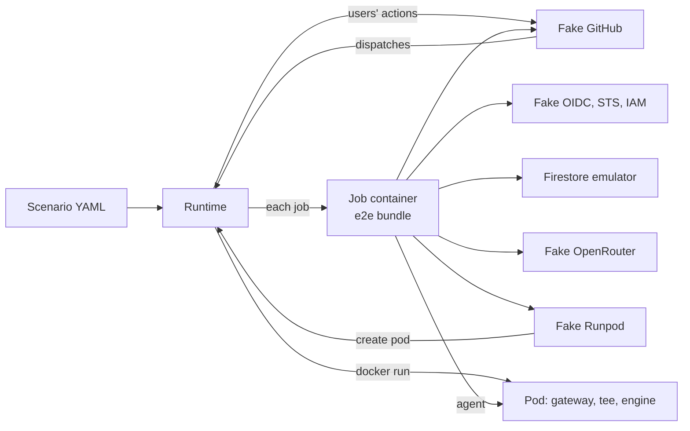

# End-to-end test suite

## Goal

A developer runs `npm run test:e2e`, and Codeman's real bundles run a task from a labeled issue to `codeman:done` against local fakes of GitHub, OpenRouter, Runpod and Google, with real Ollama and vLLM engines on CPU. Each scenario is a YAML file of actions and expectations, kept in a new top-level `e2e/`.

## Context

Several bugs showed only when Codeman ran on a real repository. The unit and flow tests (`src/steps/flow.test.ts`, about 640 tests) never run `dist/index.js` as an action, cross job boundaries through real outputs and artifacts, run OpenCode against a model, run the gateway as a process in front of an engine, or enforce GitHub token permissions.

| Bug found in real use | Kind | Source |
| --- | --- | --- |
| `select` needed `pull-requests: read` to list reviews | Token permission | [MVP plan](2026-09-23-codeman-mvp.md) |
| `next-run` skipped after a record-only run: `success()` across skipped jobs | Workflow expressions | [MVP plan](2026-09-23-codeman-mvp.md) |
| A review did not start a run: the merge ref held the old workflow | Events and workflow files | [MVP plan](2026-09-23-codeman-mvp.md) |
| `gh workflow run` without a ref needs `metadata: read` | Token permission, `gh` behavior | Commit `e26a8c9` |
| A spent shared pod terminated itself before `close-key`'s `/admin/end` | Timing across processes | [Keep a spent pod](2026-10-15-keep-a-spent-pod-for-its-close.md) |
| OpenRouter's cost read as 0 (analytics lag), never refreshed by later pod runs | Provider consistency | [Refresh OpenRouter costs](2026-10-15-refresh-openrouter-costs-from-any-run.md) |
| The agent cloned repositories inside the tree: no manifest, run lost | Real agent behavior | [Keep unfinished work](2026-10-16-keep-unfinished-work-collectable.md) |
| Commands during `awaiting-decision` made every run `record`, with no budget stop | Multi-run state | [Commands around decisions](2026-10-19-commands-around-decisions-and-review-rounds.md) |
| Review rounds against `max-runs`, off by one | Counters across runs | [Align the max-runs counters](2026-10-19-align-the-max-runs-counters.md) |
| A routing run refused by budget posted a noisy comment | Comment policy | [Keep routing quiet](2026-10-19-keep-routing-quiet-on-budget-waits.md) |
| A repository's `CODEMAN_SETTINGS` dropped the organization's pool and budget | Settings across repositories | [Repository override](2026-10-19-repository-override-of-organization-settings.md) |

Constraints:

- `AGENTS.md`: every image, tool and package is audited before use, and each is a decision.
- act was audited and not adopted on 2026-10-19 ([decision 1](2026-10-19-run-github-actions-locally.md#decisions)). This plan reverses that decision for the smoke scenarios only, with a new audit row.
- No production code path may redirect credentials by an environment variable: the management key, the Runpod key, the App token and the OIDC token all go to hard-coded hosts today.
- Codeman is public: fixture repositories are synthetic, under `e2e/fixtures/`.

### The machine of this plan

macOS x86_64, i7-8559U (4 cores, 8 threads, AVX2, no AVX-512), 16 GB. Docker Desktop 29.3.1: a VM with 8 CPUs and 7.8 GB, no NUMA information. Node 24. act 0.2.89. Java 21 and the emulator jar v1.20.4 on the host.

### What can be redirected today

| Integration | Redirectable today | Through |
| --- | --- | --- |
| GitHub REST and GraphQL, web links | Yes | `GITHUB_API_URL`, `GITHUB_GRAPHQL_URL`, `GITHUB_SERVER_URL` |
| The OIDC token request | Yes | `ACTIONS_ID_TOKEN_REQUEST_URL`, `ACTIONS_ID_TOKEN_REQUEST_TOKEN` |
| The agent's model on a pod or Serverless | Yes | `open-key`'s `base-url` and `handle` outputs |
| OpenRouter API, and OpenCode's `openrouter` provider | No | `src/inference/openrouter.ts`, `src/harness/opencode.ts` |
| Runpod REST, the pod proxy URL, the Serverless queue | No | `src/inference/runpod.ts`, `src/inference/providers.ts` |
| STS, IAM Credentials, Firestore | No | `src/store/google.ts`, `src/store/firestore.ts` |
| Hugging Face Hub, the npm registry | No | `src/inference/huggingface.ts`, `src/harness/opencode.ts` |

The classes already take `fetch` or `baseUrl` arguments. Only the wiring drops them: `gitHubServices` (`src/main.ts`), `backendStore` (`src/store/backend.ts`), `inferenceProvider` and `gpuProvider` (`src/inference/index.ts`).

### What act does and does not do

From act 0.2.89's source at `4f41128` ([cmd/root.go](../web/nektos/act-cmd-root-go-at-4f41128.md), [run_context.go](../web/nektos/act-pkg-runner-run-context-go-at-4f41128.md), [gh.go](../web/nektos/act-pkg-gh-gh-go-at-4f41128.md)):

- It has no OIDC. `--env ACTIONS_ID_TOKEN_REQUEST_URL=...` reaches every step, reusable-workflow jobs included. `permissions` is ignored, so a missing `id-token: write` goes unnoticed (`src/templates.test.ts` checks it statically).
- `github.run_id`, `run_attempt` and `run_number` come from `--env GITHUB_RUN_ID` and its siblings, `1` by default. Ledger documents, batch IDs and key names key on them, so each invocation needs its own.
- It ignores `concurrency` and `timeout-minutes`, and receives no `workflow_dispatch` from the API.
- A custom GitHub instance must be HTTPS, and act clones `uses:` actions from it.
- It reads `.env`, `.secrets` and `.vars` from its working directory.

> [!WARNING]
> When no `GITHUB_TOKEN` secret is given, act runs `gh auth token` on the host and injects the developer's real token into the jobs ([gh.go](../web/nektos/act-pkg-gh-gh-go-at-4f41128.md)). The act driver must always pass a fake token, and explicit env, secret and variable files, from an empty directory.

### Audit

| Component | What and why | Verdict | Facts |
| --- | --- | --- | --- |
| act 0.2.89 | Runs the real templates for the smoke scenarios | Adopt, smoke only, after spike 0.2 | MIT. CVE-2026-34041 ([set-env](../web/nektos/set-env-and-add-path-workflow-commands-unconditionally-processed.md)) and CVE-2026-34042 ([cache server](../web/nektos/remote-code-execution-possible-actions-cache-server-allows-malicious-cache-injec.md)) fixed in 0.2.86. Run with `--no-cache-server`, no Docker socket in jobs. No commit on `master` since 2026-06-01 |
| floci-gcp 0.11.0 | Asked for: act's missing OIDC and Google side | Reject | Pre-1.0, one main maintainer, no release checksums. Its STS takes form bodies for GCS downscoping only, with no Workload Identity Federation or JWT check ([STS](../web/floci/floci-gcp-docs-services-sts-md-at-0fa563c.md), [IAM](../web/floci/floci-gcp-docs-services-iam-md-at-0fa563c.md)). Its IAM Credentials refuses the `datastore` scope ([IAM Credentials](../web/floci/floci-gcp-docs-services-iam-credentials-md-at-0fa563c.md)). Its Firestore is gRPC only ([Firestore](../web/floci/floci-gcp-docs-services-firestore-md-at-0fa563c.md)). Its compose mounts the Docker socket ([image](../web/floci/floci-floci-gcp-0-11-0.md)). The AWS sibling had two critical RCEs in September 2026 ([release](../web/floci/floci-gcp-0-11-0.md)) |
| In-house fake OIDC, STS, IAM Credentials | Replaces floci | Recommended, decision 1 | Node built-ins, about 200 lines. Verifies the JWT against its JWKS, the audience and the [attribute condition](../installation/setup.md#choose-the-attribute-condition). Returns the token `owner`, which the Firestore emulator takes as admin (checked with v1.20.4 and `firebase/firestore.rules`) |
| `yaml` 2.9.1 (npm) | Parses scenario files and the templates, in `e2e/` only | Adopt (answered) | ISC, no dependencies, no install scripts, no known vulnerabilities (CVE-2026-33532 fixed in 2.8.3). One maintainer, no provenance attestation. Ships a `yaml` CLI in `node_modules/.bin` |
| `vllm/vllm-openai-cpu:v0.31.0` | vLLM on CPU, the version Codeman pins | Adopt after spike 0.1 | Official, 1.57 GB, AVX2 kernels chosen at run time ([image](../web/docker-hub/vllm-vllm-openai-cpu-v0-31-0.md), [x86](../web/vllm/docs-getting-started-installation-cpu-x86-inc-md-at-v0-31-0.md), [platform](../web/vllm/vllm-platforms-cpu-py-at-v0-31-0.md)). K/V size fixed by `VLLM_CPU_KVCACHE_SPACE` ([CPU](../web/vllm/cpu.md), [worker](../web/vllm/vllm-v1-worker-cpu-worker-py-at-v0-31-0.md), [memory](../web/vllm/vllm-utils-cpu-resource-utils-py-at-v0-31-0.md)) |
| `eclipse-temurin:21.0.12_8-jre-noble` and the emulator jar v1.22.0 | The Firestore emulator in Compose | Recommended, decision 3 | Base by digest ([image](../web/docker-hub/eclipse-temurin-21-0-12-8-jre-noble.md)); jar by the SHA-256 firebase-tools 15.34.0 records ([emulator info](../web/firebase/firebase-tools-downloadableemulatorinfo-json-at-48f511a.md)), with `ADD --checksum` ([Dockerfile](../web/docker/dockerfile-reference.md)) |
| `qwen2.5:0.5b` (Ollama) and `Qwen/Qwen2.5-0.5B-Instruct` at `7ae5576` (Hugging Face) | The same tiny model on both engines | Adopt | Apache-2.0, not gated, Hermes tool-call template. Ollama manifest `a8b0c515…`, 398 MB; safetensors 988 MB bf16. 12 KB of K/V per token |
| Docker Compose | Starts the infrastructure | Record | Bundled with Docker Desktop. Version, license and permissions recorded in step 3.1 |
| `gh` | The templates' `run:` steps | Decision 8 | Pages in `docs/web/github-cli/` |

Not reused: `ollama/ollama:0.35.1`, `node:24.21.0-bookworm-slim` and `ubuntu:noble-20260930.1` are already audited ([dependencies](../development/dependencies.md#the-local-runner-image)).

## Decisions

### Answered

Answered by the responsible person on 2026-10-20.

1. **Approach.**
   - a) A Node workflow simulator runs the real bundle job by job.
   - b) act on the real templates for every scenario.
   - c) Hybrid: a) for most scenarios, b) for one or two smoke scenarios after a spike.

   **Answer: c).** The simulator follows the templates' job order, `if:` rules, matrix and reusable workflow, a per-repository concurrency queue, and dispatch chaining. act 0.2.89 runs the smoke scenarios. floci was evaluated for act's missing OIDC and rejected ([audit](#audit)); its replacement is [decision 1 of the review](#answered-in-review).
2. **Seams for the hard-coded endpoints.**
   - a) Environment overrides in production code.
   - b) Overrides compiled only into an e2e bundle, through esbuild's `define` (`__CODEMAN_E2E__`).
   - c) DNS and TLS interception, with no code change.

   **Answer: b).** The published `dist/` keeps none of them. c) fails for the agent: its environment allowlist drops CA and proxy variables.
3. **Engines.**
   - a) A scripted model only.
   - b) Real Ollama only.
   - c) Real Ollama and real vLLM on CPU, with the scenario scripting the replies.

   **Answer: c),** with `qwen2.5:0.5b` and `Qwen/Qwen2.5-0.5B-Instruct` at a pinned revision. What matters is concurrency, the context split between tasks and the engine's configuration, not the model's output. Design:
   - A tee proxy in each e2e pod image takes the engine's port. It forwards each chat request to the real engine with `max_tokens` capped, waits for the engine's reply, then returns the scenario's scripted reply.
   - For Ollama, it rewrites `size_vram` in `/api/ps` against a virtual VRAM budget, so the real fit search runs on real sizes.
   - The shipped `dist/gateway.js` runs unchanged.
   - vLLM uses the official CPU image with `VLLM_CPU_KVCACHE_SPACE` and `enforce-eager`. One vLLM pod at a time, in its own Compose profile, after a spike.
   - Assertions read the gateway's `/admin/status`, Ollama's `/api/ps`, vLLM's `/v1/models` and `/metrics`.
4. **Scenario format.**
   - a) YAML, with the npm `yaml` package as a pinned development dependency, used only in `e2e/`.
   - b) Typed `.ts` modules, no dependency.
   - c) JSON.

   **Answer: a).** JSON is the fallback if YAML proves unworkable. The runtime validates each scenario against a TypeScript schema. Risk accepted: one maintainer, no provenance.

### Answered in review

Answered by the responsible person on 2026-10-20: every recommendation below was approved, as were the design's choices (the simulator parses the templates, `npm test` adds the fakes' tests, a reverted fix must fail its scenario).

1. **The Google side under test.**

   | Option | Trade-off |
   | --- | --- |
   | a) In-house fake OIDC issuer, STS and IAM Credentials; Firebase's emulator for Firestore | About 200 lines, no dependency. Tests the whole token path, including the signature, audience and condition. Mirrors Google's documented behavior; does not prove it |
   | b) Skip the token path in the e2e build (`Firestore.emulator`) | Smallest. Tests none of OIDC, STS or IAM |

   **Recommendation: a).** **Answer: a).** It also gives each act invocation its own claims (repository, run ID, workflow) through a request token per invocation.
2. **How the fake Runpod starts pod containers.**

   | Option | Trade-off |
   | --- | --- |
   | a) The fake mounts the Docker socket | Simple. The fake gets root on Docker's VM |
   | b) The host-side orchestrator starts a container on the fake's request | No socket in any container. The orchestrator maps each pinned production image digest to a local e2e image, from an allowlist |
   | c) A fixed pool of pre-started pods | No Docker access. Cannot test the pod's environment from `open-key`, creation races or start failures |

   **Recommendation: b).** **Answer: b).**
3. **The Firestore emulator.**

   | Option | Trade-off |
   | --- | --- |
   | a) A self-built image: Temurin 21 JRE by digest, jar v1.22.0 by checksum | About 240 MB, reproducible. Changes the emulator's audit from "newest in the cache" to a pin |
   | b) The host's jar and Java | No image. Not reproducible across machines; containers reach it through the host |
   | c) `google/cloud-sdk:emulators` | 452 MB, gcloud, Python and every emulator; re-pushed weekly; jar version hidden |

   **Recommendation: a).** **Answer: a).** `src/store/emulator.test.ts` can use it through `FIRESTORE_EMULATOR_HOST`, as it already allows.
4. **OpenCode's download, 185 MB per agent job.**
   - a) An e2e-build seam to a local registry cache, filled once; Codeman still checks the pinned integrity.
   - b) The network on every agent job.

   **Recommendation: a).** **Answer: a).** It removes the network from the agent's path and keeps the check that makes a cache safe.
5. **Timers and expiry** (run leases 2 h, keep leases 15 min, reservations 30 min, pod start 25 min).
   - a) Seed documents with past timestamps before a run.
   - b) A clock-scale seam in the e2e build.

   **Recommendation: a).** **Answer: a).** No new seam; the code under test reads the real clock.
6. **Where it runs.**
   - a) Locally only, with `npm run test:e2e`.
   - b) Also in CI.

   **Recommendation: a).** **Answer: a).** for now. CI gets its own plan: time, Docker on `ubuntu-latest`, and model downloads.
7. **Docker Desktop's memory.** By estimate, four agent jobs on one Ollama pod need about 6.2 GB, and a vLLM pod with two agent jobs about 6.5 GB, of the VM's 7.8 GB.
   - a) Ask developers to raise it to 10 to 12 GB.
   - b) Keep 8 GB: the runtime runs scenarios one at a time, vLLM scenarios alone, and refuses to start a profile when Docker reports less memory than it needs.

   **Recommendation: b).** **Answer: b),** measured in spike 0.1. Advise 10 GB in the docs if the measure leaves under 1 GB free.
8. **`gh` in the templates' `run:` steps** (the commit check, `next-run`, `dispatch`, `forward-review`).
   - a) GitHub's `gh` release, pinned, checked by its checksum, in the e2e runner image only, with `GH_HOST` on the fake.
   - b) A shim that calls the fake.

   **Recommendation: a).** **Answer: a).** The `metadata: read` bug was `gh`'s own GraphQL call for the default branch; a shim would hide it. It needs an audit row and `docs/web/github-cli/` pages for `gh workflow run`.
9. **The vLLM metrics page.** The concurrency assertions read `vllm:num_requests_running` and `vllm:num_requests_waiting`. The saved [metrics page](../web/vllm/vllm-v1-metrics-loggers-py-at-v0-31-0.md) covers only `cache_config_info`.
   - a) Refresh it to cover both gauges.
   - b) Assert concurrency only from the tee's timestamps.

   **Recommendation: a).** **Answer: a).** `AGENTS.md` requires the responsible person's request to refresh a page.

## Design

### Layout

| Path | Holds |
| --- | --- |
| `e2e/infra/compose.yaml` | The network, services, profiles (`ollama`, `vllm`), volumes and health checks |
| `e2e/infra/images/` | `runner/` (the local runner image, plus `gh` and the test CA), `pod-ollama/`, `pod-vllm/`, `emulator/`, `fakes/` |
| `e2e/fakes/` | `github/`, `openrouter/`, `runpod/`, `google/` (OIDC, STS, IAM Credentials), `llm/` (the scripted model and the tee), `npm/` (decision 4), each with its own tests |
| `e2e/runtime/` | The scenario loader and schema, the workflow simulator, the act driver, the orchestrator, assertions and reports |
| `e2e/scenarios/` | YAML files by subject: `happy-path/`, `pods/`, `serverless/`, `parallel/`, `pools/`, `budgets/`, `failures/`, `commands/`, `security/` |
| `e2e/fixtures/` | Synthetic target repositories as file trees; the runtime makes bare repositories of them |
| `e2e/.build/`, `e2e/.out/` | The e2e bundle and each scenario's report; ignored by git |

There is no `e2e/README.md`: the docs go to `docs/development/e2e.md`.

### How a run flows



- **The simulator** reads `templates/codeman.yml` and `codeman-task.yml` with `yaml`. It evaluates the subset of expressions the templates use (`always()`, `success()`, `needs.*.result`, `outputs`, `fromJSON`, `==`, `!=`, `&&`, `||`, `!`), and fails on any other construct, so a template change is noticed.
- **Each job** runs in the e2e runner image with `--init --cap-add SYS_ADMIN --security-opt seccomp=unconfined --security-opt apparmor=unconfined`, as [the local runner](../development/local-actions.md) does. `uses: ./` runs the e2e bundle; `run:` steps run in bash; `actions/checkout`, `create-github-app-token` and the artifact actions are emulated against the fake GitHub.
- **The fake GitHub** serves HTTPS with a test CA made per session, trusted by Node, git and `gh` in the runner image. It enforces each App token's permissions and each user's collaborator permission. Any request with a token it did not issue fails the scenario.
- **The agent's model** is the scripted model: through the fake OpenRouter on the OpenRouter path, and through the tee on pods and Serverless. A marker in the issue's body, which reaches the prompt, names the scenario and the issue; the stage and the turn give the step.

### Scenario schema, sketched

| Action | Does |
| --- | --- |
| `open-issue`, `comment`, `label`, `unlabel`, `review`, `close`, `reopen` | A user acts on the fake GitHub; `as:` names the user |
| `push` | A user moves a branch, such as the task branch |
| `set-variable` | Changes an organization's or repository's `CODEMAN_SETTINGS` |
| `seed` | Writes store documents, with `age:` for past timestamps |
| `run` | Starts one workflow run for an event, and waits for its jobs |
| `advance` | Follows `next-run` and `dispatch` until a condition holds, or `max-runs` |
| `parallel` | Runs several action lists at once, such as two repositories' runs |
| `fault` | Makes a fake or a job fail: an HTTP status, a delay, a job's failure, a pod that never serves |
| `apply` | `skip` cancels the `apply` job, `fail` fails it, so the agent's work is not applied |
| `wait` | Waits for a condition, with a timeout |
| `expect` | Checks labels, comments, commits, pull requests, store documents, ledger costs, fakes' state and engine state |

The `agent:` section scripts the agent per issue, stage and round. Each round lists steps the scripted model turns into OpenCode tool calls (`write`, `edit`, `bash`), then the stage's `output`. Other steps: `raw` (an invalid output), `hang`, `exit`, `delay`, and `usage` for deterministic costs.

```yaml
name: OpenRouter, from a labeled issue to done
tags: [happy-path, openrouter]
runner: simulator            # or act
world:
  organization: { owner: acme, settings: "task-budget: 2" }
  repositories:
    - { name: acme/app, fixture: node-small, maintainers: [alice] }
agent:
  i1:
    plan: [{ steps: [{ output: { decisions: [{ question: Which port?, options: ["8080", "3000"] }] } }] }]
    route: [{ steps: [{ output: { route: [code, review] } }] }]
    code: [{ steps: [{ write: { path: src/health.ts, content: "export const ok = true;\n" } }, { output: { summary: Adds the route } }], usage: { prompt: 1200, completion: 300 } }]
    review: [{ steps: [{ output: { verdict: done } }] }]
actions:
  - open-issue: { ref: i1, as: alice, repo: acme/app, title: Add a health route, labels: [codeman] }
  - run: { repo: acme/app, event: issues.labeled }
  - expect: { issue: i1, labels: [codeman:awaiting-decision], comment: { kind: decisions, contains: Which port? } }
  - comment: { issue: i1, as: alice, body: /codeman decide 1a }
  - advance: { repo: acme/app, until: { issue: i1, label: codeman:done }, max-runs: 6 }
  - expect: { issue: i1, pull-request: { ready: true, files: [src/health.ts] }, ledger: { cost-at-most: 2 } }
```

The output fields above are illustrative: step 4.1 takes them from Codeman's [agent output](../runs/agent.md#agent-output).

## Steps

Each step is one commit, done when `npm run check` passes and what it names holds. Phase 0 commits nothing but this plan's results.

### Phase 0: spikes

#### 0.1 Run vLLM and Ollama on CPU

1. Run `vllm/vllm-openai-cpu:v0.31.0` by digest with `VLLM_CPU_KVCACHE_SPACE=1`, `--max-model-len 8192 --max-num-seqs 2 --enforce-eager --enable-auto-tool-choice --tool-call-parser hermes`; then with `--max-model-len auto`.
2. Run `ollama/ollama:0.35.1` with `qwen2.5:0.5b`, `OLLAMA_NUM_PARALLEL=2`, and check whether `/api/pull` needs the registry when the blobs are present.

Done when the plan's results record, for vLLM: the time to `/health`, `/v1/models`' `max_model_len`, `/metrics`' `cache_config_info`, a parsed `ping` tool call, and the peak memory; for Ollama: `/api/ps`, llama-server's `-c` and `-np`, and the pull's behavior offline. If vLLM fails, the plan takes the next [fallback](#out-of-scope) (`--dtype float32` from the wrapper, then the tee emulating vLLM) and goes back to review.

#### 0.2 Run the jail and a reusable workflow under act

On a scratch workflow with the e2e runner image, a stub HTTPS GitHub and the act flags of step 6.1, check:

- a reusable workflow called as a matrix, with `secrets:`, `always()` and `needs.*.result`;
- `upload-artifact@v7` and `download-artifact@v8` against act's artifact server;
- the sandbox tests, as `runner`, with the jail;
- `GITHUB_RUN_ID` set per invocation;
- `uses:` actions resolved without github.com, from the fake or an offline action cache;
- `RUNNER_TEMP` and the workspace's path.

Done when each item is recorded pass or fail in the plan. If the matrix of a reusable workflow or the artifacts fail, phase 6 is dropped and the plan goes back to review.

### Phase 1: the e2e build

#### 1.1 Compile the endpoint overrides into an e2e bundle only

- `scripts/build.ts`: `define: { __CODEMAN_E2E__: "false" }` for `dist/`, `"true"` for `npm run build:e2e`, which writes `e2e/.build/`.
- One module reads `CODEMAN_E2E_ENDPOINTS` (JSON) only when `__CODEMAN_E2E__` is true. The wiring passes its URLs and `fetch` to: OpenRouter, OpenCode's `openrouter` provider (`baseURL`), Runpod REST, the pod proxy URL, the Serverless queue host and the `endpoint` setting's check, Hugging Face, the npm registry (decision 4), STS, IAM Credentials and Firestore.
- The build fails if `dist/` contains `CODEMAN_E2E`.

Done when:

1. `npm run build` leaves `dist/` byte for byte as before: `git diff --exit-code dist/`.
2. `grep -c CODEMAN_E2E dist/index.js dist/gateway.js` prints `0` for both.
3. Unit tests cover the override's parsing, and its absence when the flag is false.

Commit message: `Compile endpoint overrides into an e2e-only bundle`.

### Phase 2: the fakes

Node built-ins only. Each fake has its tests under `e2e/fakes/`, which need no Docker. `npm test`'s glob gains `e2e/**/*.test.ts`; the scenarios stay out of it.

| Step | Fake | Done when its tests show |
| --- | --- | --- |
| 2.1 | GitHub, API: the REST subset Codeman and `gh` call, GraphQL `markPullRequestReadyForReview` and `gh`'s default-branch query, App installation tokens with enforced permissions, collaborators, the scenario API | A call outside a token's permissions answers 403 as GitHub does; a non-collaborator's command is visible but not a maintainer's |
| 2.2 | GitHub, git: the Git Data API on bare repositories, `updateRef` without force, `git http-backend` for clones, `compare`, artifacts (zip, written in-house), dispatches to the runtime, `concurrency_groups`, HTTPS with the session's CA | `git clone` over HTTPS and a commit through the Data API land on the same bare repository; a moved branch refuses `updateRef` |
| 2.3 | Google: OIDC issuer with JWKS, STS, IAM Credentials, faults | A token with a wrong audience or repository is refused like Google's; a valid one yields `owner`, accepted by the emulator |
| 2.4 | OpenRouter: keys with limits, expiry and disabling, analytics with a configurable lag, `/chat/completions` through the scripted model | Usage appears only after the lag; a spent key answers 402 |
| 2.5 | Runpod: pods through the runtime (decision 2), catalog, prices, CUDA versions, GPU memory, billing, Serverless endpoints and queue, the `{id}-{port}` proxy, faults | A created pod's `env` reaches the runtime's request unchanged; a terminated pod stops billing |
| 2.6 | The scripted model and the tee: OpenAI SSE with tool-call deltas and `usage`; the tee's forwarding with `max_tokens` capped, `/api/ps` rewrite, synthetic pull, inspection port | A scripted round yields the same tool calls each time; the tee holds the reply until the engine's ends |
| 2.7 | npm cache (decision 4) | It serves OpenCode's tarball, and Codeman's integrity check passes on it |

Commit message per step, such as `Add a fake GitHub for the e2e suite`.

### Phase 3: infrastructure

#### 3.1 Record the audits

- Commit the `docs/web/` pages the research saved: `docs/web/floci/`, the three `docs/web/nektos/act-*-at-4f41128.md`, the vLLM CPU pages, `docs/web/docker-hub/vllm-vllm-openai-cpu-v0-31-0.md`, `eclipse-temurin-21-0-12-8-jre-noble.md`, `docs/web/ollama/docker.md`, `docs/web/firebase/firebase-tools-downloadableemulatorinfo-json-at-48f511a.md`, `docs/web/docker/`.
- Add the models' pages, which need the Ollama registry and Hugging Face model routes in `docs/web/tools/ollama.md` and `hugging-face.md`; a Docker Compose reference page; `gh workflow run`'s page (decision 8).
- In [dependencies](../development/dependencies.md): inventory rows and sections for `yaml`, act 0.2.89, the vLLM CPU image, the emulator image and jar, the models, Docker Compose and `gh`; the emulator's row changes to the pin; audit-log rows for each, and for floci-gcp, not adopted.
- Add `yaml` 2.9.1 to `devDependencies`, exactly, with the lockfile.

Done when `src/docs.test.ts` and `src/webdocs.test.ts` pass and `npm audit` reports nothing new.

Commit message: `Record the audit of the e2e suite's tools and images`.

#### 3.2 Build the images

- `runner`: from `docker/runner/`, plus `gh` (decision 8) and the session CA's trust.
- `pod-ollama`: `docker/pod/Dockerfile`'s `ollama` target, plus the tee and the `ollama` wrapper that moves the engine to 11435.
- `pod-vllm`: the vLLM CPU image by digest, plus Node from the pod images' pinned input, `dist/gateway.js`, the tee and the `vllm` wrapper that moves the engine to 8001.
- `emulator` (decision 3) and `fakes`: one image on `node:24.21.0-bookworm-slim`, a service per fake.

Done when each image builds from a clean clone, and `pod-ollama` serves `/health` as ready with `qwen2.5:0.5b`, the fit's `source` being `search`.

#### 3.3 Write the Compose file

Profiles `ollama` and `vllm`, named volumes for models, Hugging Face's cache and npm, one-shot seed services that check each model's digest or revision, health checks, memory limits.

Done when `docker compose -f e2e/infra/compose.yaml up --wait` reports every service healthy, a second run downloads nothing, and the memory of each profile is recorded in `docs/development/e2e.md`'s draft.

Commit message: `Add the e2e suite's images and Compose file`.

### Phase 4: the runtime

| Step | Part | Done when |
| --- | --- | --- |
| 4.1 | Scenario loader and TypeScript schema | An invalid scenario fails with the field's path; every action of the [schema](#scenario-schema-sketched) parses |
| 4.2 | Workflow simulator: templates, `if:` subset, matrix, reusable workflow, step kinds, outputs and env files, artifacts, the concurrency queue (one running, one pending, a newer one replaces it), dispatches, schedules | Its tests replay the `always()` regression: with the template before the fix, `next-run` is skipped after a record-only run |
| 4.3 | Orchestrator: Compose's lifecycle, a fresh state per scenario (fakes reset, a Firestore project per scenario), pods started on the fake Runpod's request and removed by label | Two scenarios in a row share no document, pod or issue |
| 4.4 | Assertions and reports: each `expect` kind; on failure, a timeline of events, job logs, the fakes' requests, store documents and engine status in `e2e/.out/<scenario>/` | A failing `expect` prints the timeline's last events and the report's path |

`npm run test:e2e [-- <paths or tags>]` builds the e2e bundle, starts Compose and runs the scenarios. Done when `happy-path/openrouter-plan-only.yaml` passes.

Commit message: `Add the e2e runtime and workflow simulator`.

### Phase 5: the scenario catalogue

Each step's scenarios pass three times in a row. Where the fix of a listed bug is one commit that still reverts, its scenario fails with the revert, in a scratch branch.

| Step | Scenarios | Covers |
| --- | --- | --- |
| 5.1 | `happy-path/openrouter-to-done`, `pods/ollama-keep-and-release`, `serverless/split-on-one-endpoint` | Plan, decisions, route, code, review, done; a pod kept for the next stage and released; the Serverless split. The MVP plan's bugs |
| 5.2 | `parallel/four-tasks-one-pod`, `parallel/five-tasks-two-pods`, `parallel/vllm-two-seats` (`vllm` profile), `parallel/same-repository-twice`, `pools/two-organizations-batch`, `pools/reservation-expired`, `pools/repository-override` | Seats, `num-parallel` and `max-num-seqs`, the context per request, shares of the pod's time, one creator per pod; boards, batches and dispatches (`metadata: read`); settings precedence |
| 5.3 | `budgets/task-budget-then-continue`, `budgets/monthly-race`, `budgets/shared-pod-402`, `budgets/openrouter-cost-lag`, `budgets/routing-quiet` | Reservations never pass a budget; the spent pod kept for `close-key`; costs refreshed after the lag; no comment on a budget wait |
| 5.4 | `failures/provider-open-fails`, `pod-never-serves`, `fit-floor` (Ollama's virtual VRAM, vLLM's explicit message), `agent-timeout`, `agent-exit`, `invalid-output-fix-pass`, `clones-inside-tree`, `apply-branch-moved`, `missing-secret`, `firestore-down`, `github-5xx`, `next-run-without-chain` | Each failure leaves the documented label, comment and ledger entry; unfinished work is collected |
| 5.5 | `commands/decide-during-review`, `commands/max-runs-review-rounds`, `security/non-maintainer`, `security/workflow-staged`, `security/symlink-fifo-submodule`, `security/token-permissions` | The record-loop and max-runs regressions; commands only from maintainers; workflows staged; collection refusing what the sandbox did not hold; each template job within its token's permissions |

Commit message per step, such as `Add the e2e happy-path scenarios`.

### Phase 6: act smoke scenarios

#### 6.1 Add the act driver

It runs each invocation from an empty temporary directory, with:

- `-s GITHUB_TOKEN=<fake>`, and `--env-file`, `--secret-file` and `--var-file` written by the runtime, empty but for what the scenario sets;
- `--env GITHUB_RUN_ID=<n>`, `GITHUB_RUN_ATTEMPT`, `RUNNER_TEMP=/home/runner/work/_temp`, and the OIDC request URL and token of that invocation;
- `--no-cache-server`, `--container-daemon-socket -`, the Compose network, `--init`, `SYS_ADMIN` and unconfined seccomp and AppArmor;
- the fake GitHub as the GitHub instance, and the e2e runner image for `ubuntu-latest`.

The runtime turns the fake's dispatches into the next `act workflow_dispatch`, and serializes invocations per repository.

Done when the driver's tests show it refuses to start without the fake token and the three files, and the fake GitHub sees no token it did not issue.

#### 6.2 Run two scenarios under act

`happy-path/openrouter-to-done` and `pods/ollama-keep-and-release`, with `runner: act`, on the real templates. Add `security/set-env-in-agent-output`: the agent prints `::set-env::`, and no later step sees the variable.

Done when the three pass three times in a row.

Commit message: `Run the e2e smoke scenarios under act`.

### Phase 7: docs

- `docs/development/e2e.md`: what the suite covers, how to run it, the memory it needs, how to write a scenario, the seams and the tee and what they hide, the act hazards.
- [`docs/README.md`](../README.md): a row under "Contribute".
- [`docs/development/guide.md`](../development/guide.md): `build:e2e` and `test:e2e` in [scripts](../development/guide.md#scripts), the suite in [tests](../development/guide.md#tests), `e2e/` in "Outside src/".
- [`docs/development/local-actions.md`](../development/local-actions.md): act now runs the e2e smoke scenarios; link to the new page.
- `tsconfig.json` includes `e2e/`; `.gitignore` adds `e2e/.build/` and `e2e/.out/`.

Done when `src/docs.test.ts` passes and a reader can run one scenario from the page alone. Then set this plan to `completed`.

Commit message: `Document the e2e suite`.

## Out of scope

- vLLM on a GPU, and the production `vllm` target of `docker/pod/Dockerfile`: the e2e vLLM image is the CPU one. If CPU vLLM fails, the fallbacks are, in order: `--dtype float32` from the wrapper, the tee emulating vLLM's routes, then no vLLM in the suite.
- Real OpenRouter, Runpod, Google or GitHub accounts, and anything that costs money.
- A CI workflow for the suite (decision 6).
- The model's quality: replies are scripted.
- Real throughput, the 100 s proxy cut, Runpod's real worker states and billing, and Workload Identity Federation's real behavior.
- arm64 hosts, and AVX-512 paths.
- Changing the 2026-10-19 plan: it stays as written, as history.
