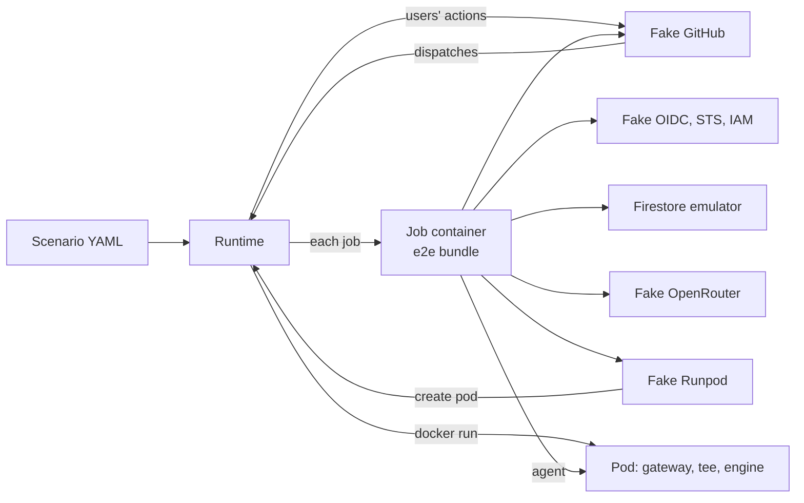

# End-to-end test suite

## Goal

A developer runs `npm run test:e2e`, and Codeman's real bundles run a task from a labeled issue to `codeman:done` against local fakes of GitHub, OpenRouter, Runpod and Google, with real Ollama and vLLM engines on CPU. Each scenario is a YAML file of actions and expectations, kept in a new top-level `e2e/`.

## Context

Several bugs showed only when Codeman ran on a real repository. The unit and flow tests (`src/steps/flow.test.ts`, about 640 tests) never run `dist/index.js` as an action, cross job boundaries through real outputs and artifacts, run OpenCode against a model, run the gateway as a process in front of an engine, or enforce GitHub token permissions.

| Bug found in real use | Kind | Source |
| --- | --- | --- |
| `select` needed `pull-requests: read` to list reviews | Token permission | [MVP plan](2026-09-23-codeman-mvp.md) |
| `next-run` skipped after a record-only run: `success()` across skipped jobs | Workflow expressions | [MVP plan](2026-09-23-codeman-mvp.md) |
| A review did not start a run: the merge ref held the old workflow | Events and workflow files | [MVP plan](2026-09-23-codeman-mvp.md) |
| `gh workflow run` without a ref needs `metadata: read` | Token permission, `gh` behavior | Commit `e26a8c9` |
| A spent shared pod terminated itself before `close-key`'s `/admin/end` | Timing across processes | [Keep a spent pod](2026-10-15-keep-a-spent-pod-for-its-close.md) |
| OpenRouter's cost read as 0 (analytics lag), never refreshed by later pod runs | Provider consistency | [Refresh OpenRouter costs](2026-10-15-refresh-openrouter-costs-from-any-run.md) |
| The agent cloned repositories inside the tree: no manifest, run lost | Real agent behavior | [Keep unfinished work](2026-10-16-keep-unfinished-work-collectable.md) |
| Commands during `awaiting-decision` made every run `record`, with no budget stop | Multi-run state | [Commands around decisions](2026-10-19-commands-around-decisions-and-review-rounds.md) |
| Review rounds against `max-runs`, off by one | Counters across runs | [Align the max-runs counters](2026-10-19-align-the-max-runs-counters.md) |
| A routing run refused by budget posted a noisy comment | Comment policy | [Keep routing quiet](2026-10-19-keep-routing-quiet-on-budget-waits.md) |
| A repository's `CODEMAN_SETTINGS` dropped the organization's pool and budget | Settings across repositories | [Repository override](2026-10-19-repository-override-of-organization-settings.md) |

Constraints:

- `AGENTS.md`: every image, tool and package is audited before use, and each is a decision.
- act was audited and not adopted on 2026-10-19 ([decision 1](2026-10-19-run-github-actions-locally.md#decisions)). This plan reverses that decision for the smoke scenarios only, with a new audit row.
- No production code path may redirect credentials by an environment variable: the management key, the Runpod key, the App token and the OIDC token all go to hard-coded hosts today.
- Codeman is public: fixture repositories are synthetic, under `e2e/fixtures/`.

### The machine of this plan

macOS x86_64, i7-8559U (4 cores, 8 threads, AVX2, no AVX-512), 16 GB. Docker Desktop 29.3.1: a VM with 8 CPUs and 7.8 GB, no NUMA information. Node 24. act 0.2.89. Java 21 and the emulator jar v1.20.4 on the host.

### What can be redirected today

| Integration | Redirectable today | Through |
| --- | --- | --- |
| GitHub REST and GraphQL, web links | Yes | `GITHUB_API_URL`, `GITHUB_GRAPHQL_URL`, `GITHUB_SERVER_URL` |
| The OIDC token request | Yes | `ACTIONS_ID_TOKEN_REQUEST_URL`, `ACTIONS_ID_TOKEN_REQUEST_TOKEN` |
| The agent's model on a pod or Serverless | Yes | `open-key`'s `base-url` and `handle` outputs |
| OpenRouter API, and OpenCode's `openrouter` provider | No | `src/inference/openrouter.ts`, `src/harness/opencode.ts` |
| Runpod REST, the pod proxy URL, the Serverless queue | No | `src/inference/runpod.ts`, `src/inference/providers.ts` |
| STS, IAM Credentials, Firestore | No | `src/store/google.ts`, `src/store/firestore.ts` |
| Hugging Face Hub, the npm registry | No | `src/inference/huggingface.ts`, `src/harness/opencode.ts` |

The classes already take `fetch` or `baseUrl` arguments. Only the wiring drops them: `gitHubServices` (`src/main.ts`), `backendStore` (`src/store/backend.ts`), `inferenceProvider` and `gpuProvider` (`src/inference/index.ts`).

### What act does and does not do

From act 0.2.89's source at `4f41128` ([cmd/root.go](../web/nektos/act-cmd-root-go-at-4f41128.md), [run_context.go](../web/nektos/act-pkg-runner-run-context-go-at-4f41128.md), [gh.go](../web/nektos/act-pkg-gh-gh-go-at-4f41128.md)):

- It has no OIDC. `--env ACTIONS_ID_TOKEN_REQUEST_URL=...` reaches every step, reusable-workflow jobs included. `permissions` is ignored, so a missing `id-token: write` goes unnoticed (`src/templates.test.ts` checks it statically).
- `github.run_id`, `run_attempt` and `run_number` come from `--env GITHUB_RUN_ID` and its siblings, `1` by default. Ledger documents, batch IDs and key names key on them, so each invocation needs its own.
- It ignores `concurrency` and `timeout-minutes`, and receives no `workflow_dispatch` from the API.
- A custom GitHub instance must be HTTPS, and act clones `uses:` actions from it.
- It reads `.env`, `.secrets` and `.vars` from its working directory.

> [!WARNING]
> When no `GITHUB_TOKEN` secret is given, act runs `gh auth token` on the host and injects the developer's real token into the jobs ([gh.go](../web/nektos/act-pkg-gh-gh-go-at-4f41128.md)). The act driver must always pass a fake token, and explicit env, secret and variable files, from an empty directory.

### Audit

| Component | What and why | Verdict | Facts |
| --- | --- | --- | --- |
| act 0.2.89 | Runs the real templates for the smoke scenarios | Adopt, smoke only, after spike 0.2 | MIT. CVE-2026-34041 ([set-env](../web/nektos/set-env-and-add-path-workflow-commands-unconditionally-processed.md)) and CVE-2026-34042 ([cache server](../web/nektos/remote-code-execution-possible-actions-cache-server-allows-malicious-cache-injec.md)) fixed in 0.2.86. Run with `--no-cache-server`, no Docker socket in jobs. No commit on `master` since 2026-06-01 |
| floci-gcp 0.11.0 | Asked for: act's missing OIDC and Google side | Reject | Pre-1.0, one main maintainer, no release checksums. Its STS takes form bodies for GCS downscoping only, with no Workload Identity Federation or JWT check ([STS](../web/floci/floci-gcp-docs-services-sts-md-at-0fa563c.md), [IAM](../web/floci/floci-gcp-docs-services-iam-md-at-0fa563c.md)). Its IAM Credentials refuses the `datastore` scope ([IAM Credentials](../web/floci/floci-gcp-docs-services-iam-credentials-md-at-0fa563c.md)). Its Firestore is gRPC only ([Firestore](../web/floci/floci-gcp-docs-services-firestore-md-at-0fa563c.md)). Its compose mounts the Docker socket ([image](../web/floci/floci-floci-gcp-0-11-0.md)). The AWS sibling had two critical RCEs in September 2026 ([release](../web/floci/floci-gcp-0-11-0.md)) |
| In-house fake OIDC, STS, IAM Credentials | Replaces floci | Recommended, decision 1 | Node built-ins, about 200 lines. Verifies the JWT against its JWKS, the audience and the [attribute condition](../installation/setup.md#choose-the-attribute-condition). Returns the token `owner`, which the Firestore emulator takes as admin (checked with v1.20.4 and `firebase/firestore.rules`) |
| `yaml` 2.9.1 (npm) | Parses scenario files and the templates, in `e2e/` only | Adopt (answered) | ISC, no dependencies, no install scripts, no known vulnerabilities (CVE-2026-33532 fixed in 2.8.3). One maintainer, no provenance attestation. Ships a `yaml` CLI in `node_modules/.bin` |
| `vllm/vllm-openai-cpu:v0.31.0` | vLLM on CPU, the version Codeman pins | Adopt after spike 0.1 | Official, 1.57 GB, AVX2 kernels chosen at run time ([image](../web/docker-hub/vllm-vllm-openai-cpu-v0-31-0.md), [x86](../web/vllm/docs-getting-started-installation-cpu-x86-inc-md-at-v0-31-0.md), [platform](../web/vllm/vllm-platforms-cpu-py-at-v0-31-0.md)). K/V size fixed by `VLLM_CPU_KVCACHE_SPACE` ([CPU](../web/vllm/cpu.md), [worker](../web/vllm/vllm-v1-worker-cpu-worker-py-at-v0-31-0.md), [memory](../web/vllm/vllm-utils-cpu-resource-utils-py-at-v0-31-0.md)) |
| `eclipse-temurin:21.0.12_8-jre-noble` and the emulator jar v1.22.0 | The Firestore emulator in Compose | Recommended, decision 3 | Base by digest ([image](../web/docker-hub/eclipse-temurin-21-0-12-8-jre-noble.md)); jar by the SHA-256 firebase-tools 15.34.0 records ([emulator info](../web/firebase/firebase-tools-downloadableemulatorinfo-json-at-48f511a.md)), with `ADD --checksum` ([Dockerfile](../web/docker/dockerfile-reference.md)) |
| `qwen2.5:0.5b` (Ollama) and `Qwen/Qwen2.5-0.5B-Instruct` at `7ae5576` (Hugging Face) | The same tiny model on both engines | Adopt | Apache-2.0, not gated, Hermes tool-call template. Ollama manifest `a8b0c515…`, 398 MB; safetensors 988 MB bf16. 12 KB of K/V per token |
| Docker Compose | Starts the infrastructure | Record | Bundled with Docker Desktop. Version, license and permissions recorded in step 3.1 |
| `gh` | The templates' `run:` steps | Decision 8 | Pages in `docs/web/github-cli/` |

Not reused: `ollama/ollama:0.35.1`, `node:24.21.0-bookworm-slim` and `ubuntu:noble-20260930.1` are already audited ([dependencies](../development/dependencies.md#the-local-runner-image)).

## Decisions

### Answered

Answered by the responsible person on 2026-10-20.

1. **Approach.**
   - a) A Node workflow simulator runs the real bundle job by job.
   - b) act on the real templates for every scenario.
   - c) Hybrid: a) for most scenarios, b) for one or two smoke scenarios after a spike.

   **Answer: c).** The simulator follows the templates' job order, `if:` rules, matrix and reusable workflow, a per-repository concurrency queue, and dispatch chaining. act 0.2.89 runs the smoke scenarios. floci was evaluated for act's missing OIDC and rejected ([audit](#audit)); its replacement is [decision 1 of the review](#answered-in-review).
2. **Seams for the hard-coded endpoints.**
   - a) Environment overrides in production code.
   - b) Overrides compiled only into an e2e bundle, through esbuild's `define` (`__CODEMAN_E2E__`).
   - c) DNS and TLS interception, with no code change.

   **Answer: b).** The published `dist/` keeps none of them. c) fails for the agent: its environment allowlist drops CA and proxy variables.
3. **Engines.**
   - a) A scripted model only.
   - b) Real Ollama only.
   - c) Real Ollama and real vLLM on CPU, with the scenario scripting the replies.

   **Answer: c),** with `qwen2.5:0.5b` and `Qwen/Qwen2.5-0.5B-Instruct` at a pinned revision. What matters is concurrency, the context split between tasks and the engine's configuration, not the model's output. Design:
   - A tee proxy in each e2e pod image takes the engine's port. For each chat request it sends the real engine a short fixed prompt with `temperature: 0` and `max_tokens` capped, waits for the engine's reply, then returns the scenario's scripted reply. Spike 0.1 changed this from forwarding the agent's prompt: on CPU in bf16 a real prompt takes minutes, and one past 8192 tokens is refused. Concurrency, the context split and the engines' settings are still exercised and asserted.
   - For Ollama, it rewrites `size_vram` in `/api/ps` against a virtual VRAM budget, so the real fit search runs on real sizes.
   - The shipped `dist/gateway.js` runs unchanged.
   - vLLM uses the official CPU image with `VLLM_CPU_KVCACHE_SPACE` and `enforce-eager`. One vLLM pod at a time, in its own Compose profile, after a spike.
   - Assertions read the gateway's `/admin/status`, Ollama's `/api/ps`, vLLM's `/v1/models` and `/metrics`.
4. **Scenario format.**
   - a) YAML, with the npm `yaml` package as a pinned development dependency, used only in `e2e/`.
   - b) Typed `.ts` modules, no dependency.
   - c) JSON.

   **Answer: a).** JSON is the fallback if YAML proves unworkable. The runtime validates each scenario against a TypeScript schema. Risk accepted: one maintainer, no provenance.

### Answered in review

Answered by the responsible person on 2026-10-20: every recommendation below was approved, as were the design's choices (the simulator parses the templates, `npm test` adds the fakes' tests, a reverted fix must fail its scenario).

1. **The Google side under test.**

   | Option | Trade-off |
   | --- | --- |
   | a) In-house fake OIDC issuer, STS and IAM Credentials; Firebase's emulator for Firestore | About 200 lines, no dependency. Tests the whole token path, including the signature, audience and condition. Mirrors Google's documented behavior; does not prove it |
   | b) Skip the token path in the e2e build (`Firestore.emulator`) | Smallest. Tests none of OIDC, STS or IAM |

   **Recommendation: a).** **Answer: a).** It also gives each act invocation its own claims (repository, run ID, workflow) through a request token per invocation.
2. **How the fake Runpod starts pod containers.**

   | Option | Trade-off |
   | --- | --- |
   | a) The fake mounts the Docker socket | Simple. The fake gets root on Docker's VM |
   | b) The host-side orchestrator starts a container on the fake's request | No socket in any container. The orchestrator maps each pinned production image digest to a local e2e image, from an allowlist |
   | c) A fixed pool of pre-started pods | No Docker access. Cannot test the pod's environment from `open-key`, creation races or start failures |

   **Recommendation: b).** **Answer: b).**
3. **The Firestore emulator.**

   | Option | Trade-off |
   | --- | --- |
   | a) A self-built image: Temurin 21 JRE by digest, jar v1.22.0 by checksum | About 240 MB, reproducible. Changes the emulator's audit from "newest in the cache" to a pin |
   | b) The host's jar and Java | No image. Not reproducible across machines; containers reach it through the host |
   | c) `google/cloud-sdk:emulators` | 452 MB, gcloud, Python and every emulator; re-pushed weekly; jar version hidden |

   **Recommendation: a).** **Answer: a).** `src/store/emulator.test.ts` can use it through `FIRESTORE_EMULATOR_HOST`, as it already allows.
4. **OpenCode's download, 185 MB per agent job.**
   - a) An e2e-build seam to a local registry cache, filled once; Codeman still checks the pinned integrity.
   - b) The network on every agent job.

   **Recommendation: a).** **Answer: a).** It removes the network from the agent's path and keeps the check that makes a cache safe.
5. **Timers and expiry** (run leases 2 h, keep leases 15 min, reservations 30 min, pod start 25 min).
   - a) Seed documents with past timestamps before a run.
   - b) A clock-scale seam in the e2e build.

   **Recommendation: a).** **Answer: a).** No new seam; the code under test reads the real clock.
6. **Where it runs.**
   - a) Locally only, with `npm run test:e2e`.
   - b) Also in CI.

   **Recommendation: a).** **Answer: a).** for now. CI gets its own plan: time, Docker on `ubuntu-latest`, and model downloads.
7. **Docker Desktop's memory.** By estimate, four agent jobs on one Ollama pod need about 6.2 GB, and a vLLM pod with two agent jobs about 6.5 GB, of the VM's 7.8 GB.
   - a) Ask developers to raise it to 10 to 12 GB.
   - b) Keep 8 GB: the runtime runs scenarios one at a time, vLLM scenarios alone, and refuses to start a profile when Docker reports less memory than it needs.

   **Recommendation: b).** **Answer: b),** measured in spike 0.1. Advise 10 GB in the docs if the measure leaves under 1 GB free. Spike 0.1 measured a vLLM pod at about 5.5 GiB, which leaves under 1 GB free: the docs advise 10 GB for the `vllm` profile.
8. **`gh` in the templates' `run:` steps** (the commit check, `next-run`, `dispatch`, `forward-review`).
   - a) GitHub's `gh` release, pinned, checked by its checksum, in the e2e runner image only, with `GH_HOST` on the fake.
   - b) A shim that calls the fake.

   **Recommendation: a).** **Answer: a).** The `metadata: read` bug was `gh`'s own GraphQL call for the default branch; a shim would hide it. It needs an audit row and `docs/web/github-cli/` pages for `gh workflow run`.
9. **The vLLM metrics page.** The concurrency assertions read `vllm:num_requests_running` and `vllm:num_requests_waiting`. The saved [metrics page](../web/vllm/vllm-v1-metrics-loggers-py-at-v0-31-0.md) covers only `cache_config_info`.
   - a) Refresh it to cover both gauges.
   - b) Assert concurrency only from the tee's timestamps.

   **Recommendation: a).** **Answer: a).** `AGENTS.md` requires the responsible person's request to refresh a page.

### Answered after the spikes

Answered by the responsible person on 2026-10-20.

10. **Phase 6, after spike 0.2 met its drop rule** (a failed job inside a reusable workflow stops act's whole run, so `always()` jobs such as `next-run` never start; `upload-artifact` v7 fails against act's artifact server).
    - a) Keep two act smoke scenarios, on success paths only, with the fake GitHub serving the artifact API.
    - b) Drop phase 6.
    - c) Defer phase 6 until a newer act.

    **Answer: a).** Failure scenarios run on the simulator only. Step 6.1 takes the spike's hardening.

11. **The gateway's call that terminates its own pod** (`src/gateway/main.ts`) reaches `api.runpod.io` directly, so on the e2e's internal network the fake Runpod never sees it.
    - a) The gateway takes the same e2e-only redirect, and the pod images run `e2e/.build/gateway.js`. `dist/gateway.js` gains a dead branch only, but its bytes change, so the published pod images differ from `dist/` until their next publish.
    - b) Keep `dist/gateway.js` unchanged; the host launcher tells the fake Runpod when a pod's container exits.

    **Answer: a).** The fake then sees the real call, with its pod ID and key, which matters for cost bugs. This replaces step 1.1's note that `dist/gateway.js` stays unchanged.

## Design

### Layout

| Path | Holds |
| --- | --- |
| `e2e/infra/compose.yaml` | The network, services, profiles (`ollama`, `vllm`), volumes and health checks |
| `e2e/infra/images/` | `runner/` (the local runner image, plus `gh` and the test CA), `pod-ollama/`, `pod-vllm/`, `emulator/`, `fakes/` |
| `e2e/fakes/` | `github/`, `openrouter/`, `runpod/`, `google/` (OIDC, STS, IAM Credentials), `llm/` (the scripted model and the tee), `npm/` (decision 4), each with its own tests |
| `e2e/runtime/` | The scenario loader and schema, the workflow simulator, the act driver, the orchestrator, assertions and reports |
| `e2e/scenarios/` | YAML files by subject: `happy-path/`, `pods/`, `serverless/`, `parallel/`, `pools/`, `budgets/`, `failures/`, `commands/`, `security/` |
| `e2e/fixtures/` | Synthetic target repositories as file trees; the runtime makes bare repositories of them |
| `e2e/.build/`, `e2e/.out/` | The e2e bundle and each scenario's report; ignored by git |

There is no `e2e/README.md`: the docs go to `docs/development/e2e.md`.

### How a run flows



- **The simulator** reads `templates/codeman.yml` and `codeman-task.yml` with `yaml`. It evaluates the subset of expressions the templates use (`always()`, `success()`, `needs.*.result`, `outputs`, `fromJSON`, `==`, `!=`, `&&`, `||`, `!`), and fails on any other construct, so a template change is noticed.
- **Each job** runs in the e2e runner image with `--init --cap-add SYS_ADMIN --security-opt seccomp=unconfined --security-opt apparmor=unconfined`, as [the local runner](../development/local-actions.md) does. `uses: ./` runs the e2e bundle; `run:` steps run in bash; `actions/checkout`, `create-github-app-token` and the artifact actions are emulated against the fake GitHub.
- **The fake GitHub** serves HTTPS with a test CA made per session, trusted by Node, git and `gh` in the runner image. It enforces each App token's permissions and each user's collaborator permission. Any request with a token it did not issue fails the scenario.
- **The agent's model** is the scripted model: through the fake OpenRouter on the OpenRouter path, and through the tee on pods and Serverless. A marker in the issue's body, which reaches the prompt, names the scenario and the issue; the stage and the turn give the step.

### Scenario schema, sketched

| Action | Does |
| --- | --- |
| `open-issue`, `comment`, `label`, `unlabel`, `review`, `close`, `reopen` | A user acts on the fake GitHub; `as:` names the user |
| `push` | A user moves a branch, such as the task branch |
| `set-variable` | Changes an organization's or repository's `CODEMAN_SETTINGS` |
| `seed` | Writes store documents, with `age:` for past timestamps |
| `run` | Starts one workflow run for an event, and waits for its jobs |
| `advance` | Follows `next-run` and `dispatch` until a condition holds, or `max-runs` |
| `parallel` | Runs several action lists at once, such as two repositories' runs |
| `fault` | Makes a fake or a job fail: an HTTP status, a delay, a job's failure, a pod that never serves |
| `apply` | `skip` cancels the `apply` job, `fail` fails it, so the agent's work is not applied |
| `wait` | Waits for a condition, with a timeout |
| `expect` | Checks labels, comments, commits, pull requests, store documents, ledger costs, fakes' state and engine state |

The `agent:` section scripts the agent per issue, stage and round. Each round lists steps the scripted model turns into OpenCode tool calls (`write`, `edit`, `bash`), then the stage's `output`. Other steps: `raw` (an invalid output), `hang`, `exit`, `delay`, and `usage` for deterministic costs.

```yaml
name: OpenRouter, from a labeled issue to done
tags: [happy-path, openrouter]
runner: simulator            # or act
world:
  organizations: [{ name: acme, settings: { model: deepseek/deepseek-v4.1-flash, task-budget: 2 } }]
  repositories: [{ name: acme/app, fixture: node-small, maintainers: [alice] }]
agent:
  i1:
    plan:
      - steps:
          - bash: plan=$(sed -n 's/.*Create the plan at `\([^`]*\)`.*/\1/p' .codeman/task.md) && mkdir -p "$(dirname "$plan")" && printf '# Add a health route\n' > "$plan"
          - output: { summary: Adds a health route., decisions: [{ id: 1, title: Port, question: Which port?, options: [{ key: a, label: "8080" }, { key: b, label: "3000" }], recommendation: a }] }
    route: [{ steps: [{ output: { summary: Code, then review., route: [{ stage: code, brief: Add the route. }, { stage: review, brief: Check it. }], skipped: [{ stage: web, reason: No docs. }, { stage: design, reason: Settled. }, { stage: test, reason: Too small. }] } }] }]
    code: [{ usage: { prompt: 1200, completion: 300 }, steps: [{ write: { path: src/health.ts, content: "export const ok = true;\n" } }, { output: { status: done, summary: Adds the route., commitMessage: Add a health route } }] }]
    review: [{ steps: [{ output: { status: done, summary: The route is right. } }] }]
actions:
  - open-issue: { ref: i1, as: alice, title: Add a health route, labels: [codeman] }
  - run: { event: issues.labeled }
  - expect: { issue: i1, labels: [codeman:awaiting-decision], comments: [{ kind: decisions, contains: Which port? }] }
  - comment: { issue: i1, as: alice, body: /codeman decide 1 a }
  - advance: { until: { issue: i1, labels: [codeman:done] }, max-runs: 6 }
  - expect: { issue: i1, pull-request: { ready: true, files: [src/health.ts] }, ledger: { cost-at-most: 2 }, violations: none }
```

The outputs are Codeman's [agent output](../runs/agent.md#agent-output). The planning agent writes its plan at a path that holds the day's date, so the script reads it from the task file. This example is `e2e/scenarios/happy-path/openrouter-to-done.yaml`; the schema of every action is in `e2e/runtime/scenario/schema.ts`.

## Steps

Each step is one commit, done when `npm run check` passes and what it names holds. Phase 0 commits nothing but this plan's results.

### Phase 0: spikes

#### 0.1 Run vLLM and Ollama on CPU

1. Run `vllm/vllm-openai-cpu:v0.31.0` by digest with `VLLM_CPU_KVCACHE_SPACE=1`, `--max-model-len 8192 --max-num-seqs 2 --enforce-eager --enable-auto-tool-choice --tool-call-parser hermes`; then with `--max-model-len auto`.
2. Run `ollama/ollama:0.35.1` with `qwen2.5:0.5b`, `OLLAMA_NUM_PARALLEL=2`, and check whether `/api/pull` needs the registry when the blobs are present.

Done when the plan's results record, for vLLM: the time to `/health`, `/v1/models`' `max_model_len`, `/metrics`' `cache_config_info`, a parsed `ping` tool call, and the peak memory; for Ollama: `/api/ps`, llama-server's `-c` and `-np`, and the pull's behavior offline. If vLLM fails, the plan takes the next [fallback](#out-of-scope) (`--dtype float32` from the wrapper, then the tee emulating vLLM) and goes back to review.

#### 0.1 results

Run on 2026-10-20 on the plan's machine (Docker Desktop VM, 8 CPUs, 7.8 GB), `HEAD` `b139ff0`. Memory is `docker stats --no-stream` of the spike's own container, sampled every second; "anon" is the cgroup's `memory.stat`, without the page cache of the weights.

**Verdict: pass with changes.** Both engines run on CPU with the pinned images and models, bf16 included. vLLM needs more memory and time than estimated, and the tee must not forward the agent's real prompt to it.

##### Downloads

| Input | Pinned | Measured |
| --- | --- | --- |
| `vllm/vllm-openai-cpu:v0.31.0@sha256:495c84fe…` | Index digest | 25 min to pull, 6.73 GB on disk |
| `ollama/ollama:0.35.1@sha256:292ee794…` | Index digest, as in `docker/pod/Dockerfile` | First pull failed after 2 h (`short read: … unexpected EOF`); the retry took 35 min. 9.37 GB on disk |
| `Qwen/Qwen2.5-0.5B-Instruct` | `7ae5576` | `hf download` (hf 1.33.0, inside the vLLM image) into a volume: 5 min, 1.0 GB. `refs/main` is `7ae557604adf67be50417f59c2c2f167def9a775`. Every vLLM run used `HF_HUB_OFFLINE=1` |
| `qwen2.5:0.5b` | `a8b0c515…` | `/api/pull` 2 min 20 s, 398 MB; `/api/tags` digest `a8b0c51577010a279d933d14c2a8ab4b268079d44c5c8830c0a93900f1827c67` |

##### vLLM

Arguments as `vllmServeArguments` builds them (`serve <model> --served-model-name <model> --enable-auto-tool-choice --max-num-seqs 2 --enforce-eager --tool-call-parser hermes --max-model-len <n|auto>`), on `0.0.0.0` instead of the loopback, with `VLLM_CPU_KVCACHE_SPACE=1`, `VLLM_CPU_OMP_THREADS_BIND=nobind`, `OMP_NUM_THREADS=4` and `--shm-size=1g`.

| | `--max-model-len 8192` | `--max-model-len auto` | `8192`, `--dtype float32` |
| --- | --- | --- | --- |
| Time to `/health` | 82 s (cold cache) | 126 s | 111 s |
| `/v1/models` `max_model_len` | 8192 | 32768 (log: `Auto-fit max_model_len: full model context length 32768 fits`, which `autoFitModelContext` matches) | 8192 |
| `cache_config_info` | `kv_cache_size_tokens="87296"` (682 blocks of 128), `kv_cache_max_concurrency="10.65625"`, `kv_cache_memory_bytes="1073741824"`, `block_size="128"`, `cache_dtype="auto"`, `enable_prefix_caching="True"`, `gpu_memory_utilization="0.92"` | Same cache, `kv_cache_max_concurrency="2.6640625"` | `kv_cache_size_tokens="43648"`, concurrency `5.328125` |
| `ping` probe, the gateway's own body (`tool_choice: "auto"`, `temperature: 0`) | Parsed `tool_calls[0].function.name == "ping"`, `arguments: "{}"`, `finish_reason: tool_calls`. **First request: 214 s** | Same call. First request: 233 s | Same call. First request: 176 s |
| Later requests | 152-token prompt, 8 tokens: 1.3 s. 2,843-token prompt: 69 s and 86 s | Not measured | 2,842-token prompt: 18 s |
| 3 concurrent requests, 150 tokens each | `num_requests_running` 2.0 and `num_requests_waiting` 1.0 for 25 s; two end at 27 s, the third at 47 s | Not measured | Same pattern: 26 s, 26 s, 49 s |
| Peak memory | 5.42 GiB (anon 4.28 GiB; API server 1.2 GB, engine core 0.9 GB, worker 2.8 GB RSS) | 4.50 GiB (probe only) | 6.47 GiB (anon 6.3 GiB). Not viable in 7.8 GB |

Notes:

- The gauges exist under the plan's names, plus `vllm:num_requests_waiting_by_reason{reason="capacity"|"deferred"}`. `/metrics` has 389 `vllm:` lines.
- The first request is slow whatever the dtype: about 3 to 4 minutes of one busy thread in the worker, with `prompt_tokens_total` at 0 until it ends. The gateway's probe is that first request. It passed within its 5-minute try each time, with little margin.
- bf16 logs `Failed to create oneDNN linear, fallback to torch linear` (the CPU has no AVX-512 BF16). Prefill runs at about 35 tokens/s in bf16 and 160 in float32. Decode is the same in both, about 11 tokens/s across 2 sequences.
- The model's `generation_config.json` overrides vLLM's default sampling (`temperature 0.7`, `top_k 20`, `top_p 0.8`, `repetition_penalty 1.1`).
- Harmless warnings: `numa_migrate_pages failed. errno: 1`, `numa_set_membind failed`.

##### Ollama

Run with `OLLAMA_NUM_PARALLEL=2`, `OLLAMA_CONTEXT_LENGTH=32768` (the only candidate for this model: its own context, below the 64000 floor), `OLLAMA_KEEP_ALIVE=-1`. The `server config` log line shows all three.

- `/api/ps`: `context_length: 32768`, `size: 1481543514`, `size_vram: 0`, `expires_at: 2319-01-30T21:45:04Z`, digest `a8b0c515…`.
- llama-server: `--model …/sha256-c5396e06… -c 65536 -np 2 --flash-attn auto -b 2048 -ub 2048 --context-shift --keep 4 --offline --no-jinja --chat-template chatml`. Its log: `n_ctx = 65536`, `n_ctx_seq = 32768`, `n_seq_max = 2`, K/V 768 MiB in f16, model 346 MiB.
- `/api/show`: `qwen2.context_length 32768`, `head_count_kv 2`, `block_count 24`, no `sliding_window`; capabilities `completion`, `tools`.
- `ping` on `/v1/chat/completions`: a parsed tool call in 1.1 s.
- 3 concurrent chats, 300 tokens each: two end at 11.3 s, the third at 21.1 s, so 2 run in parallel.
- Peak memory: 1.41 GiB.
- `/api/pull` of a model already present, online: `success` in 1.6 s.
- `/api/pull` with no network, after `docker network disconnect`. It always needs the registry, even when the blobs are present:
  - A freshly started `ollama serve` fails at once: `dial tcp: lookup registry.ollama.ai … network is unreachable`.
  - The Ollama that had pulled before hung on `pulling manifest` for 12 min 34 s, then failed with `read: connection timed out`.
  - The gateway's `pullModel` has no timeout, so an offline pod would hang until `CODEMAN_START_BY`.

##### The gateway in front of Ollama on CPU

`docker build --target ollama -f docker/pod/Dockerfile` from a copy of `dist/gateway.js` (last changed in `ca7f3e8`, sha256 `eabc55bb…`). Run with `CODEMAN_MODEL=qwen2.5:0.5b`, `CODEMAN_ENGINE=ollama`, `CODEMAN_ADMIN_SHA256`, `CODEMAN_START_BY` (now + 25 min), `CODEMAN_OLLAMA={"OLLAMA_NUM_PARALLEL":"2"}` and `CODEMAN_GPU_MEMORY_GB=24`, with network.

Six seconds after it started: pull, `Fitting qwen2.5:0.5b to the GPU, from 32768 tokens`, one load, `1.5 GB off the GPU`, then the floor message. `/health` answers `{"ready":false,"failed":true}`, and `/admin/status.failure` holds the same message. The fit fails exactly at `onGpu` on `size_vram: 0`. The tee's `/api/ps` rewrite is the one change it needs; with `context-length` set, the single load fails the same way.

##### Changes the plan needs

1. **Decision 7, memory.** A vLLM pod peaks at 4.5 to 5.4 GiB, not 3.5 to 4. That leaves under 1 GB free next to the emulator, a runner with OpenCode and the fakes. As decision 7 says, the docs advise 10 GB. The runtime's check for the `vllm` profile counts about 5.5 GiB for the pod. float32 (6.5 GiB) is not a fallback on 8 GB: keep bf16.
2. **The tee must not forward the agent's prompt to vLLM.** bf16 prefill runs at about 35 tokens/s, so a real OpenCode prompt costs minutes, and one longer than `max-model-len 8192` is refused. The tee forwards a short fixed prompt with `temperature: 0` and `max_tokens` capped, and checks the context split through `/v1/models`, `/metrics` and `/api/ps`. Ollama gets the same policy.
3. **vLLM time to ready: about 5 to 6 minutes.** That is the start (1.5 to 2 min) plus the probe's first request (3 to 4 min). Scenario timeouts, the fake Runpod's pod start and `open-key`'s wait must allow it. Step 3.3's health check of a `pod-vllm` must not require a warm engine sooner.
4. **The tee's synthetic pull is required, not optional.** Without it, an offline pod fails at once or hangs for over 12 minutes (see Ollama above).
5. **Assertion values** for vLLM with `VLLM_CPU_KVCACHE_SPACE=1`:
   - `kv_cache_size_tokens` 87296;
   - concurrency 10.65625 at 8192 and 2.6640625 at 32768;
   - the auto-fit line names 32768.

   For Ollama: llama-server `-c 65536 -np 2`, and `/api/ps` `context_length` 32768.
6. **Step 3.3, downloads.** The first run downloads about 6.4 GB (images and models) and stores about 17 GB of images. Pulls can fail midway: the seed services and the docs say to retry.

<details>
<summary>Commands</summary>

```sh
docker pull --platform linux/amd64 vllm/vllm-openai-cpu:v0.31.0@sha256:495c84fe30f3572b83a78100a1e8ba423dbb77fc532ecefebe114e6b77327bd9
docker pull --platform linux/amd64 ollama/ollama:0.35.1@sha256:292ee7945dfc3d5840a181f3ab86fedb1e66703e02c8af98b50f4da56b7e278c
docker run --rm -v e2e-spike01-hf:/root/.cache/huggingface --entrypoint hf <vllm image> download Qwen/Qwen2.5-0.5B-Instruct --exclude '*.md'

docker run -d --init --shm-size=1g -p 127.0.0.1:18100:8000 -v e2e-spike01-hf:/root/.cache/huggingface \
  -e VLLM_CPU_KVCACHE_SPACE=1 -e VLLM_CPU_OMP_THREADS_BIND=nobind -e OMP_NUM_THREADS=4 -e HF_HUB_OFFLINE=1 \
  -e VLLM_NO_USAGE_STATS=1 -e DO_NOT_TRACK=1 --entrypoint vllm <vllm image> \
  serve Qwen/Qwen2.5-0.5B-Instruct --host 0.0.0.0 --port 8000 --served-model-name Qwen/Qwen2.5-0.5B-Instruct \
  --enable-auto-tool-choice --max-num-seqs 2 --enforce-eager --tool-call-parser hermes --max-model-len 8192   # then auto; then 8192 --dtype float32

docker run -d --init -p 127.0.0.1:18101:11434 -v e2e-spike01-ollama:/root/.ollama -e OLLAMA_HOST=0.0.0.0:11434 \
  -e OLLAMA_NUM_PARALLEL=2 -e OLLAMA_CONTEXT_LENGTH=32768 -e OLLAMA_KEEP_ALIVE=-1 <ollama image> serve
docker network disconnect bridge <ollama container>; docker exec <ollama container> ollama pull qwen2.5:0.5b
```

</details>

#### 0.2 Run the jail and a reusable workflow under act

On a scratch workflow with the e2e runner image, a stub HTTPS GitHub and the act flags of step 6.1, check:

- a reusable workflow called as a matrix, with `secrets:`, `always()` and `needs.*.result`;
- `upload-artifact@v7` and `download-artifact@v8` against act's artifact server;
- the sandbox tests, as `runner`, with the jail;
- `GITHUB_RUN_ID` set per invocation;
- `uses:` actions resolved without github.com, from the fake or an offline action cache;
- `RUNNER_TEMP` and the workspace's path.

Done when each item is recorded pass or fail in the plan. If the matrix of a reusable workflow or the artifacts fail, phase 6 is dropped and the plan goes back to review.

#### 0.2 results

Run on 2026-10-20 with act 0.2.89, `codeman-runner:local` rebuilt from `docker/runner/Dockerfile` at `b139ff0`, the four actions at the SHAs `templates/` pins (fetched once from github.com, anonymously, with git and no credential helper), a stub HTTPS GitHub (Node, test CA made for the spike, git smart HTTP through `git http-backend`) on a scratch Docker network, and scratch workflows only. Every job ran as `runner` (uid 1001), with `tini` (`docker-init`) as PID 1 and seccomp off.

| Item | Result | Note |
| --- | --- | --- |
| 1a. Reusable workflow called as a matrix, `secrets:`, outputs read by a later job | Pass | `fromJSON` matrix of 2 legs with `fail-fast: false` and an `if:` on the caller. The secret reached both legs. `always()` and `needs.work.result` work inside the reusable workflow. The later job read `needs.task.result` (`success`), and `needs.task.outputs` held the last leg's value only (`task-2-success`), as on GitHub |
| 1b. A skipped job inside the reusable workflow | Pass | `needs.task.result` is `success`, the later job runs |
| 1c. `always()` in the caller after a job inside the reusable workflow fails | **Fail** | act stops the whole run when a job inside a reusable workflow fails: `next-run`-like jobs with `if: always()` never start, so `needs.task.result == 'failure'` is never seen. The same `always()` after a failed plain job runs (`needs.a.result` is `failure`). No flag changes it |
| 2a. `upload-artifact` v7.0.1 (`043fb46`) against act's artifact server | **Fail** | Two incompatibilities. 1. act rejects `CreateArtifact` with `unknown field "mime_type"`, which `@actions/artifact` always sends. 2. Without that field, the blob upload gets 401: the client drops the `=` padding of the signed URL's `sig`, and act's HMAC check fails. A 40-line proxy in front of act's server that removes `mime_type` and pads `sig` makes uploads work |
| 2b. `download-artifact` v8.0.1 (`3e5f45b`) against act's artifact server | Pass | By name and all artifacts, with no proxy change on the download path. Artifacts are stored as `<artifact-server-path>/<run_id>/<name>/` |
| 2c. Artifact actions and a fake GitHub | Pass, with a constraint | `@actions/artifact` refuses to run (`GHESNotSupportedError`) unless `GITHUB_SERVER_URL`'s host is `github.com`, ends in `.ghe.com` or ends in `.localhost`. The fake must be named `*.localhost` (the spike used `github-e2e.localhost`) |
| 3. Sandbox tests as `runner`, with the jail | Pass | `npm ci`, then `CODEMAN_SANDBOX_TEST=1 npm test` inside an act job: 646 tests, 632 pass, 0 fail, 14 skipped (the Firestore emulator tests, as `npm run test:runner` without an emulator). "A harness that does nothing ran in the jail in 83 ms". `--container-options` takes `--init --cap-add SYS_ADMIN --security-opt seccomp=unconfined --security-opt apparmor=unconfined` and `-v` mounts. `docs.test.ts` needs the copy to be a git repository |
| 4. `GITHUB_RUN_ID` per invocation | Pass | `--env GITHUB_RUN_ID=4242`, then `4243` and `4244`, reach `$GITHUB_RUN_ID` and `github.run_id` in every job, reusable workflow included; `run_attempt` from `GITHUB_RUN_ATTEMPT`, `run_number` stays `1`. The artifact server's directory and `ACTIONS_RUNTIME_TOKEN` follow it |
| 5a. `uses:` from `--local-repository <owner>/<repo>@<sha>=<dir>` | Pass | Upload and download artifact. No clone |
| 5b. `uses:` from an offline action cache | Pass | `--action-cache-path <dir> --action-offline-mode`, with each action as a git clone in `<dir>/<owner>-<repo>@<sha>`: checkout and create-github-app-token ran with no request anywhere. act still prints `git clone '<url>'` |
| 5c. An action missing from the cache | Clone attempt | act clones it from `GITHUB_SERVER_URL` given with `--env`, else from `--github-instance`, else from github.com, sending the `GITHUB_TOKEN` secret as the password. Its Go TLS uses the host's trust store, so it fails on the test CA. One spike run, with a broken wrapper that dropped both, sent `fake-token` to github.com for a repository that does not exist |
| 5d. `actions/checkout` v7.0.1 against the fake | Pass | It calls `GET /repos/{owner}/{repo}/hash-algorithm` with the token, then git smart HTTP with `x-access-token:<token>`. git needs the CA (`GIT_SSL_CAINFO`, or the image's store) and `http.curloptResolve=<host>:<port>:<ip>`: libcurl sends every `*.localhost` to 127.0.0.1 |
| 5e. `actions/create-github-app-token` v3.2.0 against the fake | Pass | `GET /repos/{owner}/{repo}/installation` and `POST /app/installations/{id}/access_tokens` with the App JWT, then `DELETE /installation/token` in its post step. Node trusts the fake through `NODE_EXTRA_CA_CERTS` |
| 6a. Workspace path | Recorded | `GITHUB_WORKSPACE` and `github.workspace` are act's working directory's host path (here `/private/tmp/.../run`), on a volume, owned by `runner`. Not `/home/runner/work/<repo>/<repo>` |
| 6b. `RUNNER_TEMP` | **Partial** | `--env RUNNER_TEMP=/home/runner/work/_temp` sets the variable, but `${{ runner.temp }}` stays `/tmp`. The templates pass `${{ runner.temp }}/codeman/...` to the artifact actions while Codeman reads `process.env.RUNNER_TEMP`, so under act they name different directories |
| 6c. `/opt/hostedtoolcache` | Recorded | act mounts its named volume `act-toolcache` there, world-writable and shared by every invocation. Here it dated from 2026-10-19: it shadows the image's tool cache, and keeps whatever a job writes there |
| 7a. A stub HTTPS GitHub from `--env GITHUB_API_URL`, `GITHUB_SERVER_URL`, `GITHUB_GRAPHQL_URL` | Pass | The variables and `github.api_url`, `server_url`, `graphql_url` take them. act itself contacted the stub only to clone an uncached action (5c) |
| 7b. Node trusts the stub with `NODE_EXTRA_CA_CERTS` | Pass | `fetch` from a step and from the JavaScript actions |
| 7c. `ACTIONS_ID_TOKEN_REQUEST_URL` and `_TOKEN` from `--env` | Pass | Visible in every step, reusable-workflow jobs included; a step's `fetch` of the URL with `&audience=` reached the stub with `Bearer <token>` |
| Also: `::set-env::`, `::add-path::` | Pass | Both refused ("command is disabled"); the next step does not see them |
| Also: `secrets.GITHUB_TOKEN`, `github.token` | Recorded | Both are the `-s GITHUB_TOKEN` value; `GITHUB_TOKEN` is not in the environment |
| Also: failed jobs' containers | Recorded | Without `--rm`, act leaves each failed job's container running, with its two volumes |
| Not checked: `gh` against a `*.localhost` host | Not checked | `gh` is not installed. Go's resolver and `gh`'s handling of `github.localhost` are unknown for `github-e2e.localhost` |
| Not checked: the real templates under act | Not checked | Out of the spike's scope |

The act command line that ran items 1, 2 (with the proxy), 4, 5 and 7, from a directory holding only `.github/workflows/`:

```sh
S=<scratch directory>
cd "$S/run"   # only .github/workflows/, no .env, .secrets, .vars, .actrc
env -u GITHUB_TOKEN -u GH_TOKEN \
  XDG_CONFIG_HOME="$S/xdg-config" XDG_CACHE_HOME="$S/xdg-cache" \
  ACTIONS_RUNTIME_URL=http://host.docker.internal:34591/ ACTIONS_RESULTS_URL=http://host.docker.internal:34591/ \
  act workflow_dispatch -W .github/workflows/main.yml \
  -P ubuntu-latest=codeman-runner:local --pull=false \
  --no-cache-server --container-daemon-socket - \
  --network e2e-spike02-net --concurrent-jobs 1 \
  --container-options "--init --cap-add SYS_ADMIN --security-opt seccomp=unconfined --security-opt apparmor=unconfined -v $S/stub/ca.crt:/etc/e2e/ca.crt:ro" \
  --artifact-server-path "$S/artifacts" --artifact-server-addr 127.0.0.1 --artifact-server-port 34590 \
  --action-cache-path "$S/cache" --action-offline-mode \
  --local-repository actions/upload-artifact@043fb46d1a93c77aae656e7c1c64a875d1fc6a0a="$S/actions-src/upload-artifact" \
  --local-repository actions/download-artifact@3e5f45b2cfb9172054b4087a40e8e0b5a5461e7c="$S/actions-src/download-artifact" \
  --env-file "$S/files/env" --secret-file "$S/files/secrets" --var-file "$S/files/vars" \
  -s GITHUB_TOKEN=fake-token -s KEY=fake-key \
  --env GITHUB_RUN_ID=4243 --env GITHUB_RUN_ATTEMPT=1 --env GITHUB_REPOSITORY=acme/app \
  --env RUNNER_TEMP=/home/runner/work/_temp \
  --env GITHUB_API_URL=https://github-e2e.localhost:8443/api/v3 \
  --env GITHUB_SERVER_URL=https://github-e2e.localhost:8443 \
  --env GITHUB_GRAPHQL_URL=https://github-e2e.localhost:8443/api/graphql \
  --env NODE_EXTRA_CA_CERTS=/etc/e2e/ca.crt --env GIT_SSL_CAINFO=/etc/e2e/ca.crt \
  --env GIT_CONFIG_COUNT=1 --env GIT_CONFIG_KEY_0=http.curloptResolve \
  --env GIT_CONFIG_VALUE_0=github-e2e.localhost:8443:<the fake's IP> \
  --env "ACTIONS_ID_TOKEN_REQUEST_URL=https://github-e2e.localhost:8443/oidc/token?api-version=2.0" \
  --env ACTIONS_ID_TOKEN_REQUEST_TOKEN=req-token-4243
```

- Port 34591 is the proxy that removes `mime_type` and pads `sig`, in front of act's server on 127.0.0.1:34590. Binding act's server to 127.0.0.1, and naming `host.docker.internal` in act's own environment, keeps it off the LAN: by default act binds it to the host's LAN address (`192.168.1.9` here).
- The sandbox run (item 3) added `-v <Codeman copy>:/mnt/codeman:ro` to `--container-options`.
- The checkout and app-token run (5b, 5d, 5e) used the same flags with a secret file holding a fake App key.

**What the plan needs:**

1. **Decide whether phase 6 stays.** Step 0.2's rule drops phase 6 when the reusable workflow's matrix or the artifacts fail, and both partly failed:
   - 1c means a scenario under act cannot cover any failure inside `codeman-task.yml`: `next-run` and anything after a failed task never run. The two smoke scenarios have no failing job, so they are not affected.
   - 2a means `upload-artifact` v7 fails against act 0.2.89, and there has been no commit on act's `master` since 2026-06-01.

   | Option | Trade-off |
   | --- | --- |
   | a) Drop phase 6; the simulator covers everything | The rule as written. Loses the check that the real templates parse and chain under a real runner |
   | b) Keep phase 6 for the two success-only smoke scenarios, with the fake GitHub serving the artifact API (`ACTIONS_RESULTS_URL` and a signed blob URL) instead of act's server | About 150 lines in the fake, which also answers `next-run`'s `GET /repos/{owner}/{repo}/actions/runs/{id}/artifacts` from the same store. No `--artifact-server-path` |
   | c) b), but keep act's server behind the spike's proxy | Smallest, but it patches act's protocol on the fly, and the fake still has to read act's directory for `next-run` |

   **Recommendation: b),** with 1c recorded as a limit of act: failure scenarios run only on the simulator. This deviates from the plan's rule, so it goes back to review.
2. **Step 6.1, if phase 6 stays:**
   - Add `--pull=false`, `--rm`, `--action-offline-mode` with `--action-cache-path` in the runtime's own directory, and `XDG_CONFIG_HOME` and `XDG_CACHE_HOME` there too, so act writes nothing in the developer's home.
   - Fill the action cache with each action `templates/` pins, as `<owner>-<repo>@<sha>` git clones checked at their SHA, and fail before act starts when one is missing. Otherwise act clones it from `GITHUB_SERVER_URL` with the fake token.
   - Name the fake GitHub `*.localhost` (for `@actions/artifact`). Give it a fixed address on the Compose network, and set `http.curloptResolve` for git in the e2e runner image, since libcurl sends `*.localhost` to 127.0.0.1. Check `gh` against that name in step 3.2 (decision 8).
   - Do not pass `--github-instance`. `--env GITHUB_SERVER_URL`, `GITHUB_API_URL` and `GITHUB_GRAPHQL_URL` take precedence over it, for the jobs and for act's clones.
   - `RUNNER_TEMP`: `${{ runner.temp }}` stays `/tmp` under act. Choose between leaving `RUNNER_TEMP` at act's `/tmp`, which matches the templates but fails the sandbox test "the agent cannot read the job's temporary files", and `/home/runner/work/_temp`, which splits the templates' artifact paths from Codeman's. Either way, record it as a limit of the smoke scenarios.
   - Remove the `act-toolcache` volume before each invocation, or run invocations one at a time, since it is shared and world-writable.
   - Record that the workspace is act's working directory's host path, so the empty directory needs `.github/workflows/` (for `uses: ./.github/workflows/codeman-task.yml`) and nothing else.
3. **Step 3.2:** the e2e runner image trusts the test CA for git and `gh` (system store), not only `NODE_EXTRA_CA_CERTS`.
4. **Audit row for act:** its artifact server binds the host's LAN address by default; the driver binds it to 127.0.0.1, or uses the fake's. Its authentication was not checked.

### Phase 1: the e2e build

#### 1.1 Compile the endpoint overrides into an e2e bundle only

- `scripts/build.ts`: `define: { __CODEMAN_E2E__: "false" }` for `dist/`, `"true"` for `npm run build:e2e`, which writes `e2e/.build/`.
- One module reads `CODEMAN_E2E_ENDPOINTS` (JSON) only when `__CODEMAN_E2E__` is true. The wiring passes its URLs and `fetch` to: OpenRouter, OpenCode's `openrouter` provider (`baseURL`), Runpod REST, the pod proxy URL, the Serverless queue host and the `endpoint` setting's check, Hugging Face, the npm registry (decision 4), STS, IAM Credentials and Firestore.
- The build fails if `dist/` contains `CODEMAN_E2E`.

Done when:

1. `npm run build` leaves `dist/` byte for byte as before: `git diff --exit-code dist/`.
2. `grep -c CODEMAN_E2E dist/index.js dist/gateway.js` prints `0` for both.
3. Unit tests cover the override's parsing, and its absence when the flag is false.

> [!WARNING]
> **Divergence, for review (2026-10-20).** Criterion 1 cannot hold: the wiring reads `E2E` from [`src/e2e.ts`](../../src/e2e.ts), so `dist/index.js` changes by about 30 lines. The changes are the wiring only: `var E2E = false ? redirects(process.env) : void 0;`, and `E2E?.fetch`, `E2E ? E2E.gpu(...) : new Runpod(key)` and `E2E?.endpoints...` at the wiring points. esbuild drops `redirects` and the parsing, so `dist/` holds no code that reads the variable (criterion 2 holds). `dist/gateway.js` is unchanged byte for byte: `src/inference/runpod.ts` is not touched, so the pod images need no rebuild. The `endpoint` setting's check compares the URL's origin with `https://api.runpod.ai`, which accepts and rejects the same URLs as before.
>
> The seam is one `fetch` that swaps a service's origin for its fake's, passed to the constructors' existing `fetch` parameters (`backendStore`, `OpenRouter`, `Runpod`, `selfHosted`, OpenCode's download), plus `E2E.gpu`, which sets Runpod's pod and queue URLs. The keys are in [the e2e build](../development/guide.md#the-e2e-build).

Commit message: `Compile endpoint overrides into an e2e-only bundle`.

### Phase 2: the fakes

Node built-ins only. Each fake has its tests under `e2e/fakes/`, which need no Docker. `npm test`'s glob gains `e2e/**/*.test.ts`; the scenarios stay out of it.

| Step | Fake | Done when its tests show |
| --- | --- | --- |
| 2.1 | GitHub, API: the REST subset Codeman and `gh` call, GraphQL `markPullRequestReadyForReview` and `gh`'s default-branch query, App installation tokens with enforced permissions, collaborators, the scenario API | A call outside a token's permissions answers 403 as GitHub does; a non-collaborator's command is visible but not a maintainer's |
| 2.2 | GitHub, git: the Git Data API on bare repositories, `updateRef` without force, `git http-backend` for clones, `compare`, artifacts (zip, written in-house), dispatches to the runtime, `concurrency_groups`, HTTPS with the session's CA | `git clone` over HTTPS and a commit through the Data API land on the same bare repository; a moved branch refuses `updateRef` |
| 2.3 | Google: OIDC issuer with JWKS, STS, IAM Credentials, faults | A token with a wrong audience or repository is refused like Google's; a valid one yields `owner`, accepted by the emulator |
| 2.4 | OpenRouter: keys with limits, expiry and disabling, analytics with a configurable lag, `/chat/completions` through the scripted model | Usage appears only after the lag; a spent key answers 402 |
| 2.5 | Runpod: pods through the runtime (decision 2), catalog, prices, CUDA versions, GPU memory, billing, Serverless endpoints and queue, the `{id}-{port}` proxy, faults | A created pod's `env` reaches the runtime's request unchanged; a terminated pod stops billing |
| 2.6 | The scripted model and the tee: OpenAI SSE with tool-call deltas and `usage`; the tee's fixed prompt to the engine with `max_tokens` capped, `/api/ps` rewrite, synthetic pull (required: Ollama's pull needs the registry even for a present model, and the gateway's pull has no timeout), inspection port | A scripted round yields the same tool calls each time; the tee holds the reply until the engine's ends |
| 2.7 | npm cache (decision 4) | It serves OpenCode's tarball, and Codeman's integrity check passes on it |

Commit message per step, such as `Add a fake GitHub for the e2e suite`.

### Phase 3: infrastructure

#### 3.1 Record the audits

- Commit the `docs/web/` pages the research saved: `docs/web/floci/`, the three `docs/web/nektos/act-*-at-4f41128.md`, the vLLM CPU pages, `docs/web/docker-hub/vllm-vllm-openai-cpu-v0-31-0.md`, `eclipse-temurin-21-0-12-8-jre-noble.md`, `docs/web/ollama/docker.md`, `docs/web/firebase/firebase-tools-downloadableemulatorinfo-json-at-48f511a.md`, `docs/web/docker/`.
- Add the models' pages, which need the Ollama registry and Hugging Face model routes in `docs/web/tools/ollama.md` and `hugging-face.md`; a Docker Compose reference page; `gh workflow run`'s page (decision 8).
- In [dependencies](../development/dependencies.md): inventory rows and sections for `yaml`, act 0.2.89, the vLLM CPU image, the emulator image and jar, the models, Docker Compose and `gh`; the emulator's row changes to the pin; audit-log rows for each, and for floci-gcp, not adopted.
- Add `yaml` 2.9.1 to `devDependencies`, exactly, with the lockfile.

Done when `src/docs.test.ts` and `src/webdocs.test.ts` pass and `npm audit` reports nothing new.

Commit message: `Record the audit of the e2e suite's tools and images`.

#### 3.2 Build the images

- `runner`: from `docker/runner/`, plus `gh` (decision 8) and the session CA's trust.
- `pod-ollama`: `docker/pod/Dockerfile`'s `ollama` target, plus the tee and the `ollama` wrapper that moves the engine to 11435.
- `pod-vllm`: the vLLM CPU image by digest, plus Node from the pod images' pinned input, `dist/gateway.js`, the tee and the `vllm` wrapper that moves the engine to 8001.
- `emulator` (decision 3) and `fakes`: one image on `node:24.21.0-bookworm-slim`, a service per fake.

Done when each image builds from a clean clone, and `pod-ollama` serves `/health` as ready with `qwen2.5:0.5b`, the fit's `source` being `search`.

#### 3.3 Write the Compose file

Profiles `ollama` and `vllm`, named volumes for models, Hugging Face's cache and npm, one-shot seed services that check each model's digest or revision, health checks, memory limits.

Done when `docker compose -f e2e/infra/compose.yaml up --wait` reports every service healthy, a second run downloads nothing, and the memory of each profile is recorded in `docs/development/e2e.md`'s draft.

Commit message: `Add the e2e suite's images and Compose file`.

### Phase 4: the runtime

| Step | Part | Done when |
| --- | --- | --- |
| 4.1 | Scenario loader and TypeScript schema | An invalid scenario fails with the field's path; every action of the [schema](#scenario-schema-sketched) parses |
| 4.2 | Workflow simulator: templates, `if:` subset, matrix, reusable workflow, step kinds, outputs and env files, artifacts, the concurrency queue (one running, one pending, a newer one replaces it), dispatches, schedules | Its tests replay the `always()` regression: with the template before the fix, `next-run` is skipped after a record-only run |
| 4.3 | Orchestrator: Compose's lifecycle, a fresh state per scenario (fakes reset, a Firestore project per scenario), pods started on the fake Runpod's request and removed by label | Two scenarios in a row share no document, pod or issue |
| 4.4 | Assertions and reports: each `expect` kind; on failure, a timeline of events, job logs, the fakes' requests, store documents and engine status in `e2e/.out/<scenario>/` | A failing `expect` prints the timeline's last events and the report's path |

`npm run test:e2e [-- <paths or tags>]` builds the e2e bundle, starts Compose and runs the scenarios. Done when `happy-path/openrouter-plan-only.yaml` passes.

#### 4.3 and 4.4 results

Run on 2026-10-21 on the plan's machine, `HEAD` `36a1b38`, with the real e2e bundle in the runner container, OpenCode from the npm cache in the jail, and the scripted model through the fake OpenRouter.

| Done criterion | Result |
| --- | --- |
| `happy-path/openrouter-plan-only` passes | Pass, 34 s |
| Two scenarios in a row share no document, pod or issue | Pass: each scenario checks it starts with none of them, nor a container, event, dispatch or model turn of the session; three scenarios in a row passed the check |
| A failing `expect` prints the timeline's last events and the report's path | Pass, with a temporary scenario expecting `codeman:done` |
| Also: `happy-path/openrouter-to-done` | Pass, 133 s |

Where the runtime differs from this plan:

- The fake GitHub runs in Compose, so the runtime drives it over HTTP (`e2e/runtime/github.ts`). The simulator's `GitHubPort` calls and the OIDC registration may answer with a promise: `simulator.ts`, `actions.ts` and `github.ts` await them.
- A `run` leaves the dispatches its run makes to the next `advance`. On GitHub they would run at once, before the scenario's next comment, so in `openrouter-to-done` both the dispatched run and the comment's run move the task, and two chains run, one after the other in the concurrency group. Changed in step 5.1: a `run` runs its own chain.
- Not done yet: `fault: { job, conclusion: cancelled }` and `apply: skip` (the executor cannot cancel a job), `world.openrouter.credits` (the fake has no control route for it), and the engine's `gateway` check reads `/health`, since `/admin/status` needs the pod's admin token. Done in step 5.1.

Commit message: `Add the e2e runtime and workflow simulator`.

### Phase 5: the scenario catalogue

Each step's scenarios pass three times in a row. Where the fix of a listed bug is one commit that still reverts, its scenario fails with the revert, in a scratch branch.

| Step | Scenarios | Covers |
| --- | --- | --- |
| 5.1 | `happy-path/openrouter-to-done`, `pods/ollama-keep-and-release`, `serverless/split-on-one-endpoint` | Plan, decisions, route, code, review, done; a pod kept for the next stage and released; the Serverless split. The MVP plan's bugs |
| 5.2 | `parallel/four-tasks-one-pod`, `parallel/five-tasks-two-pods`, `parallel/vllm-two-seats` (`vllm` profile), `parallel/same-repository-twice`, `pools/two-organizations-batch`, `pools/reservation-expired`, `pools/repository-override` | Seats, `num-parallel` and `max-num-seqs`, the context per request, shares of the pod's time, one creator per pod; boards, batches and dispatches (`metadata: read`); settings precedence |
| 5.3 | `budgets/task-budget-then-continue`, `budgets/monthly-race`, `budgets/shared-pod-402`, `budgets/openrouter-cost-lag`, `budgets/routing-quiet` | Reservations never pass a budget; the spent pod kept for `close-key`; costs refreshed after the lag; no comment on a budget wait |
| 5.4 | `failures/provider-open-fails`, `pod-never-serves`, `fit-floor` (Ollama's virtual VRAM, vLLM's explicit message), `agent-timeout`, `agent-exit`, `invalid-output-fix-pass`, `clones-inside-tree`, `apply-branch-moved`, `missing-secret`, `firestore-down`, `github-5xx`, `next-run-without-chain` | Each failure leaves the documented label, comment and ledger entry; unfinished work is collected |
| 5.5 | `commands/decide-during-review`, `commands/max-runs-review-rounds`, `security/non-maintainer`, `security/workflow-staged`, `security/symlink-fifo-submodule`, `security/token-permissions` | The record-loop and max-runs regressions; commands only from maintainers; workflows staged; collection refusing what the sandbox did not hold; each template job within its token's permissions |

Commit message per step, such as `Add the e2e happy-path scenarios`.

#### 5.1 results

Run on 2026-10-21 on the plan's machine (Docker VM 7.65 GiB), `HEAD` `734de35` with the uncommitted step, three passes in a row of `npm run test:e2e -- happy-path pods serverless`.

| Scenario | Pass 1 | Pass 2 | Pass 3 |
| --- | --- | --- | --- |
| `happy-path/openrouter-plan-only` | 37 s | 35 s | 36 s |
| `happy-path/openrouter-to-done` | 149 s | 137 s | 139 s |
| `happy-path/review-round` (the MVP plan's bugs) | 248 s | 254 s | 255 s |
| `pods/ollama-keep-and-release` (`known-bug`) | Reproduced, 61 s | 60 s | 60 s |
| `pods/ollama-release-after-decisions` | 44 s | 46 s | 47 s |
| `serverless/split-on-one-endpoint` | 39 s | 39 s | 40 s |

Runtime changes this step needed:

- `run` runs its own chain: the dispatches and the App's events that appear after it began, until none is left, within `max-runs` (10 by default). `advance` is for what follows users' actions.
- The executor stops a cancelled or timed-out step inside its container (SIGINT, SIGTERM after 7.5 s, SIGKILL of its tree 2.5 s later), and keeps the container, so the job's `always()` steps run. Before, the whole container was killed. A step that runs after its job was cancelled or timed out has its own time, not what is left of the job's.
- `fault: { job, conclusion: cancelled }` and `apply: skip` cancel the run as the job reaches its Codeman step, as a user's cancel would.
- `world.openrouter.credits`, through the fake's new `PUT /_fake/openrouter/credits`.
- `expect.engine.gateway` reads `/admin/status` with the admin token derived from the account's key and the pod's `CODEMAN_NONCE`, as the fake Runpod recorded its env.
- The ledger check `split-on`; the fake Runpod's pods say whether they are still billed; a `known-bug` tag the runner reports apart; a scenario's ID selects it; failure reports hold the pool's documents.

The MVP plan's bugs, in `happy-path/review-round`:

| Bug | Fix | Reverts cleanly | Check |
| --- | --- | --- | --- |
| The agent's report lost its line breaks | `d37ebc2` | No: conflicts in `src/pull.ts`, `src/status.ts`, `src/text.ts` | The code stage's two-line summary is on its run comment |
| `next-run` skipped after a record-only run | `7ff267b` | No: conflicts in `templates/codeman.yml` | Answering the decision runs route, code and review with no other trigger. Removing `always()` from today's `next-run` by hand still passes: it now needs only `select` and the task call, whose result is `success` when the call's inner jobs are skipped. `e2e/runtime/simulator/regression.test.ts` covers the template before the fix |
| `select` needed `pull-requests: read` to list reviews | `2ca46fd` | No: conflicts in `templates/codeman.yml` | A review that requests changes is applied. Removing the permission by hand fails the scenario: `select` gets 403, "Resource not accessible by integration" |
| A review ran the merge ref's old workflow | `forward-review`, by design | No single commit | The review's run is `forward-review` alone; the default branch's run then applies the review |

> [!WARNING]
> **Codeman bug, not fixed (2026-10-21).** A task whose stage ran on a pod cannot start its next stage until its batch expires, 30 minutes later. `exchange` in `src/board.ts` skips the repository's own ready tasks that an unexpired batch holds, its own `started` members included; [batches](../runs/batches.md#forming-batches) says only the other snapshots' tasks are held. So after a pod's plan with no decisions, the chain's next `select` logs "#1 Add a health route [ready]" and "Nothing to do", the kept pod is never joined, and `release-pod` never runs. `pods/ollama-keep-and-release` reproduces it, tagged `known-bug`; `pods/ollama-release-after-decisions` covers the pod's creation, fit, keep lease, release and cost on the path the bug does not reach.

### Phase 6: act smoke scenarios

#### 6.1 Add the act driver

It runs each invocation from an empty temporary directory, with:

- `-s GITHUB_TOKEN=<fake>`, and `--env-file`, `--secret-file` and `--var-file` written by the runtime, empty but for what the scenario sets;
- `--env GITHUB_RUN_ID=<n>`, `GITHUB_RUN_ATTEMPT`, `RUNNER_TEMP=/tmp`, and the OIDC request URL and token of that invocation;
- `--no-cache-server`, `--container-daemon-socket -`, the Compose network, `--init`, `SYS_ADMIN` and unconfined seccomp and AppArmor;
- the fake GitHub on a `*.localhost` host with a fixed IP, through the `--env` URLs and without `--github-instance`, and the e2e runner image for `ubuntu-latest`;
- `--rm`, `--pull=false`, `--action-offline-mode` with an action cache the driver checks holds every pinned action before act starts;
- `XDG_CONFIG_HOME` and `XDG_CACHE_HOME` in the runtime's directory, so act writes nothing in the home directory;
- the artifact API served by the fake GitHub, not act's artifact server (decision 10), and nothing bound beyond `127.0.0.1`;
- one invocation at a time, since `act-toolcache` is shared and world-writable.

`${{ runner.temp }}` stays `/tmp` whatever `RUNNER_TEMP` says (0.2 results): the driver sets `RUNNER_TEMP=/tmp`, so the templates' artifact paths and Codeman's temporary directory agree.

The runtime turns the fake's dispatches into the next `act workflow_dispatch`, and serializes invocations per repository.

Done when the driver's tests show it refuses to start without the fake token and the three files, and the fake GitHub sees no token it did not issue.

#### 6.2 Run two scenarios under act

`happy-path/openrouter-to-done` and `pods/ollama-keep-and-release`, with `runner: act`, on the real templates, success paths only (decision 10). Add `security/set-env-in-agent-output`: the agent prints `::set-env::`, and no later step sees the variable.

Done when the three pass three times in a row.

Commit message: `Run the e2e smoke scenarios under act`.

### Phase 7: docs

- `docs/development/e2e.md`: what the suite covers, how to run it, the memory it needs, how to write a scenario, the seams and the tee and what they hide, the act hazards.
- [`docs/README.md`](../README.md): a row under "Contribute".
- [`docs/development/guide.md`](../development/guide.md): `build:e2e` and `test:e2e` in [scripts](../development/guide.md#scripts), the suite in [tests](../development/guide.md#tests), `e2e/` in "Outside src/".
- [`docs/development/local-actions.md`](../development/local-actions.md): act now runs the e2e smoke scenarios; link to the new page.
- `tsconfig.json` includes `e2e/`; `.gitignore` adds `e2e/.build/` and `e2e/.out/`.

Done when `src/docs.test.ts` passes and a reader can run one scenario from the page alone. Then set this plan to `completed`.

Commit message: `Document the e2e suite`.

## Out of scope

- vLLM on a GPU, and the production `vllm` target of `docker/pod/Dockerfile`: the e2e vLLM image is the CPU one. If CPU vLLM fails, the fallbacks are, in order: `--dtype float32` from the wrapper, the tee emulating vLLM's routes, then no vLLM in the suite.
- Real OpenRouter, Runpod, Google or GitHub accounts, and anything that costs money.
- A CI workflow for the suite (decision 6).
- The model's quality: replies are scripted.
- Real throughput, the 100 s proxy cut, Runpod's real worker states and billing, and Workload Identity Federation's real behavior.
- arm64 hosts, and AVX-512 paths.
- Changing the 2026-10-19 plan: it stays as written, as history.
