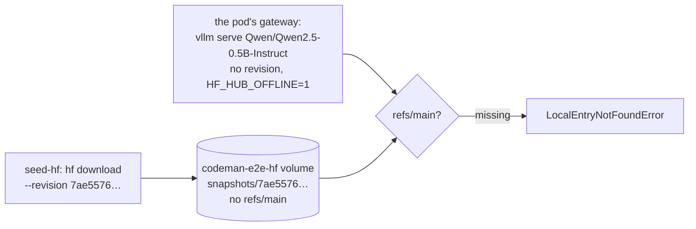

# Seed the e2e suite's vLLM model with `refs/main`

## Goal

The e2e suite's vLLM scenarios pass on a fresh Docker volume, as on GitHub's runner, and a service that fails to start says why.

## Context

The first run of the e2e suite on GitHub's runner, on 2026-11-05, passed the 30 scenarios without an engine and the 16 of the `ollama` group. Both scenarios of the `vllm` group failed:

- `failures/fit-vllm-explicit` expected the fit's message, and got vLLM's `LocalEntryNotFoundError`: "Cannot find an appropriate cached snapshot folder for the specified revision on the local disk and outgoing traffic has been disabled."
- `parallel/vllm-two-seats` waited 900 seconds for a gateway that never became ready.

The plan for running the suite on GitHub's runners, `docs/plans/2026-11-04-run-e2e-on-github-runners.md`, is still on the branch `features/multi-service-pods`, and records each run.

### Why vLLM found no model

1. The pod's gateway runs `vllm serve` with the model's name and no revision ([`vllmServeArguments`](../../src/gateway/vllm.ts)). The e2e pod image sets `HF_HUB_OFFLINE=1`, and mounts the `codeman-e2e-hf` volume as the Hugging Face cache, read-only.
2. With no revision, `snapshot_download` uses `main`. Offline, it finds the commit only in the cache's `refs/main` ([`_snapshot_download.py`](../web/hugging-face/src-huggingface-hub-snapshot-download-py-at-v1-33-0.md)).
3. `seed-hf` ([`e2e/infra/seeds/hf.sh`](../../e2e/infra/seeds/hf.sh)) downloads the model by its commit. A download by commit writes no ref ([`file_download.py`](../web/hugging-face/src-huggingface-hub-file-download-py-at-v1-33-0.md)).
4. Local runs passed because their volume had kept the `refs/main` of the download in [spike 0.1](2026-10-20-end-to-end-test-suite.md). A runner starts with an empty volume.

### Why the second failure left no trace

A dispatch of the two vLLM scenarios with the fix ran none of them: `seed-hf` exited with 1. The suite starts its services with `docker compose up --wait --detach`, which shows nothing of a service that fails. The job ran about 2.5 minutes longer than the first `vllm` job before its scenarios, which matches the seed's five failed downloads and their 150 seconds of pauses. So the Hub most likely refused or failed the download, a risk already known for anonymous downloads from a shared runner. This could not be confirmed.

## Decisions

None needed: the fix changes only the e2e suite, not Codeman's code or its pod images.

## Steps

1. **Write `refs/main` in the seed.** `hf.sh` writes the pinned commit to `refs/main`, without a newline as `huggingface_hub` writes it, after the weights' SHA-256 check passes. It also does so on a volume that already holds the snapshot, so older volumes gain the ref. Done: `608bf60`.
2. **Show why a service failed to start.** When `compose up` fails, the suite prints the last 50 lines of each service that exited with an error (`failedServices` in [`e2e/runtime/compose.ts`](../../e2e/runtime/compose.ts)), with a unit test. Done: `dcae7e2`.
3. **Record the sources.** `huggingface_hub` 1.33.0's `_snapshot_download.py` and `file_download.py`, the version in vLLM's CPU image, in `docs/web/hugging-face/`. Done in this plan's commit.
4. **Run the vLLM group on GitHub's runner.** Done: a dispatch of `failures/fit-vllm-explicit parallel/vllm-two-seats` on this branch passed both, in a job of 8 min 1 s.

## Results

| Scenario | First run, on `main` | With the fix |
| --- | --- | --- |
| `failures/fit-vllm-explicit` | Failed, 54.3 s | Passed, 69.3 s |
| `parallel/vllm-two-seats` | Failed, 906.5 s | Passed, 298.5 s |

A vLLM pod's first answers fit the gateway's 10-minute probe on the runner's 4 vCPUs. With the 46 scenarios of the first run, all 48 have now passed on `ubuntu-24.04`.

## Out of scope

- Pinning the model's revision in Codeman's own pods: production pods download the model online, and the gateway's choice of revision is unchanged here.
- A Hugging Face token for the suite's downloads: it would need a secret in a job that has none. If anonymous downloads keep failing, it gets its own decision.
