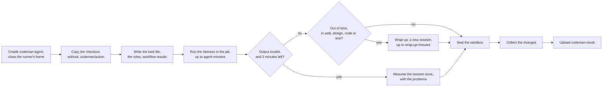
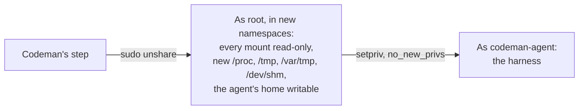

# The agent

This page says how the `agent` job isolates the agent, which rules the agent gets, and what it must report.

## Agent sandbox

The agent reads text that may be hostile (see [security](../security/risks.md)) and runs shell commands. It runs in a [sandbox](../glossary.md#sandbox): as `codeman-agent`, a user without `sudo`, on a copy of the checkout in that user's home, in a [jail](#the-jail) where the rest of the machine is read-only.

> [!IMPORTANT]
> The sandbox protects credentials and the runner's files, not the network. The agent can reach any host, and read what the runner image has.

| The agent can | The agent cannot |
| --- | --- |
| Use what the runner image has, and what earlier steps of the job set up | Read the runner's processes, so it cannot reach the job's tokens or the secrets of other steps |
| Reach the network | Use `sudo`, or the `docker` group, which it is not in |
| Use its own credential, through its environment | Read the runner's home, which holds the job's temporary files |
| Write in its copy of the checkout, in its home, and in its own `/tmp`, `/var/tmp` and `/dev/shm` | See a Serverless endpoint's key, which stays in Codeman's step, outside the sandbox |
| | Leave work running after the [seal](#sealing) |
| | Change a program or a file that runs outside the sandbox: those Codeman runs, and those the job's later steps run |

### Before the agent runs

- Codeman runs each program it needs by its path in `/usr/bin`, `/usr/sbin`, `/bin` or `/sbin`, after checking that only root can change it. Root must own the file and every directory on the way to it, links followed, and no other user may write any of them.
- Codeman never runs a program by a name looked up in the job's `PATH`, whose directories GitHub's images leave writable by every user. A runner that lacks a program fails, naming it, before the run reaches its model.
- `codeman-agent`'s login shell is `/usr/sbin/nologin`, so a login, such as through `sshd`, runs no command for it.
- The runner's home is closed to other users before the agent starts.
- The agent's environment is rebuilt from an allowlist: its own `HOME` and XDG directories, `TMPDIR` set to `/tmp` (outside its working tree, for scratch work), the job's `PATH` without entries in the runner's home, and the harness's variables.
- Nothing else from the runner passes, including what `sudo`'s PAM session adds from `/etc/environment`.
- Its credential is the run's OpenRouter key, or its token for a self-hosted gateway. It reaches the agent only through its environment, and it is the only credential the agent holds.

### The jail

Each harness run, the fix pass included, runs in new mount, PID and IPC namespaces. GitHub's Ubuntu images leave `/opt`, `/usr/share` and `/usr/local/bin` writable by every user, ahead of `/usr/bin` on the `PATH` ([`configure-system.sh`](../web/github/runner-images-configure-system-sh-at-82d1b86.md), [`install-nodejs.sh`](../web/github/runner-images-install-nodejs-sh-at-82d1b86.md)). The jail keeps the agent from planting programs there, without changing them for anyone else.

| In the jail | Agent's access |
| --- | --- |
| Every mount of the runner, such as `/`, `/opt`, `/usr/local/bin`, `/run` | Read-only |
| `/home/codeman-agent`, with its copy of the checkout | Read and write, `nosuid`, `nodev` |
| `/tmp`, `/var/tmp`, `/dev/shm` | Its own, empty at the start, gone at the end |
| `/proc` | Its own processes only |
| `/run/dbus`, where the runner has a system bus | Hidden by an empty directory |
| The network | Shared with the runner, so it reaches its model and a Serverless gateway on the loopback |

- Codeman sets the jail up with `unshare`, `mount`, `findmnt` and `setpriv` from Ubuntu's `util-linux`, by their trusted paths. If a mount cannot be made read-only, the agent does not start.
- The harness runs as `codeman-agent`, with no capability and with `no_new_privs`, so `sudo` and other set-user-ID programs give it nothing.
- When the harness exits, every process left in the jail ends with it. Nothing it started in the background reaches the fix pass.
- The agent installs its tools in its home: a global `npm install` into `/usr/local` fails.
- The runner's services stay outside the jail and refuse the agent: `sshd` runs no command for it, and `cron` takes no crontab from it. The jail hides the system bus, since a read-only mount still lets a socket be connected to, and polkit lets any user turn lingering on for itself, which would start a systemd manager for the agent outside the jail ([logind's policy](../web/ubuntu/usr-share-polkit-1-actions-org-freedesktop-login1-policy-in-systemd-255-4-1ubunt.md)). Abstract Unix sockets have no file, so the read-only mounts do not reach them; those of GitHub's image, `multipathd`'s and `iscsid`'s, serve a user other than root nothing that changes the runner. A sandbox test tries each route on every CI run.

### Time limit

- The agent has the run's `agent-minutes` ([agent time](../settings/reference.md#agent-time)): 50 by default. Codeman then stops the harness: it sends SIGTERM to every process of `codeman-agent`, then SIGKILL after 10 seconds.
- The `agent` job's timeout is `agent-minutes` plus `wrap-up-minutes` plus 10 minutes, which `select` computes for each task: the job's own steps fit in those 10.
- The fix pass of the [agent output](#agent-output) gets what is left of that time, and runs only when at least 2 minutes are.
- A run of web, design, code or test that runs out of time gets a [wrap-up](#wrap-up), of `wrap-up-minutes`.

### Wrap-up

A run stopped by its time leaves its work wherever it was: half-written edits, scratch files, tests of code that is not there. `apply` commits the working tree whatever it holds, so the wrap-up makes it consistent first.

1. The agent job starts a new session of the harness, in a new jail, with Codeman's wrap-up prompt. It gets `wrap-up-minutes`: 10 by default ([agent time](../settings/reference.md#agent-time)).
2. The prompt says the agent ran out of time and must not carry on the task. It reads the task file for the stage, the plan and the rules, and `git status` and `git diff` for what the run changed.
3. It finishes a half-written change only when a few lines do it, and otherwise undoes it. It removes what does not belong in the commit, updates the plan's `## Progress` section with what is done and what is left, and writes the output with status `partial`.
4. `apply` commits the result, and the task stays in its stage, out of time: the run comment says "The agent ran out of time. A wrap-up left its work consistent, and it is committed.", with the wrap-up's summary. Only `blocked` changes that: it blocks the task with the wrap-up's reason.

| When | What happens |
| --- | --- |
| The wrap-up fails, or runs out of its own time | The working tree is committed as it left it, and the run is out of time, as without a wrap-up |
| The run was stopped by its budget | No wrap-up: the run's key no longer pays for one |
| Review | No wrap-up: review commits nothing |
| Planning and routing | No wrap-up: a planning or routing run out of time commits nothing |
| `wrap-up-minutes: 0` | No wrap-up |

A fresh session, rather than the stopped one, because that one may have stopped in the middle of a tool call, with a context close to full ([decision 4](../plans/2026-10-28-configurable-agent-time-and-wrap-up-after-timeout.md#4-a-fresh-session-or-the-timed-out-one)).

### Sealing

When the harness exits or is stopped, and after the fix pass, Codeman seals the sandbox before it collects:

1. It removes the agent's scheduled work: `cron`, `at`, and a systemd user service kept alive by lingering.
2. It locks the account.
3. It kills every process of that user, and checks none survive.
4. It takes the agent's home and working tree away from it: `chown` to root, without following symlinks.

So no process the agent left can change a path while root reads it.

### Collecting

1. Collection first refuses a working tree that is a symbolic link, since the agent owns its home.
2. Codeman finds changes with `git status`, using the original checkout's `.git` against the agent's copy. The agent's `.git` is never used.
3. Git does not enter submodules, whose repositories and configuration the agent controls, so submodules are not collected.
4. Untracked files that the `.gitignore` files of the agent's copy ignore, as the agent left them, are not collected.
5. Codeman copies each changed path only after a check that opens nothing classes it a regular file. So root never follows a link out of the sandbox, or blocks on a named pipe. Changed files are copied without following symlinks.

Only regular files are copied. These are listed as changed without their content:

- symlinks;
- special files, such as named pipes and sockets;
- directories that git lists as one entry, such as a repository the agent cloned or created inside the working tree;
- a path that cannot be copied, so one path never costs the run its result.

`apply` drops them all as not regular files, and the run comment lists them ([change policy](changes.md#change-policy)).

### Codeman's own checkout

The `agent` job puts Codeman's checkout in the workspace, at `.codeman/action`, after the repository's checkout.

- It is left out of the agent's copy and of the changes Codeman collects, wherever the workflow puts it inside the workspace.
- The original, which runs, is in the runner's home, out of the agent's reach.
- No Codeman code runs after the agent in that job: the action has no post step.
- Under `.codeman/`, it would never reach the task branch anyway: `apply` drops every change there ([change policy](changes.md#change-policy)).

## Agent rules

Every [agent run](../glossary.md#agent-run) gets Codeman's working rules: every `##` section of Codeman's own [`AGENTS.md`](../../AGENTS.md), after a short section on applying them without a person to ask. The sections are language, documentation, plans, commits, third-party code, third-party documentation, and decisions.

- They come from Codeman's checkout at `CODEMAN_COMMIT_SHA`, so they change only when that variable does.
- The agent job writes them to `.codeman/rules.md` in the agent's copy. The harness loads that file as instructions next to the repository's `AGENTS.md` (OpenCode: the `instructions` setting).
- The repository's files are not changed.

Which rules win:

- The repository's `AGENTS.md` (or `CLAUDE.md`) wins for its own conventions, such as where documentation lives or which language it uses.
- The rules in the task file always hold: plan path and format, output file, protected paths, no secrets.

A section the repository's file already contains is left out: when 60% or more of its three-word sequences appear there, ignoring case and punctuation. So a repository that copied Codeman's `AGENTS.md`, even with edits, does not get it twice. The job's log lists the sections left out.

## Agent output

The agent reports in `.codeman/output.json`.

| Agent run | Reports |
| --- | --- |
| Planning | A summary and decisions |
| Routing | A summary and the route ([routing](../tasks/stages.md#routing)) |
| A routed stage | A status, a summary, a reason, a commit message and decisions |

What it writes there ends up in comments on GitHub, which hold at most 65,536 characters, so each text has a limit; see [settings](../settings/reference.md).

| Limit | The agent is told | Codeman accepts |
| --- | --- | --- |
| Each text | Its limit | Up to twice its limit |
| The commit message | 1,000 characters | Up to twice that |
| Decisions per output | `max-decisions` | The same: counts have no margin |
| Options per decision | 2 to `max-options` | The same |
| All decisions of one output together: titles, questions and labels | 25,000 characters | 50,000 characters |

The margin is not told to the agent: LLMs count characters poorly, and a text a little too long is not worth losing a run.

### The fix pass

1. When the harness exits, the agent job checks the output as `apply` will. It reads the file as the agent, while the sandbox is still live.
2. If the output is missing or invalid, or a text would be cut, the job continues the agent's session once with the problems. It states them with the limits the agent was told.
3. It does so only when the harness did not run out of time, and at least two minutes of the agent's time are left.
4. A fix that fails or runs out of time leaves the first outcome.

`apply` validates the output again. A text still longer than twice its limit is cut, and the run comment lists it under Problems. Any other problem blocks the task.
