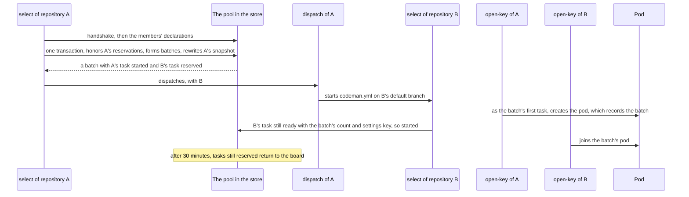

# Batches across repositories

This page says how tasks of several repositories, and of several organizations, run together on one pod.

A profile's [count](../glossary.md#count) (`tasks`, `min-tasks`, `max-tasks`) is the size of a [batch](../glossary.md#batch): the tasks that run at once with the same resolved settings.

- On a pod, a batch may take tasks of several repositories, and of several organizations of a [pool of organizations](../glossary.md#pool-of-organizations).
- For example, 2 tasks ready in one repository and 2 in another form a batch of 4 on one GPU. Each runs in its own repository's workflow, and counts against its own organization's budget.
- On OpenRouter and Serverless, a batch is the tasks of one run that take the profile.

The choice was made in the [plan for GPU batches across repositories](../plans/2026-10-13-gpu-batches-across-repositories.md).

> [!NOTE]
> GitHub stays the source of truth of tasks. The [board](../glossary.md#board) and the batches, in [Codeman's store](../backend/data-layout.md), are an index: at worst an inconsistency makes a batch smaller; it never runs a task that should not run.

## Terms

| Term | Meaning on this page |
| --- | --- |
| Offer | A count at which a profile serves a ready task, with the profile and the settings key that serve it there |
| Settings key | A key of the settings that serve a task at a count. It is not an OpenRouter key. |
| Board | The pool's index of ready tasks that a pod profile could serve, one snapshot per repository |
| [Reservation](../glossary.md#reservation) | A task that another repository's batch reserved for this repository's next run |

## Pools

A pool is a closed list of organizations that share the board, the batches, the [pod registry](../inference/pods.md) and the Runpod account. Without the `pool` setting, an organization is a pool alone.

- `pool` is set only in the organization's settings (`CODEMAN_SETTINGS`), as a list of 1 to 10 logins that includes the organization itself: `pool: [organization-a, organization-b]`. Anywhere else, or without the organization, it stops the run.
- The pool's ID is its members' logins, lowercase, sorted, joined by `+`: `organization-a+organization-b`. Alone, it is the organization's login.
- A pool shares one Runpod account: a pod's admin token derives from the account's key, so only that key's jobs can join or end it. Each organization keeps its own budgets.
- Codeman never lists the App's installations: it mints tokens only for owners its pool names and that agree on it.

### The handshake

- Each `select` writes the pool it declares on its organization's document (`organizations/{owner}`: `pool`, `members`, `declaredAt`).
- It batches with another member only when that member's document declares the same pool.
- Otherwise it warns once per run, such as "Organization organization-b declares pool `organization-b`, not `organization-a+organization-b`: its repositories are not batched with this one's."
- Neither side can pull the other in.

## The board

Each `select` rewrites its repository's snapshot whole (`pools/{pool}/board/{owner%2Fname}`), in one transaction with the batches. The snapshot holds:

- its ready tasks that a pod profile could serve, in its own order of priority;
- for each task, its stage, the issue's last update, `since` (when the board first listed it ready, carried from the previous snapshot), and its offers;
- `expiresAt`, 25 hours later. The daily schedule rewrites it, and the `issues` triggers rewrite it whenever the `codeman` label changes or a task closes or reopens.

The tasks the run starts, and those no pod serves, are left out.

## Forming batches

After honoring its reservations (below), a `select` forms every batch that the board of the members that agree completes, whether its own tasks are in it or not:

1. **Candidates.** Its own ready tasks, read from GitHub this run, and the other snapshots' tasks that no unexpired batch holds.
2. **Priority.** Oldest `since` first, then by repository, then by each repository's own order (planning before stages).
3. **Forming.** In that order, the first task that some offer completes takes the largest such count n, with the first n tasks offering the same count and settings key; then the next. A count on OpenRouter or Serverless is completed only by the forming repository's own tasks.
4. **Limits.**
   - The run's own tasks fit in the run's cap, after the tasks without an agent and the reserved ones.
   - Another repository's reserved tasks are at most 10.
5. **Documents.** Each batch on a pod gets `pools/{pool}/batches/{run}-{attempt}-{n}`: its count, settings key and profile, who formed it, `expiresAt` 30 minutes later, and each task as `started` (the forming repository's) or `reserved` (the others').

A task that no batch of its count completes waits. Its panel says how many are ready, and where: "Waiting for 4 tasks ready for profile `parallel-tasks`; 3 are, in 2 repositories."

## Reservations

- A reservation belongs to the repository, not to the dispatched run: whichever `select` of that repository comes first honors it.
- That `select` checks each reserved task against GitHub: still ready, with the batch's count and settings key among its offers.
- It starts those (`started`), resolving their profile with the batch's count. It drops the others (`dropped`), which releases their seat on the pod.
- It starts at most 10 reserved tasks, and drops the rest.
- After 30 minutes, a batch's tasks still `reserved` return to the board, and the batch runs smaller.

## Waking the other repositories

`select` outputs `dispatches`: one entry per other repository with tasks in a batch it formed, only for owners in the pool that agree. The `dispatch` job runs one leg for each entry:

1. It mints a token for that owner, limited to that repository, with `actions: write` and `metadata: read`. gh reads the repository's default branch with it.
2. It logs whether that repository's `codeman` group is busy.
3. It starts the target's `codeman.yml` on its default branch with `workflow_dispatch`, with the batch IDs as its `batch` input, which the started run only logs.

The dispatched run waits in that repository's `codeman` group like any other.

> [!IMPORTANT]
> A dispatch always starts the target's `codeman.yml` on its default branch, the only workflow Workload Identity admits. The token may start any of the target's workflows, so nothing on the board, which any member's run may write, chooses what a dispatch starts.

A dispatch can be refused: the App is not installed on the repository, its permission is not approved, the installation is suspended, or the workflow is missing or disabled. Then:

- its leg fails, visibly in the forming run;
- the reservation expires after 30 minutes;
- the forming repository's tasks run on their pod meanwhile.

## On the pod

- The tasks of a batch carry its ID to `open-key`, and the pod the first of them creates records it.
- A pod takes runs only while its unexpired run leases, plus the tasks its batch reserved that have not joined, are fewer than its parallel requests.
- A task of its batch always joins it.
- A task that finds every pod of its settings full creates another ([pods](../inference/pods.md#shared-pods)).
