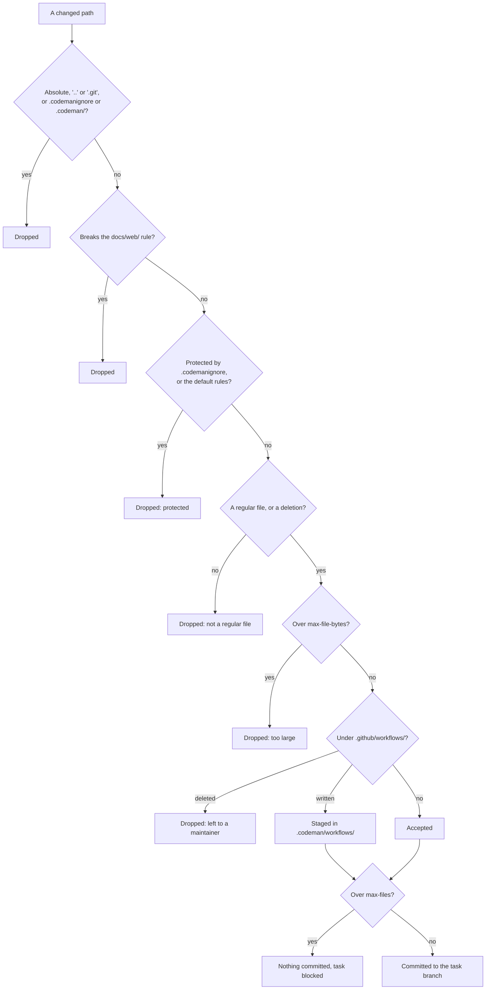
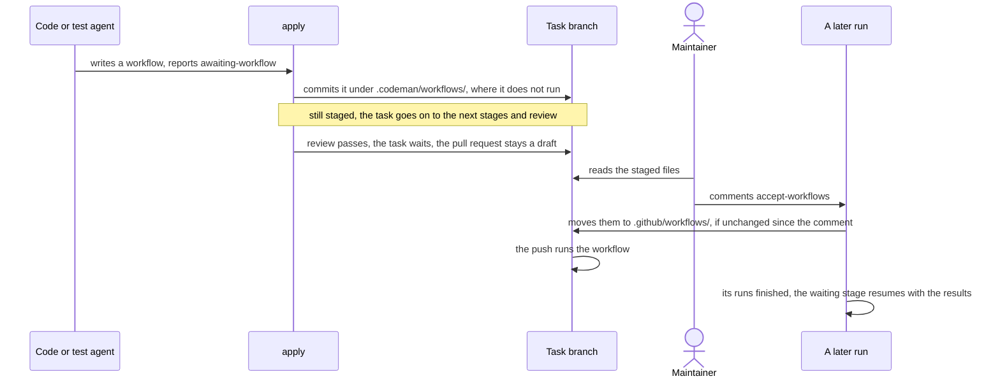

# What the agent may change

This page says which of the agent's changes Codeman commits, how workflows the agent writes reach `.github/workflows/`, and how the web stage keeps third-party documentation.

## Change policy

`apply` commits only regular files that pass these rules. It drops the others and lists them in the run comment. It applies the rules in this order:



1. **Codeman's own rules.** Whatever `.codemanignore` says, the agent never changes `.codemanignore` or `.codeman/`, since it must not change its own rules. Invalid paths are dropped too.
2. **Third-party documentation.** Only the web stage changes `docs/web/`, and it changes nothing else but the plan; see [third-party documentation](#third-party-documentation).
3. **Protected paths.** The paths that [`.codemanignore`](#protected-paths) protects are dropped. The plan file is always accepted.
4. **Regular files.** Only regular files and deletions pass ([collecting](agent.md#collecting)).
5. **Size.** Each file may have at most `max-file-bytes`.
6. **Workflows.** Workflow files are never committed where they would run; see [on-demand workflows](#on-demand-workflows).
7. **Count.** A run whose kept changes, accepted and staged after the drops above, are more than `max-files` files commits nothing and blocks the task.

Review's changes are all discarded. The web stage's pages are also checked for their format ([third-party documentation](#third-party-documentation)).

### When the branch moved during the run

`apply` commits on the task branch's head as the run's `select` saw it, and never forces the branch. When someone pushed to it during the run, their commits are kept, and `apply` compares the paths they changed with the run's own:

| The new commits | What `apply` does |
| --- | --- |
| Change none of the run's paths | Commits the run's changes on the new head, and the task goes on as usual |
| Change some of them | Commits nothing, blocks the task, and names those paths in the run comment |
| Cannot be compared: the branch was rewritten, or GitHub lists too many files (300) | Commits nothing, and blocks the task |
| Are followed by another push while `apply` commits on them | Commits nothing, and blocks the task: it tries once |

- The run's paths are the files it writes and deletes, and each staged workflow's `.codeman/workflows/` path and the `.github/workflows/` path the accept would overwrite.
- When the task blocks, the run's changes are not kept. `/codeman continue <guidance>` runs the stage again from the new commits.
- The same holds for the `.codemanignore` that review proposes.

### Protected paths

`.codemanignore` at the repository's root lists the paths the agent may not change, in `.gitignore` syntax.

- `!` re-allows a path.
- A file inside an excluded directory cannot be re-allowed. To re-allow a whole subdirectory, add both `!/dir/sub/` and `!/dir/sub/**`.
- Matching uses `git check-ignore` in an empty repository, so git's own rules apply.

Without that file, Codeman uses its own rules, and its first pull request proposes them as the repository's `.codemanignore`:

```text
/.github/**

opencode.json
opencode.jsonc
/.opencode/**

AGENTS.md
CLAUDE.md
/.claude/**
/.agents/**
```

- They protect the harness's configuration and agent instructions. Agent instructions are protected because later runs would follow a changed version before anyone reviewed it.
- When the repository's file stops protecting one of those paths, `select` warns in the run's summary.
- The proposed rules protect all of `.github/`. To let the agent write workflows while keeping the rest of `.github/` protected, use `/.github/**`, `!/.github/workflows/` and `!/.github/workflows/**`.

> [!NOTE]
> Codeman reads the rules from the default branch, never from the task branch, so one run cannot loosen them for the next.

## On-demand workflows

> [!WARNING]
> A workflow file runs as soon as it reaches a branch, if it listens to `push`, and on pull requests from the same repository, and it gets the repository's secrets. So Codeman never lets a workflow the agent wrote run before a maintainer reads it.



### Staging

- When the agent writes or changes a file under `.github/workflows/`, at any depth, and `.codemanignore` allows it, `apply` commits it to `.codeman/workflows/` on the task branch instead, where it does not run.
- The status comment lists these files.
- Deleting a workflow is left to a maintainer.

### Accepting

1. After reading the staged files in the pull request or on the branch, a maintainer comments `/codeman accept-workflows`.
2. The next run moves them into `.github/workflows/` with a token that may write workflows, which `apply` requests only for this.
3. If a staged file changed after the comment, nothing moves. The maintainer must read them again and comment again.
4. Codeman records the accepted comment, and the commit names who accepted.

Accepting workflows of a blocked task resumes the stage that blocked, with a new run count. The stage's agent is told which workflows were accepted, and by whom.

### Workflows the agent waits for

A workflow can be what the task delivers, such as a deploy workflow. It can also be something the agent needs: another operating system, a device, a secret.

- In that case the agent writes a workflow that runs on pushes to the task branch, and reports `awaiting-workflow`, with the workflows it waits for. The task becomes `codeman:awaiting-workflow`.
- The agent never waits for a workflow that deploys, publishes or releases: from the task branch, it would ship work nobody reviewed.
- A workflow the agent waits for includes its own file in its `paths` filters, so the push that accepts it runs it.
- Codeman looks for the runs on the branch's head, so a later commit that the filters skip leaves the task waiting. `/codeman continue <guidance>` goes on without them.

> [!NOTE]
> A workflow that needs secrets should take them from a GitHub Environment with required reviewers, so a human also approves each run.

### With review

A stage that waits for workflows that are still staged does not stop the task: they cannot run before a maintainer accepts them. The stage records the wait, and the task goes on to the next stages and review.

- Review also checks the staged workflows as workflows: triggers, `permissions`, secrets only through a GitHub Environment, and actions pinned to a full commit SHA. For a workflow that runs on the task branch, it checks `paths` filters and no deploy.
- If review asks for changes, the code stage makes them.
- If review passes while workflows are still staged, the task becomes `codeman:awaiting-workflow` until they are accepted. The pull request stays a draft, since merged from `.codeman/workflows/` they would never run.

After that accept:

- a stage that waited for their runs waits for them, then goes on with their results, and the stages after it run again;
- if no stage waited, the task is done and the pull request becomes ready for review;
- the accept moves only files that did not change since review read them.

### Results

Once accepted, the workflow runs on the push that moved it. When every awaited workflow has a finished run on the branch's head, the next run resumes the task.

The agent job downloads, into `.codeman/results/`:

- each run's job conclusions;
- the last 64 KiB of the log of each job that did not succeed;
- the artifacts, up to 50 MiB in total.

They came from code on the branch, so the agent treats them as data. `/codeman continue <guidance>` resumes the task without waiting.

## Third-party documentation

Repositories keep the documentation of the third-party services they rely on in `docs/web/`:

- one page per file, in `docs/web/<third-party>/<slug>.md`;
- in `docs/web/tools/`, how each kind of page is fetched.

The format, and when a page may be a full copy, are rules in [`AGENTS.md`](../../AGENTS.md) ("Third-party documentation"), which every agent receives. Codeman's own catalog is in `docs/web/`.

- Only the web stage writes there. The other stages' changes under `docs/web/` are dropped, and every agent is told to read it as data. The web stage changes nothing else but the plan.
- Before committing, `apply` checks each page and tool: its path, a file name that is the slug of its title, the front matter's fields, and ISO 8601 dates. It also checks for a `tool` that exists on the branch or in the same run, and a non-empty `license` when there is one. A file that fails is dropped, with why, in the run comment.
- The web stage gets Codeman's generic tool in `.codeman/fetch-markdown.md`, and copies it into `docs/web/tools/` when the repository has none.

Pages are not refreshed on their own.

- After each run, Codeman reads the front matter of the pages on the task branch: only those whose blob changed, since the record keeps the rest.
- The status comment lists the pages fetched more than 30 days ago, or whose `updated_at` cannot be read.
- It also says how to ask for a refresh: a request such as `/codeman fix Refresh docs/web/<third-party>/`, which the routing agent sends to the web stage.
