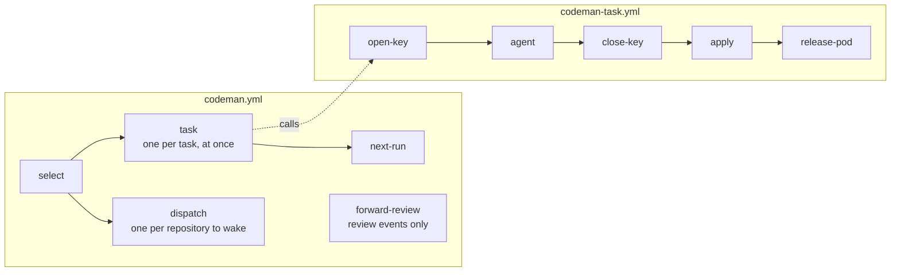
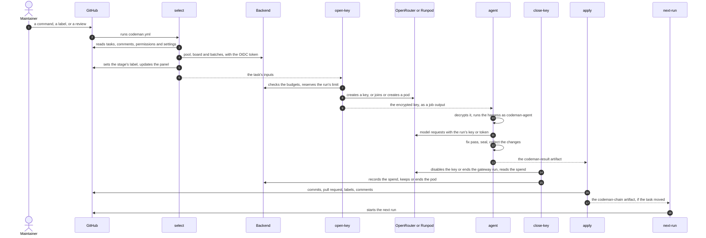

# Runs and jobs

This page says what starts a [workflow run](../glossary.md#workflow-run), which tasks it takes, and what each of its jobs does.

Codeman is a GitHub Action written in TypeScript. A workflow in the target repository runs it; see [installation](../installation/setup.md).

- The workflow templates are [`templates/codeman.yml`](../../templates/codeman.yml) and [`templates/codeman-task.yml`](../../templates/codeman-task.yml), which runs each task's jobs.
- Codeman's logic reaches GitHub only through interfaces, so other platforms can be added; see [platforms](../development/platforms.md).

## Runs

A run is one execution of `codeman.yml`. It reads the state of every task from GitHub, works on some of them, and may start the next run.

### What starts a run

| Event | Starts a run when | Notes |
| --- | --- | --- |
| `schedule` | Once a day | |
| `workflow_dispatch` | Always | Used by manual runs, `next-run`, `forward-review` and other repositories' `dispatch`. |
| `issue_comment` | A comment is created, contains `/codeman`, and its author is not a bot | Editing a comment starts no run. Anyone can start one, but `select` ignores comments from non-maintainers, so the run finds nothing new to do. |
| `issues` | The `codeman` label is added or removed, or an issue with it is closed or reopened | So the pool's [board](batches.md#the-board) changes at once. Codeman's own `codeman:*` labels start runs that skip every job. |
| `pull_request_review` | On a pull request from a `codeman/` branch of the same repository, a review by someone other than a bot requests changes or mentions `/codeman` | Forwarded by `forward-review`; see below. |

A review event runs the workflow file of the pull request's branch, which may be older than the default branch's. So its only job, `forward-review`, starts the default branch's workflow with `workflow_dispatch`. It holds no secrets.

### One run at a time

- Only one run per repository is active (`concurrency`, group `codeman`), so no two runs work on the same task.
- GitHub keeps at most one queued run, and replaces older queued runs.
- A run whose jobs will all be skipped goes to a group of its own, `codeman-skipped-<run id>`, so it never replaces a queued run that has work. Such runs come from a comment without `/codeman`, a `codeman:*` label, or a review that `forward-review` forwards.
- That group is computed from the event with `select`'s condition. Skipped jobs use no runner minutes, but each such run shows in the Actions tab.
- Each run reads the state of every task from GitHub instead of reacting only to the event that started it. A replaced or failed run therefore loses no work: the next run picks it up.

### Which tasks a run takes

A run works on as many tasks as the [profiles' counts](../settings/profiles.md#how-many-tasks-a-run-takes) allow, or one when no profile has a count. It picks them in this order:

1. Accepting workflows and recording answers, because they need no LLM.
2. The tasks that another repository's batch reserved for this one ([reservations](batches.md#reservations)).
3. [Batches](batches.md). A profile's count is the size of a [batch](../glossary.md#batch): the tasks that run at once with the same settings. On a pod, a batch may take tasks of the pool's other repositories; on other providers, it is tasks of this run.

A task that no batch of its count completes waits, and so does one whose profile runs as many [instances](../glossary.md#instance) as its [concurrency](../settings/profiles.md#concurrency) allows. A task whose stage nothing serves is blocked.

Once picked:

- Each task runs its own jobs, at once with the others'. One that fails leaves the others.
- The run ends when its slowest task does, and the next run starts then.
- Tasks on pods with the same settings share one pod, whatever run or repository they belong to ([shared pods](../inference/pods.md#shared-pods)).

The choice was made in the [parallel tasks plan](../plans/2026-10-06-parallel-tasks-and-inference-profiles.md) (decisions 1 and 2), and the counts in the [plan for profiles that pick the tasks](../plans/2026-10-08-profiles-pick-the-tasks.md).

### The next run

When a run moved a task, its `next-run` job starts another run with `workflow_dispatch`, carrying over a manual run's inputs. That run's `select` picks the next tasks, or stops without an LLM when none can move.

| A task that | Counts as moved | Why |
| --- | --- | --- |
| Recorded answers, or accepted workflows | Yes | |
| Got its key, so its agent ran, even if the agent then failed | Yes | |
| Got no key: a budget refused it, a provider's secret is missing, or the key job failed | No | It would be picked again without moving. |
| Got no key because its profile's instances were all busy (`concurrency-reached`) | Yes | The next run's `select` makes it wait in view, and lists a pod's task on the board. |
| Waits for more ready tasks | No | No run moves it until there are enough. |

A run in which no task moved starts no other run. The loop is bounded by the budgets, `max-runs` and the states: tasks that are blocked, done or awaiting an answer never start a run.

## Jobs

Each part of a run, from picking the tasks to applying the agent's work, is its own job, so the workflow graph shows where a run is and where it stopped.

`codeman.yml` calls `codeman-task.yml`, a reusable workflow, once per task `select` picked, as a matrix (`fail-fast: false`).

One run of one task that runs an agent goes like this:

Jobs that do not apply to a task are skipped:

- a task that only records answers or accepts workflows skips `open-key`, `agent` and `close-key`, and goes straight to `apply`;
- `release-pod` runs only after a run whose task kept its pod; see [self-hosted inference](../inference/self-hosted.md).

### What each job does

| Job | Runs when | Does |
| --- | --- | --- |
| `forward-review` | A review event passes its condition ([what starts a run](#what-starts-a-run)) | Starts the default branch's workflow with `workflow_dispatch`. |
| `select` | The event passes its condition | Reads the settings and `.codemanignore` from the default branch, and the organization's settings from its `settings` input. Declares the organization's [pool](batches.md#pools). Picks the tasks and each one's action, batch and [profile](../settings/profiles.md). Updates the pool's board and batches. Sets the stage's label (`codeman:planning`, `codeman:routing`, `codeman:coding`, ...). Writes each task's context as an artifact, and lists the repositories to wake (`dispatches`). |
| `dispatch` | `select` listed repositories to wake | Starts the Codeman workflow of each repository of the pool whose tasks a batch this run formed reserved, with the batch IDs as its `batch` input. Logs whether that repository's `codeman` group is busy. |
| `open-key` | The task's action runs an agent | Checks the task's and the months' budgets against Codeman's ledger, where it reserves the run's limit. Gives the run access to its model: an OpenRouter key, or a token for a self-hosted model's gateway, on a pod of the [pod registry](../inference/pods.md) that it joins or creates. It first terminates the pool's pods that nothing holds. |
| `agent` | `open-key` opened the run's access | Runs the harness on a copy of the checkout, and uploads what it changed as an artifact, even when the agent fails or runs out of time. For a Serverless run, also runs the gateway, outside the sandbox. See [the agent](agent.md). |
| `close-key` | `open-key` created a key or a gateway run, whatever happened after | Ends the run's access: disables the key, or ends the run on its gateway. Reads what the run spent, and records it in the ledger with what the providers say now of the task's earlier runs. For Serverless, splits the worker's time with the runs that shared it. Reports the task's spend from the ledger. Keeps the pod for the next run on its settings (a keep lease) or leaves it, and terminates it when no other task uses or keeps it. |
| `apply` | Always, once the jobs before it end | Validates the agent's result and writes it to its own task: commits, pull request, labels, run and status comments, spend. When the action is `record`, it applies the maintainers' answers instead; when it is `accept`, it moves the accepted workflows. Says whether the task goes on to another agent run (`continues`). When the task moved, uploads an artifact that says so. |
| `release-pod` | `close-key` kept a pod, and the task does not go on to another run now, or `apply` failed | Ends the task's keep lease on that pod, and terminates the pod when no other task uses or keeps it. |
| `next-run` | `select` succeeded and picked tasks, whatever happened to them | Starts another run when this one moved a task: when the run has a `codeman-chain-` artifact, which only an `apply` that succeeded uploads. |

`select`'s actions are `plan`, `route`, `implement` (with its routed stage), `record` and `accept`, or `none` when nothing can move.

- Only `agent` runs an LLM. The jobs that write to GitHub never run one, and they treat everything the agent produced as untrusted.
- `select`, `open-key`, `close-key` and `release-pod` also record what they did in Codeman's ledger, through the [backend](../backend/backend.md), after their GitHub writes. `agent` never reaches the backend.

### Tokens and permissions

| Job | GitHub token | OIDC token |
| --- | --- | --- |
| `forward-review` | `GITHUB_TOKEN` with `actions: write` only | No |
| `select` | App token: issues write; contents, pull requests, actions and metadata read | Yes, for the [backend](../backend/backend.md) |
| `dispatch` | App token for that owner, limited to that repository, `actions: write` and `metadata: read`, revoked when its step ends. No permission for its `GITHUB_TOKEN`, and no checkout. | No |
| `open-key` | — | Yes |
| `agent` | `GITHUB_TOKEN` with contents and actions read, for workflow results. The agent never sees it. | No |
| `close-key` | — | Yes |
| `apply` | App token: contents, issues and pull requests write. For `accept` only, a second token with contents and workflows write. | No |
| `release-pod` | — | Yes |
| `next-run` | `GITHUB_TOKEN` with `actions: write`, which also lists the run's artifacts | No |

This table lists only GitHub permissions and the OIDC token. The secrets each job receives, such as the providers' keys and the encryption secret, are in [secrets](../security/secrets.md#permissions-each-job-requests).

### Data between jobs

A task's jobs pass their outputs to each other as one workflow's jobs do. GitHub keeps only one value per output of a matrix, so nothing passes between tasks that way.

| Data | Written by | Read by |
| --- | --- | --- |
| `tasks` output: each task's inputs | `select` | The `task` matrix |
| `dispatches` output | `select` | `dispatch` |
| `codeman-task` artifact: each task's context, in `task/<number>.json` | `select` | `agent`, `apply` |
| `open-key`'s outputs: the encrypted key, the gateway's handle and URL, the budget's figures | `open-key` | `agent`, `close-key`, `apply` |
| `codeman-result-<number>` artifact: what the agent changed, and its output | `agent` | `apply` |
| The Serverless gateway's usage | `agent` | `close-key` |
| `close-key`'s outputs: the run's cost and tokens, the task's spend, the kept pod | `close-key` | `apply`, `release-pod` |
| `continues` output | `apply` | `release-pod` |
| `codeman-chain-<number>` artifact | `apply` | `next-run` |

The artifacts are kept for one day.

### Codeman's checkout

Each job that runs Codeman first checks the `CODEMAN_COMMIT_SHA` variable:

1. It is a full commit SHA.
2. It is a commit of Codeman's `main` ([Codeman's own code](../security/risks.md#7-codemans-own-code-and-dependencies)).

The job then checks Codeman out at that commit into `.codeman/action`, and runs it from there. The `agent` job does so after checking out the repository.

Every Codeman step passes the version of the templates its file was copied from. It fails before doing anything when the commit expects another one ([installation](../installation/setup.md#5-add-the-workflow-and-settings)).
