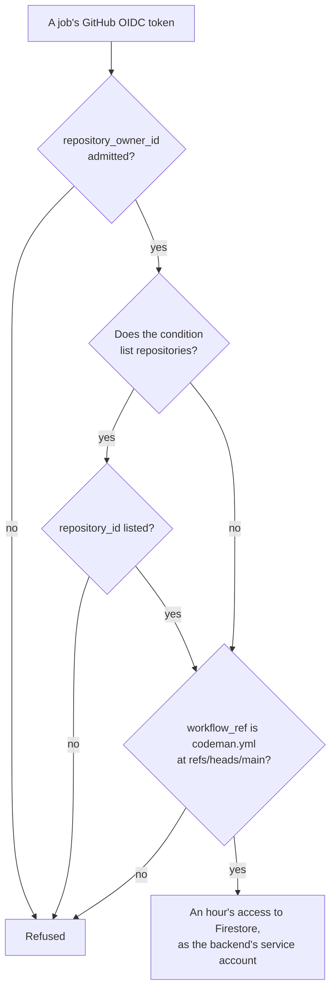

# Forks

For maintainers of public and private repositories that run Codeman: what someone who forks your repository gets, what they can start in yours, and what to set.

> [!NOTE]
> A fork gets your code, not your secrets. GitHub keeps secrets and variables with the repository and organization that set them, so Codeman's secrets are not passed to a fork, and Codeman's [backend](../glossary.md#backend) admits no workflow of another owner's repository. A secret that someone with write access read from your repository works from anywhere, though ([who can read Codeman's secrets](overview.md#who-can-read-codemans-secrets)).

## Who gets what

| | Fork in another account | Fork or new repository inside your organization | Outsider on your public repository |
| --- | --- | --- | --- |
| Your secrets and variables | None | Those whose policy covers it; none with **Selected repositories** | None |
| App tokens | No: it has neither the key nor an installation | Only if it receives the App's key | No |
| The backend | No: another owner ID | Yes with the condition that admits any repository of the organization, and `codeman.yml` on its `main`; no with the condition that lists repositories, until its ID is added | No |
| The pool's pods | No | Their admin routes only with the Runpod API key. If it reaches the backend, it can make pods end or take new tasks | No |
| What it can start in your repository | Fork pull request workflows, as your approval settings allow. A review on its pull request runs its copy of `codeman.yml`, with no secret, a read-only token and no OIDC token | Whatever its people's access to your repository allows | `select`, as often as they comment `/codeman`, which replaces a pending run ([below](#what-others-can-start-in-a-public-repository)) |

## What a fork gets

- **A repository of its own.** A fork starts as a copy of your repository's Git data, with its own settings, permissions, issues, pull requests and Actions ([forks](../web/github/forks.md#what-makes-forks-distinct-from-branches)). Its workflows do not run until its owner enables Actions in it ([events](../web/github/events-that-trigger-workflows.md#pull_request)).
- **None of your secrets or variables.** They are stored in a repository, one of its environments, or an organization, whose policy chooses which of its own repositories may use them ([secrets](../web/github/using-secrets-in-github-actions.md#creating-secrets-for-an-organization), [variables](../web/github/store-information-in-variables.md#creating-configuration-variables-for-an-organization)). A fork in another account is not one of those repositories.
- **Its owner's secrets and variables.** When the fork's workflows run, in the fork, they get what the fork's owner set, and the fork's own `GITHUB_TOKEN`.
- **Exception: a fork inside your organization.** A fork created in the same organization is one of its repositories:
  - organization secrets and variables whose policy covers it reach it, as with any new repository. With the policy **Selected repositories**, none does until it is added ([repository access](../installation/setup.md#repository-access));
  - it copies the upstream's collaborators and teams ([forks within an organization](../web/github/forks.md#forks-within-an-organization));
  - only people who may create repositories in the organization can fork into it ([which repositories can be forked](../web/github/forks.md#which-repositories-can-be-forked)).

## What a fork cannot reach

Even with secrets and variables of the same names, set by its owner, a fork cannot reach:

- **Codeman's backend.** The [Workload Identity provider](../glossary.md#workload-identity-provider) admits only OIDC tokens that pass all of its [attribute condition](../glossary.md#attribute-condition)'s checks (diagram below; [attribute condition](../installation/setup.md#4-set-up-the-backend)):
  - `repository_owner_id` is your organization's ID;
  - when the condition lists repositories, `repository_id` is listed;
  - `workflow_ref` is `codeman.yml` on `main`.

  A fork owned by another account has another owner ID. The variables that name the project, provider and service account grant nothing without a token the provider admits.
- **The App.** An App token needs the App's private key, and an installation on the repository. The fork's owner has neither. Installing a public App gains nothing without the key ([risk 8](risks.md#8-a-pool-shares-one-app-key)).
- **The pool's pods.** A pod's admin routes take only the token derived from the Runpod API key, and a run's routes only that run's token ([risk 4](risks.md#4-the-agent-can-send-its-task-key-out)).

A fork in another account fails the owner check. A fork's pull request fails the `workflow_ref` check ([what others can start](#what-others-can-start-in-a-public-repository)). A new repository or fork inside the organization passes the owner check.

> [!WARNING]
> With the condition that admits any repository of the organization, a repository inside it passes. That condition checks the owner, not the repository. So a fork or new repository in your organization with `codeman.yml` on its `main` reaches the backend, with no secret needed; whoever may create repositories in the organization can do this.

Two settings close it:

- **The condition that lists repositories**, by their numeric IDs, admits no other repository of the organization until its ID is added ([the two conditions](../installation/setup.md#4-set-up-the-backend), [changing it](../installation/backend-maintenance.md#change-the-attribute-condition)).
- **The policy Selected repositories** for Codeman's organization secrets and variables gives a new repository or fork none of them, the App's key included ([repository access](../installation/setup.md#repository-access)).

With the other condition, also restrict repository creation to owners ([repository creation](../web/github/restricting-repository-creation-in-your-organization.md)).

## What others can start in a public repository

Anyone can fork a public repository, open issues and pull requests, and comment ([forks](../web/github/forks.md#which-repositories-can-be-forked)). Codeman's [`codeman.yml`](../../templates/codeman.yml) has no `pull_request` or `pull_request_target` trigger. Its triggers:

| Trigger | Workflow file from | Secrets | What Codeman does |
| --- | --- | --- | --- |
| `issue_comment`, `issues` | The default branch ([events](../web/github/events-that-trigger-workflows.md#issue_comment)) | Yes | `select` runs, with the App's key and the backend. It drops comments from non-maintainers and ignores issues they opened ([untrusted input](risks.md#untrusted-input)), so the run does what the daily schedule would do |
| `schedule`, `workflow_dispatch` | The default branch, or the branch a user with write access dispatches | Yes | Not started by outsiders |
| `pull_request_review` | The pull request's merge commit ([events](../web/github/events-that-trigger-workflows.md#pull_request_review)) | No, for a pull request from a fork: a read-only `GITHUB_TOKEN` only | Only `forward-review` can run on this event, and only for a pull request whose head is a `codeman/` branch of the same repository. It holds no secret, and dispatches the default branch's workflow. On a fork's pull request, every job is skipped |

### Comments from anyone

- Anyone can start a run as often as they comment `/codeman`.
- The run joins the `codeman` concurrency group before the job checks who commented, so it replaces the run pending there ([concurrency](../web/github/control-the-concurrency-of-workflows-and-jobs.md)).
- A maintainer's `workflow_dispatch`, or a next run, then loses its inputs, though no task loses work.
- The cost is runner time, free on public repositories with standard runners ([billing](../web/github/github-actions-billing.md)).

### A fork's copy of the workflow

A fork's pull request can change `codeman.yml`, and a review on it then runs the fork's version. That run gets:

- no secret, and a read-only token;
- no OIDC token, since a fork's pull request cannot be granted write permissions such as `id-token: write` ([permissions](../web/github/workflow-syntax-for-github-actions.md#permissions));
- a `workflow_ref` that names `refs/pull/<number>/merge`, which the backend's condition refuses.

GitHub may also hold it for approval ([recommendations](#recommendations)).

## Variables

GitHub states: "With the exception of `GITHUB_TOKEN`, secrets are not passed to the runner when a workflow is triggered from a forked repository" ([using secrets](../web/github/using-secrets-in-github-actions.md#using-secrets-in-a-workflow), [events](../web/github/events-that-trigger-workflows.md#pull_request)). That statement names secrets only. GitHub's documentation states no such rule for configuration variables (`vars`) on workflows from forks. It describes them as "non-sensitive configuration information" that "render unmasked in your build outputs" ([variables](../web/github/variables.md#about)).

So treat every variable as readable by any workflow that runs in the repository, a fork's pull request included, and as public on a public repository. Codeman keeps no secret in variables: `CODEMAN_SETTINGS`, the App's client ID, the backend's project, provider and service account, and `CODEMAN_COMMIT_SHA` grant nothing on their own ([variables](secrets.md#variables)).

> [!WARNING]
> Never put a secret in a variable: any workflow that runs in the repository may read it, and on a public repository it is public.

## Private repositories

- **Who can fork.** Only people with access to the repository, and only when its owner allows forking. New organizations disallow forking of private repositories by default. Organization owners set it under **Settings → Member privileges → Repository forking**, and a private repository's admins can disallow it for that repository ([forking policy](../web/github/managing-the-forking-policy-for-your-organization.md), [forks](../web/github/forks.md#what-happens-to-forks-when-a-repository-is-deleted-or-changes-visibility)).
- **Forks stay private.** A private repository's forks are private, and their visibility cannot change on its own ([visibility](../web/github/forks.md#visibility-of-forks)). They inherit the upstream's team permissions ([permissions](../web/github/forks.md#permissions-of-forks)). Removing a person's access to the repository deletes their forks of it, except forks created in another organization ([security considerations](../web/github/forks.md#important-security-considerations)).
- **Pull requests from forks run workflows only if enabled**, under **Settings → Actions → General → Fork pull request workflows** ([repository](../web/github/managing-github-actions-settings-for-a-repository.md#enabling-workflows-for-forks-of-private-repositories), [organization](../web/github/disabling-or-limiting-github-actions-for-your-organization.md#enabling-workflows-for-private-repository-forks)):
  - its **Send secrets to workflows from pull requests** option gives such workflows all secrets, Codeman's included;
  - its **Send write tokens to workflows from pull requests** option gives them a token with write access;
  - keep both off in the organization and every repository that runs Codeman.

## Recommendations

1. **Require approval for fork pull request workflows from all external contributors**, in the organization or each repository ([public](../web/github/managing-github-actions-settings-for-a-repository.md#controlling-changes-from-forks-to-workflows-in-public-repositories), [private](../web/github/managing-github-actions-settings-for-a-repository.md#enabling-workflows-for-forks-of-private-repositories)). The default covers only first-time contributors, and one merged typo fix ends it. Before approving, read the changes under `.github/workflows/` ([approving](../web/github/approving-workflow-runs-from-forks.md)).
2. **Never use `pull_request_target` with a checkout of the pull request's code**, in any workflow of a repository that runs Codeman.
   - That event runs with the repository's secrets, Codeman's included, and a write token, even for a fork's pull request. Approval settings do not hold it back ([securely using pull_request_target](../web/github/securely-using-pull-request-target.md#risks-of-pull_request_target), [approval](../web/github/managing-github-actions-settings-for-a-repository.md#controlling-changes-from-forks-to-workflows-in-public-repositories)).
   - Building or running the pull request's code then gives the fork those secrets.
   - The same holds for `issue_comment` or `workflow_run` workflows that fetch and run a pull request's code.
   - GitHub is moving public repositories to a default policy that blocks `pull_request_target`. Keep it in place unless a workflow needs the event ([default policy](../web/github/securely-using-pull-request-target.md#default-policy-for-pull_request_target)).
3. **Keep write access limited** to people you would trust with every Codeman secret. They can read them all with a workflow on any branch ([who can read Codeman's secrets](overview.md#who-can-read-codemans-secrets)). They can also dispatch Codeman, approve fork runs, and set a repository's `CODEMAN_SETTINGS` or `CODEMAN_COMMIT_SHA` ([risk 7](risks.md#7-codemans-own-code-and-dependencies)).
4. **List the repositories in the backend's condition, and give Codeman's organization secrets and variables the policy Selected repositories**, so a repository or fork created inside the organization gets neither ([above](#what-a-fork-cannot-reach)). With the condition that admits any repository of the organization, restrict repository creation, and private forking, to people you trust as maintainers.
