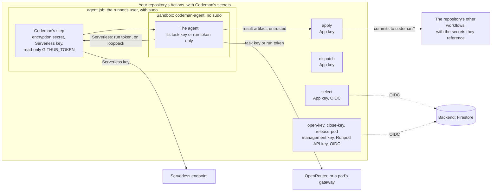

# Security

These pages tell you whether Codeman is safe to run on your repository. This page holds the threat model, the trust boundaries, who can read Codeman's secrets, the checklist and what is planned.

| Page | Read it to … |
| --- | --- |
| [Secrets](secrets.md) | Know which secrets Codeman uses, and why each one is safe |
| [Risks](risks.md) | Know the real risks, from most to least severe, and how to protect against them |
| [Forks](forks.md) | Know what someone who forks your repository gets, and can start in it |

The mechanisms themselves are described in [the other docs](../README.md).

> [!IMPORTANT]
> Read these pages assuming the agent can be manipulated. Codeman runs an AI agent that reads text and runs shell commands: whatever the agent can reach, an attacker who controls text it reads can reach too.

## Trust boundaries

- **Codeman's secrets** are repository or organization secrets. Every workflow of a repository that receives them can read them, so write access is the outer boundary ([who can read Codeman's secrets](#who-can-read-codemans-secrets)).
- **The jobs that hold keys** (`select`, `dispatch`, the [key jobs](../glossary.md#key-jobs) and `apply`) run no LLM and no repository code. Each job references only its own secrets ([where each credential goes](secrets.md#where-each-credential-goes)).
- **The [agent job](../runs/agent.md)**: only Codeman's step holds its secrets. The agent runs in the [sandbox](../glossary.md#sandbox), as another user, with only its own [task key](../glossary.md#task-key) or [run token](../glossary.md#run-token). Steps added to the job run outside the sandbox ([risk 3](risks.md#3-steps-added-to-the-agent-job-run-outside-the-sandbox)).
- **`apply`** treats the agent's result as untrusted, and filters it through the [change policy](../runs/changes.md#change-policy).
- **Commits to [task branches](../glossary.md#task-branch)** run the repository's other workflows, with the secrets they reference ([risk 1](risks.md#1-code-the-agent-wrote-runs-with-the-repositorys-secrets)).
- **The [backend](../glossary.md#backend)** admits only the jobs of `codeman.yml` on the default branch, of the repositories its [attribute condition](../glossary.md#attribute-condition) admits ([backend admission](forks.md#what-a-fork-cannot-reach)). The agent job never gets an OIDC token.
- **A Serverless run's gateway** runs in Codeman's step, outside the sandbox, and listens only on the runner's loopback. It holds the Serverless key; the agent sends it only the run token.

## Who can read Codeman's secrets

**Write access to a repository that receives Codeman's secrets is access to all of them.** They are plain repository or organization secrets, referenced by name, and the templates put none of them in an Environment. Inside a repository that receives them, every workflow that references them gets them, on any branch ([secrets](secrets.md)).

| Who | Can read or change | How |
| --- | --- | --- |
| Anyone with write access to a repository that receives Codeman's secrets | Every one it receives: the App's private key, the OpenRouter management key, the Runpod keys and the encryption secret | A workflow pushed to a branch of their own, with no review and no change to the default branch |
| The same people | That repository's `CODEMAN_SETTINGS` and `CODEMAN_COMMIT_SHA` | A repository variable of the same name, which overrides the organization's |
| With a [pool of organizations](../glossary.md#pool-of-organizations), anyone with write access to such a repository in any member | Every member's installed repositories, with the App's permissions | The App's key, read as above ([risk 8](risks.md#8-a-pool-shares-one-app-key)) |
| Whoever can change `codeman.yml` or `codeman-task.yml` on the default branch | The backend: all of the project's Firestore data | A change on the default branch, which a ruleset that requires a reviewed pull request holds back |
| Organization owners | The organization's secrets and variables | The organization's settings |

A repository variable overrides the organization's variable of the same name, and write access lets a person create one ([variables](../web/github/store-information-in-variables.md#creating-configuration-variables-for-a-repository), [precedence](../web/github/variables-reference.md#configuration-variable-precedence)):

- `CODEMAN_SETTINGS` replaces the [organization's settings](../glossary.md#organizations-settings) whole for that repository, `organization-monthly-budget` and `pool` included ([shared settings](../installation/shared-settings.md#settings-only-the-organization-sets)). Its runs also write the pool that variable sets, or the organization alone, as the pool the whole organization declares. Until another of the organization's repositories runs `select`, the other members batch with none of the organization's repositories ([the handshake](../runs/batches.md#the-handshake)).
- `CODEMAN_COMMIT_SHA` chooses which commit of Codeman's `main` runs with the secrets ([risk 7](risks.md#7-codemans-own-code-and-dependencies)).

Codeman does not detect these variables. Whoever can create one can already read every secret above, and spend or stop the pool's pods with them. So a check in `select` would hold back no one it targets.

The backend is the exception. Its attribute condition admits only `codeman.yml` on the default branch ([installation](../installation/setup.md#4-set-up-the-backend)). So reaching it takes changing that file there, which a ruleset that requires a reviewed pull request holds back.

> [!NOTE]
> The other pages say what protects each secret from the agent and from other jobs, not from people with write access.

## Checklist

Before running Codeman on a repository, go through these items. Each one sets one thing.

### The GitHub App

1. Install the App on selected repositories only.
2. With a pool, install it in each member. Check its installations in the App's settings from time to time, and suspend any you do not know ([risk 8](risks.md#8-a-pool-shares-one-app-key)).

### Secrets and variables

3. Give Codeman's organization secrets and variables the policy **Selected repositories**, listing only the repositories that use it ([repository access](../installation/setup.md#repository-access)). Then a new repository of the organization, or a fork inside it, receives none of them.
4. Give write access to the repositories that run Codeman only to people you would trust with every Codeman secret ([who can read Codeman's secrets](#who-can-read-codemans-secrets)). They can also create repository variables that override the organization's ([risk 7](risks.md#7-codemans-own-code-and-dependencies)).

### Branches and workflows

5. Add a ruleset on the default branch that requires a reviewed pull request.
6. Check which secrets the workflows that run on `codeman/*` branches expose. Move secrets that deploy or publish to an Environment with required reviewers ([risk 1](risks.md#1-code-the-agent-wrote-runs-with-the-repositorys-secrets)).
7. In the `agent` job, add only steps that install tools, each pinned to a full commit SHA. They run outside the sandbox, with the job's secrets in reach ([risk 3](risks.md#3-steps-added-to-the-agent-job-run-outside-the-sandbox)).

### Budgets

8. Keep `task-budget` and `monthly-budget` low ([risk 4](risks.md#4-the-agent-can-send-its-task-key-out)).
9. With several repositories, set `organization-monthly-budget` in the organization's settings. It holds only as far as people with write access are trusted:
   - a repository variable `CODEMAN_SETTINGS` replaces the organization's settings whole for that repository, `organization-monthly-budget` and `pool` included ([who can read Codeman's secrets](#who-can-read-codemans-secrets));
   - whoever can change the repository's workflow file on the default branch can replace them too.
10. With self-hosted inference, use a Runpod account dedicated to Codeman, with prepaid credits and no auto-pay.

### Codeman's version

11. Set `CODEMAN_COMMIT_SHA` in the organization to a commit of Codeman's `main` branch, which each job checks ([risk 7](risks.md#7-codemans-own-code-and-dependencies)).

### The backend

12. Give the backend a Firebase project of its own, with the rules of [installation](../installation/setup.md#4-set-up-the-backend).
13. Grant its service account only Cloud Datastore User.
14. Use one of the attribute conditions of [installation](../installation/setup.md#4-set-up-the-backend). Prefer the condition that lists repositories for a pool and for public repositories.
15. With the condition that admits any repository of the organization, restrict repository creation and forking in it ([forks](forks.md#what-a-fork-cannot-reach)).
16. Read the project, rules and condition back from time to time ([backend maintenance](../installation/backend-maintenance.md)).

### Issues and forks

17. Label only issues you opened, written in your own words.
18. Require approval for fork pull request workflows from all external contributors ([forks](forks.md#recommendations)).
19. On private repositories, keep sending secrets and write tokens to fork pull requests off.
20. Use `pull_request_target` in no workflow that runs the pull request's code.

## Roadmap

Planned improvements, most valuable first. Each will get its own plan.

| # | Improvement | How | Reduces |
| --- | --- | --- | --- |
| 1 | **Restrict the agent's network** | An allowlist (OpenRouter or the run's gateway, package registries), with `iptables` rules that match the agent's user | Risks 2 and 4 |
| 2 | **Test the sandbox against a hostile agent** | A CI job on a GitHub-hosted runner replaces the harness with a script that tries to read secrets: other users' `/proc/*/environ`, the runner's home, `sudo`, `docker`, the runner's credentials and cloud metadata endpoints. The build fails if any attempt succeeds | Keeps [secrets](secrets.md) true as Codeman and the runner images change |
| 3 | **Warn about secrets exposed to task branches** | `select` warns when a workflow that runs on `push` or `pull_request` for `codeman/*` references `secrets.*` outside an Environment | Risk 1 |
| 4 | **Warn about extra steps in the agent job** | `select` reads the workflows, and warns when the `agent` job has `run` steps, or actions other than known setup actions | Risk 3 |
| 5 | **Have the review stage look for exfiltration** | It looks for new network calls, reads of environment variables, and changes to scripts that CI runs. It does not replace a human review | Risk 1 |
