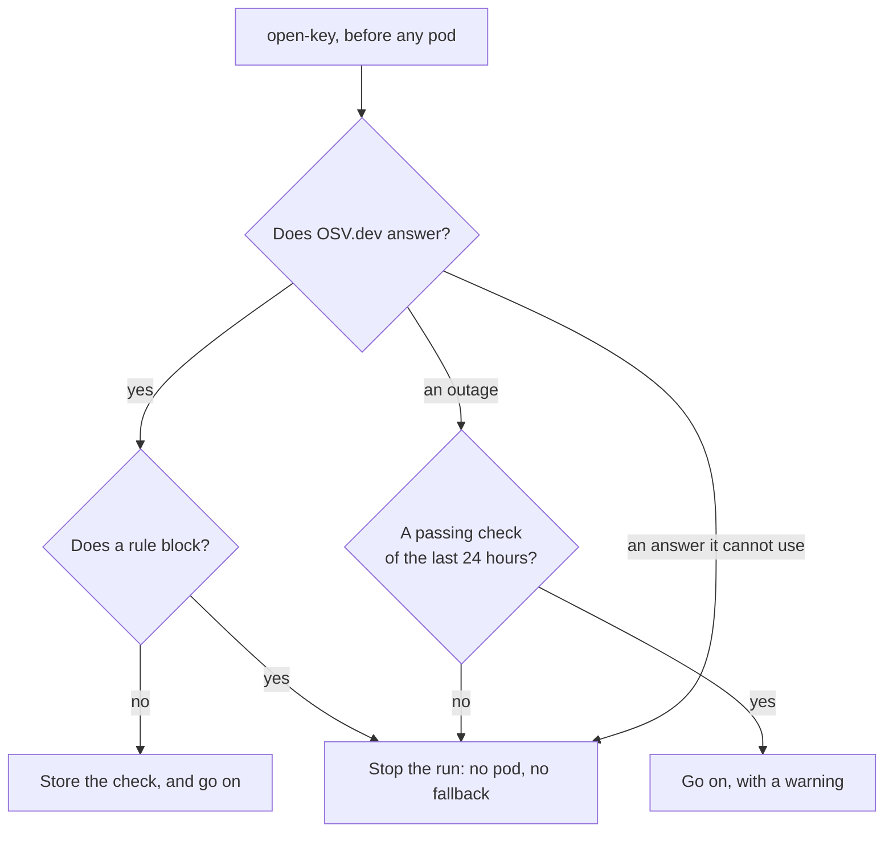

# Release policy

Before a run gets a [pod](../glossary.md#pod), `open-key` checks the releases that pod would run, and stops the run when one should not be trusted. This page says what it checks and when, what a blocked run shows, and how a maintainer pins a new engine version.

## What it checks

The check runs in `open-key` on every run on `runpod-pod` or `salad-pod`, before the job sweeps, joins or creates a pod ([pods](../inference/pods.md#opening-a-run)). It reads the catalog in [`src/inference/images.ts`](../../src/inference/images.ts), which pins two releases per pod:

| Release | Catalog entry | Its date | Its advisories |
| --- | --- | --- | --- |
| The [engine](../glossary.md#engine) | `ENGINE_RELEASES` | When its official image was created | OSV.dev: `github.com/ollama/ollama` (Go), or `vllm` (PyPI) |
| Node.js, for the [bootstrap](../glossary.md#bootstrap) | `NODE_RELEASE` | When it was published | Not on OSV.dev, which covers no Node.js release: checked by hand when pinned |

Each rule gives one result:

| Rule | Result |
| --- | --- |
| Published less than 7 days ago | Block, unless the [security fix bypass](#security-fix-bypass) admits it |
| Its date cannot be read | Block |
| A high or critical advisory | Block, unless an [exception](#exceptions) accepts it |
| A moderate or low advisory, or one without a severity | Warning |
| An advisory an exception accepts | Note, with the exception's reason |
| An exception without a reason | Block |
| An exception that matches no advisory | Note: it can go |
| Provenance: the source, commit, signatures and attestations the catalog lists | Recorded, never required |

A run with warnings goes on. The pod's `resolution` records the result ([data layout](../backend/data-layout.md#resolution)).

> [!NOTE]
> The minimum age covers these two releases, not each package inside an image. What an image holds is scanned when it is pinned ([OS packages](#os-packages)).

### Security fix bypass

A release younger than 7 days passes when both hold:

- The catalog names the release it replaces (`replaces`).
- OSV.dev shows it is the earliest release that fixes a high or critical advisory of that release.

The bypass waives only the age: the release's own advisories still count. It cannot admit Node.js, since OSV.dev holds nothing to show what it fixes.

### Exceptions

An exception accepts one advisory of an engine's release, whatever its severity. It lives beside the pin, in the entry's `exceptions`, with the reason the advisory is accepted.

- It names the advisory's ID or one of its aliases, in any case.
- Codeman pins the engines, so a repository's settings cannot add one.

### When OSV.dev does not answer

| OSV.dev | Result |
| --- | --- |
| It answers | The rules above apply |
| An outage: no answer in 30 seconds, `429`, a `5xx`, or a body that is not JSON, with a passing check of the same releases and exceptions in the last 24 hours | That check stands, with a warning |
| The same outage, with no such check | Block |
| An answer Codeman cannot use: another `4xx`, another shape, or more than its caps | Block |

A check stands only when it was made against OSV.dev, so an outage never extends it. Passing checks live in `releaseChecks/{key}` ([data layout](../backend/data-layout.md#release-checks)). A block is never stored.

### OS packages

An image's OS and language packages are not checked at run time. A maintainer scans each image once, with Trivy, when pinning it. So a finding published after the pin shows only at the next scan.

### An image of your own

The `pod-image` input chooses an Ollama image, which the policy does not check: you chose it. Node.js is still checked. `open-key` logs that, and the pod's `resolution` records the image with `checked: false`.

### The gateway

The policy does not check the [gateway](../glossary.md#gateway), which is Codeman's own code. `open-key` computes its SHA-256 from its own copy of `dist/gateway.js`. When its checkout is not of a full commit SHA, it stops the run before any pod, since a pod could not download that gateway.

## What a blocked run shows

A block is a mistake in the pinned releases, or an outage, never a lack of room. So the run [falls back](../settings/profiles.md#fallback) to no other profile, and no pod is created.

| Where | What it shows |
| --- | --- |
| The task | The label `codeman:blocked`, with a run comment: "Codeman could not give this run access to its model (an OpenRouter key, or a GPU). See the run log." |
| The run's log | Each reason, as `Release policy: <reason>`, then the error below |
| The backend | A `key-failed` event with the error, and a ledger run `failed`, at a cost of 0 |

The error names the releases, the advisory and how to move on:

```text
The release policy blocks ollama 0.40.10 and node 24.22.1, so no pod was created, and the run stops
rather than fall back to another profile: ollama 0.40.10: it has GHSA-… (critical, also CVE-…): <its
summary>. It is fixed in 0.40.11; pin that release, or add an exception for GHSA-… with its reason.
Codeman pins these releases (`ENGINE_RELEASES` and `NODE_RELEASE` in src/inference/images.ts): set
CODEMAN_COMMIT_SHA to a commit of Codeman whose releases pass, or, for Ollama, choose an image with
the `pod-image` input, which the policy does not check.
```

During an outage, it starts "The release policy could not check …, so no pod was created and the run stops:" and says to try again later.

What to do:

| The error says | Do |
| --- | --- |
| "blocks" | Set `CODEMAN_COMMIT_SHA` to a commit whose releases pass ([choose Codeman's commit](../installation/setup.md#choose-codemans-commit)). A newer commit may not exist yet: then choose an Ollama image with `pod-image`, or another provider |
| "could not check" | Wait for OSV.dev, then remove the `codeman:blocked` label to try again |

A passing run logs "The release policy passes ollama 0.40.10 and node 24.22.1." With warnings, it says "passes, with warnings," and logs each.

## Pin a new engine version

For maintainers of Codeman. A new release reaches pods only once it is pinned.

1. **Choose the release.** It must pass the rules above: at least 7 days old, or the earliest fix of a blocking advisory of the release it replaces.
2. **Scan its image**, by index digest. The scan needs Docker, and takes 30 to 45 minutes on a vLLM image:

   ```sh
   scripts/scan-image.sh docker.io/vllm/vllm-openai@sha256:<index digest>
   ```

3. **Decide on what the scan and OSV.dev found.** Choose another release, or accept each finding with its reason.
4. **Run the engine's upgrade checklist** in [dependencies](../development/dependencies.md): [Ollama](../development/dependencies.md#ollama) or [vLLM](../development/dependencies.md#vllm).
5. **Change the entry** in `ENGINE_RELEASES`:
   - `image`, by its index digest, with the image's page in `docs/web/docker-hub/`;
   - `release`: `version`, `publishedAt`, `osv`, `replaces` and `provenance`;
   - `exceptions`: the IDs OSV.dev returns for the release, each with its reason, and its page in `docs/web/osv/`.
6. **Record the audit** in the [audit log](../development/dependencies.md#audit-log), the scan's result included.
7. **Run `npm test`.** Tests compare the digest and the exceptions with their recorded pages, and the version with the engine's constant.
8. **Say what changes for users** in [upgrading](../installation/upgrading.md), then commit.

Node.js has its own steps, since its digest comes from its signed `SHASUMS256.txt` and its advisories from its security releases ([Node.js for pods](../development/dependencies.md#nodejs-for-pods)).

## How it works



- **The query.** One `POST /v1/querybatch` for each release's package and version, then `GET /v1/vulns/{id}` for each record. It carries no key, and only those names and versions ([`src/inference/osv.ts`](../../src/inference/osv.ts)).
- **One advisory.** Records that alias each other count as one, under its GHSA ID when it has one. Withdrawn records are ignored.
- **Its severity.** The one a database names, the highest when several do. Otherwise a score computed from a CVSS 3 vector: 9 and up is critical, 7 high, 4 moderate, and below that low. A record with neither takes the severity of up to 4 of its aliases' records.
- **The cache's key.** A hash of the policy's version, the releases with their provenance, and the exceptions. A change to any of them makes a new check ([`src/inference/release-policy.ts`](../../src/inference/release-policy.ts)).

Why these rules, and the measurements behind them, are in the [investigation of multi-service pods](../plans/2026-10-30-investigate-multi-service-pods.md#recommendations) and the [plan to start pods from official engine images](../plans/2026-10-30-start-pods-from-official-engine-images.md#decisions).
