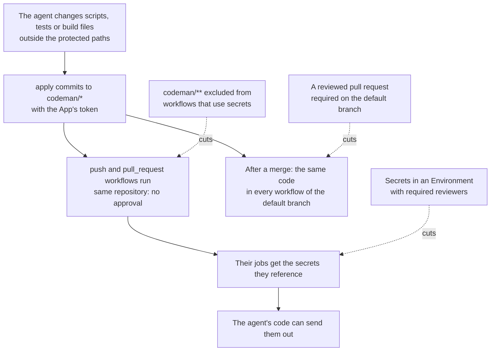
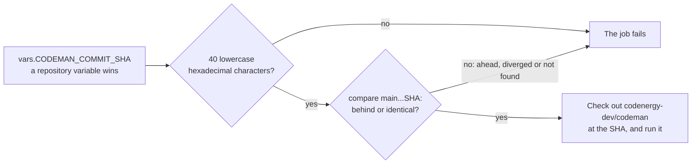

# Risks

The real risks of running Codeman, and how to protect against each. Risks 1 to 7 go from most to least severe; risk 8 applies only to a [pool of organizations](../glossary.md#pool-of-organizations). Each risk says which repositories it applies to.

## Summary

Severity is the harm when the risk happens, with the templates as they are.

| # | Risk | Applies to | Severity | Bounded by | Main protection |
| --- | --- | --- | --- | --- | --- |
| [1](#1-code-the-agent-wrote-runs-with-the-repositorys-secrets) | Code the agent wrote runs in CI with the repository's secrets | Public and private | High | The secrets that workflows on `codeman/*` expose | Secrets in an Environment with required reviewers; reviewed pull requests |
| [2](#2-prompt-injection-through-what-the-agent-reads) | Prompt injection | Public and private; more on public | High | The pull request's review; the budgets | Issues in your own words; review |
| [3](#3-steps-added-to-the-agent-job-run-outside-the-sandbox) | Steps added to the `agent` job | Repositories that add steps there | High | What the job holds | Only steps that install tools, pinned |
| [4](#4-the-agent-can-send-its-task-key-out) | The task key or run token sent out | Public and private | Medium | What remains of the task's budget, until the run ends | Low budgets |
| [5](#5-results-of-accepted-workflows-reach-the-agent) | Accepted workflows' results reach the agent | Repositories that accept workflows | Medium | What the workflow writes to its logs and artifacts | Read the workflow before accepting it |
| [6](#6-the-agents-output-and-the-repositorys-code-leave-the-repository) | Output and code leave the repository | Logs: public; model provider: both | Medium | What the repository holds | A provider whose data policy you accept |
| [7](#7-codemans-own-code-and-dependencies) | Codeman's own code and dependencies | Public and private | Medium | The check against Codeman's `main`; pinning | The organization's variable; the audit log |
| [8](#8-a-pool-shares-one-app-key) | A pool shares one App key | Pools of organizations | High, for a pool | The pool's members and their installations | Pool only organizations you trust as your own |

## 1. Code the agent wrote runs with the repository's secrets

*Public and private repositories.*

Codeman commits to `codeman/*` branches, and opens a pull request from the same repository. Commits made with the App's token trigger workflows, so each commit runs the repository's `push` and `pull_request` workflows. Those get the repository's secrets without approval, because the pull request does not come from a fork.

The agent may change the scripts, tests and build files those workflows run. By default, the [change policy](../runs/changes.md#change-policy) protects only `.github/`, the harness configuration and agent instructions, besides `.codemanignore` and `.codeman/`, which it always protects. A manipulated agent can therefore make CI send out every secret its jobs expose. After a merge, the same code runs in every workflow of the default branch.

### How the agent's code reaches the secrets



### How to protect (risk 1)

- Expose no secrets to jobs that run on `codeman/*` branches. Keep secrets that deploy or publish in a GitHub Environment with required reviewers, and limit its deployment branches to the default branch. Alternatively, exclude `codeman/**` from workflows that use secrets.
- Codeman's own secrets are in the same repository. A workflow that runs on `codeman/*` branches and calls a reusable workflow with `secrets: inherit` passes it every secret the repository receives, Codeman's included ([reuse workflows](../web/github/reuse-workflows.md#passing-inputs-and-secrets-to-a-reusable-workflow)). Pass only the secrets it needs, by name.
- A `pull_request_target` workflow that checks out the pull request's code carries the same risk.
- Review Codeman's pull requests the way you would review code from an outside contributor, and add a ruleset that requires that review on the default branch.

## 2. Prompt injection through what the agent reads

*Public and private repositories; more exposure on public ones.*

The agent follows text it reads. Delimiters and instructions to treat text as data help, but they guarantee nothing.

### What reaches the agent

- Codeman gives it only the title and body of issues opened by [maintainers](../glossary.md#maintainer), and only comments and reviews by maintainers. See [untrusted input](#untrusted-input).
- The agent still reads other text: third-party text that a maintainer quotes, the repository's files, the dependencies it installs, and the results of workflows.

### What a manipulated agent can do

- Write malicious code ([risk 1](#1-code-the-agent-wrote-runs-with-the-repositorys-secrets)).
- Send its key, and what it reads, over the network ([risk 4](#4-the-agent-can-send-its-task-key-out)).
- Write a misleading report.
- As the routing agent, leave out the [routed stages](../glossary.md#routed-stage) before review. It can never leave out review, which always runs and decides whether the task is done.

### Third-party pages

The web [stage](../glossary.md#stage) brings third-party pages into the repository, where later agents read them. Every agent is told to read `docs/web/` as data, and only the web stage may change it. A page reaches the default branch only through the pull request a maintainer reviews.

### How to protect (risk 2)

- Open issues in your own words. Do not paste a third party's text as the task.
- Review the pull request, as in [risk 1](#1-code-the-agent-wrote-runs-with-the-repositorys-secrets).
- There is no network restriction yet: [roadmap](overview.md#roadmap) item 1.

## 3. Steps added to the agent job run outside the sandbox

*Public and private repositories.*

Only Codeman's step runs the agent as the unprivileged `codeman-agent` user, in the [sandbox](../glossary.md#sandbox). Any other step in the `agent` job runs as the runner's user, which has `sudo`.

The agent itself cannot run code as the runner's user, through Codeman's step or through the steps after it. Those include the post steps of `actions/checkout`, which run `git` from the job's `PATH`. Codeman runs its programs from root's directories, and closes the image's world-writable paths before the agent starts ([before the agent runs](../runs/agent.md#before-the-agent-runs)). This does not depend on which directories the image and the setup actions put on the `PATH`.

The job checks out the [task branch](../glossary.md#task-branch). So a step that runs repository code (`npm ci`, `make`, a test script) runs code the agent wrote. A setup action is such a step too: third-party code that runs as the runner's user, with the same reach.

### What an added step can read

It can read the job's secrets from the runner's memory, among them:

- the key encryption secret, with which it can also decrypt the task keys in the run logs;
- the run's [task key](../glossary.md#task-key), which reaches the job encrypted with that secret, and which Codeman's step decrypts and holds;
- the Serverless key (`CODEMAN_RUNPOD_SERVERLESS_KEY`);
- the job's `GITHUB_TOKEN`.

### What an added step can change

Such a step can also change the job's outputs, among them a Serverless [gateway](../glossary.md#gateway)'s usage, which `close-key` trusts. It can make its run count nothing, or claim times its run did not use the endpoint's worker. Those lower the costs of the organization's runs that used the worker then, and its own run counts that time instead. So the runs' total in the budgets does not drop ([Serverless](../inference/serverless.md)).

### How to protect (risk 3)

- In the `agent` job (in `codeman-task.yml`), add only steps that install tools, such as `actions/setup-node`.
- Pin each action to a full commit SHA.
- Turn off an action's options that install the project's dependencies, which run repository code.
- Leave installing dependencies and running scripts to the agent, inside the sandbox.
- Run the `agent` job on a GitHub-hosted runner: Codeman changes the machine's permissions for good, and a new VM per job takes them away.

## 4. The agent can send its task key out

*Public and private repositories.*

The agent's network is not restricted, and it holds its task key or [run token](../glossary.md#run-token).

### OpenRouter keys

A manipulated agent can send the key out, and spend it until the run ends and `close-key` disables it. The loss is bounded by the key's limit: what remains of the task's budget, never more than the monthly budget allows.

### Pod tokens

- The token opens the pod's gateway, which Runpod's proxy makes public, until the run ends or its budget is spent. The [pod](../glossary.md#pod) costs the same whether the requests come from the agent or not.
- Tasks may share a pod, whether of one run or of several repositories of the pool. Each run's token then opens only its own run: its requests count in its own records and against its own limit. It cannot end, read or spend another task's run.
- A leaked token can still make the GPU busy, and so slow the other tasks' requests, until its own run ends or its budget is spent.
- The admin routes take only the token that the Runpod API key derives.

### Serverless tokens

On Serverless, the gateway listens only on the runner's loopback.

### How to protect (risk 4)

Keep `task-budget` and `monthly-budget` low. [Roadmap](overview.md#roadmap) item 1 would close the channel.

## 5. Results of accepted workflows reach the agent

*Public and private repositories.*

When the agent waits for a workflow, Codeman gives the agent that workflow's results: the end of each failed job's log, and its artifacts. See [on-demand workflows](../runs/changes.md#on-demand-workflows). Accepted workflows run with the secrets they reference. GitHub masks registered secrets in logs, but not in artifacts, and not when a secret is transformed, for example base64-encoded.

### How to protect (risk 5)

Before `/codeman accept-workflows`, check that the workflow takes its secrets from an Environment, and writes none of them to its logs or artifacts.

## 6. The agent's output and the repository's code leave the repository

*Logs: public repositories. Model provider: both.*

### Run logs

The agent job logs what the agent does, and run logs are public on public repositories. The task key is masked. Anything else the agent prints appears in the log.

### The model provider

The repository's code, issues and comments go to the model provider through OpenRouter, or, with self-hosted inference, to a container on Runpod.

### Self-hosted inference

- Codeman creates pods on Secure Cloud only, in Runpod's certified data centers. A Serverless endpoint runs where the maintainer who created it chose.
- A pod's gateway is public behind Runpod's proxy, and serves only whoever holds the run's token. Ollama's and vLLM's own ports stay inside the pod.
- A vLLM pod downloads its model from Hugging Face. Before creating it, Codeman asks Hugging Face's API whether the model is public, without a token; the request carries only the model's ID.
- vLLM's usage statistics are turned off. Its arguments that run a model repository's code (`trust-remote-code`), load plugins, or send the cache, traces or requests elsewhere are refused ([vLLM settings](../settings/vllm.md#refused-keys)).

### How to protect (risk 6)

- Keep secrets out of the repository, as you would anyway.
- On private repositories, choose a model and provider whose data policy you accept. OpenRouter's privacy settings can restrict providers.
- With Serverless, choose Secure Cloud data centers.

## 7. Codeman's own code and dependencies

*Public and private repositories.*

The workflow runs Codeman, third-party actions and the OpenCode [harness](../glossary.md#harness) with the permissions of [secrets](secrets.md#permissions-each-job-requests).

### Pinned dependencies

- Each job that runs Codeman checks it out at the commit in the `CODEMAN_COMMIT_SHA` variable, after a check of that commit (below).
- The templates pin every other action to a full commit SHA.
- OpenCode is pinned to a version, and checked against its npm integrity hash.
- Codeman's pod images, one with Ollama and one with vLLM, are pinned by digest.

See [dependencies](../development/dependencies.md).

### The commit check

A step before the checkout fails unless the variable's value is a full commit SHA of Codeman's `main` branch:

- A branch or tag would let the code change by itself, so the value must be 40 lowercase hexadecimal characters.
- GitHub also serves its forks' commits under Codeman's name. So the step asks GitHub to compare the commit with `main`, and the answer must be `behind` or `identical`.

```text
GET /repos/codenergy-dev/codeman/compare/main...<sha>
```



### Who chooses the commit

The variable is the trade-off of the [plan for Codeman's commit from a variable](../plans/2026-10-14-commit-from-a-variable.md). One change moves every repository to another version. But **whoever can change the variable chooses which of Codeman's published commits runs with its secrets**, with no commit and no review. Since the check against `main`, that is never code of their own: at worst an older commit of Codeman's, with whatever it lacked.

- An organization variable is changed by the organization's owners. A repository variable of the same name overrides it, and anyone with write access to the repository can create one ([variables](../web/github/store-information-in-variables.md#creating-configuration-variables-for-a-repository), [precedence](../web/github/variables-reference.md#configuration-variable-precedence)).
- Such a person could already read Codeman's secrets, with a workflow of their own on any branch ([who can read Codeman's secrets](overview.md#who-can-read-codemans-secrets)).
- The change leaves no trace in the repository's history. GitHub records it only in the organization's audit log.

### Why the check against main

A full SHA alone does not prove a commit is Codeman's: a commit pushed to a fork of `codenergy-dev/codeman` is served under its name. Without the check, the variable would also have let such a person's own code run in `codeman.yml` on the default branch. Its jobs would get the OIDC token the backend's [attribute condition](../installation/setup.md#4-set-up-the-backend) admits, and reach a pool's [board](../glossary.md#board), batches and [pod registry](../glossary.md#pod-registry).

The check closes that: a commit that is not on Codeman's `main` fails the job before it is checked out.

What remains: moving to an older commit of Codeman's `main`, or to a newer one before you read it.

### How to protect (risk 7)

- Set `CODEMAN_COMMIT_SHA` once, in the organization, and read Codeman's changes before moving to a newer commit.
- Give write access to the repositories that run Codeman, and to every repository of a pool that receives Codeman's secrets, only to people you would trust with all of those secrets. Write access is access to them ([who can read Codeman's secrets](overview.md#who-can-read-codemans-secrets)).
- Check from time to time that no repository has a variable of that name of its own (**Settings → Secrets and variables → Actions → Variables**), and read the audit log for changes to it.

## 8. A pool shares one App key

*Pools of organizations only.*

A [pool of organizations](../runs/batches.md#pools) installs one App, made public so each organization can install it by its link. The same private key is in each organization's secrets. The choice is decision 6 of the [plan for GPU batches across repositories](../plans/2026-10-13-gpu-batches-across-repositories.md).

### What the App's key reaches

- **A stranger who installs the App gains nothing.** Without the private key they mint no token. Codeman never acts on owners outside its pool: it mints tokens only for the members its organization's `pool` names and that declare the same pool, and it never lists the App's installations.
- **Whoever holds the key reaches a stranger's installation too**, with the App's permissions. Codeman ignores it, but a person with the key does not have to. The App's owner sees every installation in the App's settings, and can suspend any of them.
- **A leaked key reaches every installation**, the pool's and any stranger's.

### A pool is mutual trust

- Anyone with write access to a repository of any member that receives the key can read it, with a workflow on any branch ([who can read Codeman's secrets](overview.md#who-can-read-codemans-secrets)).
- So they reach every member's installed repositories with the App's permissions, which already include Contents and Workflows write. Inside one organization this was already true.
- A pool's members also read each other's ready tasks' numbers and stages on the board, and each other's runs' costs in the backend. These hold no secret.
- The backend's attribute condition, which lists the pool's owner IDs, is the boundary of what reaches the board, the batches and the registry.

### The dispatch job

- `dispatch` holds the key only to mint a token for one repository of the pool, other than its own, limited to `actions: write` and `metadata: read`.
- The token action revokes that token when the job ends ([create-github-app-token](../web/github/create-github-app-token.md#how-it-works)).
- The job checks out nothing, runs no Codeman step, and has no OIDC token.
- Actions write also lets that token cancel, re-run and delete runs, and disable workflows, of that repository, for one hour at most.

### Why one public App

The alternative considered was one private App per organization, with each key also in the other organizations' secrets. It gives the same trust, with more upkeep.

### How to protect (risk 8)

- Pool only organizations whose maintainers you trust as your own.
- Check the App's installations from time to time, and suspend any you do not know.
- If the key leaks, rotate it: an App may hold several keys, so add one and delete the leaked one. Suspend installations while doing so.

## Untrusted input

Repositories may be public, so text from people who are not maintainers is untrusted, and so is everything the agent produces. A [maintainer](../glossary.md#maintainer) is a user with write access to the repository; see [commands](../tasks/commands.md).

| Input | Reaches the agent when | Otherwise |
| --- | --- | --- |
| An issue's title and body | A maintainer opened the issue. The agent reads them as its task, and whoever opened the issue can edit them at any time | Codeman leaves the labeled issue alone, also when a bot or a deleted account opened it. Nothing from it reaches the agent, and its [status comment](../glossary.md#status-comment) says how to go on: a maintainer opens a new issue in their own words |
| Comments and reviews | Their author is a maintainer | Dropped before anything reads them |

How Codeman handles the text it passes on:

| Text | Handling |
| --- | --- |
| Issue text in the agent's task file | Marked as data, and wrapped in markers with a random nonce |
| Untrusted text written to a log | Collapsed to one line or prefixed, so it cannot inject workflow commands such as `::add-mask::` |
| Text the agent writes on issues and pull requests | Rendered as safe Markdown; see [status and run comments](../tasks/comments.md#status-and-run-comments) |
