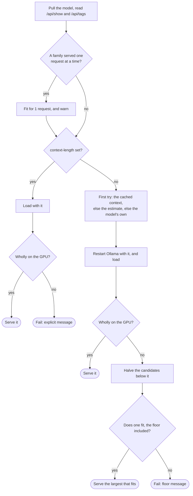

# Ollama settings

With `provider: runpod-pod` or `salad-pod` and its [engine](../glossary.md#engine) `ollama`, an `ollama:` block tunes the [pod](../glossary.md#pod)'s Ollama server. Each key becomes one of the server's environment variables, such as `num-parallel: 4` for `OLLAMA_NUM_PARALLEL=4`.

```yaml
provider: runpod-pod
model: qwen3-coder:30b
gpu: "NVIDIA RTX PRO 6000 Blackwell Server Edition"
ollama:
  num-parallel: 4          # OLLAMA_NUM_PARALLEL=4: four requests at once
  context-length: 65536    # OLLAMA_CONTEXT_LENGTH=65536, instead of the model's own
```

Without the block, a pod still serves as many requests at once as its profile's tasks, with the largest context that fits its GPU, and its model always runs wholly on the GPU. What both engines share, such as where the block goes, is in [pod engines](pod-engines.md).

The choices were made in the [Ollama settings plan](../plans/2026-10-08-ollama-settings.md) and the [plan for fitting Ollama to the GPU](../plans/2026-10-13-fit-ollama-to-the-gpu.md).

## Accepted keys

Only these keys, taken from the server of Ollama 0.35.1, the version in Codeman's pod image ([`envconfig/config.go` at v0.35.1](../web/ollama/envconfig-config-go-at-v0-35-1.md), and the [FAQ](../web/ollama/faq.md)). `src/inference/ollama.test.ts` checks this table against `OLLAMA_SETTINGS` in [`src/inference/ollama.ts`](../../src/inference/ollama.ts).

| Key | Variable | Value | Ollama's default | Without the key | Meaning |
| --- | --- | --- | --- | --- | --- |
| `context-length` | `OLLAMA_CONTEXT_LENGTH` | Whole number, at least 1 | 4k, 32k or 256k tokens, by the GPU's memory | Codeman computes the largest that fits the GPU ([memory](#memory)) | The context length of each request, which the agent is told |
| `num-parallel` | `OLLAMA_NUM_PARALLEL` | Whole number, at least 1 | 1 | Codeman sets the most tasks the profile serves ([parallel requests](#parallel-requests)) | How many requests the model processes at once; the others queue |
| `max-queue` | `OLLAMA_MAX_QUEUE` | Whole number, at least 1 | 512 | Ollama's | How many requests wait while it is busy, before it answers 503 |
| `flash-attention` | `OLLAMA_FLASH_ATTENTION` | `true` or `false` | On when the backend and GPU support it | Ollama's | Forces Flash Attention on or off; it reduces memory as the context grows |
| `kv-cache-type` | `OLLAMA_KV_CACHE_TYPE` | `f16`, `q8_0` or `q4_0` | `f16` | Ollama's | The K/V cache's quantization: `q8_0` uses about half the memory of `f16`, `q4_0` a quarter, with some loss of precision; it needs Flash Attention |
| `gpu-overhead` | `OLLAMA_GPU_OVERHEAD` | Whole number, at least 0 | 0 | Ollama's | Bytes of each GPU's memory that Ollama leaves free |
| `sched-spread` | `OLLAMA_SCHED_SPREAD` | `true` or `false` | `false` | Ollama's | Spreads the model over all the pod's GPUs, even when one would hold it |
| `load-timeout` | `OLLAMA_LOAD_TIMEOUT` | A duration, such as `10m` or `1h30m`, or whole seconds | `5m` | Ollama's | How long a model's load may stall before Ollama gives up |

## Refused keys

Codeman controls these, so setting them stops the run with the reason:

| Key | Variable | Why |
| --- | --- | --- |
| `host` | `OLLAMA_HOST` | Codeman runs Ollama on the pod's loopback, where only its gateway reaches it |
| `origins` | `OLLAMA_ORIGINS` | Only Codeman's gateway calls Ollama, from the pod's loopback |
| `keep-alive` | `OLLAMA_KEEP_ALIVE` | Codeman keeps the model loaded for as long as the pod lives |
| `models` | `OLLAMA_MODELS` | Codeman pulls the model where the pod image keeps models, on the disk it sizes for it |
| `remotes` | `OLLAMA_REMOTES` | Remote models would send the runs' requests off the pod |
| `debug-log-requests` | `OLLAMA_DEBUG_LOG_REQUESTS` | It writes the runs' requests, with the repository's code in them, to the pod's disk |

## Errors

Ollama ignores a variable it does not know. So Codeman checks each key and value, and stops the run, naming the line, before any pod is created. The messages are in [errors common to both blocks](pod-engines.md#errors-common-to-both-blocks).

## How they apply

1. **Layers.** Each key is inherited like a provider setting, and a layer that names another provider drops the block ([the block](pod-engines.md#the-block)).
2. **Pods.** The settings are part of the [pod settings](../glossary.md#pod-settings), so tasks with different Ollama settings never share a pod ([pods](../inference/pods.md)).
3. **The pod.** Codeman creates it with `CODEMAN_OLLAMA`, the variables as JSON, such as `{"OLLAMA_NUM_PARALLEL":"4"}`, the derived `num-parallel` included ([from settings to the pod](pod-engines.md#from-settings-to-the-pod)).
4. **The gateway.** It checks the variables against the same list, and gives them to Ollama with its own `OLLAMA_HOST` and `OLLAMA_KEEP_ALIVE` on top. It logs them ("Ollama settings: OLLAMA_NUM_PARALLEL=4.") and reports them in its status. A pod whose `CODEMAN_OLLAMA` it cannot read terminates itself, saying why.
5. **The context length.** With `context-length`, Ollama keeps it, and the gateway only checks that the model fits the GPU with it. Without it, the gateway computes one ([memory](#memory)). Either is the context length `open-key` reports and the agent is told.

## Parallel requests

Without `num-parallel`, a pod's Ollama serves as many requests at once as the most tasks its profile serves in a run. The rule, with an example, is in [pod engines](pod-engines.md#parallel-requests). An explicit `num-parallel` wins, and more requests wait in Ollama's queue (`max-queue`), without error.

### Families served one request at a time

Ollama 0.35.1 serves some model families one request at a time, whatever `num-parallel` says ([server/sched.go](../web/ollama/server-sched-go-at-v0-35-1.md#parallel-requests); `OLLAMA_SERIAL_FAMILIES` in [`src/inference/ollama.ts`](../../src/inference/ollama.ts)):

- `qwen35`, `qwen35moe` and `qwen3next`;
- `qwen3vl` and `qwen3vlmoe`;
- `mllama`;
- `lfm2` and `lfm2moe`;
- `nemotron_h`, `nemotron_h_moe` and `nemotron_h_omni`.

The gateway fits such a model for one request. `open-key` warns that the runs on the pod wait for each other's requests: "Ollama 0.35.1 serves `<model>`'s family (`<family>`) one request at a time, whatever num-parallel says: the runs that share pod `<id>` wait for each other's requests." [vLLM](vllm.md) batches every family.

## Memory

Ollama's K/V cache grows with `num-parallel` × `context-length`, beside the model ([FAQ](../web/ollama/faq.md#how-does-ollama-handle-concurrent-requests)).

> [!WARNING]
> When the model and its cache do not fit the GPU, Ollama does not fail: it puts part of the model on the CPU, which runs much slower ([server/sched.go](../web/ollama/server-sched-go-at-v0-35-1.md#loading), [common/fit.cpp](../web/llama-cpp/common-fit-cpp-at-b11232.md)).

So the pod's gateway checks every load, and computes the context when the settings give none ([`src/gateway/fit.ts`](../../src/gateway/fit.ts)). The floor, the candidates and what a failed start does are in [context and the GPU](pod-engines.md#context-and-the-gpu).



### Wholly on the GPU

After each load, the gateway reads `GET /api/ps`. A model wholly on the GPU has `size_vram` equal to `size` ([list running models](../web/ollama/list-running-models.md)). The pod serves only such a model, with an explicit `context-length` too.

llama.cpp, which Ollama runs, leaves 1024 MiB of each GPU free when it decides what goes on it ([common/common.h](../web/llama-cpp/common-common-h-at-b11232.md)). A model wholly on the GPU therefore leaves that much for what grows while it runs.

### The computed context

Without `context-length`, the gateway searches the candidates, from the floor up to the model's own, in multiples of 4096 ([context and the GPU](pod-engines.md#context-and-the-gpu)). When `/api/show` gives no context of the model's own, it tries 64000 only.

The first try is the first of these that applies:

1. The context cached for the same settings and the same model digest ([the cache of fits](pod-engines.md#the-cache-of-fits)).
2. The estimate below.
3. The model's own context, when the estimate cannot be made: for a model with a sliding window, a field missing from `/api/show`, or an unknown GPU memory.

The estimate:

```text
free       = GPU memory − model size on disk − 1024 MiB − gpu-overhead
per token  = attention layers × K/V heads × (key length + value length) × bytes per element
estimate   = the largest candidate ≤ free ÷ (per token × parallel requests); the floor at least
```

- **GPU memory** is the GPU type's memory as Runpod's API gives it, or as a Salad class's name says it, such as `(24 GB)`, read as GiB.
- **Model size on disk** comes from `/api/tags`.
- **Attention layers, K/V heads, key and value lengths** come from `/api/show`.
- **Bytes per element** depend on `kv-cache-type`: 2 for `f16`, 34/32 for `q8_0`, 18/32 for `q4_0`.
- **The estimate errs high**, since it counts no compute buffers. The search corrects it.

Then the search:

1. Restart Ollama with the first try, and load the model.
2. If it is wholly on the GPU, serve it.
3. Otherwise, halve the candidates below it until the largest that fits is found.

Each try restarts Ollama with the context and loads the model: about 8 loads at most.

**Example**, with illustrative figures: a 19 GB model with 48 attention layers, 4 K/V heads, and key and value lengths of 128, whose own context is 262144 tokens. It runs on a 96 GB GPU, with 4 parallel requests, `f16` and no `gpu-overhead`.

```text
free       = 96 GiB − 19 GB − 1 GiB                ≈ 83.0 GB
per token  = 48 × 4 × (128 + 128) × 2              = 98304 bytes
tokens     = 83.0 GB ÷ (98304 × 4)                 ≈ 211094
first try  = 51 × 4096                             = 208896
```

With `kv-cache-type: q8_0`, the same GPU holds about 397000 tokens, so the first try is the model's own, 262144.

### When it fails

A start that fails stops the run with the gateway's message, in `open-key`'s log ([context and the GPU](pod-engines.md#context-and-the-gpu)).

| When | Message |
| --- | --- |
| The explicit `context-length` does not fit | "`qwen3-coder:30b` does not fit the GPU with 4 parallel requests and a context of 262144 tokens: Ollama put 3.2 of its 122.9 GB off the GPU, which runs much slower. Lower `context-length` or `num-parallel` in the `ollama` settings, set `kv-cache-type: q8_0`, or use a GPU with more memory." |
| Even the floor does not fit | "`qwen3-coder:30b` does not fit the GPU with 10 parallel requests and a context of 64000 tokens, the least Codeman gives an agent: Ollama put 3.2 of its 43.6 GB off the GPU, which runs much slower. Give the profile fewer tasks (`tasks` or `max-tasks`) or set a smaller `num-parallel`, set `kv-cache-type: q8_0` in the `ollama` settings, or use a GPU with more memory." |

To serve a larger context, lower `num-parallel`, set `kv-cache-type: q8_0`, or use a GPU with more memory.

### What the run shows

| Where | Example |
| --- | --- |
| The gateway, at each load | "Loaded qwen3-coder:30b with 4 parallel request(s) and a context of 131072 tokens: wholly on the GPU." |
| `open-key`, the result | "Pod … serves qwen3-coder:30b with 4 parallel request(s) and a context of 131072 tokens (the model's own is 262144), wholly on the GPU; found in 5 load(s)." |

## Pod images

The Ollama image is the `ollama` entry of `POD_IMAGES`, or the `pod-image` input's ([pod images](pod-engines.md#pod-images)). Applying the settings, and fitting the model to the GPU, need an image whose gateway does both. A requested setting is never dropped:

| Image | With `ollama:` settings | Without them |
| --- | --- | --- |
| Codeman's pinned image | Applied and checked | The derived `num-parallel` and the computed context |
| Listed in `IMAGES_WITHOUT_OLLAMA_SETTINGS` | The run stops in `open-key`, before any pod is created | Served without the derived `num-parallel`, with the model's own context length, and no check of the GPU |
| Any other, such as a `pod-image` input's | It must report exactly the requested variables and a fit, or the run fails | It must report a fit, or the run fails |

`IMAGES_WITHOUT_OLLAMA_SETTINGS`, in [`src/inference/ollama.ts`](../../src/inference/ollama.ts), lists Codeman's images from before Ollama settings ([development](../development/guide.md#pod-images)). The messages:

- **A listed image, with settings:** "The pod image `<image>` cannot apply Ollama settings (`OLLAMA_NUM_PARALLEL=4`), so no pod was created: use a version of Codeman whose pod image can, or remove `ollama` from the settings."
- **A listed image, without settings:** the run goes on, and `open-key` logs that the image predates Ollama settings: its pods serve one request at a time, with the model's own context length, and nothing checks that the model fits the GPU.
- **Another image that does not apply them:** "Pod `<id>`'s gateway did not apply the Ollama settings (…): its image cannot."
- **Another image that reports no fit:** "Pod `<id>`'s gateway did not report how … fits the GPU: its image cannot check it."

Such a pod fails the run like a pod that did not serve its model, and is terminated when the task created it.
