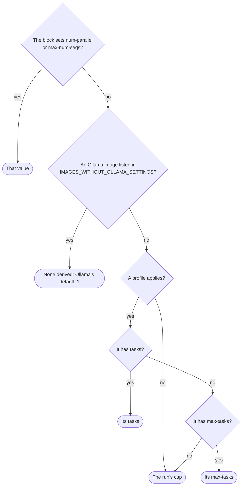
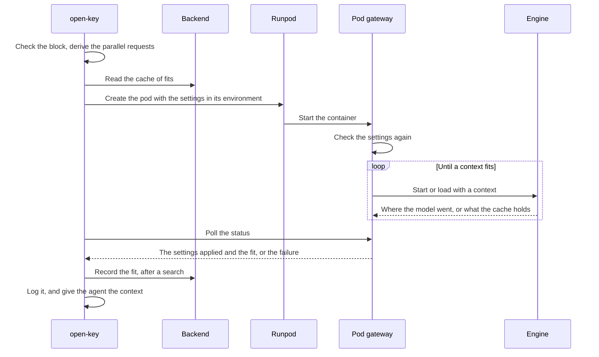

# Pod engines

A [pod](../glossary.md#pod) serves its model with an [engine](../glossary.md#engine), Ollama or vLLM, chosen with `engine`. This page holds what both engines share; [Ollama settings](ollama.md) and [vLLM settings](vllm.md) hold each engine's keys and how it fits the GPU.

## Choosing an engine

| | Ollama (`engine: ollama`, the default) | vLLM (`engine: vllm`) |
| --- | --- | --- |
| `model` | An Ollama name, such as `qwen3-coder:30b` | A Hugging Face ID of a public model, not gated, with safetensors weights, such as `unsloth/Qwen3.8-27B-NVFP4` |
| Block | `ollama:`, optional | `vllm:`, required for its `tool-call-parser` |
| Engine version | Ollama 0.35.1 | vLLM 0.31.0 |
| Parallel requests | `num-parallel`; some model families are served one request at a time | `max-num-seqs`; every family is batched |
| Context key | `context-length` | `max-model-len` |
| Host | Any CUDA version | CUDA 13.0 or newer |
| Checks before the pod is created | The pod image | The pod image, a host with CUDA 13.0 or newer with room, and the model on Hugging Face |
| Container disk | 80 GB | The model's weights with a quarter more, plus 40 GB; 80 GB at least |
| Start of a new pod | 2 to 4 minutes | About 6 to 9 minutes for a 27B model, and 2 to 3 more for each restart of the fit |
| Image | `codeman-ollama`, or the `pod-image` input's | `codeman-vllm`, always the pinned one |

Choose vLLM when several tasks share a pod and the model belongs to a family that Ollama serves one request at a time ([Ollama's parallel requests](ollama.md#parallel-requests)). Choose Ollama for faster starts and any host. [Self-hosted inference](../inference/self-hosted.md#choosing) compares pods with OpenRouter and Serverless.

## The block

The engine's block, `ollama:` or `vllm:`, tunes the engine. Each key becomes one of the engine's environment variables or arguments.

```yaml
provider: runpod-pod
model: qwen3-coder:30b
gpu: "NVIDIA RTX PRO 6000 Blackwell Server Edition"
ollama:
  num-parallel: 4
```

- **Where.** The block goes at the top level or in a [profile](profiles.md), on indented lines.
- **No braces.** `ollama: { num-parallel: 4 }` is outside the settings' YAML subset. Its error says: "the value of `ollama` is in braces, which the settings do not read: write each `name: value` on its own line, indented under `ollama:`."
- **A block, not a value.** `ollama: 4` stops the run: "`ollama` must be a block of Ollama's settings, one `name: value` per line, indented under it, such as `num-parallel: 4`." The `vllm` block has the same message, with `tool-call-parser: qwen3_xml` as its example.
- **Layers.** Each key is inherited like a provider setting: a [layer](../glossary.md#layer) or profile on the same provider and engine keeps the keys it inherits, and replaces those it sets. So an organization's `num-parallel` and a profile's `context-length` both apply.
- **Another provider or engine.** A layer or profile that names another provider drops the block. One that names another engine drops the other engine's block ([provider settings across layers](provider-settings-across-layers.md)).
- **Not from a task.** No `/codeman set` or workflow input sets the block's keys.
- **Pod settings.** The block, with its derived values, is part of the [pod settings](../glossary.md#pod-settings). Tasks with different engine settings never share a pod ([pods](../inference/pods.md)).

## Parallel requests

The [parallel requests](../glossary.md#parallel-requests) are how many requests the engine serves at once: `num-parallel` for Ollama, `max-num-seqs` for vLLM. Without the key, Codeman sets the most tasks the pod's profile serves in a run, so the tasks that share the pod do not wait for each other's requests.

| The profile has | Parallel requests |
| --- | --- |
| `tasks: N` | N |
| `max-tasks: M`, with or without `min-tasks` | M |
| `min-tasks` alone, or no count | The run's cap |
| No profile applies | The run's cap |

The run's cap is the largest `tasks` or `max-tasks` of the profiles, or 10 when a profile has `min-tasks` alone. It is 1 when no profile has a count ([how many tasks a run takes](profiles.md#how-many-tasks-a-run-takes)).



- **An explicit value wins** over the derived one.
- **Both are pod settings.** The derived value is part of the pod settings like an explicit one, so a profile of 4 tasks and one of 3 never share a pod.
- **They are the pod's capacity.** A pod takes a task only while it has room for its requests ([capacity](../glossary.md#capacity), [shared pods](../inference/pods.md#shared-pods)).
- **More requests wait.** Requests beyond them, such as those of another repository's tasks on the same pod, wait in the engine's queue, without error.
- **Older Ollama images derive nothing.** The images that cannot apply Ollama settings get no derived `num-parallel` ([Ollama's pod images](ollama.md#pod-images)).

**Example.** A repository has four pod profiles:

```yaml
profiles:
  - name: review
    tasks: 4
  - name: fix
    max-tasks: 3
  - name: bulk
    min-tasks: 2
  - name: misc
```

`bulk` has `min-tasks` alone, so the run's cap is 10.

| Profiles | Run's cap | `review` | `fix` | `bulk` | `misc` | Top level |
| --- | --- | --- | --- | --- | --- | --- |
| All four | 10 | 4 | 3 | 10 | 10 | 10 |
| `review` and `fix` only | 4 | 4 | 3 | — | — | 4 |

## Context and the GPU

A pod serves its model and its K/V cache wholly on the GPU, with the largest [context](../glossary.md#context) that fits there. The context and the parallel requests it fits with are its [fit](../glossary.md#fit).

- **The floor.** 64000 tokens, the least Ollama's docs recommend for agents and coding tools ([context length](../web/ollama/context-length.md)). A model whose own context is smaller gets its own.
- **The candidates.** The floor, every multiple of 4096 above it, and the model's own context, the largest.
- **With the context key** (`context-length` or `max-model-len`), the pod serves that context or fails to start.
- **Without it,** the pod's [gateway](../glossary.md#gateway) finds the largest candidate that fits: [Ollama's memory](ollama.md#memory), [vLLM's memory](vllm.md#memory).
- **The agent is told it.** The context served is the context length that `open-key` reports and the agent gets, so OpenCode compacts the conversation before it reaches it.

When the model does not fit, even at the floor, the pod's start fails:

1. The gateway reports the failure in its status, with what to change. It terminates itself 2 minutes later.
2. `open-key` stops the run with the gateway's message, in its log.
3. The pod is terminated. The tasks waiting for it fail too, rather than create another pod of the same settings.

To serve a larger context, or to fit at all:

| Lever | Ollama | vLLM |
| --- | --- | --- |
| Fewer parallel requests | `num-parallel`, or the profile's `tasks` or `max-tasks` | `max-num-seqs`, or the profile's `tasks` or `max-tasks` |
| A quantized K/V cache | `kv-cache-type: q8_0`: half the cache's memory, with some loss of precision | `kv-cache-dtype: fp8`: half the cache's memory |
| Skip a vision tower | — | `language-model-only: true`; the agent then reads text only ([images](#images)) |
| A GPU with more memory | `gpu` | `gpu` |

## Images

The agent reads images, such as the design stage's screenshots, only when Codeman knows its model can. `open-key` decides it on every run, a joined pod's included, logs why, and passes it to the agent job in the run's handle.

| Engine | The model reads images when |
| --- | --- |
| Ollama | The pod's gateway reports that Ollama's `/api/show` lists the model's `vision` capability ([show model details](../web/ollama/show-model-details.md)) |
| vLLM | The model's `config.json` on Hugging Face, at `main`, has a `vision_config` and does not set `language_model_only: true`, and the `vllm` block does not set `language-model-only: true` |

Otherwise the model reads text only: OpenCode replaces each image with an error saying the model cannot read it ([transform.ts](../web/opencode/opencode-packages-opencode-src-provider-transform-ts-at-545f51d.md)).

- **Why not always.** An image sent to a model that cannot read it would make the engine refuse the whole request.
- **When Codeman cannot tell,** such as when Hugging Face does not answer, the model reads text only and the run goes on.
- **Older gateways.** The gateways of pod images pinned before 2026-10-28, and of an older image given with the `pod-image` input, do not report it, so their Ollama models read text only. vLLM pods do not depend on the image.

> [!NOTE]
> Models on [Serverless](../inference/serverless.md) read text only: nothing tells whether an endpoint's worker serves its model's vision tower.

## Errors common to both blocks

Codeman checks each key and value before any pod is created, and stops the run naming the line.

| Problem | Ollama's message | vLLM's message |
| --- | --- | --- |
| An unknown key, a typo or another of the engine's options | "`ollama` does not accept `num-paralel`; it takes `context-length`, `num-parallel`, … and `load-timeout` (docs/settings/ollama.md)." | "`vllm` does not accept `max-num-seq`; it takes `max-model-len`, `max-num-seqs`, … and `async-scheduling` (docs/settings/vllm.md)." |
| A key written as the variable or the argument | "`ollama` takes its keys in kebab-case, without `OLLAMA_`: write `num-parallel`, not `OLLAMA_NUM_PARALLEL`." The same for `num_parallel` | "`vllm` takes its keys in kebab-case, without `--`: write `max-num-seqs`, not `max_num_seqs`." |
| A refused key | "`ollama` cannot set `host`: Codeman runs Ollama on the pod's loopback, where only its gateway reaches it." | "`vllm` cannot set `host`: Codeman serves the run's model on the pod's loopback, behind its gateway." |
| A value of the wrong type | "`ollama`'s `num-parallel` must be a whole number, at least 1." | "`vllm`'s `tool-call-parser` must be one of vLLM 0.31.0's, such as `qwen3_xml`, not `qwen4` (docs/settings/vllm.md)." |
| Another engine | "With `runpod-pod`, `ollama` configures the engine `ollama`, not `vllm`." | The same, with `vllm` |
| Another provider | "`runpod-serverless` does not accept `ollama`; besides `model`, it takes `engine` and `endpoint`." | "`runpod-serverless` does not accept `vllm`; …" |

Serverless endpoints keep their worker's own settings ([Serverless](../inference/serverless.md)). vLLM has more errors of its own ([vLLM's errors](vllm.md#errors)).

## Pod images

Codeman picks a pod's image by its engine: one image per engine, built from the same Dockerfile and gateway.

| Engine | Image | Size, compressed | `pod-image` input |
| --- | --- | --- | --- |
| Ollama | `ghcr.io/codenergy-dev/codeman-ollama` | 3.8 GB | Replaces it |
| vLLM | `ghcr.io/codenergy-dev/codeman-vllm` | 9.1 GB | Ignored: vLLM pods always run the pinned image |

- **Pinned.** Pods run the image pinned by digest in `POD_IMAGES` in [`src/inference/images.ts`](../../src/inference/images.ts), not the latest build ([pinned pod image](../glossary.md#pinned-pod-image)). Publishing and pinning are in [development](../development/guide.md#pod-images), and the images' contents in [dependencies](../development/dependencies.md#codemans-pod-images).
- **Pulled by each pod.** Each new pod pulls its own image, and Runpod bills the pull.
- **No pinned image.** A version of Codeman whose `POD_IMAGES` has no image for an engine stops that engine's runs in `open-key`, before any pod is created, at no cost ([vLLM's pod images](vllm.md#pod-images)). With `engine: ollama` and no `pod-image` input, a task that would create a pod stops with "No pod image is pinned; see docs/installation/runpod.md#pods."
- **Images that cannot apply Ollama settings** are in [Ollama's pod images](ollama.md#pod-images).

## The cache of fits

The [cache of fits](../glossary.md#cache-of-fits) keeps, in the [backend](../backend/data-layout.md), the context that fitted the same settings before. A pod that starts from it skips most of the search.

| | Ollama | vLLM |
| --- | --- | --- |
| Key | The image, the model, the GPU type, and the Ollama variables but `OLLAMA_CONTEXT_LENGTH`, the derived `num-parallel` included | The image, the model, the GPU type, the engine, and the vLLM settings but `max-model-len`, the derived `max-num-seqs` included |
| Read | By the task that creates a pod, without `context-length` | By the task that creates a pod, without `max-model-len` |
| Given to the pod | `CODEMAN_FIT`, with the model's digest | `CODEMAN_FIT` |
| Used | Only for the same model digest, and checked like any other try | As vLLM's first start, without auto-fit |
| Written | By the same task, after a search | By the same task, after a search |
| Replaced | When the cached context no longer fits: the pod searches again, and the task records the new one | The same |

When the cache cannot be read, `open-key` warns, and the pod searches for its context itself. When it cannot be written, `open-key` warns, and the next pod searches again.

## From settings to the pod



1. **`open-key` resolves the block.** It checks every key, derives the parallel requests, and hashes the pod settings ([pods](../inference/pods.md)).
2. **It reads the cache of fits**, when the task creates the pod.
3. **It creates the pod** with the settings in its environment:

   | Variable | Holds | Example |
   | --- | --- | --- |
   | `CODEMAN_ENGINE` | The engine | `vllm` |
   | `CODEMAN_OLLAMA` | The Ollama variables as JSON, the derived `num-parallel` included; only when there are some | `{"OLLAMA_NUM_PARALLEL":"4"}` |
   | `CODEMAN_VLLM` | The vLLM settings as JSON, by key, the derived `max-num-seqs` included | `{"max-num-seqs":"4","tool-call-parser":"qwen3_xml"}` |
   | `CODEMAN_GPU_MEMORY_GB` | The GPU type's memory, from Runpod's catalog; Ollama pods only | `96` |
   | `CODEMAN_FIT` | The cached context, from the cache of fits | `{"contextLength":131072}` |

4. **The gateway checks them again**, against the same list of keys. A pod terminates itself, saying why, when it cannot read them, or when its image serves another engine.
5. **The gateway starts the engine** on the pod's loopback with the settings, and Codeman's own settings on top. It logs the settings, such as "Ollama settings: OLLAMA_NUM_PARALLEL=4." or "vLLM settings: max-num-seqs=4, tool-call-parser=qwen3_xml."
6. **It fits the model** to the GPU, by each engine's rules ([Ollama](ollama.md#memory), [vLLM](vllm.md#memory)).
7. **It reports in its status** the settings it applied and the fit. `open-key` requires both, exactly as requested, or fails the run like a pod that did not serve.
8. **`open-key` logs the fit**, records it in the cache of fits when its task created the pod after a search, and gives the agent the context served.
