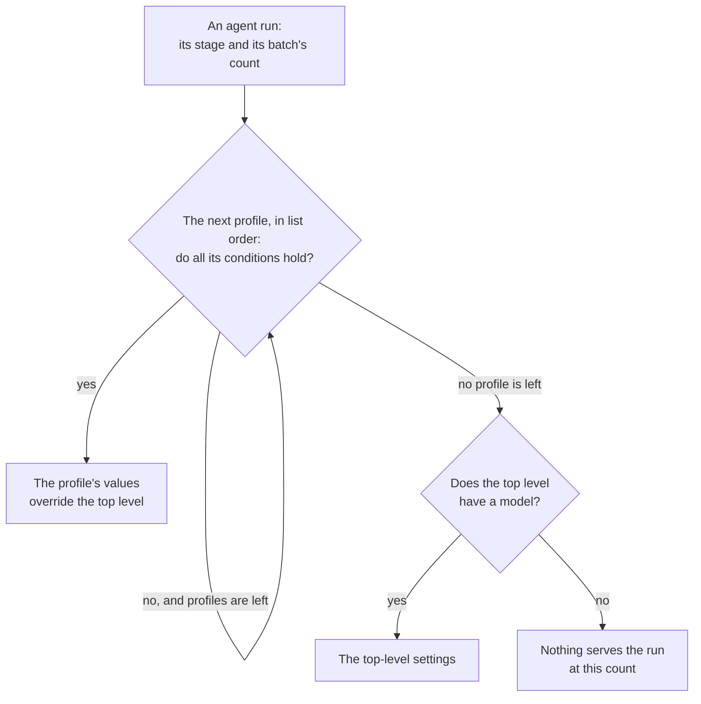

# Profiles

A [profile](../glossary.md#profile) gives some [agent runs](../glossary.md#agent-run) another provider, model or provider settings than the [top level's](../glossary.md#top-level). `profiles` is the list of them:

```yaml
model: deepseek/deepseek-v4.1-flash      # when no profile applies
profiles:
  - name: small-pod
    stages: [code, test]
    max-tasks: 2
    provider: runpod-pod
    gpu: "NVIDIA RTX A6000"
    model: qwen3-coder:30b
```

## What a profile sets

| Key | What it is |
| --- | --- |
| `name` | Required. 1 to 64 letters, digits, `.`, `_` or `-`, starting with a letter or a digit, and unique in the list |
| `stages`, `tasks`, `min-tasks`, `max-tasks` | Its [conditions](#conditions), all optional |
| `provider`, `model`, and the provider's settings | What it changes ([providers](providers.md)). A profile changes nothing else |

Any other setting in a profile stops the run with an error. Budgets and limits stay at the top level. The budgets count every agent run in the [ledger](../glossary.md#ledger), whatever profile served it ([budget](../budget/budget.md)).

## Conditions

A profile's [conditions](../glossary.md#profile-condition) sit at its first level, beside its `name`. A profile applies to an agent run when all its conditions hold:

| Condition | Holds when | Without it |
| --- | --- | --- |
| `stages` | The run's [stage](../tasks/stages.md) is one of the list: `plan` (planning), `route` (routing), `web`, `design`, `code`, `test` or `review` | Every stage |
| `tasks` | The batch's count is exactly this, from 1 to 10 | Any count |
| `min-tasks` | The batch's count is at least this, from 1 to 10 | No lower bound |
| `max-tasks` | The batch's count is at most this, from 1 to 10 | No upper bound |

- **The [count](../glossary.md#count)** is the size of the run's [batch](../glossary.md#batch): the tasks that run at once with the same resolved settings.
  - On a pod, a batch may take tasks of the [pool's](../glossary.md#pool-of-organizations) other repositories, which share the pod ([batches across repositories](../runs/batches.md)).
  - On OpenRouter and Serverless, it is the tasks of the [workflow run](../glossary.md#workflow-run) that take the profile.
  - Recording answers and accepting workflows are in no batch.
  - So a planning task on OpenRouter and three code tasks on a pod are two batches, of 1 and of 3.
- **`tasks` goes alone.** `min-tasks` and `max-tasks` go together, as a range, or apart. `tasks` with either, or `min-tasks` above `max-tasks`, stops the run with an error.
- **Only profiles have conditions.** The top level applies when no profile does, so a condition at the top level stops the run with an error that says to write it in a profile.
- **Old conditions.** `when` and `parallel-tasks` stop the run with an error that says what to write ([renamed and removed settings](reference.md#renamed-and-removed-settings)).

## Which applies



- `select` takes the first profile, in the list's order, whose conditions all hold for the run. Its values replace the top-level ones.
- With none, the top-level settings apply when they have a `model`.
- Runs without an agent, recording answers and accepting workflows, use the top-level settings, and need no model.
- **Put a profile without `stages` last.** It holds for every stage, so the profiles after it apply only at the counts where it does not.
- What a profile that names another provider than the top level's keeps of its provider settings is in [provider settings across layers](provider-settings-across-layers.md).
- The run's log names the profile, and the spend table's model and provider columns show what each run used.

## How many tasks a run takes

The profiles' counts also decide how many tasks a workflow run works on at once, each in its own jobs ([runs](../runs/runs-and-jobs.md#runs)). This is the run's **cap**: the largest number the table below gives for any profile, or 1 when no profile has a count.

| A profile has | It allows |
| --- | --- |
| `tasks: N` | N tasks |
| `max-tasks: M`, with or without `min-tasks` | M tasks |
| `min-tasks` without `max-tasks` | 10 tasks, Codeman's cap |

The run fills its cap in this order:

1. **Tasks without an agent.** Recording answers and accepting workflows come first, and take places of the cap. They are in no batch.
2. **Reserved tasks.** Tasks that another repository's batch reserved for this one, still ready for it ([reservations](../runs/batches.md#reservations)).
3. **Batches.** The other ready tasks, each with the settings it would run with, in the places left ([forming batches](../runs/batches.md#forming-batches)). On a pod, ready tasks of the pool's other repositories complete a batch too.

What happens to a ready task:

| When | The task | What the maintainer sees |
| --- | --- | --- |
| A batch takes it, within the cap | Runs | – |
| A batch would take it now, but the run has no place left | Is left for the next run | No message |
| No batch of a count that serves it can be completed | Waits. Every run checks it again. Waiting moves nothing, so it starts no other run | Its labels stay, and its panel says so, such as "Waiting for 4 tasks ready for profile `parallel-tasks`; 3 are, in 2 repositories." |
| Nothing serves its stage at any count: no profile does, and the top level has no `model` | Is blocked: `select` labels it `codeman:blocked` | Its panel names the stage |

To unblock a task, fix the settings, then comment `/codeman continue`. For a task never planned, remove the label instead.

`select`'s log says what it picked, of how many, which tasks wait and which are blocked.

On a pod, these counts also set the engine's [parallel requests](../glossary.md#parallel-requests), unless its settings give them ([Ollama](ollama.md#parallel-requests), [vLLM](vllm.md#parallel-requests)).

## Layers

Profiles follow the [layers](reference.md#layers):

- **The list is one value.** A layer that sets `profiles` overrides its base's list whole. So a repository's file with `profiles` replaces the organization's list, its counts too, and `profiles: []` removes it.
- **A profile's base is the top level**, a manual run's inputs included, and its values override it. So a manual run's `model` applies only to the runs whose profile sets none.
- **A task's `/codeman set model`** is for the top level's provider: it overrides the profiles on that provider, and a profile on another provider keeps its own model.
- **With no top-level model**, a task's `/codeman set model` gives the top level one for that task. It then serves the task's runs that no profile serves.
- **A task's `/codeman set gpu`** applies to the runs whose provider accepts it. When the task's `model` or `gpu` does not fit, see [the model](provider-settings-across-layers.md#the-model).

## Checks

No setting is required, at the top level or in a profile. The settings are checked as a whole, whichever stage runs, so a mistake stops the first run:

| Mistake | Error |
| --- | --- |
| A profile has no `model` and inherits none | "Profile `<name>` has no `model`, and the top-level settings have none to inherit: set one in the profile." |
| A profile names another provider than the top level's and sets no `model` | The error under [the model](provider-settings-across-layers.md#the-model). Neither a manual run's input nor a task's command makes up for it |
| The top level, or a profile with what it inherits, does not fit its provider on its own, without the task's commands | The provider's error, naming the profile when it is one |

A top level without a model serves no run, so only what its provider accepts is checked, not what it requires.

## Example

Planning on OpenRouter, and the other stages on Runpod pods: exactly 4 tasks on a full GPU, or up to 3 on a MIG partition of one. The top level sets no model: every stage has a profile. `src/settings.test.ts`, `src/tasks.test.ts` and `src/steps/flow.test.ts` read this example and assert what follows.

```yaml
task-budget: 2
monthly-budget: 20
profiles:
  - name: planner
    stages: [plan]
    model: deepseek/deepseek-v4.1-flash
  - name: parallel-tasks
    stages: [route, web, design, code, test, review]
    tasks: 4
    provider: runpod-pod
    gpu: "NVIDIA RTX PRO 6000 Blackwell Server Edition"
    model: qwen3-coder:30b
  - name: mig
    stages: [route, web, design, code, test, review]
    max-tasks: 3
    provider: runpod-pod
    gpu: "NVIDIA RTX PRO 6000 Blackwell Server Edition MIG 2g.48gb"
    model: qwen3-coder:30b
```

A run takes up to 4 tasks. Planning runs on OpenRouter whatever the count.

| Ready tasks | The run takes | Profile |
| --- | --- | --- |
| A planning task | It, in a batch of its own | `planner`, on OpenRouter |
| 4 or more past planning | 4, on one full-GPU pod | `parallel-tasks` |
| 1 to 3 past planning | All of them, on one MIG pod | `mig` |
| 1 planning task and 3 code tasks | All 4, in batches of 1 and 3 | `planner`, and `mig` for the code tasks |
| 2 past planning here, and 2 in another repository of the pool with the same profiles | Its 2, in a batch of 4 on one full-GPU pod, 2 in each repository's run | `parallel-tasks` |

With other settings:

| Settings | Ready tasks | Result |
| --- | --- | --- |
| Without `mig` | 3 past planning | They wait, each panel saying "Waiting for 4 tasks ready for profile `parallel-tasks`; 3 are, in 1 repository." |
| Without `review` in the pod profiles' stages | A task reaching review | It is blocked: no settings apply to the review stage |

## Where the choices were made

- The profiles: the [inference profiles plan](../plans/2026-10-06-parallel-tasks-and-inference-profiles.md), decisions 4 to 6.
- Their names: the [provider settings plan](../plans/2026-10-08-provider-settings.md).
- The conditions and counts: the [plan for profiles that pick the tasks](../plans/2026-10-08-profiles-pick-the-tasks.md).
- Counts as batches: the [plan for GPU batches across repositories](../plans/2026-10-13-gpu-batches-across-repositories.md).
