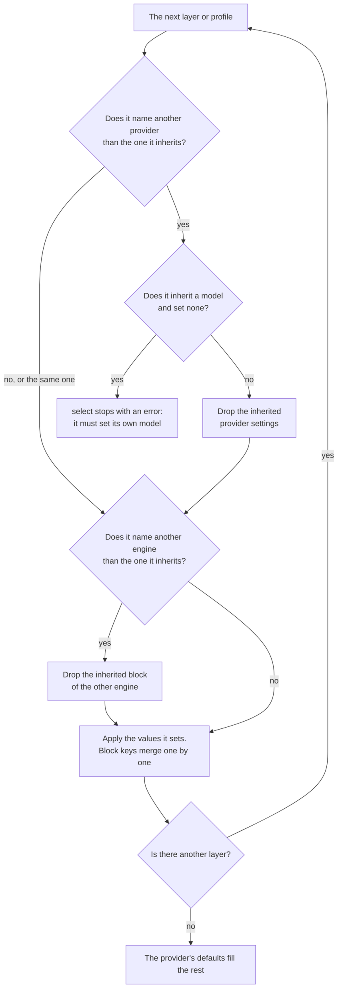

# Provider settings across layers

This page says what happens to a [provider's](../glossary.md#inference-provider) settings when a [layer](../glossary.md#layer) or a [profile](../glossary.md#profile) changes provider, with worked examples. The order of the layers is in [layers](reference.md#layers).

The provider settings are `engine`, `gpu`, `endpoint`, `pod-reuse`, and the keys of the `ollama` and `vllm` blocks ([providers](providers.md)).

## At a glance

| Where | Names a provider? | Inherited provider settings | Inherited `model` |
| --- | --- | --- | --- |
| The organization's settings, the repository's file, or a profile, without `provider` | No | Kept; those it sets replace them | Carries over, unless it sets one |
| The same, with the same provider as its base | Yes, the same | Kept; those it sets replace them | Carries over, unless it sets one |
| The same, with another provider | Yes, another | Dropped: only its own, then the new provider's defaults | Never carries over: it must set its own when it inherits one |
| A manual run's inputs | Cannot: there is no `provider` input | Kept | Its `model` replaces the top level's, not a profile's. It does not stand in for a layer's own |
| A task's `/codeman set` | Cannot: there is no `set provider` | Its `gpu` applies to the runs whose provider accepts it | For the top level's provider: it overrides the model of that provider's runs, profiles included. A profile on another provider keeps its own. See [the model](#the-model) |

## The rule

A provider's settings go with it. Budgets and limits are not provider settings, and never drop.



1. Each layer, then the run's profile, applies its values over its base, in the order of [layers](reference.md#layers). A profile's base is the [top level](../glossary.md#top-level).
2. A layer or profile that names another provider than the one it inherits starts with none of the inherited provider settings. It must set its own `model` ([the model](#the-model)).
3. One that names the same provider, or none, keeps them, and replaces only those it sets.
4. Each key of the `ollama` and `vllm` blocks counts as a setting of its own. A profile that sets `context-length` keeps the `num-parallel` it inherits ([Ollama settings](ollama.md#how-they-apply)).
5. A block configures one [engine](../glossary.md#engine). A layer or profile that names another `engine` than the one it inherits leaves out the inherited block of that engine. So a profile with `engine: vllm` on an organization's Ollama pods does not inherit its `ollama` keys ([vLLM settings](vllm.md#how-they-apply)).
6. Then the provider's defaults fill what is left: `engine`, and `pod-reuse: task`.

## The model

A model is set for one provider, and never reaches another.

### When a layer must set its own

A layer or profile that changes provider sets its own `model`. Otherwise the first run, whatever its stage, stops in `select`, before any key is opened or pod created. The error names the layer or profile:

```text
Profile `planner` names `openrouter`, but inherits `runpod-pod` from the top level, so it must set its own `model`, one for `openrouter`.
```

- A layer or profile that names no provider, or the same one, inherits `model`.
- **Only a model that would carry over counts.** Codeman's defaults have no model, so a change of provider that inherits no model needs none of its own. An organization can name `provider: runpod-pod` and leave the model to each repository.

### Which provider it inherits

The provider a layer or profile inherits is the one its base resolves to, and the error names where it comes from:

| The one that changes provider | Inherits its provider from |
| --- | --- |
| A profile | The top level |
| A layer | The last layer before it that names a provider, or Codeman's default `openrouter` when none does |

So a repository's file with `provider: runpod-pod`, whose organization's settings set only `model`, changes provider:

```text
.codeman/settings.yml names `runpod-pod`, but inherits `openrouter` from Codeman's default, so it must set its own `model`, one for `runpod-pod`.
```

### What does not make up for it

- **A manual run's `model` input**, since scheduled runs have none: the repository's file must set its own. The input replaces the top level's model, so it reaches the runs on the top level's provider.
- **A task's `/codeman set model`.** It is for the top level's provider: it overrides the model of the runs on that provider, profiles included. A profile on another provider keeps its own model.

A task's `/codeman set gpu` applies to the runs whose provider accepts it.

### When the task's settings do not fit

If either the task's `model` or its `gpu` does not fit, Codeman leaves out both:

- A `model` does not fit when it does not fit the top level's provider.
- A `gpu` does not fit when none of the settings' providers accepts it.

The run goes on with the other settings, and its comment reports the problem: "The task's settings were not applied: …", with the first error. So a valid `gpu` is lost with a `model` that does not fit, and the other way round.

## Why

- **No layer can unset a value it inherits.** `gpu:` with no value is an error: "`gpu` must be a GPU type, such as `NVIDIA RTX A6000`." Without the rule, a profile could not leave a provider whose settings the next one refuses.
- **Codeman checks a model's form only.** An OpenRouter ID such as `deepseek/deepseek-v4.1-flash` also has the form of an Ollama name and of a Hugging Face ID. A model carried from OpenRouter to a pod would pass the check, and fail only when the pod, already created and billed, pulls it.

## Examples

Every outcome and error below is asserted by `src/settings.test.ts` ("provider settings across layers").

### 1. A profile that switches provider

**Settings:**

```yaml
provider: runpod-pod
model: qwen3-coder:30b
gpu: "NVIDIA RTX A6000"
profiles:
  - name: serverless-review
    stages: [review]
    provider: runpod-serverless
    endpoint: abc123xyz
    model: Qwen/Qwen3-Coder-30B-A3B-Instruct
```

**Result:**

| Runs | Provider | Model | Provider settings |
| --- | --- | --- | --- |
| Review | `runpod-serverless` | `Qwen/Qwen3-Coder-30B-A3B-Instruct` | `endpoint: abc123xyz`, and `engine: vllm`, its default. No `gpu`, no `pod-reuse` |
| Every other | `runpod-pod` | `qwen3-coder:30b` | `gpu: "NVIDIA RTX A6000"`, and the defaults `pod-reuse: task` and `engine: ollama` |

**Without the rule:** the profile would inherit `gpu`, and every run would stop with an error that nothing in the profile could fix:

```text
Profile `serverless-review`: `runpod-serverless` does not accept `gpu`; besides `model`, it takes `engine` and `endpoint`.
```

### 2. A repository leaves the organization's pods

**Settings.** The organization's `CODEMAN_SETTINGS`:

```yaml
provider: runpod-pod
model: qwen3-coder:30b
gpu: "NVIDIA RTX A6000"
pod-reuse: run
task-budget: 1
```

The repository's `.codeman/settings.yml`:

```yaml
provider: openrouter
model: deepseek/deepseek-v4.1-flash
```

**Result:**

| Setting | Value |
| --- | --- |
| `provider` | `openrouter` |
| `model` | `deepseek/deepseek-v4.1-flash` |
| `gpu`, `pod-reuse` | Dropped |
| `task-budget` | `1`, the organization's: budgets never drop |

**If you get it wrong:** had the file set only `provider: openrouter`, the organization's model would carry over to another provider. The first run would stop with:

```text
.codeman/settings.yml names `openrouter`, but inherits `runpod-pod` from the organization's settings, so it must set its own `model`, one for `openrouter`.
```

### 3. No provider, or the same provider, keeps them

**Settings.** The same organization's settings as example 2, and a repository file with either:

- only `model: qwen2.5-coder:32b`;
- or `provider: runpod-pod` and that model.

**Result:** both run `runpod-pod` with `qwen2.5-coder:32b`, the organization's `gpu` and `pod-reuse: run`.

The same holds for profiles. **Settings:**

```yaml
provider: runpod-pod
model: qwen3-coder:30b
gpu: "NVIDIA RTX A6000"
pod-reuse: run
profiles:
  - name: bigger-gpu
    stages: [code]
    gpu: "NVIDIA H100 80GB HBM3"
  - name: other-model
    stages: [test]
    provider: runpod-pod
    model: qwen2.5-coder:32b
```

**Result:**

| Runs | Model | GPU | `pod-reuse` |
| --- | --- | --- | --- |
| Code | `qwen3-coder:30b` | `"NVIDIA H100 80GB HBM3"` | `run` |
| Test | `qwen2.5-coder:32b` | `"NVIDIA RTX A6000"` | `run` |

**If you get it wrong:** a profile that names another provider instead, without a `model`, stops the run, as in example 4.

### 4. A profile that changes provider sets its own model

**Settings:**

```yaml
provider: runpod-pod
model: qwen3-coder:30b
gpu: "NVIDIA RTX A6000"
profiles:
  - name: planner
    stages: [plan, route]
    provider: openrouter
```

**Result:** the profile changes provider without `model`, so the first run, whatever its stage, stops with:

```text
Profile `planner` names `openrouter`, but inherits `runpod-pod` from the top level, so it must set its own `model`, one for `openrouter`.
```

**The fix:** a `model` in the profile, such as `model: deepseek/deepseek-v4.1-flash`.

**The other way round:** the same holds for a profile on Runpod that inherits OpenRouter from the top level, though an OpenRouter ID would pass the Runpod engines' check of its form ([why](#why)).

## Where the choices were made

- The rule: the [provider settings plan](../plans/2026-10-08-provider-settings.md), choice 9.
- What it requires of `model`: the [model per provider plan](../plans/2026-10-08-model-per-provider.md).
- `serving` and `resolveRun` in [`src/settings.ts`](../../src/settings.ts) apply them.
