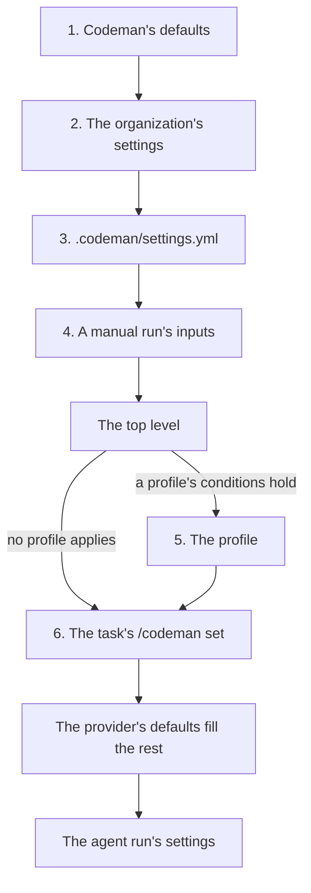

# Settings

This page lists every setting, where each one can be set, and which value wins when several [layers](../glossary.md#layer) set it.

## Layers

Settings come in **layers**. Each layer **inherits** from its **base**, which is what the layers before it resolve to, and may **override** any of its values:

- A value the layer sets replaces the base's.
- A value the layer does not set is the base's.

### The layers, in order



| # | Layer | Where it comes from | What it can set |
| --- | --- | --- | --- |
| 1 | Codeman's defaults | The Default column of the tables under [settings](#settings) | – |
| 2 | The [organization's settings](../glossary.md#organizations-settings) | The `settings` input of the `select` step. The template fills it from the `CODEMAN_SETTINGS` variable, in the file's format | Any setting. Only this layer sets `organization-monthly-budget` and `pool` |
| 3 | The repository's file | `.codeman/settings.yml` on the default branch | Any setting but those two |
| 4 | A manual run's inputs | The workflow's inputs, in a manual run only | Only `model`, `task-budget`, `monthly-budget` and `max-runs` |
| 5 | The [profile](../glossary.md#profile) | The [profile](profiles.md) that applies to the [agent run](../glossary.md#agent-run), if any | Only `provider`, `model` and the provider's settings |
| 6 | The task's commands | A `/codeman set` on the [task](../glossary.md#task), in the issue's description or in a comment | Only `model`, `task-budget`, `max-runs`, `language` and `gpu` |

[Where each setting can be set](#where-each-setting-can-be-set) gives the same, setting by setting.

Notes on the layers:

- **The organization's settings (2)** are defaults that several repositories share. An empty input, or one that an older workflow file does not pass, means none. See [shared settings](../installation/shared-settings.md).
- **A repository variable named `CODEMAN_SETTINGS`** replaces the organization's whole, not value by value, since GitHub gives it precedence.
- **Organization-only settings.** A repository's file or a profile that sets `organization-monthly-budget` or `pool` stops the run with an error. Neither a manual run's inputs nor a task's commands take them.
- **The profile (5).** Profiles also have conditions, which decide when each one applies and how many tasks a [workflow run](../glossary.md#workflow-run) takes.
- **Files-only settings.** `hosts` decides whose machines get the repository's code, so only the settings files set it, at the top level or in a profile. A manual run has no input for it, and `/codeman set hosts` is refused ([hosts](providers.md#hosts)).
- **The task's commands (6).** The description is read first, then the comments, and the last command for a setting wins ([commands](../tasks/commands.md)). What their `model` and `gpu` apply to, and what happens when one does not fit, is in [the model](provider-settings-across-layers.md#the-model).

### Which value wins

- A value comes from the **last** layer that sets it.
- The list of `profiles` is one value: a layer that sets it replaces its base's whole list ([profiles](profiles.md#layers)).
- A layer that names another [provider](../glossary.md#inference-provider) than the one it inherits keeps **none** of the inherited provider's settings ([provider settings across layers](provider-settings-across-layers.md)).

### The top level

The [**top level**](../glossary.md#top-level) is the settings outside `profiles`:

- **In a file:** its keys outside `profiles`.
- **For a run:** what layers 1 to 4 resolve to. This is each profile's base.

### Worked example

Three layers set values:

| Layer | Sets |
| --- | --- |
| The organization's settings | `task-budget: 1`, `monthly-budget: 50`, `language: pt-BR` |
| `.codeman/settings.yml` | `model: deepseek/deepseek-v4.1-flash`, `monthly-budget: 30` |
| `/codeman set task-budget 5` on the task | `task-budget: 5` |

The task's agent runs use:

| Setting | Value | From |
| --- | --- | --- |
| `task-budget` | `5` | The task's command |
| `monthly-budget` | `30` | The repository's file |
| `language` | `pt-BR` | The organization's settings |
| `model` | `deepseek/deepseek-v4.1-flash` | The repository's file |
| `provider` | `openrouter` | Codeman's defaults |
| `max-runs` | `3` | Codeman's defaults |

### Where each value came from

When `select` picks a task, its log has a line per layer, naming the values that come from it. For the worked example:

```text
Settings from the task's commands: task-budget=5.
Settings from .codeman/settings.yml: model=deepseek/deepseek-v4.1-flash, monthly-budget=30.
Settings from the `settings` input (organization variable CODEMAN_SETTINGS): language=pt-BR.
```

When a profile applies, another line names it, such as "Profile `planner` applies to this run." The values that no line names come from that profile, from the provider's defaults (`engine`, `pod-reuse`, `hosts`, `priority`) or from Codeman's defaults.

> [!NOTE]
> These lines show what each layer sets, not what the run uses. A provider setting that a change of provider drops is still listed under the layer that set it, such as the organization's `gpu` when a repository's file names `openrouter`.

## Settings

No setting is required. A provider may require some of its own settings ([providers](providers.md)).

### Model and provider

| Setting | Type | Default | Allowed values | Meaning |
| --- | --- | --- | --- | --- |
| `model` | Model ID | None | The provider's form, at most 100 characters ([providers](providers.md)) | The model of the agent runs. At the top level, the model of the runs no profile serves. Without one, only profiles serve agent runs, and each sets its own |
| `provider` | Choice | `openrouter` | `openrouter`, `runpod-pod`, `runpod-serverless`, `salad-pod` | Where agent runs get their model. Each provider accepts only its own settings ([providers](providers.md)) |
| `engine`, `gpu`, `endpoint`, `pod-reuse`, `ollama`, `vllm` | By provider | The provider's | The provider's | The provider's settings, accepted only by some providers. See [providers](providers.md), [Ollama settings](ollama.md) and [vLLM settings](vllm.md) |
| `hosts` | List of kinds | `[secure]` | `secure`, `community`, each once, by preference | The [kinds of host](providers.md#hosts) a pod may run on, on `runpod-pod` and `salad-pod`. Only the settings files set it |
| `priority` | Choice | The provider's highest | The provider's: `on-demand` on Runpod; `high`, `medium`, `low`, `batch` on Salad | A pod's [priority](providers.md#priority), on `runpod-pod` and `salad-pod` |
| `profiles` | List of profiles | None | See [profiles](profiles.md) | A provider, a model and that provider's settings for some agent runs, with conditions: the [stages](../glossary.md#stage) and the [batch's](../glossary.md#batch) [count](../glossary.md#count) of tasks. The counts also decide how many tasks a workflow run takes, one without them |
| `pool` | List of logins | None: the organization alone | 1 to 10 logins, each once in any case, this organization included | The organizations whose repositories batch tasks on shared pods, such as `[organization-a, organization-b]`. Only the organization's settings set it. See [pools](../runs/batches.md#pools) |

### Budgets

| Setting | Type | Default | Allowed values | Meaning |
| --- | --- | --- | --- | --- |
| `task-budget` | Number, USD | `2` | Above 0, decimals allowed | Spending limit of each task, across all its runs |
| `monthly-budget` | Number, USD | `20` | Above 0, decimals allowed | Spending limit of the repository per calendar month |
| `organization-monthly-budget` | Number, USD | None: no limit | Above 0, decimals allowed | Spending limit per calendar month of all the organization's repositories together, with the GPU accounts' billing. Only the organization's settings set it. See [budget](../budget/budget.md) |

### Run limits

| Setting | Type | Default | Allowed values | Meaning |
| --- | --- | --- | --- | --- |
| `max-runs` | Whole number | `3` | 1 or more | Two limits before a task is blocked, below |
| `max-files` | Whole number | `300` | 1 or more | Files one agent run may change |
| `max-file-bytes` | Whole number, bytes | `1048576` (1 MiB) | 1 or more | Size limit of each changed file |

`max-runs` bounds two counts, and each blocks the task when it reaches `max-runs`: by default, at the 3rd.

| It counts | A new count starts with |
| --- | --- |
| A [routed stage's](../glossary.md#routed-stage) agent runs in a row that end without finishing it: partial, or out of time | `/codeman fix` or `/codeman continue` |
| Review's rounds in a row asking for changes | `/codeman fix`, `/codeman continue`, or a review that passes |

### Agent time

| Setting | Type | Default | Allowed values | Meaning |
| --- | --- | --- | --- | --- |
| `agent-minutes` | Whole number, minutes | `50` | 5 to 300 | How long an agent run has before Codeman stops it |
| `wrap-up-minutes` | Whole number, minutes | `10` | `0`, or 2 to 30 | How long the wrap-up after a run that ran out of time has. `0` turns it off |

- Both may be set at the top level and in a [profile](profiles.md), so a slower model gets more time.
- The `agent` job's timeout is their sum plus 10 minutes, 340 at most, within GitHub's 360. The run's [budget reservation](../budget/budget.md#reservations) lasts an hour more.
- See [time limit](../runs/agent.md#time-limit).

### Concurrency

| Setting | Type | Default | Allowed values | Meaning |
| --- | --- | --- | --- | --- |
| `concurrency` | Whole number | `1` | 1 to 10 | How many [instances](../glossary.md#instance) of a profile, or of the top level, run at once: pods on `runpod-pod` and `salad-pod`, batches of runs on other providers |

- It may be set at the top level and in a [profile](profiles.md). A profile without it takes the top level's.
- Tasks beyond it wait for a seat. See [concurrency](profiles.md#concurrency).

### Agent output limits

| Setting | Type | Default | Allowed values | Meaning |
| --- | --- | --- | --- | --- |
| `max-decisions` | Whole number | `10` | 1 to 10 | Decisions in one output of the agent |
| `max-options` | Whole number | `4` | 2 to 6 | Options of each decision |
| `max-title-chars` | Whole number | `80` | 1 to 200 | Characters of a decision's title |
| `max-question-chars` | Whole number | `600` | 1 to 1,500 | Characters of a decision's question |
| `max-label-chars` | Whole number | `150` | 1 to 300 | Characters of an option's label |
| `max-summary-chars` | Whole number | `2000` | 1 to 4,000 | Characters of the agent's summary and reason |

These limits are what the agent is told. See [agent output](../runs/agent.md#agent-output) for the margin.

### Conversation

| Setting | Type | Default | Allowed values | Meaning |
| --- | --- | --- | --- | --- |
| `language` | Language tag | `auto` | `auto`, or a BCP 47 tag such as `pt-BR` | The language Codeman talks to [maintainers](../glossary.md#maintainer) in. `auto` uses the conversation's. See [conversation language](../tasks/comments.md#conversation-language) |

## Where each setting can be set

| Setting | Organization's settings | `.codeman/settings.yml` | Profile | Manual run's input | `/codeman set` |
| --- | --- | --- | --- | --- | --- |
| `model` | Yes | Yes | Yes | Yes | Yes, for the top level's provider |
| `provider`, `engine`, `endpoint`, `pod-reuse`, `priority`, `ollama`, `vllm` | Yes | Yes | Yes | No | No |
| `hosts` | Yes | Yes | Yes | No | No: refused, since it decides whose machines get the code |
| `gpu` | Yes | Yes | Yes | No | Yes, for the runs whose provider accepts it |
| `profiles` | Yes, the whole list | Yes, the whole list | Error | No | No |
| `task-budget`, `max-runs` | Yes | Yes | Error | Yes | Yes |
| `monthly-budget` | Yes | Yes | Error | Yes | No |
| `organization-monthly-budget`, `pool` | Yes | Error | Error | No | No |
| `language` | Yes | Yes | Error | No | Yes |
| `agent-minutes`, `wrap-up-minutes`, `concurrency` | Yes | Yes | Yes | No | No |
| `max-files`, `max-file-bytes`, the agent output limits | Yes | Yes | Error | No | No |

- **Error:** setting it there stops the run with an error.
- **No:** the workflow has no such input, or `/codeman set` reports it as an invalid command.

## The settings file

`.codeman/settings.yml` is a strict subset of YAML, read without a dependency ([`src/yaml.ts`](../../src/yaml.ts)). Whatever it accepts means the same in YAML. [`templates/settings.yml`](../../templates/settings.yml) is an example.

### What it accepts

- `name: value` lines.
- Block mappings, indented with spaces, for the profiles and the `ollama` and `vllm` blocks.
- Block lists, one `- item` per line, such as the list of profiles.
- Lists of values in brackets, such as `[code, test]`.
- Plain or quoted values.
- Comments and blank lines.

### What it rejects

- Flow mappings, such as `{...}`.
- Anchors and tags.
- Multi-line values.
- Indentation with tabs.
- A key that appears twice.

Anything it rejects stops the run with an error that names its line, so the file never means something other than what it looks like. The organization's settings follow the same rules, and their errors name the `settings` input instead of the file.

## Renamed and removed settings

- An old name of a setting stops the run with an error that gives the new one. [Upgrading](../installation/upgrading.md#old-setting-names) lists them.
- `parallel-tasks` and a profile's `when` are gone, replaced by the profiles' conditions. Their errors say what to write ([upgrading](../installation/upgrading.md#profiles-pick-the-tasks)).
