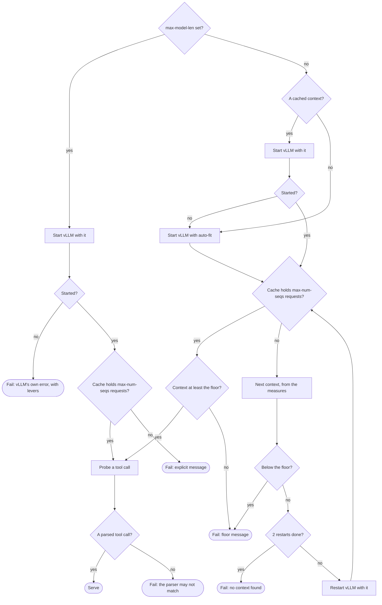

# vLLM settings

With `provider: runpod-pod` and `engine: vllm`, a [pod](../glossary.md#pod) serves a Hugging Face model with vLLM. A `vllm:` block tunes it: each key becomes one of `vllm serve`'s arguments, such as `max-num-seqs: 4` for `--max-num-seqs 4`.

```yaml
provider: runpod-pod
engine: vllm
model: unsloth/Qwen3.8-27B-NVFP4      # a Hugging Face ID
gpu: "NVIDIA RTX PRO 6000 Blackwell Server Edition"
vllm:
  tool-call-parser: qwen3_xml         # --tool-call-parser qwen3_xml; required
  reasoning-parser: qwen3
  kv-cache-dtype: fp8                 # half the K/V cache's memory
  speculative-method: mtp             # with speculative-tokens: --speculative-config
  speculative-tokens: 3
  language-model-only: true           # skips the vision tower, leaving its memory to the cache
```

- **Required.** The block needs `tool-call-parser` ([tool calls](#tool-calls)).
- **Without the other keys,** a pod serves as many requests at once as its profile's tasks, with the largest context that fits its GPU for them, wholly on the GPU. Otherwise its start fails, saying what to change.
- **Shared with Ollama:** where the block goes, how it is inherited, and how it reaches the pod, in [pod engines](pod-engines.md). That page also compares the two [engines](../glossary.md#engine).

The choices were made in the [plan for vLLM on pods](../plans/2026-10-13-vllm-on-pods.md).

## Accepted keys

Only these keys, taken from `vllm serve` of vLLM 0.31.0, the version in Codeman's vLLM pod image ([arg_utils.py](../web/vllm/vllm-engine-arg-utils-py-at-v0-31-0.md), [cli_args.py](../web/vllm/vllm-entrypoints-launchers-cli-args-py-at-v0-31-0.md), [cache.py](../web/vllm/vllm-config-cache-py-at-v0-31-0.md), [speculative.py](../web/vllm/vllm-config-speculative-py-at-v0-31-0.md)). `src/inference/vllm.test.ts` checks this table against `VLLM_SETTINGS` in [`src/inference/vllm.ts`](../../src/inference/vllm.ts).

| Key | Argument | Value | vLLM's default | Without the key |
| --- | --- | --- | --- | --- |
| `max-model-len` | `--max-model-len` | Whole number, at least 1 | The model's own | The largest that fits the GPU for `max-num-seqs` requests ([memory](#memory)) |
| `max-num-seqs` | `--max-num-seqs` | Whole number, at least 1 | 256 or 1024, by the GPU's memory | The most tasks the profile serves ([parallel requests](#parallel-requests)) |
| `gpu-memory-utilization` | `--gpu-memory-utilization` | Number above 0, at most 1 | 0.92 | vLLM's: the share of the GPU's memory it may use |
| `kv-cache-dtype` | `--kv-cache-dtype` | `auto`, `bfloat16`, `float16`, `fp8`, `fp8_e4m3` or `fp8_e5m2` | `auto`, the model's | vLLM's; `fp8` halves the cache's memory ([quantized K/V cache](../web/vllm/quantized-kv-cache.md)) |
| `enable-prefix-caching` | `--enable-prefix-caching` | `true` or `false` | `true` | vLLM's: reuses the cache of a prompt's prefix across requests |
| `max-num-batched-tokens` | `--max-num-batched-tokens` | Whole number, at least 1 | 2048 to 16384, by the GPU's memory | vLLM's |
| `tool-call-parser` | `--tool-call-parser` | One of vLLM 0.31.0's tool call parsers | None | Required ([tool calls](#tool-calls)) |
| `reasoning-parser` | `--reasoning-parser` | One of vLLM 0.31.0's reasoning parsers | None | None: the model's reasoning stays in its answer |
| `speculative-method` | `--speculative-config` | `mtp`, `ngram`, `eagle3`, `dflash`, `dspark` or `draft_model` | None | No speculative decoding |
| `speculative-tokens` | `--speculative-config` | Whole number, at least 1 | None | Required with `speculative-method` |
| `speculative-model` | `--speculative-config` | A Hugging Face model ID | None | Required with `eagle3`, `dflash`, `dspark` and `draft_model`, refused with `mtp` and `ngram` |
| `language-model-only` | `--language-model-only` | `true` or `false` | `false` | vLLM's; `true` skips a multimodal model's vision tower |
| `enforce-eager` | `--enforce-eager` | `true` or `false` | `false` | vLLM's ([starting](#starting)) |
| `async-scheduling` | `--async-scheduling` | `true` or `false` | Decided by vLLM | vLLM's |

### Booleans

A boolean key becomes `--key` or `--no-key`.

### Speculative decoding

The settings file holds no JSON, so the three `speculative-*` keys make one `--speculative-config`, such as `{"method":"mtp","num_speculative_tokens":3}`.

- `custom_class`, which loads code, is not offered.
- MTP needs its tokens given explicitly. vLLM's recipe for Qwen3.8-27B uses 3 ([MTP](../web/vllm/mtp-multi-token-prediction.md), [recipe](../web/vllm/models-qwen-qwen3-8-27b-yaml-at-d0f2838.md)).

### Parsers

`VLLM_TOOL_PARSERS` and `VLLM_REASONING_PARSERS` list those of vLLM 0.31.0 ([tool parsers](../web/vllm/vllm-tool-parsers-init-py-at-v0-31-0.md), [reasoning parsers](../web/vllm/vllm-reasoning-init-py-at-v0-31-0.md)). A test checks them against the recorded source.

> [!NOTE]
> For Qwen3 models, use `tool-call-parser: qwen3_xml`, which is the same as `qwen3_coder`, and `reasoning-parser: qwen3`.

## Refused keys

Codeman controls these, so setting them stops the run with the reason. Every `ssl-*` argument is refused like `ssl-keyfile`.

| Key | Why |
| --- | --- |
| `host`, `port`, `uds`, `api-key`, `served-model-name`, `model` | Codeman serves the run's model on the pod's loopback, behind its gateway |
| `enable-auto-tool-choice` | Codeman always turns it on: its agents work through tool calls |
| `allowed-origins`, `ssl-keyfile`, `root-path` | Only Codeman's gateway calls vLLM, from the pod's loopback |
| `middleware`, `tool-parser-plugin`, `reasoning-parser-plugin`, `chat-template` | It loads code or files that Codeman does not ship in the pod image |
| `trust-remote-code` | It runs the model repository's code beside the runs' requests |
| `download-dir`, `load-format`, `hf-token` | Codeman has vLLM download public models from Hugging Face, onto the pod's disk |
| `tensor-parallel-size`, `pipeline-parallel-size`, `data-parallel-size` | A pod has one GPU |
| `cpu-offload-gb`, `kv-offloading-size`, `kv-offloading-backend` | It moves weights or the cache off the GPU, which runs much slower |
| `kv-transfer-config`, `kv-events-config`, `otlp-traces-endpoint` | It sends the runs' data, with the repository's code in it, off the pod |
| `enable-log-requests`, `enable-log-outputs` | It writes the runs' requests, with the repository's code in them, to the pod's log |

## Errors

Codeman checks each key and value, and the block as a whole once the layers are resolved. It stops the run, naming the line or the profile, before any pod is created.

The errors that Ollama's block shares, such as an unknown key, are in [errors common to both blocks](pod-engines.md#errors-common-to-both-blocks). These are vLLM's own:

| Problem | Message |
| --- | --- |
| `speculative-config` written as a key | It says to write the three `speculative-*` keys |
| `speculative-tokens` or `speculative-model` without a method | "`vllm`'s `speculative-tokens` and `speculative-model` go with `speculative-method`." |
| A method without its tokens | "`vllm`'s `speculative-method` needs `speculative-tokens`, the tokens drafted per step, such as `3`." |
| `eagle3`, `dflash`, `dspark` or `draft_model` without a draft model | "`vllm`'s `speculative-method: eagle3` needs `speculative-model`, its draft model's Hugging Face ID." |
| `mtp` or `ngram` with a draft model | "`vllm`'s `speculative-method: mtp` takes no `speculative-model`." |
| No parser | "`vllm` needs `tool-call-parser`, the one that matches the model, such as `qwen3_xml` for Qwen3 models; see the model's card or vLLM's recipe for it (docs/settings/vllm.md)." |
| Not a Hugging Face ID | "With `runpod-pod` and the engine `vllm`, `model` must be a Hugging Face model ID, `namespace/name`, such as `Qwen/Qwen3-Coder-30B-A3B-Instruct`, not `Qwen3-8B`." |

## How they apply

1. **Layers.** Each key is inherited like a provider setting, as `ollama:`'s are. A layer that names another provider drops the block, and one that names another engine drops the other engine's block ([the block](pod-engines.md#the-block)).
2. **Pods.** The engine and the settings, the derived `max-num-seqs` included, are part of the [pod settings](../glossary.md#pod-settings). So tasks with different vLLM settings never share a pod ([pods](../inference/pods.md)).
3. **The pod.** Codeman creates it with `CODEMAN_ENGINE=vllm` and `CODEMAN_VLLM`, the settings as JSON by key, such as `{"max-num-seqs":"4","tool-call-parser":"qwen3_xml"}` ([from settings to the pod](pod-engines.md#from-settings-to-the-pod)).
4. **The gateway.** It checks the settings against the same list, and logs them ("vLLM settings: max-num-seqs=4, tool-call-parser=qwen3_xml."). A pod whose `CODEMAN_VLLM` it cannot read, or whose image serves another engine, terminates itself, saying why.
5. **vLLM's command.** The gateway starts vLLM on the pod's loopback, with the settings as arguments, and the context it serves ([memory](#memory)):

   ```text
   vllm serve <model> --host 127.0.0.1 --port 8000 --served-model-name <model> \
     --enable-auto-tool-choice <the settings as arguments> --max-model-len <context, or auto>
   ```

6. **vLLM's environment.** It has `VLLM_NO_USAGE_STATS=1` and `DO_NOT_TRACK=1`, and not the pod's Runpod key. `CUDA_VISIBLE_DEVICES` becomes `0` when it held a MIG partition's UUID, on which vLLM 0.31.0 fails to start.
7. **The status.** The gateway reports the settings it applied (`vllm`) and how it served the model (`fit`). `open-key` requires both, exactly as requested, or fails the run like a pod that did not serve.

## Parallel requests

Without `max-num-seqs`, a pod's vLLM serves as many requests at once as the most tasks its profile serves in a run. The rule, the same as Ollama's `num-parallel`, is in [pod engines](pod-engines.md#parallel-requests). An explicit `max-num-seqs` wins. vLLM batches the requests whatever the model's family, and more requests wait in vLLM's queue, without error.

## Memory

At its start, vLLM sizes its K/V cache from the GPU's memory left after the model, within `gpu-memory-utilization`.

- **It refuses to start**, naming the largest context that would fit, when the cache cannot hold **one** request of `max-model-len` tokens.
- **It never moves the model or its cache to the CPU** unless told to, which Codeman refuses ([kv_cache_utils.py](../web/vllm/vllm-v1-core-kv-cache-utils-py-at-v0-31-0.md)).
- **It reports what its cache holds.** On `/metrics`, it gives the cache's tokens and how many requests of `max-model-len` it holds at once ([loggers.py](../web/vllm/vllm-v1-metrics-loggers-py-at-v0-31-0.md)).

The gateway reads these, with the served context from `GET /v1/models` ([`src/gateway/vllm.ts`](../../src/gateway/vllm.ts)). The context it serves is the one vLLM reports. The floor and what a failed start does are in [context and the GPU](pod-engines.md#context-and-the-gpu).



### With `max-model-len`

vLLM starts with it. The pod serves it only when the cache holds `max-num-seqs` requests of it. Otherwise the start fails ([when it fails](#when-it-fails)).

### Without `max-model-len`

1. **The first start.** The gateway starts vLLM with the cached context of the same settings ([the cache of fits](pod-engines.md#the-cache-of-fits)). Without one, it uses vLLM's auto-fit (`--max-model-len auto`): the largest context whose cache holds one request, up to the model's own.
2. **When the cache holds `max-num-seqs` requests** of that context, the pod serves it.
3. **Otherwise, the first restart** takes the largest multiple of 4096 tokens that the cache's tokens hold `max-num-seqs` times.
4. **The second restart**, should a hybrid model's fixed state per request leave it still short, takes its context from the line through both measures.
5. **When the cache still holds fewer** after those two restarts, the pod's start fails.

Each restart takes a context at least 4096 tokens below the last one. A next context below the floor fails the start too.

```text
target₁ = ⌊ cache tokens ÷ n ÷ 4096 ⌋ × 4096
target₂ = ⌊ (1/n − b) ÷ a ÷ 4096 ⌋ × 4096,  where 1/holds = a × context + b through the last two starts
each target ≤ the last context − 4096
```

Here `n` is `max-num-seqs`, and *holds* is how many requests of a context the cache holds at once. So a fit takes at most 3 starts, or 4 when the cached context did not start.

**The cached context.** The gateway starts vLLM with it, without auto-fit:

1. When it starts and its cache holds `max-num-seqs` requests, the pod serves it.
2. When it starts but its cache holds fewer, the gateway restarts vLLM with smaller contexts, as after auto-fit. The model's own context stays unknown, so the floor is 64000 even for a model whose own is smaller, and `open-key`'s log leaves out "(the model's own is …)".
3. When vLLM refuses it, the gateway fits again from auto-fit.

**Example**, with illustrative figures: 3 parallel requests, a model whose own context is 262144 tokens, and a cache of 500000 tokens.

| Start | Context | The cache holds | Next |
| --- | --- | --- | --- |
| 1 | Auto-fit: 262144, the model's own | 1.91 requests | ⌊500000 ÷ 3 ÷ 4096⌋ × 4096 = 163840 |
| 2 | 163840 | 2.80 requests, for a hybrid model | The line through both starts gives 149775, so 147456 |
| 3 | 147456 | 3 or more: the pod serves it. Fewer: the start fails, with the floor message when the next context would be below the floor, else with no context found in 3 starts | — |

### When it fails

| When | Message |
| --- | --- |
| vLLM refuses an explicit `max-model-len` | "vLLM did not start `<model>` with a context of 262144 tokens: ValueError: To serve at least one request … Lower `max-model-len` in the `vllm` settings, set `kv-cache-dtype: fp8` or `language-model-only: true`, or use a GPU with more memory." |
| vLLM does not start with auto-fit, or with a restart's context | "vLLM did not start `<model>`: …", with vLLM's own error, or "with a context of `<N>` tokens" for a restart |
| The cache holds fewer than `max-num-seqs` requests of an explicit `max-model-len` | "`<model>` does not fit the GPU with 3 parallel requests and a context of 262144 tokens: vLLM's K/V cache holds 1.91 of them (500000 tokens). Lower `max-model-len` or `max-num-seqs` …" |
| The next context is below the floor, or vLLM serves less than it | "`<model>` does not fit the GPU with 10 parallel requests and a context of 64000 tokens, the least Codeman gives an agent: with a context of 262144 tokens, vLLM's K/V cache holds 0.76 of them (200000 tokens). Give the profile fewer tasks (`tasks` or `max-tasks`) or set a smaller `max-num-seqs`, set `kv-cache-dtype: fp8` or `language-model-only: true` in the `vllm` settings, or use a GPU with more memory." |
| Two restarts still fall short | "vLLM found no context of `<model>` for 4 parallel requests in 3 starts: with a context of 98304 tokens, vLLM's K/V cache holds 3.20 of them (314572 tokens). Set `max-model-len` in the `vllm` settings, give the profile fewer tasks, or use a GPU with more memory." |

### What the run shows

| Where | Example |
| --- | --- |
| The gateway, at each start | "vLLM serves `<model>` after 312 s, with a context of 131072 tokens: its K/V cache holds 4.50 requests of it (589824 tokens)." |
| `open-key`, the result | "Pod … serves `<model>` with vLLM, 4 parallel request(s) and a context of 131072 tokens (the model's own is 262144), wholly on the GPU: …; found in 2 start(s). Its tool calls work with the parser qwen3_xml." |

The fit report counts vLLM's starts as `loads`, as it counts Ollama's loads. The pod's `context-length`, which the agent is told, is the context served.

## Tool calls

Codeman's agents work through tool calls. vLLM returns them only with `--enable-auto-tool-choice` and the parser that matches the model's format ([tool calling](../web/vllm/tool-calling.md)). vLLM does not pick a parser from the model.

1. **The parser is required.** So `tool-call-parser` is required, and the gateway always turns tool calls on.
2. **The gateway probes it.** Once vLLM serves, the gateway sends a chat request offering a `ping` tool and asking for it.
3. **Two tries.** Without a parsed tool call after two tries, the pod's start fails: "vLLM did not return a tool call with the parser `<parser>`: it may not match `<model>` (…). Set the `tool-call-parser` that the model's card or vLLM's recipe gives in the `vllm` settings."

`reasoning-parser` is optional and not probed ([reasoning outputs](../web/vllm/reasoning-outputs.md)).

## Before the pod is created

Before creating a vLLM pod, `open-key` checks the GPU's hosts, then the model. Either check stops the run before paying for anything. Joining a pod checks nothing.

### CUDA

vLLM 0.31.0's image is built with CUDA 13.0, and fails on a host whose driver is older (CUDA's error 804). So a vLLM pod is created with `minCudaVersion` 13.0 (`VLLM_MIN_CUDA`). Before creating it, `open-key` reads which CUDA versions the GPU type's hosts offer pods on Secure Cloud, and whether they have room ([get a GPU type](../web/runpod/get-a-gpu-type.md)). This check runs before the [model's](#the-model).

| When | Message |
| --- | --- |
| No host of the GPU type offers CUDA 13.0 or newer | "Runpod offers no host with `<gpu>` and CUDA 13.0 or newer, which vLLM's image needs, so no pod was created: use another GPU type, or `engine: ollama`." |
| None of those hosts has room | "No host with `<gpu>` and CUDA 13.0 or newer has room now (Runpod offers 13.0, 13.1), which vLLM's image needs, so no pod was created: try again later, or use another GPU type." |

`open-key` logs the host's CUDA version once the pod runs. Ollama pods take any host.

### The model

A pod's model is a Hugging Face ID, which vLLM downloads in the pod. `open-key` asks Hugging Face's API for it, and for a `speculative-model`, without a token (`GET https://huggingface.co/api/models/<id>?blobs=true`, [hf_api.py](../web/hugging-face/src-huggingface-hub-hf-api-py-at-v2-2-0.md)). Gated and private models need a token, which Codeman does not hold.

| When | Message |
| --- | --- |
| The model is missing or private | "Hugging Face has no public model `<id>`: check its ID, whose case counts. Codeman serves only public models, without a token." |
| It is gated | "`<id>` is gated on Hugging Face: its files need an accepted request and a token, which Codeman does not use. Choose a model that is not gated, such as a copy of it by another publisher." |
| It is disabled | "`<id>` is disabled on Hugging Face." |
| It has no safetensors weights | "`<id>` has no safetensors weights on Hugging Face, which vLLM loads: choose a version of the model in safetensors, not GGUF nor PyTorch's pickles." |

The weights' size, with a `speculative-model`'s, sets the pod's container disk:

```text
disk GB = max(80, ⌈ weights GB × 1.25 + 40 ⌉)
```

The 40 GB are for vLLM's image, unpacked, and its caches.

## Pod images

vLLM pods always run the vLLM image pinned in `POD_IMAGES`; the `pod-image` input overrides the Ollama image only ([pod images](pod-engines.md#pod-images)). A version of Codeman that pins no vLLM image stops runs with `engine: vllm` in `open-key`, before any pod is created, at no cost:

> "This version of Codeman pins no vLLM pod image yet (`POD_IMAGES` in src/inference/images.ts), so no pod was created: use a version that pins one, or `engine: ollama`."

Publishing and pinning are in [development](../development/guide.md#pod-images).

## Starting

A new vLLM pod starts vLLM's processes, downloads the model, loads it, compiles it and captures CUDA graphs, then starts its server. vLLM's own log, in the pod's, times each phase.

| Phase | Time |
| --- | --- |
| Pull the image, on a host without it | 2 to 4 minutes |
| Compile the model and capture CUDA graphs | 2 to 2.5 minutes |
| In all, before the first request | About 6 to 9 minutes, against 2 to 4 for Ollama |
| Each restart the fit needs, the first time | 2 to 3 minutes more |

- **`enforce-eager: true`** skips the compilation and the graphs, for 1.5 to 2 minutes less per start, at the cost of slower decoding for every request ([optimization levels](../web/vllm/optimization-levels.md)). Pods are kept and shared, so starts are rarer than requests.
- **Nothing is cached across pods**, neither the model nor the compilation.
- **A new context compiles again**, so a pod that starts from the cache of fits saves the restarts' minutes.
