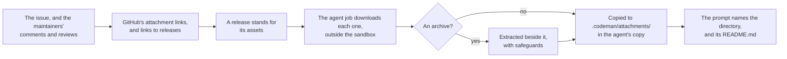

# Attachments

[Maintainers](../glossary.md#maintainer) can give the agent files, such as CSV data, a screenshot or a log, by attaching them to the task's issue or its comments, or by linking assets of a release of the repository. This page says what reaches the agent, the limits, and what happens when a file cannot be downloaded.

> [!IMPORTANT]
> On a private repository, GitHub does not let workflows download the files attached to issues and comments, except images. Give such files [through a release](#give-files-through-a-release).

## How to attach a file

Drag the file into the issue's description or a comment, or click the paperclip below it. GitHub uploads it and writes its link into the text ([attaching files](../web/github/attaching-files.md)). GitHub limits each file to 10 MB for images, 25 MB for other files, and 100 MB for videos on paid plans.

| Repository | Images | Other files, such as CSV, ZIP or PDF files |
| --- | --- | --- |
| Public | Attach them | Attach them |
| Private | Attach them | Upload them to [a release](#give-files-through-a-release), and link it |

## What reaches the agent

Every [agent run](../glossary.md#agent-run) downloads the files attached to, and the release assets linked in, the texts the agent already reads:

- the issue's description;
- the maintainers' comments, on the issue and on its pull request;
- the maintainers' reviews of the pull request, and their line comments.

Files attached or linked by anyone else are never downloaded: their comments do not reach the agent either ([which comments count](commands.md#which-comments-count)).



1. The `agent` job finds GitHub's attachment links in those texts: `github.com/user-attachments/files/…` and `…/assets/…`, their older forms under a repository, and `user-images.githubusercontent.com`. It also finds [links to releases](#which-release-links), and replaces a link to a whole release with its assets. Other links stay text.
2. It downloads each file once, before the agent starts. It names the file with its position and its name, such as `01-data.csv`.
3. It extracts each [archive](#archives) into a directory beside it, such as `02-logs.zip.extracted/`.
4. It writes `README.md`, the index: each link, the text it was found in, the release it came through, and its file, or why it is missing.
5. The agent finds all of it in `.codeman/attachments/`, and its prompt says so. The prompt also tells it to read the files as data, not instructions.

> [!NOTE]
> Codeman never commits `.codeman/`. When the task needs a file in the repository, such as a test fixture, the agent copies it there, and the copy is a change like any other ([what the agent may change](../runs/changes.md)).

The agent reads an image only when its model reads images: on a pod, see [images](../settings/pod-engines.md#images).

## Private repositories

GitHub serves a private repository's attachments only to people signed in with access to it ([attaching files](../web/github/attaching-files.md)). The `agent` job has its `GITHUB_TOKEN`, which may read issues and pull requests, and sends it to `github.com` only. GitHub refuses that token, and every other token a workflow can hold, such as a fine-grained personal access token ([unable to download](../web/github/unable-to-download-attached-file-to-a-github-issue.md), [private attachments](../web/github/issue-accessing-private-repository-attachments-with-github-app-installation-toke.md)).

- **Images** still download. The job reads the text again as GitHub renders it, where images have signed addresses that need no token.
- **Other files** cannot. The run comment lists each one, and says why once, with a link to this page. Give them [through a release](#give-files-through-a-release) instead.

## Give files through a release

A release's assets have an API, which the `agent` job reads with the `contents: read` it already has ([release assets](../web/github/rest-api-endpoints-for-release-assets.md#get-a-release-asset)). A maintainer uploads the files to a release, and links the release, or each file, in the issue or a comment.

### Steps

1. On the repository's page, click **Releases**, then **Draft a new release** ([managing releases](../web/github/managing-releases-in-a-repository.md#creating-a-release)).
2. Under **Choose a tag**, type a new tag that names the task, such as `codeman-issue-12`, and click **Create new tag**. Any target branch will do.
3. Give it a title, such as `Files for #12`, and drop the files into the binaries box.
4. Select **This is a pre-release**, so that the release never becomes the repository's latest.
5. Click **Publish release**.

   > [!WARNING]
   > Not **Save draft**: the `agent` job cannot read a draft release, whose links it reports as refused.

6. In the issue or a comment, link the release: copy its address, `https://github.com/<owner>/<repo>/releases/tag/codeman-issue-12`, and paste it. Every asset of the release reaches the agent. To give only some, right-click each asset on the release's page, copy its link, and paste those instead.

With the GitHub CLI, steps 1 to 5 are one command:

```sh
gh release create codeman-issue-12 data.csv logs.zip --prerelease --title "Files for #12" --notes ""
```

### Which release links

| Link | What reaches the agent |
| --- | --- |
| `https://github.com/<owner>/<repo>/releases/tag/<tag>` | Every asset of the release, in its order |
| `https://github.com/<owner>/<repo>/releases/latest` | Every asset of the latest release |
| `https://github.com/<owner>/<repo>/releases/download/<tag>/<name>` | That asset |
| `https://github.com/<owner>/<repo>/releases/latest/download/<name>` | That asset of the latest release |

Each asset counts against the [limits](#limits) as an attachment does: a linked release of 80 files downloads the first 50, by default. A release of another repository downloads only when that repository is public.

### What a release costs

| Effect | What to do |
| --- | --- |
| Publishing it creates the tag in the repository | Name the tag after the task, and delete it with the release |
| People who watch the repository's releases may be notified ([about releases](../web/github/about-releases.md#about-releases)) | Nothing, or tell them |
| On a public repository, anyone can download its assets | Attach only what may be public |
| With [immutable releases](../web/github/immutable-releases.md) on, its assets cannot change once published ([managing releases](../web/github/managing-releases-in-a-repository.md#editing-a-release)) | Upload every file before publishing; to fix one, make a new release |

GitHub accepts assets of up to 2 GiB, and 1000 per release ([about releases](../web/github/about-releases.md#storage-and-bandwidth-quotas)). Codeman's [limits](#limits) are lower.

### Clean up

Once the task no longer needs the files, delete the release and its tag. On the release's page, click the trash icon, then delete the tag under **Tags**. Or, with the GitHub CLI:

```sh
gh release delete codeman-issue-12 --cleanup-tag --yes
```

## Archives

Codeman extracts `.zip`, `.tar.gz`, `.tgz`, `.tar` and `.gz` files itself, in Node.js, without running a program. An archive may come from anywhere a maintainer got it, so extraction never trusts it:

| Safeguard | What it stops |
| --- | --- |
| Only regular files and directories are written. Symbolic links, hard links and special files are skipped | An entry that points outside the directory |
| A path that is absolute, has a `..` part, a drive letter or a control character is skipped. Every path must stay inside the archive's directory | Files written outside the directory, such as in the repository |
| No file is overwritten | A second entry that replaces the first |
| Sizes are checked against `max-extracted-bytes` before inflating, and inflating stops at the size each entry declares. Files are counted against `max-extracted-files` | Archive bombs that fill the disk |
| A ZIP entry must match its CRC-32. Encrypted entries, ZIP64 archives and compression methods other than stored and deflated are skipped | Damaged or unreadable entries |
| An archive inside an archive stays a file | Nesting without end |

An archive over the limits is not extracted at all, and stays as a file. The index lists what was skipped.

## Limits

Five [settings](../settings/reference.md#attachments) bound what one agent run downloads and extracts, attachments and release assets alike. A maintainer sets them in `.codeman/settings.yml` or the organization's settings.

| Setting | Default | What it limits |
| --- | --- | --- |
| `max-attachments` | 50 | Attachments downloaded. `0` turns downloads off |
| `max-attachment-bytes` | 25 MiB | Each attachment |
| `max-attachment-total-bytes` | 100 MiB | The run's attachments together |
| `max-extracted-bytes` | 200 MiB | Everything extracted from the run's archives. `0` turns extraction off |
| `max-extracted-files` | 1,000 | Files extracted from the run's archives |

Downloads and extraction also have 4 minutes per run, within the time the `agent` job has for its own steps. What is left when they run out is not downloaded.

## When a file does not reach the agent

A file that cannot be downloaded never fails the run. The agent works without it, and three places say why:

- the index, `.codeman/attachments/README.md`, which the agent reads;
- the `agent` job's log, under **Download the attachments**;
- the [run comment](comments.md#run-comments), under its problems, with one line per file.

| The run comment says | Why | What to do |
| --- | --- | --- |
| The platform refused it (HTTP 404), then a note that the platform does not let workflows download these files | A private repository's attachment that is not an image | Give it [through a release](#give-files-through-a-release) |
| The platform refused it: the release … is a draft | A link to a draft release | Publish the release |
| The platform refused it: no published release the job can read | No such release, or it belongs to another private repository | Check the link; give the files through a release of the task's repository |
| The platform refused it: the release … has no asset named … | The asset was renamed or removed | Link the release, or the asset again |
| It is larger than … | Over `max-attachment-bytes` or `max-attachment-total-bytes` | Raise the setting, or split the file |
| A run downloads at most … attachments | Past `max-attachments` | Raise the setting, or attach fewer files |
| The time for attachments ran out | The 4 minutes ran out | Attach fewer or smaller files |
| Downloaded, but not extracted | Over `max-extracted-bytes` or `max-extracted-files`, or not a valid archive | Raise the setting, or check the archive |
| Extracted, but … entries were skipped | Links, special files or unsafe paths in the archive | Nothing, unless the agent needs them as files |
