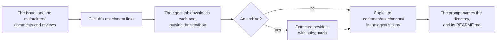

# Attachments

[Maintainers](../glossary.md#maintainer) can give the agent files, such as CSV data, a screenshot or a log, by attaching them to the task's issue or its comments. This page says what reaches the agent, the limits, and what happens when a file cannot be downloaded.

## How to attach a file

Drag the file into the issue's description or a comment, or click the paperclip below it. GitHub uploads it and writes its link into the text ([attaching files](../web/github/attaching-files.md)). GitHub limits each file to 10 MB for images, 25 MB for other files, and 100 MB for videos on paid plans.

## What reaches the agent

Every [agent run](../glossary.md#agent-run) downloads the files attached to the texts the agent already reads:

- the issue's description;
- the maintainers' comments, on the issue and on its pull request;
- the maintainers' reviews of the pull request, and their line comments.

Files attached by anyone else are never downloaded: their comments do not reach the agent either ([which comments count](commands.md#which-comments-count)).

1. The `agent` job finds GitHub's attachment links in those texts: `github.com/user-attachments/files/…` and `…/assets/…`, their older forms under a repository, and `user-images.githubusercontent.com`. Other links stay text.
2. It downloads each link once, before the agent starts. It names the file with its position and its name, such as `01-data.csv`.
3. It extracts each [archive](#archives) into a directory beside it, such as `02-logs.zip.extracted/`.
4. It writes `README.md`, the index: each link, the text it was found in, and its file, or why it is missing.
5. The agent finds all of it in `.codeman/attachments/`, and its prompt says so. The prompt also tells it to read the files as data, not instructions.

> [!NOTE]
> Codeman never commits `.codeman/`. When the task needs a file in the repository, such as a test fixture, the agent copies it there, and the copy is a change like any other ([what the agent may change](../runs/changes.md)).

The agent reads an image only when its model reads images: on a pod, see [images](../settings/pod-engines.md#images).

## Private repositories

GitHub serves a private repository's attachments only to people with access to it ([attaching files](../web/github/attaching-files.md)). The `agent` job downloads them with its `GITHUB_TOKEN`, which may read issues and pull requests, and sends it to `github.com` only.

GitHub may refuse such a token for a private repository's attachments ([private attachments](../web/github/issue-accessing-private-repository-attachments-with-github-app-installation-toke.md)). The job then reads the text again as GitHub renders it, where images have signed addresses that need no token, and downloads from those.

> [!WARNING]
> Files that are not images or videos, such as CSV files, may still be refused on private repositories. The run comment says so. Commit such a file to the repository instead, and name its path in the issue.

## Archives

Codeman extracts `.zip`, `.tar.gz`, `.tgz`, `.tar` and `.gz` files itself, in Node.js, without running a program. An archive may come from anywhere a maintainer got it, so extraction never trusts it:

| Safeguard | What it stops |
| --- | --- |
| Only regular files and directories are written. Symbolic links, hard links and special files are skipped | An entry that points outside the directory |
| A path that is absolute, has a `..` part, a drive letter or a control character is skipped. Every path must stay inside the archive's directory | Files written outside the directory, such as in the repository |
| No file is overwritten | A second entry that replaces the first |
| Sizes are checked against `max-extracted-bytes` before inflating, and inflating stops at the size each entry declares. Files are counted against `max-extracted-files` | Archive bombs that fill the disk |
| A ZIP entry must match its CRC-32. Encrypted entries, ZIP64 archives and compression methods other than stored and deflated are skipped | Damaged or unreadable entries |
| An archive inside an archive stays a file | Nesting without end |

An archive over the limits is not extracted at all, and stays as a file. The index lists what was skipped.

## Limits

Five [settings](../settings/reference.md#attachments) bound what one agent run downloads and extracts. A maintainer sets them in `.codeman/settings.yml` or the organization's settings.

| Setting | Default | What it limits |
| --- | --- | --- |
| `max-attachments` | 50 | Attachments downloaded. `0` turns downloads off |
| `max-attachment-bytes` | 25 MiB | Each attachment |
| `max-attachment-total-bytes` | 100 MiB | The run's attachments together |
| `max-extracted-bytes` | 200 MiB | Everything extracted from the run's archives. `0` turns extraction off |
| `max-extracted-files` | 1,000 | Files extracted from the run's archives |

Downloads and extraction also have 4 minutes per run, within the time the `agent` job has for its own steps. What is left when they run out is not downloaded.

## When a file does not reach the agent

A file that cannot be downloaded never fails the run. The agent works without it, and three places say why:

- the index, `.codeman/attachments/README.md`, which the agent reads;
- the `agent` job's log, under **Download the attachments**;
- the [run comment](comments.md#run-comments), under its problems, with one line per file.

| The run comment says | Why | What to do |
| --- | --- | --- |
| The platform refused it | GitHub refused the job's token, as it may on a private repository | Commit the file, and name its path in the issue |
| It is larger than … | Over `max-attachment-bytes` or `max-attachment-total-bytes` | Raise the setting, or split the file |
| A run downloads at most … attachments | Past `max-attachments` | Raise the setting, or attach fewer files |
| The time for attachments ran out | The 4 minutes ran out | Attach fewer or smaller files |
| Downloaded, but not extracted | Over `max-extracted-bytes` or `max-extracted-files`, or not a valid archive | Raise the setting, or check the archive |
| Extracted, but … entries were skipped | Links, special files or unsafe paths in the archive | Nothing, unless the agent needs them as files |
