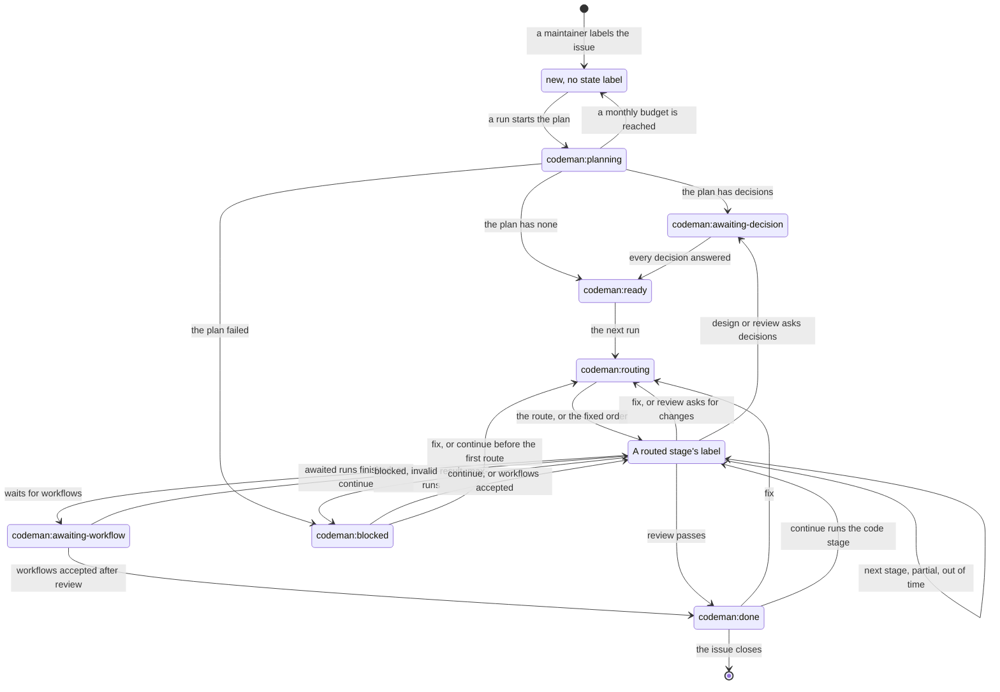

# Task lifecycle

This page says what makes an issue a task, which state labels a task moves through, and how to get a blocked task going again.

## What is a task

- A [task](../glossary.md#task) is an open issue with the `codeman` label, opened by a [maintainer](../glossary.md#maintainer).
- A maintainer applies the label to opt in. Codeman ignores everything else.
- Pull requests are not handled yet.
- A labeled issue that a maintainer did not open is left alone, and its [status comment](../glossary.md#status-comment) says why. See [untrusted input](../security/risks.md#untrusted-input).

## Tasks and states

Each task has at most one state label. A task without one has not started yet (`new`).

`/codeman replan` sends any task that has a plan back to `codeman:planning`; the diagram leaves out those arrows. The [commands](commands.md#commands) say in which states each command counts.

| Label | Meaning |
| --- | --- |
| `codeman:planning` | The agent is writing the plan. |
| `codeman:awaiting-decision` | Plan posted; decisions pending. |
| `codeman:ready` | All decisions answered; the next run starts the routing agent. |
| `codeman:routing` | The routing agent is choosing the [routed stages](../glossary.md#routed-stage) that run next. |
| `codeman:researching` | The web stage is recording third-party documentation. |
| `codeman:designing` | The design stage is working. |
| `codeman:coding` | The code stage is working. |
| `codeman:testing` | The test stage is working. |
| `codeman:reviewing` | The review stage is working. |
| `codeman:awaiting-workflow` | Waiting for workflows the agent asked for; see [on-demand workflows](../runs/changes.md#on-demand-workflows). |
| `codeman:blocked` | Needs human attention. The status comment says how to go on, and the last run comment says why; see [below](#blocked-and-how-to-go-on). |
| `codeman:done` | Reviewed; the pull request is ready for a human review. |

- `select` sets the label of the [stage](../glossary.md#stage) a run starts: `codeman:planning`, `codeman:routing` or a routed stage's.
- `apply` sets the label the run ends in.
- When no settings serve the task's next stage, `select` sets `codeman:blocked` before any run, and the status comment says why.

> [!NOTE]
> A task with more than one state label is invalid: Codeman reports a warning and leaves it alone.

### Waiting for a batch

A task that its [profiles](../settings/profiles.md#how-many-tasks-a-run-takes) serve only in a [batch](../glossary.md#batch) of more tasks than are ready waits. The ready tasks counted are those of its repository or, on a pod, of its [pool of organizations](../glossary.md#pool-of-organizations).

- A waiting task keeps its label.
- Its status comment says how many tasks it waits for, how many are ready, and in how many repositories.
- Every run checks it again.
- A task that another repository's batch reserved runs in this repository's next run, which first checks that it is still ready ([reservations](../runs/batches.md#reservations)).

### Budget refusals

A run refused because the monthly budget, or the organization's, is reached does not block the task:

- the task goes back to the state it was in, and a later run tries again;
- a task refused while planning goes back to `new` (no state label).

A spent task budget blocks the task instead. See [budget](../budget/budget.md).

## Blocked, and how to go on

How to go on from `codeman:blocked` depends on why the task blocked.

| Cause | How to go on |
| --- | --- |
| A routed stage reported `blocked` | `/codeman continue <guidance>`, or `/codeman replan <what to change>` when the request needs a revised plan |
| A routed stage wrote no result or an invalid one | `/codeman continue <guidance>` |
| A routed stage ran `max-runs` times in a row unfinished | `/codeman continue <guidance>` |
| Review asked for changes `max-runs` times in a row | `/codeman continue <guidance>` |
| Planning failed, and the task already had a plan | `/codeman replan <what to change>` |
| The task was never planned: its first plan failed, or no settings serve planning | Remove the `codeman:blocked` label. No command moves a task that has no plan. |
| Codeman could not give the run access to its model: the key job failed, or the workflow does not pass a secret that a provider of the run needs | Fix the cause, then go on as for a failed run of the same stage: `/codeman continue` for routing and the routed stages; `/codeman replan`, or removing the label, for planning |
| The task's budget is spent | `/codeman set task-budget <usd>`, then `/codeman continue` |
| No settings serve the task's next stage | Add the stage to a profile, or a top-level `model`. Then `/codeman continue`, or remove the label when the task was never planned. |

Each [agent run](../glossary.md#agent-run) is a stage. What each one does, from planning to review, is in [stages](stages.md).
