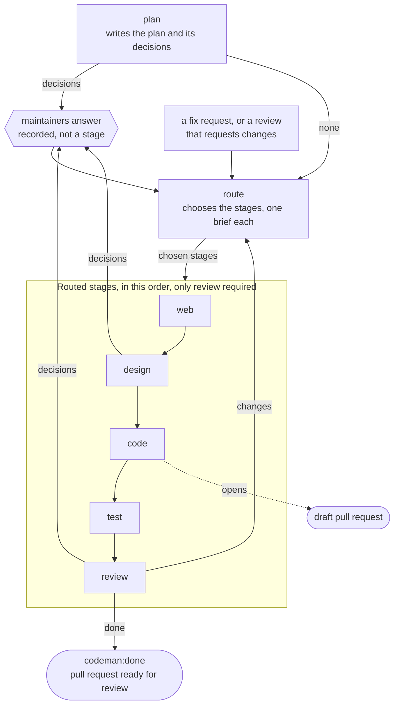

# Stages

Every [agent run](../glossary.md#agent-run) is a [stage](../glossary.md#stage): one run, one agent. This page says what each stage does, how routing chooses them, and what each outcome leads to.

## The seven stages

A [task](../glossary.md#task) goes through up to seven stages, in this order. Routing runs again whenever the task needs to know what comes next.

| Stage | Name | Routed | Does |
| --- | --- | --- | --- |
| [Planning](#planning) | `plan` | No | The plan, with the decisions the maintainers answer before anything else runs. It changes nothing but the plan. |
| [Routing](#routing) | `route` | No | Chooses which of the routed stages run next, each with a brief for its agent. It changes nothing. |
| Web | `web` | Yes | The documentation of the third-party services the task relies on, in `docs/web/`, following the rules for [third-party documentation](../runs/changes.md#third-party-documentation). It changes nothing else but the plan. |
| Design | `design` | Yes | Flowcharts in Mermaid (`docs/flows/*.md`), screen drafts in plain HTML (`docs/design/*.html`) and their images (`docs/screenshots/*.png`, rendered with the runner's headless Chrome), linked from the plan. It may ask the maintainers decisions, such as a choice between two layouts. |
| Code | `code` | Yes | The implementation, with unit tests for the code it writes, and the documentation it changes. |
| Test | `test` | Yes | Integration and end-to-end tests where they apply, more unit tests where coverage is thin, and every check the repository has. What can only be tested outside the [task branch](../glossary.md#task-branch) (a deploy, a release) goes in a "Manual tests" section of its report, which the pull request's description shows; it is no reason to block. |
| Review | `review` | Yes, always last | A critical review against the plan and the decisions, and a merge of the default branch in its sandbox to find conflicts and integration problems early. It changes nothing; its report goes on the pull request. It is not an approval to merge. |

- Five stages are [routed](../glossary.md#routed-stage). The routing stage chooses among the four before review.
- Review always runs, last, and has the last word on whether the task is done.
- The others run only when the route chooses them.
- Every task therefore goes through planning, routing and review, at least.

### Stage names

- The name is how the settings and Codeman's outputs refer to a stage. A [profile](../glossary.md#profile)'s `stages` condition takes any of them ([profiles](../settings/profiles.md)).
- A stage that no profile serves, at any count of the run's tasks, and that the top level cannot serve for want of a `model`, blocks the task when it reaches it ([how many tasks a run takes](../settings/profiles.md#how-many-tasks-a-run-takes)).
- Each stage that works on a task sets its state label, from `codeman:planning` to `codeman:reviewing` ([states](lifecycle.md#tasks-and-states)).

### What is not a stage

Recording the maintainers' answers and accepting workflows run no agent. So they are not stages, and no profile applies to them.

## Planning

1. `select` picks a `new` task, one left in `planning` by an interrupted run, or one with a `/codeman replan` request. It chooses the branch `codeman/<issue>-<slug>` and the plan path `docs/plans/<date>-<slug>.md`.
2. `agent` gives the harness a task file with the rules, the issue and the maintainer comments. The agent writes the plan and `.codeman/output.json`, which lists the decisions: a title, a question, options and a recommendation each. See [agent output](../runs/agent.md#agent-output) for its limits.
3. `apply` accepts only the plan file; other changes are ignored and listed in the run comment. It validates `output.json` strictly and commits the plan to the task branch through the Git Data API. It sets `codeman:awaiting-decision`, or `codeman:ready` when there are no decisions.

If the agent fails, runs out of time or produces an invalid result, the task becomes `codeman:blocked`.

### Revised plans

A revised plan comes from `/codeman replan`.

- It keeps the decisions settled so far, with their numbers and answers.
- The agent numbers its new decisions after every earlier one, so one number never means two decisions.
- The plan's `## Answers` section lists the settled answers from the start.

| The [task record](../glossary.md#task-record) keeps | What starts over |
| --- | --- |
| The spend table | The routed stages' progress, from design |
| The pull request | The decisions comment: the revised decisions get a new one, after the run comments before it, unless the revised plan has none |
| The handled accepts | |
| The routed stages' reports | |
| The suggested squash message | |

## Routing

### When it runs

The routing agent runs whenever the task needs to know what comes next:

- after the decisions are answered, or when the plan has none;
- after a `fix` request;
- after review asks for changes.

It reads the plan, the decisions, the requests, the earlier run comments and the task branch's changes.

### What it chooses

- The routed stages that run, in the order above, each with a brief for its agent, always ending with review.
- The routed stages it leaves out, each with a reason. None of the routed stages before review is required: each task has its own needs.

Its run comment shows the route, the briefs and the reasons. Its file changes are discarded. The stages of a route read the requests the router handled, as well as newer ones.

When no routed stage but review should run, the route is review alone, and the router's brief says why: review decides. This happens when the request is already done, or when it needs a revised plan. On a task branch that changes nothing but the plan, review reports `blocked` when the task needed no change, so a maintainer closes the issue; no pull request opens.

A route without review is an invalid result.

### When its result cannot be used

When the routing agent failed, ran out of time, or wrote an invalid output, the routed stages run in their fixed order, from where the task was. The run comment says so.

| The task was | The fixed order starts at |
| --- | --- |
| Just planned | Design |
| Carrying out a request or a review | Code |

The web stage never runs in this order.

### What does not route

`/codeman continue`, accepting workflows and an unfinished stage go on with the stage they belong to; they do not route.

## Running a routed stage

1. `select` picks the task and its routed stage, from the task record, and sets the stage's label. The agent starts from the head of the task branch, with the default branch's history. It gets the notes the previous stage left and the router's brief.
2. Each stage's agent but review's first decides whether its stage has work. When it does not, it reports `skipped` with the reason. It writes `.codeman/output.json`: a status, a summary and, when it changed files, a commit message.
3. `apply` filters the changes through the [change policy](../runs/changes.md#change-policy) and commits the rest to the task branch through the Git Data API. It does so even when the agent failed or ran out of time, so no work is lost. Review's changes are discarded.

### Scratch work and progress notes

- So that the commit holds only the work, the agent is told to keep scratch work in a temporary directory outside the working tree, such as one `mktemp -d` creates under `/tmp`. Scratch work includes clones of other repositories, copies of this one, test output, probe scripts and backups.
- So that a run cut short still leaves a record, the agents of the stages that commit (all but review) keep a `## Progress` section at the end of the plan as they go. It says what they tried, what failed, what worked and what is left.
- The progress section is committed with the partial work, and the next run starts from it. Progress notes do not change the plan's scope or decisions.

### Statuses by stage

Each stage may report only some statuses.

| Status | Web | Design | Code | Test | Review | Means |
| --- | --- | --- | --- | --- | --- | --- |
| `done` | Yes | Yes | Yes | Yes | Yes | The stage finished. |
| `skipped` | Yes | Yes | Yes | Yes | No | The stage had no work; the reason is required. |
| `partial` | Yes | Yes | Yes | Yes | No | More work for another run of the same stage. |
| `blocked` | Yes | Yes | Yes | Yes | Yes | It needs a maintainer; the reason is required. |
| `awaiting-workflow` | No | No | Yes | Yes | No | It waits for workflows, which it names; the reason is required. |
| `decisions` | No | Yes | No | No | Yes | The maintainers must choose. |
| `changes` | No | No | No | No | Yes | The work goes back to routing; the reason is required. |

### Outcomes

| Outcome | Next state | What Codeman does |
| --- | --- | --- |
| `done` or `skipped`, but not from review | The route's next stage | Gives the next stage this stage's summary, or reason, as its notes. When code ends, it opens the [pull request](#the-pull-request) as a draft. |
| `done` from review | `codeman:done` | Adds its proposed `.codemanignore` if the repository has none. Opens the pull request if there is none yet, or updates its description. Marks it ready for review, and posts review's report on it. |
| `done` from review, while the agent's workflows are still staged | `codeman:awaiting-workflow` | Waits for them to be accepted; the pull request stays a draft. See [on-demand workflows](../runs/changes.md#on-demand-workflows). |
| `changes` from review | `codeman:routing` | Posts the report on the pull request. The routing agent chooses what addresses it. Past `max-runs` [review rounds](#runs-in-a-row-and-review-rounds), the task becomes `codeman:blocked` instead. |
| `decisions` | `codeman:awaiting-decision` | Adds the new decisions after the plan's. When they are answered, the routing agent runs, with review's report if review asked them. |
| `partial`, or out of [time](../runs/agent.md#time-limit) | The same stage | Runs the stage again. At `max-runs` [runs in a row](#runs-in-a-row-and-review-rounds), the task becomes `codeman:blocked` instead. |
| `awaiting-workflow` | `codeman:awaiting-workflow` | Waits for the workflows' runs. When they are still staged, the stage records the wait and the route goes on ([on-demand workflows](../runs/changes.md#on-demand-workflows)). A workflow that is neither on the branch nor staged blocks the task. |
| `blocked`, or an invalid result | `codeman:blocked` | Gives the reason. `/codeman continue <guidance>` tries the stage again, and so does accepting the task's staged workflows. |

When the agent reported `blocked`, the run comment also suggests `/codeman replan`. A request the plan does not cover, such as a `fix` that widens the task's scope, needs a revised plan.

### Runs in a row and review rounds

Two counters stop a task that does not converge. Both are bounded by `max-runs`.

| | Runs in a row | Review rounds |
| --- | --- | --- |
| Counts | Each run of the same stage that ends unfinished (`partial` or out of time), from 1. A run that reports `awaiting-workflow` does not count. | Each `changes` from review |
| Blocks the task | When the `max-runs`th run in a row ends unfinished | When the rounds exceed `max-runs`: with `max-runs: 3`, the fourth `changes` in a row |
| Starts over | When another stage runs, or a `fix` or `continue` request resumes the task | When review passes, and in the runs that carry out a `fix` or `continue` request |

After either counter blocks a task, `/codeman continue <guidance>` grants `max-runs` more.

### The pull request

- Codeman opens it as a draft when code ends, with `done` or `skipped`, so the repository's CI runs during test and review.
- A route without the code stage opens it when review passes.
- Its title is the issue's title.
- Its description holds `Closes #<issue>`, the plan's summary, and the code stage's commit message as the suggested squash message.
- Repositories without draft pull requests get a regular one.

## Feedback

After the pull request is open, maintainers ask for changes in either of these ways:

- a review that requests changes; its text is the request;
- `/codeman fix <what to change>` in a comment on the pull request or the issue, or in a review's text.

The routing agent chooses the routed stages that carry out the request.

- Each of them gets the requests and every maintainer review since the last run that handled reviews, with the line comments and their file and line.
- They push to the same branch.
- When the route ends, Codeman updates the pull request's description.

`/codeman replan` also works on the pull request.

A review posted while the task is `codeman:awaiting-decision` waits until the decisions are answered, then counts.

### Handled requests

Codeman records the last comment and review it handled.

- A request is handled once a run for it ends, whatever the outcome, so a failing request does not start run after run.
- When the monthly budget, or the organization's, stopped the run from starting, the request waits for a later run.
